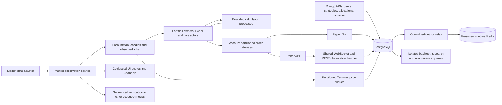

# QuantNest backend runtime

## Responsibilities

The backend keeps Django as the authenticated control plane and PostgreSQL as the financial source of truth. Long-running execution runs under a process supervisor. Celery handles bounded background jobs, not the observed-tick loop.



| Component | Responsibility | Entry point |
| --- | --- | --- |
| Django ASGI | Permissions, strategy versions, confirmed actions, allocations and session lifecycle | `uvicorn backend.asgi:application` |
| Market observations | Provider connection, subscription reconciliation, warmup, local publication, optional replication | `python -m quantnest_runtime market-data` |
| Execution | One owner per scope/session/instrument, protective checks, fair calculation scheduling | `python -m quantnest_runtime execution` |
| Order gateways | Bounded concurrent accounts; serial requests within an account; durable outcomes | `python -m quantnest_runtime orders` |
| Terminal | Indexed simulated orders, committed modifications, account-locked fills and OCO | `python -m quantnest_runtime terminal` |
| Broker observations | Account WebSockets and reconnect supervision | `python -m quantnest_runtime broker-events` |
| Outbox | Retry committed financial, risk, cache and control publications | `python -m quantnest_runtime outbox` |
| Celery/Beat | Backtests, research, REST reconciliation, historical repair, retention, email and notifications | Separate queues and one Beat scheduler |
| Private research service | Bounded model calls and tool requests through authenticated Django | Existing FastAPI entry point |

Terminal, Paper and Live retain separate accounts, APIs and financial ledgers. They share domain primitives where their semantics match.

The 12 October cleanup removes duplicate order/position cache lists with no readers. Orders, positions and trades use their PostgreSQL records; actors use dedicated runtime projections. Broker/session funds and risk caches remain. Apply `common.0010_retire_unused_order_position_projections` with old API/fill producers and the outbox relay stopped before starting the new code. It retires obsolete cache publications, not financial records or runtime/risk/control events. Apply `brokers.0008_remove_ordersettings` too: it removes the inactive per-broker timeout model/API/UI. `ORDER_TASK_TIMEOUT` remains the actual gateway task deadline.

Actor startup now reconciles assigned, positioned and pending instruments once. Owners preload their strategy program, cache warmup requirements by version, and apply one instrument snapshot per actor. Only newer state revisions invalidate calculations. Subscription refresh resolves instruments in one query; feed readiness is renewed while its prepared buffers remain active. Healthy children reset the supervisor crash counter after 60 seconds.

Run these commands from the repository's `backend` directory with the virtual environment active. Prefer `python -m quantnest_runtime <service>`; directory invocation (`python quantnest_runtime <service>`) and direct script invocation also resolve the Django project path. The launcher delegates to `quantnest_runtime/cli.py`, so spawned workers can import their process targets on Windows and Linux.

## Execution invariants

- Startup and background control may read PostgreSQL, Redis and broker metadata. Protective checks and application of calculation results use local actor state and local market buffers. They do not make ORM, Redis or broker calls.
- Numerical work runs in a fixed process pool. The owner thread applies results only if the actor and its state/configuration generation still match.
- User queues rotate fairly. Each actor consumes a bounded tick batch per cycle. Finite CPU resources still impose queueing; independence does not imply unlimited simultaneous execution.
- Session/instrument assignments are indexed in PostgreSQL and partitioned with a stable hash. Admission is serialized separately from evaluation and reserves capacity per user and worker.
- Redis leases fence ownership. Gateways validate the owner token and entry deadline. Expired entries become durable rejections; protective exits are allowed while sessions are paused/stopping.
- Partial-exit markers and order handoff publish atomically. Breakeven changes and peak/protection values checkpoint in the background with an owner and entry-time guard.
- Financial mutations and their outbox rows commit together. Failed publication remains retryable. Pending publications and order requests are never removed by routine retention.
- Database projection failures use a savepoint so the relay can record and retry the failure. Batches select independent aggregate heads so one failed aggregate's successors cannot fill the batch and starve unrelated publications. Paper funds publications use committed balance and blocked margin; a missing funds projection is recovered from PostgreSQL on the background path.
- Control events invalidate the committed session snapshot. Owners reload status and pinned configuration rather than replaying an outdated event status. Pending runtime publications block new entries while existing actors remain registered for protection.
- Protection continues after a data gap; new entries pause. Review data and broker state before explicitly resuming. Missing observations are not manufactured from OHLC bars.

## Shared strategy and simulation logic

`trading_domain/strategy.py` owns rule-group combination, entry/exit interpretation, cooldowns, time restrictions and preloaded event restrictions. It uses the existing rule evaluator and indicator engine. `trading_domain/exit_actions.py` owns partial exits and breakeven actions; `configuration.py` owns timeframes and warmup requirements.

Paper and Live use the same actor calculations. Backtests use the same strategy program with vectorized historical entry evaluation and the existing simulation adapter. Candle-based backtests cannot reproduce the order of ticks inside a candle, broker acknowledgements, market depth or real fills. Sharing rule code does not establish fill equivalence.

Cooldowns use the scope/session/instrument state, while auto-disable metrics remain session-wide. Backtests retain opening timestamps for simulated next-open fills and completion timestamps for every analytical timeframe. Event restrictions are loaded per instrument. Exit evaluation preserves partial-exit and breakeven markers; capital admission uses slipped fill notional and capital released by earlier exits in the batch.

Compiled configurations remain pinned to strategy versions. Auto-disable rules come from these configurations; recorded fills feed risk counters through a retryable outbox operation. No per-rule database lookup is introduced into evaluation.

## Market data and provider changes

The configured adapter exposes `name`, `capabilities`, `history`, `quote` and `live_client`. The existing Fyers adapter remains the current source. `MARKET_DATA_PROVIDER` accepts `fyers` or an importable adapter class path.

Common consumers use canonical instrument IDs and the existing canonical symbol keys. A new adapter maps its external symbols into these identities, normalizes history and quotes, and connects its transport to `MarketObservationClient.ingest_observation`. Source symbols/tokens must remain in that adapter/importer. Existing stored canonical keys need not change when a new source is added.

This boundary is only partly complete: the current instrument model/importer still stores Fyers token and segment fields, and common symbol normalization and market-status checks still contain NSE/Fyers assumptions. A replacement provider for the existing Indian stock universe can preserve its IDs; a general multi-provider universe needs separate external-identity mappings and removal of these assumptions. `MarketEvent` is an available contract, not yet an enforced schema at every boundary.

`trading_domain/contracts.py` defines contract quantities, tick sizes, currency and multipliers. Lot/tick validation is used by Terminal admission and lot sizes are preloaded for execution. This is an extension boundary; strategy execution still supports the currently validated stock routes. Futures/options require their contract selection, expiry/roll rules, margin and settlement adapters before enabling them. New exchanges/crypto also require verified calendars, sessions and broker adapters. These products are not silently treated as stocks.

### Data paths

1. Historical requests pass through the adapter, shared single-flight coordination and PostgreSQL candle storage. Repair jobs respect trading calendars and retain valid history when a benchmark fetch fails.
2. The feed prepares required historical depth before marking an instrument ready. Completed frames align to exchange sessions, close times, holidays and Monday weekly boundaries; incomplete source coverage blocks calculations.
3. Each accepted observation appends to a sequenced local tick ring. Readers copy a consistent snapshot under an OS lock. The feed is the only local writer.
4. UI quote publication may coalesce. Execution observations do not use that coalesced path. Receipt timestamps survive publication/replication, so delayed quotes do not appear fresh.
5. On multiple nodes, node 0 publishes a bounded observation stream and other market-data processes replicate it to local buffers. Reconnect generations and sequence discontinuities expose gaps. Stream retention is 120 seconds; a delayed replica must pause entries and recover rather than assume it observed everything.

Market buffers are intentionally local to one node. API workers need no mmap access; the execution/Terminal/calculation processes on a node share `QUANTNEST_RUNTIME_DIR`.

## Broker ownership and fills

Both WebSocket order events and REST reconciliation call `live_trading/order_processor.py`:

1. Lock the broker credential and match account/user plus broker order ID.
2. A verified exact `QN<local-order-id>` tag can identify an already persisted owned order. Symbol, side, quantity and existing broker ID conflicts are checked.
3. Retain that order's original session, allocation and saved strategy version. Never select an arbitrary running session.
4. Apply only an increased cumulative fill quantity. Incremental fill price derives from the difference in cumulative execution values.
5. Repeated or older snapshots cannot apply a fill twice. Unknown outcomes remain reconcilable; they are not automatically resubmitted to the broker.
6. Store unmatched broker activity as an account observation. It does not create strategy positions or P&L.
7. Compare signed broker position totals against the sum of owned positions. Never replace individual strategy quantities with the account-wide total.

A broker correction to cost at the same cumulative quantity is marked for reconciliation rather than silently rewriting realized accounting. Such a correction needs verified broker fill records. Check unresolved observations before attributing account differences to a strategy.

Owned account observations are available through the paginated read-only `/api/v1/live/account-observations/` endpoint (`credential`, `kind`, `matched` filters). Account position differences also produce deduplicated notifications. External orders remain account activity, not strategy trades.

Gateways run a bounded pool across accounts and serialize each account inside the owner process. Broker REST latency, broker limits and account capital remain external constraints. Increasing workers cannot bypass them.

Fyers is the implemented broker. The factory explicitly rejects unknown brokers and the unfinished Zerodha/Angel adapters. Another broker needs authenticated REST operations, order/position normalization, cumulative fill observations, verified identity mapping, WebSocket or REST recovery, cost handling and an account rate-limit policy before Live enablement.

## Terminal matching

The Terminal is a simulation against observed prices. Buy/sell limit and stop queues use heaps, with sequence priority within price. Modifications invalidate old entries. Work and fill batches are bounded; the owner retains the same observation while its eligible work drains.

Order creation and modification reserve pending capital while holding the account lock. Fills recheck actual available capital and owned protective-exit quantity. Short-sale proceeds plus collateral are blocked in used margin. Protective linked orders cannot reverse a closed position. OCO cancellation and account updates commit with outbox commands.

This does not simulate exchange depth, matching between customer orders or exchange queue position. Million-order throughput has not been benchmarked. Open order limits are configurable per account; capacity must be measured on the deployment hardware.

## Configuration

All processes in a deployment must use identical partition counts and topology settings. Node index differs between hosts.

| Setting | Default | Meaning |
| --- | --- | --- |
| `EXECUTION_WORKERS` | 2 | Protective owner processes per node |
| `CALCULATION_WORKERS` | 1 | Calculation processes per owner |
| `EXECUTION_SHARDS` | 64 | Stable execution partitions |
| `EXECUTION_NODE_COUNT` / `EXECUTION_NODE_INDEX` | 1 / 0 | Coordinated cluster topology |
| `EXECUTION_MAX_ACTORS` | 200 | Admission limit per owner |
| `EXECUTION_MAX_USER_ACTORS` | 64 | Registered actors per user |
| `EXECUTION_ENABLED_SCOPES` | paper,live | Permitted session deployment scopes |
| `EXECUTION_TICK_BATCH` | 128 | Observations per actor per cycle |
| `EXECUTION_TASK_TIMEOUT` | 10s | Calculation deadline after startup |
| `EXECUTION_STARTUP_TASK_TIMEOUT` | 60s | Initial import/compilation allowance |
| `CALCULATION_CACHE_MB` | 128 | Each frame/indicator cache budget per calculation process |
| `ORDER_PARTITIONS` | 16 | Account gateway partitions |
| `ORDER_WORKERS` | 2 | Gateway and Terminal owner processes per node |
| `ORDER_CONCURRENCY` | 4 | Concurrent accounts per gateway scope/process |
| `ORDER_TASK_TIMEOUT` | 30s | Gateway task deadline; ambiguous broker outcomes reconcile after restart |
| `TERMINAL_MATCH_BATCH` | 64 | Eligible queue work per symbol/cycle |
| `TERMINAL_MAX_OPEN_ORDERS` | 200 | Manual pending orders per account |
| `MARKET_TICK_CAPACITY` | 32768 | Retained observations per symbol/local ring |

Frame and indicator budgets are separate. Active calculations, Python objects, mmap history, queues, Django and Celery also consume memory. Measure total RSS; a cache budget is not a process memory limit.

Use `EXECUTION_ENABLED_SCOPES=paper` for a public deployment through Paper trading. Use an independently configured private deployment for Live. The customer keeps broker credentials and execution services there. Subscription/licensing control is a separate business implementation; this runtime refactor does not claim to implement billing or regulatory compliance.

For a small VM, start with one execution worker, one calculation worker, one gateway worker, two concurrent gateway accounts and 32 MB calculation caches. Set capacity to the measured workload. Oracle free-tier availability/capacity varies; do not assume every free instance can host PostgreSQL, all workers and research together. Keep the current data source, Brevo and Cloudflare frontend deployment.

## Production deployment

Use PostgreSQL and Redis 6.2+ for streams and reclaim. The existing candle aggregation uses TimescaleDB `FIRST`/`LAST` and PostgreSQL `date_bin`; use PostgreSQL 14+ with the existing TimescaleDB setup. SQLite/LocMem are only suitable for isolated static checks, and runtime startup rejects them.

Runtime Redis holds financial handoff/projections with AOF persistence and `noeviction`. UI quote and research caches should use a separate Redis instance with bounded eviction; a different logical database on the same Redis process does not isolate memory, eviction or CPU.

Example local URLs:

```dotenv
REDIS_URL=redis://127.0.0.1:6379/0
RUNTIME_REDIS_URL=redis://127.0.0.1:6379/0
RESEARCH_CACHE_URL=redis://127.0.0.1:6380/0
MARKET_CACHE_URL=redis://127.0.0.1:6380/1
QUANTNEST_RUNTIME_DIR=/var/lib/quantnest/market
EXECUTION_NODE_COUNT=1
EXECUTION_NODE_INDEX=0
```

Redis must have a private network/ACL and durable storage. Configure the supplied `infra/redis` examples for the host. Multi-node replicas need access to the shared runtime Redis and PostgreSQL over a private network; example Redis configuration binds loopback for a single host.

The current multi-key atomic scripts target one Redis primary, not Redis Cluster hash slots. Adding Redis Cluster requires deliberate key-slot/routing work; scaling execution workers does not require that change.

### Upgrade sequence

1. Stop new session starts and strategy/version changes. Pause entries, reconcile broker orders, and review open positions before a planned maintenance window. Protection is unavailable while execution is stopped; manage this window explicitly.
2. Drain existing order requests before replacing the old runtime. The new order streams are partitioned. Do not delete old pending/unknown broker outcomes or resubmit them blindly.
3. Stop the old long-running commands, API mutations and new runtime services. Apply `python manage.py migrate`. The migrations initialize fill cursors, assignment records and Terminal reservations. Old pending Terminal orders without a usable price become rejected during migration.
4. Configure matching topology, PostgreSQL, Redis and the runtime directory. Ensure `/opt/quantnest/backend/logs` and state directories are writable by the service user.
5. Run `python manage.py rebuild_execution_assignments` with execution services stopped. It checks per-user and per-worker capacity; increase capacity/resources or reduce registered demand if it refuses.
6. Start outbox and market-data. Confirm warmup/readiness. Start order gateways, broker-events for Live, Terminal and execution. Review reconciliation and resume sessions deliberately.
7. Start the API, isolated Celery workers and one Beat scheduler. Start the existing private research FastAPI service for AI research.

Install `infra/systemd/quantnest-runtime@.service` and `quantnest-celery@.service` under the systemd unit directory; configure `/etc/quantnest/backend.env` and the `quantnest` OS account. Start the six runtime instances with the service names above. Start Celery instances for `default`, `marketdata`, `paper`, `live`, `notifications`, `backtesting` and `research`, or combine only low-volume queues deliberately. Backtesting and research should retain separate resource limits. API, Beat and FastAPI need their own supervisor entries.

For Windows development, run the same `python -m quantnest_runtime <service>` commands in separate shells with the project's virtual environment. Use a shared runtime directory, PostgreSQL and Redis. Do not launch the removed management-command daemons alongside them.

### Scale and maintenance

- Increase memory, CPU and cache budgets after measuring p95/p99 and queue age. Owner counts and calculation pool counts are bounded configuration changes.
- Topology changes require a coordinated pause/stop, identical settings on every host, assignment rebuild, then restart. Keep `EXECUTION_SHARDS` and `ORDER_PARTITIONS` stable whenever possible. Changing order partition counts requires draining old streams first. There is no automatic rolling repartition protocol.
- On additional nodes run market-data, execution, Terminal and gateways with that node index. Only node 0 opens the market source socket. Outbox and broker-events use cluster-wide singleton leases and run on their selected host.
- To resize a local history ring, stop all runtime owners, wait for leases to expire, then run `python manage.py resize_market_buffer NSE:SBIN-EQ --capacity 50000`. Set `MARKET_TICK_CAPACITY` before this operation to resize the tick ring too. Restart market-data before consumers; no historical observation replay is claimed for the replaced ring.
- Keep one-shot management commands for migrations, instrument/calendar sync, historical repair and maintenance. They are appropriate administrative entry points. Removed commands were long-running service launchers.

## Health, recovery and observability

`/health/` checks PostgreSQL and runtime Redis. It is infrastructure readiness, not proof that every actor is trading. Runtime health is published under `quantnest:health:execution:*` and `quantnest:health:terminal:*`; execution health includes rolling p50/p95/p99 protection, observed tick-to-decision and calculation duration. Terminal cursor keys protect command retention.

Monitor gateway pending age, unpublished outbox age/attempts, unresolved broker observations, failed warmup, calculation deadlines, lease loss, Redis memory/AOF errors and worker restarts. Actual broker submission/acknowledgement latency needs measurement alongside worker telemetry. Run/account IDs and exception types are useful; credentials, tokens and raw authentication payloads must stay out of logs.

On restart, owners recover financial state under account locks, wait for committed publications, take a full projection snapshot and replay subsequent lifecycle messages. Stale calculation results cannot overwrite this state. Pending requests remain durable until a recorded outcome; gateways reclaim unacknowledged messages. Cancellation and provider failure handling in research remain separate from trading workers.

Orders carry the actor's pinned version and financial admission checks the locked allocation and current session status again. Stopping sessions remain monitored until positions, broker obligations and queued requests have settled; only then does cold finalization release their assignments.

Paper stopping locks account, allocation and session in financial-admission order, blocks entries first, and checks durable queued requests as well as positions before releasing assignments. A remaining obligation keeps the session in `STOPPING`.

Published outbox rows are pruned in bounded batches after seven days. Snapshot-recoverable lifecycle streams retain two days. Terminal commands trim only up to all owners' reported cursors. Pending financial requests/publications are retained.

## Verification status

The architecture audit and current verification limits are recorded in [BACKEND_ARCHITECTURE_AUDIT.md](BACKEND_ARCHITECTURE_AUDIT.md).

The isolated [instrument latency benchmark](benchmarks/INSTRUMENT_LATENCY.md) exercises the real owner loop with private mmap/UDP fixtures and one or two calculation processes. It records per-instrument distributions, scan-order bias, tick bursts and calculation admission/compute delays. The measured result does not satisfy equal instrument latency; see that report for numbers, reproduction commands and limits.

The [integrated tick-to-order benchmark](benchmarks/ORDER_E2E_LATENCY.md) adds actual private Redis queues/leases, PostgreSQL financial transactions, outbox convergence and a simulated broker. It passed 480 Paper/Live orders with duplicate fill observations. It establishes local transport correctness for the documented cases and measured latencies, not actual broker or Oracle performance. The [Oracle A1 worker profile](benchmarks/ORACLE_A1_WORKERS.md) targets the user's confirmed 2 OCPU / 12 GB host.

Run the isolated behavioral suite from `backend`:

```powershell
python manage.py test quantnest_runtime.tests paper_trading.tests backtesting.tests marketdata.tests research.tests --settings=research.test_settings --noinput
python manage.py test quantnest_runtime.tests paper_trading.tests backtesting.tests marketdata.tests research.tests --settings=quantnest_runtime.test_postgres_settings --noinput
```

SQLite skips the PostgreSQL concurrency tests. The PostgreSQL settings create and drop a uniquely named disposable test database using the configured server; the database user needs test-database creation permission. Caches and Channels are local, execution publications and broker calls are mocked in financial tests, and no runtime services are started. Run `python -m unittest research_service.tests` from the repository root for the private service contract tests.

Behavioral tests and static checks do not replace supervised process crash/reconnect, broker sandbox, multi-node failure and load/latency checks. No exchange-grade HFT latency, million-order capacity or broker-fill parity is established by this refactor.
