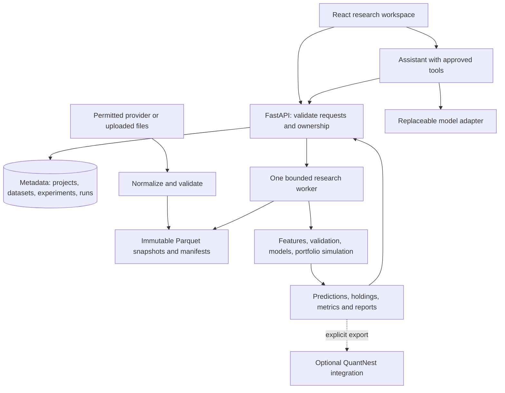

# From AI Financial Research Assistant to a quantitative research workbench

**Research date: 29 October 2026. Status: proposed architecture and delivery plan; not implemented.**

**Repository reviewed:** [ayushkaneriya05/AI-financial-research-assistant](https://github.com/ayushkaneriya05/AI-financial-research-assistant), revision [`810812bd79e8d73f65a8f5cf708349d62686df9a`](https://github.com/ayushkaneriya05/AI-financial-research-assistant/tree/810812bd79e8d73f65a8f5cf708349d62686df9a). The clean local checkout at `E:\AI-financial-research-assistant` matched GitHub's `main` revision during this review. Findings below come from reading the backend, frontend, schemas, configuration, migrations, dependencies and existing checks, rather than accepting README claims as verified functionality. The application was not launched and no paid providers were called.

**Companion:** [QuantNest quantitative roadmap](quantitative-research-roadmap.md). This document proposes moving the substantial *new research and learning work* into this separate repository. It does not propose deleting working QuantNest features or migrating its trading accounts.

## Reading guide

- [Product decision](#1-recommendation) and [separation](#2-scope-transferred-from-the-earlier-quantnest-roadmap): sections 1–3.
- [Existing code findings](#4-what-the-repository-actually-contains-today) and [cleanup](#14-concrete-cleanup-and-migration-map): sections 4 and 14.
- [Data](#5-research-data-the-first-substantive-capability), numerical methods and useful workflows: sections 5–10.
- [AI responsibilities](#11-the-ai-assistants-precise-responsibility), [architecture](#12-simple-architecture-that-can-grow) and interface: sections 11–13.
- [Delivery](#15-delivery-sequence), [validation](#16-correctness-evidence-is-part-of-the-product) and performance: sections 15–18.
- [Career evidence](#19-career-evidence-what-this-project-can-demonstrate), [learning](#20-learn-through-the-features-you-implement), interviews and business direction: sections 19–23.
- [First implementation tickets](#24-first-implementation-tickets) and [source guide](#25-primary-source-reading-map): sections 24–25.

## 1. Recommendation

**Yes: this is a good place to build a dedicated quantitative research product.** I recommend making it the primary home for your statistical research, portfolio analytics, model experiments and research-engineering portfolio. Keep QuantNest focused on its existing research-to-trading user workflows and operational execution.

The target is a **reproducible quantitative research workbench with an optional AI assistant**. A working name could be **QuantNest Research Lab**, with a clear description separating it from QuantNest's trading application. Renaming is secondary to delivering one reliable research workflow.

Its central promise should be:

> Turn a market hypothesis into a documented experiment, identify what the evidence supports, and show whether the conclusion survives different periods, costs and assumptions.

This requires a substantial change in the repository's analytical core. Keeping the current eight-stage narrative pipeline and adding more indicators or a stronger LLM would not accomplish it.

### 1.1 Why a separate project makes sense

| Decision | Recommendation | Reason |
| --- | --- | --- |
| Where to develop new quantitative methods | This research repository | Experiments can evolve without changing running trading services |
| Where to demonstrate research reproducibility | This research repository | Public studies, small reproducible datasets and numerical checks are easier to review |
| Where to demonstrate trading infrastructure | Existing QuantNest | Its execution, account and broker lifecycle already address that responsibility |
| Whether to build another broker/execution system here | No, initially | It would duplicate the most operationally demanding part of QuantNest |
| Whether QuantNest can later benefit | Yes, through explicit exports or reviewed integrations | Research independence need not prevent eventual product reuse |
| Whether to implement every quantitative topic | No | Completed studies and reliable tools provide stronger evidence than a broad unfinished catalogue |

The two repositories can support complementary career stories: **QuantNest demonstrates execution engineering; Research Lab demonstrates empirical research and analytical software.** Neither needs to contain everything.

### 1.2 What “used in a quant firm” should mean

Aim for the working practices of a research team: point-in-time data, controlled experiments, reproducible results, explicit assumptions, useful portfolio analysis and reviewable decisions. Do not claim that a quant firm uses the software unless that actually happens.

The first realistic adoption target is an individual researcher, systematic trader, student research group or small research team. An institutional deployment would additionally need data entitlements, security review, operational support, integration with its systems and validation by that firm's users. An attractive dashboard does not establish those properties.

The product can help users reject weak ideas, reduce concentration, understand implementation costs and save analysis time. Those are valuable outcomes even when a study finds no profitable strategy. Profitability and recruitment cannot be guaranteed by this roadmap.

## 2. Scope transferred from the earlier QuantNest roadmap

This is a change in proposed ownership of future work, not a wholesale copy of the old roadmap into a second application.

| Earlier capability | Research Lab responsibility | QuantNest responsibility |
| --- | --- | --- |
| Reproducible datasets and historical universes | Primary implementation for experiments | Supply permitted, versioned exports where useful; keep operational market data |
| Walk-forward testing and parameter stability | Experiment design, comparison and statistical interpretation | Keep existing strategy backtests and their execution semantics |
| Portfolio correlation, factor exposure and stress | Primary research implementation | Continue displaying account/position facts; optionally import reports later |
| ML ranking, volatility and textual signals | Train, validate and document models | No automatic model integration into live execution |
| Options pricing and sensitivities | Optional later analytical module | Keep contract handling and actual account/trade operations |
| Execution shortfall | Analyze exported event/fill records | Own authoritative events, fills and timestamps |
| Natural-language explanation | Explain pinned experiment evidence | Keep its existing assistant and confirmed user actions |
| Shared numerical definitions | Explicitly version formulas and validate equivalent calculations | Adopt a small shared package only after actual reuse warrants it |
| Operational reliability | Reliable research runs and artifacts | Reliable trading processes, broker synchronization and order state |

Do not import Django models or connect directly to QuantNest's production database. Initially, either project should work while the other is stopped. Exchange files or call a narrow read-only export API when an integration is useful.

## 3. Users and the first useful product

### 3.1 Start with one audience

Prioritize **independent systematic equity researchers who need to evaluate ideas and portfolio decisions**. Keep ordinary users supported through guided workflows and plain-language reports, but do not design the first release for beginners, HFT teams, options market makers and bank pricing desks simultaneously.

Start with **daily-frequency, long-only equity/ETF research**, with one market and one currency per study. This avoids borrowing and derivative accounting before the data and validation foundation works. India is a natural initial market given the existing repository, but an honest fixed-universe pilot is preferable to an unsupported claim of complete NSE historical coverage.

### 3.2 User decisions, not technology labels

| User question | Functionality | Useful output |
| --- | --- | --- |
| Does this idea still work after costs and outside the fitting period? | Hypothesis and chronological validation | Comparable baseline, out-of-sample returns, turnover and cost sensitivity |
| Are these investments actually diversified? | Holdings and portfolio analysis | Contributions to risk, common drawdowns, sector/factor exposure |
| Did a complex model improve the result? | Controlled model comparison | Same data/splits/costs; incremental value and uncertainty |
| Did the company's disclosure meaningfully change? | Later document comparison | Changed passages, exact sources, quantitative changes and review queue |
| Can another person reproduce this result? | Experiment export | Data manifest, configuration, code revision, dependency lock and results |
| Why did the research conclusion change? | Run comparison | Differences in data, assumptions, model and output |

### 3.3 First release: a complete research loop

Deliver these together:

1. Import an allowed dataset and inspect its quality.
2. Save a hypothesis and a small set of settings.
3. Run a deterministic baseline with chronological validation and costs.
4. Compare alternatives and inspect holdings/returns.
5. Save a concise research report with reproducible artifacts.

A user should be able to complete that loop without an AI API key. The assistant is a convenience for finding evidence and explaining it.

## 4. What the repository actually contains today

### 4.1 Useful foundations to retain

The repository already provides FastAPI, Pydantic contracts, SQLAlchemy/Alembic, a React/TypeScript interface, company search, watchlists, reports, comparisons and chat. Those are useful delivery components.

The pipeline also exposes stage timings and separates some data-provider responsibilities. That is a starting point for explicit provenance and progress reporting. The existing company-research experience can become a dataset-backed company view rather than being discarded entirely.

### 4.2 Findings that matter before adding quantitative claims

These are source-review findings, not a claim that every runtime failure has been reproduced.

| Finding | Evidence in the reviewed revision | Why it matters / proposed change |
| --- | --- | --- |
| Synthetic financials can replace failed downloads | `providers/financial_provider.py`, `get_snapshot()` and `_fallback_snapshot()` | A deterministic price derived from the symbol is not market evidence. Use synthetic fixtures only in an explicit demo dataset |
| Synthetic headlines can replace missing news | `providers/news_provider.py`, `_fallback_news()` | Demo headlines must never contribute to a real-company conclusion |
| Several company profiles bypass live retrieval | `services/company_service.py`, `_curated_companies` and `get_profile()` | Names and static descriptions may be useful seed metadata; mutable financial/officer fields require sources and dates |
| Provider provenance is weakened during assembly | `stage1_data_collection.py`, `stage7_report_assembly.py` | Generic service names replace precise origins; preserve provider, acquisition time, snapshot and demo status throughout |
| Financial units use heuristics | `_percent()` multiplies based on magnitude; debt/equity is passed through | The same number must not change interpretation when it crosses a threshold. Define source-specific unit conversions and verify sample payloads |
| Current features are unvalidated heuristics | `stage3_feature_extraction.py` applies universal PE, leverage and growth thresholds | These are not demonstrated return predictors; sector and accounting differences matter |
| Confidence is not calibrated | `stage6_llm_reasoning.py` constructs scores from counts of strengths/red flags | Replace confidence gauges with actual coverage, statistical intervals or validated model probabilities |
| Scenario probabilities are assigned constants | Deterministic report returns Bull/Base/Bear probabilities of 30/50/20 | Scenarios can be useful without inventing a probability distribution |
| The stage called RAG is context formatting | `stage5_rag_context.py` concatenates supplied facts/headlines | No independent corpus retrieval or passage-level validation is demonstrated; call it evidence-context assembly |
| Provider logic is duplicated | Pipeline stages call Gemini directly while `providers/ai_provider.py` contains another implementation | One configured adapter should own model/SDK interaction; retire unused duplicate paths after reference checks |
| Gemini failure can discard valid source inputs | `_gemini_reasoning()` falls back with `financials=None, articles=None` | Preserve available deterministic evidence; mark narrative generation unavailable rather than changing the apparent evidence |
| Cached reports have no dataset/model identity | `ReportService.get_or_create_report()` reuses the latest symbol report without an age/version requirement | Keep historical reports immutable; create a new run for new data or methods |
| Requested long history is reduced for presentation | Provider fetches a period but returns `history.tail(90)` rounded to two decimals | A chart payload is not a research dataset; retain full numerical histories separately |
| No historical availability model is present | Financial snapshot/news schemas and current provider paths | Today's fundamentals and current constituents cannot be used as if available years ago |
| Report and displayed data can represent different snapshots | `ResearchView` separately requests pipeline, financials and news | Display evidence attached to the selected run; clearly separate an optional latest-data view |
| Opening pages can initiate AI work | Research and comparison views call `runPipeline()` on load | Read existing work on navigation; make expensive analysis an explicit action |
| Multi-user authorization is not established | Routes expose reports/chat and default watchlist session IDs without authenticated ownership | Treat this as a local application until server-side authentication and ownership are implemented |

Pinned source references: [financial provider](https://github.com/ayushkaneriya05/AI-financial-research-assistant/blob/810812bd79e8d73f65a8f5cf708349d62686df9a/backend/app/providers/financial_provider.py), [news provider](https://github.com/ayushkaneriya05/AI-financial-research-assistant/blob/810812bd79e8d73f65a8f5cf708349d62686df9a/backend/app/providers/news_provider.py), [reasoning](https://github.com/ayushkaneriya05/AI-financial-research-assistant/blob/810812bd79e8d73f65a8f5cf708349d62686df9a/backend/app/pipeline/stage6_llm_reasoning.py), [report service](https://github.com/ayushkaneriya05/AI-financial-research-assistant/blob/810812bd79e8d73f65a8f5cf708349d62686df9a/backend/app/services/report_service.py), [research view](https://github.com/ayushkaneriya05/AI-financial-research-assistant/blob/810812bd79e8d73f65a8f5cf708349d62686df9a/frontend/src/views/ResearchView.tsx).

### 4.3 Small engineering defects to address during the foundation stage

- `SettingsConfigDict(...)` is assigned to `model_config`, then the class calls `model_config.env(...)`. That object is a configuration dictionary, not an environment reader. Use ordinary typed settings fields/defaults and Pydantic's environment handling. This is an import-time defect apparent from source. [Pydantic settings documentation](https://docs.pydantic.dev/latest/concepts/pydantic_settings/)
- README describes SQLite, while current configuration/example defaults to PostgreSQL; the SQLite test dependency and migration setup must be declared consistently. Choose and document a supported startup path.
- `frontend/src/api.ts` always parses JSON, including the watchlist DELETE endpoint that returns 204. Handle empty success responses.
- Missing comparison percentages can become `undefined%` because concatenation occurs before a fallback. Render missing values explicitly; zero is not missing.
- Symbol-based report lookup occurs before a common canonicalization boundary. Normalize once for provider mapping and cache identity.
- `CompareView` needs cancellation/stale-response protection and useful error state when selections change quickly.
- Chat loads a report by symbol rather than an explicit immutable report context. Pin the selected report/run ID and load its conversation after refresh.
- Broad exception fallbacks can hide which stage/provider failed. Keep typed failure states and actual execution mode, without exposing secrets.
- `backend/quantnest.db` and generated `.egg-info` files are tracked. Remove generated/local database artifacts from future tracking after preserving needed data; a repository should contain schema and reproducible fixtures, not user report databases.

The README's claims such as bias-free reports, eliminated hallucinations and a system that never crashes exceed what the code establishes. Replace them with specific capabilities and known limits. Numerical feature extraction should not be labelled AI merely because it is part of an AI application.

## 5. Research data: the first substantive capability

### 5.1 Separate four data products

| Product | Responsibility |
| --- | --- |
| Raw source archive | Preserve acquired payload/file, request identity, checksum and source conditions |
| Normalized observations | Canonical instrument identity, timestamps, currency/units and quality flags |
| Immutable dataset snapshot | Exact files/universe/revisions used by an experiment |
| Derived artifacts | Features, labels, predictions, portfolios, metrics and reports tied to that snapshot |

Use one provider adapter per source. It translates documented source fields into the canonical contract. Numerical research should not contain provider-specific fallback keys or HTTP calls.

### 5.2 Required fields and clocks

A useful long-form observation contract is:

```text
instrument_id, field, value, unit, currency
event_time or reporting_period_end
available_at, ingested_at, revision_id
source_id, source_record_id, quality_status
```

`available_at` means the earliest defensible time the information could be used in the experiment. `ingested_at` means when this application actually acquired it. These are different. An official archive acquired today can support historical research if publication history is verifiable; an undated current snapshot cannot be made point-in-time by adding a guessed lag.

Example: results for a quarter ending March are released on 15 May after the exchange closes. They cannot enter a March portfolio. A later restatement is a new version, not a silent replacement of the earlier observation. If only a publication date is known, use a documented conservative next-session rule and disclose that precision limitation.

For prices, record venue, session, timezone, interval and adjustment basis. For fundamentals, record consolidated/standalone basis, fiscal period, currency and scale. Ratios should have explicit definitions. A provider number of `50` must not ambiguously mean 50 times or 50 percent.

### 5.3 Instrument and universe identity

Use a stable internal instrument ID with dated provider/venue symbol mappings. Retain `NSE:...` or `.NS` in the appropriate source mapping; display company and venue names. A company, its two listings and a derivative contract are not the same identity.

Maintain dated universe membership. Record listings, delistings, suspensions and eligibility based on information available then. Today's NSE equity list remains useful for current search, but is not a historical universe.

When historical membership cannot be obtained, the system may support a fixed selected-universe study. Label that limitation in the result and do not generalize it to all stocks or describe it as survivorship-free.

### 5.4 Corporate actions and return basis

Retain raw prices and corporate-action records when available. Derive split-adjusted or total-return research series with documented conventions. A holdings simulation must correctly change share counts/cash for splits and dividends; a return-series simulation must not credit the same dividend again.

A provider's currently back-adjusted price history may also rescale earlier levels after later corporate actions. Return ratios can be invariant to that rescaling, while absolute-price or price-times-volume filters may not be. For decision features, use a documented as-of adjustment policy or verify the feature's invariance; do not assume an adjusted download alone establishes point-in-time correctness.

Avoid comparing a dividend-inclusive portfolio with a price-only benchmark without showing the difference. Record trading currency and benchmark currency. Multi-currency portfolio support needs dated FX conversion and comes after the first single-currency release.

### 5.5 Practical data choices

| Source/path | Appropriate use | Limitation |
| --- | --- | --- |
| User-supplied, permitted CSV/Parquet | First real research loop and portfolio imports | Validate schema, chronology, rights and dataset quality; uploads are not automatically correct |
| Existing Yahoo/yfinance adapter | Personal exploratory daily-price/company views | Current fundamentals are not a point-in-time archive; the project's documentation notes Yahoo data's personal-use restrictions |
| Licensed Indian EOD/fundamental provider | Market-wide historical research and commercial operation | Verify delistings, corporate actions, availability dates and redistribution/export rights |
| IIMA Indian factor datasets | Factor regressions and academic replication | Aggregate factor returns are not individual-stock features; pin release and methodology |
| Kenneth French Data Library | Portfolio/factor analysis and known research benchmarks | Pin release and return conventions; this is not an exchange execution dataset |
| SEC EDGAR submissions/XBRL | Optional US disclosure and point-in-time accounting study | Requires filing/tag/unit/restatement interpretation; not a replacement for Indian disclosures |
| ALFRED/FRED vintages | Optional macro research using historical information sets | Use real-time/vintage periods; today's revised series is a different dataset |

The [yfinance project](https://github.com/ranaroussi/yfinance) distinguishes its software from rights to the downloaded data. [NSE's data policy](https://www.nseindia.com/static/market-data/nse-data-policy) ties permitted use and redistribution to the relevant agreement. A free download is not blanket permission to republish it in a paid product.

[IIMA](https://faculty.iima.ac.in/iffm/Indian-Fama-French-Momentum/) documents changes in its coverage and data sources. The [French library](https://mba.tuck.dartmouth.edu/pages/faculty/ken.french/data_library.html) documents changes in return construction with its underlying data format. Save those versions instead of expecting an old download to equal a current one.

[SEC APIs](https://www.sec.gov/search-filings/edgar-application-programming-interfaces) expose submissions and XBRL data. [FRED's real-time period documentation](https://fred.stlouisfed.org/docs/api/fred/realtime_period.html) explains the distinction between today's information and historical vintages. These are useful accessible learning tracks, subject to their access/use conditions.

### 5.6 Dataset acceptance

Before a run, show duplicate records, missing sessions, non-finite values, price/volume anomalies, corporate-action gaps, coverage by instrument and whether historical membership/availability are supported. Never fill an unavailable company's price with a smooth generated sequence.

Distinguish a market closure, no trade, a suspended instrument and provider failure. Do not forward-fill executable prices indefinitely. A dataset can be usable for a limited question while unsuitable for another; record the supported use instead of creating one universal “quality score.”

## 6. The main workflow: hypothesis to evidence

### 6.1 A research specification before a model

Store the question, economic rationale, universe, data snapshot, feature definitions, label horizon, decision/execution timing, baseline, costs, validation boundaries and trial budget before comparing results.

For example:

> Does a simple momentum ranking improve a long-only portfolio relative to equal weight over the same eligible universe, after turnover costs, without relying on one sector or a handful of dates?

This is a falsifiable question. “Use AI to find profitable stocks” does not specify an experiment.

An illustrative specification could contain:

```yaml
name: momentum_vs_equal_weight
dataset_id: immutable_snapshot_id
universe_id: eligible_equities_v1
decision: after_daily_data_available
execution: next_eligible_session_open
rebalance: monthly
portfolio: long_only_equal_weight_top_quintile
features: [momentum_12_1, volatility_60, liquidity_20]
baseline: equal_weight_same_universe
validation: expanding_walk_forward
cost_scenarios_bps_per_traded_notional: [5, 15, 30]
seed: 42
```

These cost numbers are illustrative stress assumptions, not exchange/broker fee estimates. Realistic fees and spread assumptions must be sourced or supplied separately. The UI should explain each option; the YAML is an exportable configuration, not a requirement that every user write code.

### 6.2 End-to-end operation

1. Validate the specification and resolve all referenced resources.
2. Pin the dataset manifest; do not change it midway through a run.
3. Build features using only information available at each decision.
4. Build forward labels separately and retain their observation intervals.
5. Create chronological training, validation and untouched evaluation windows.
6. Fit preprocessing and models on eligible training records only.
7. Generate predictions or deterministic scores outside the fitting window.
8. Construct constrained target portfolios using those scores.
9. Simulate executable timing and costs with one consistent accounting method.
10. Calculate metrics, uncertainty and comparisons from saved numerical outputs.
11. Store every attempted variant, including failed and disappointing ones.
12. Produce an evidence report; optionally ask AI to explain it.

### 6.3 Temporal validation rules

Split a multi-stock panel by **decision dates**, not random rows. Otherwise the same market episode can appear in training and evaluation through different instruments.

For an h-session label, keep its actual entry and end timestamps. A training example whose outcome reaches into the validation/evaluation period must not be used to fit the preceding model. Purge overlap at the boundary. Any later embargo should reflect the actual information overlap in the chosen design, rather than being an arbitrary percentage copied from another project.

Fit scalers, imputation, feature selection, dimensionality reduction and model selection within the training portion of each fold. Cross-sectional normalization at a date may use the eligible cross-section available then; normalization across future dates may not.

Scikit-learn's [pipeline guidance](https://scikit-learn.org/stable/common_pitfalls.html) supports fitting transformations on training data. Its [TimeSeriesSplit](https://scikit-learn.org/stable/modules/generated/sklearn.model_selection.TimeSeriesSplit.html) provides time-ordered splits and a gap, but does not automatically implement panel grouping or variable-horizon financial-label purging.

Keep a final locked holdout. Repeatedly looking at it while redesigning the strategy turns it into development data. Record that change honestly and establish a new evaluation period or prospective study.

### 6.4 A small, correct simulation

Default: use information available after session t, trade no earlier than the next eligible session's open, and mark holdings consistently. If data arrives too late for that open, use the next eligible execution point instead of assuming instant availability.

A possible h-session prediction label is:

```text
label(t, h) = adjusted_open(t + 1 + h) / adjusted_open(t + 1) - 1
```

This is meaningful only when the adjustment basis, session index and timing match the strategy. Do not predict close-to-close returns and report an open-to-open portfolio as though they were identical. Overlapping daily labels also do not automatically describe a monthly-rebalanced portfolio; align the horizon or explain the diagnostic purpose.

Use a small holdings/cash simulator for user-facing portfolio results:

```text
cash_after_trade = cash_before_trade - signed_trade_notional - costs
equity_at_mark = cash_at_mark + sum(quantity_i * raw_mark_price_i)
```

Handle corporate-action share/cash changes explicitly. Existing holdings must drift with prices between rebalances. Rebalancing to last week's target is a trade, not a free reset of weights. Include cash, insufficient-capital handling and unavailable instruments. Initially exclude leverage, short borrow and derivatives from this simulator.

Calculate costs from actual simulated trades. For example, buying 100 units of notional and selling 100 units produces 200 units of traded notional; a per-side rate applies to that 200. Some portfolio reports call half the sum of absolute weight changes "one-way turnover." Keep that reporting convention separate from the cost base so fees are neither halved nor charged twice. Funding must cover purchases and costs, with any resulting cash or rounding residue recorded.

For fast preliminary screens, vectorized return arithmetic is useful, but reconcile it against the holdings implementation on supported cases. Do not add broker status, live order routing or tick-level queue simulation here.

### 6.5 Metrics that answer the question

| Metric | Interpretation and required context |
| --- | --- |
| Gross and net return | Show costs separately; define dividends, cash interest and any external cash flows |
| Annualized return and volatility | State frequency and calendar; do not annualize a tiny sample into a convincing claim |
| Sharpe/excess-return analysis | Align risk-free series; disclose serial-dependence and estimation assumptions |
| Drawdown and recovery | Depth, duration and whether recovery occurred before the sample ended |
| Turnover and cost break-even | Define turnover convention; charge traded notional once |
| Rank IC | Per-date Spearman association of score and future outcome; examine distribution, not only average |
| Quintile outcomes | Whether stronger scores produce an ordered economic relationship |
| Exposure | Market/sector/factor concentration and liquidity usage |
| Stability | Different periods, parameter neighbourhoods, universes and cost assumptions |
| Uncertainty | Date/block-based resampling or suitable time-series inference; not independent-stock-row resampling |

Rank IC is not a profit guarantee. A high predictive association can be difficult to monetize after turnover, exposure constraints and costs.

Record all trials before adding advanced multiple-testing diagnostics. The [Deflated Sharpe Ratio](https://www.davidhbailey.com/dhbpapers/deflated-sharpe.pdf) and [Probability of Backtest Overfitting](https://www.davidhbailey.com/dhbpapers/backtest-prob.pdf) address specific selection problems under assumptions; neither produces a certificate of future profitability. Add them only with understandable inputs and explanations.

For dependent return series, [arch's time-series bootstraps](https://arch.readthedocs.io/en/stable/bootstrap/timeseries-bootstraps.html) provide useful implementations. Resample common date blocks across related assets/strategies to preserve contemporaneous relationships, and assess block-length sensitivity.

## 7. Portfolio and quantitative-finance functionality

This is useful even for users who do not want to discover a trading signal.

### 7.1 First portfolio workflow

Import holdings or return histories. Show composition, sector exposure, correlated drawdowns, contribution to variance, historical scenarios and allocation comparisons. Clearly distinguish an actual dated holdings history from a hypothetical constant-weight reconstruction.

For covariance matrix Sigma and weights w:

```text
portfolio variance = w' Sigma w
component contribution to variance_i = w_i * (Sigma w)_i
component contribution to volatility_i = w_i * (Sigma w)_i / portfolio_volatility
```

Contributions can be negative for hedging exposures. Guard zero volatility and ensure the components sum to the stated total within numerical tolerance. This makes the calculation reviewable in an interview and useful to a user.

Start with equal weight and capped inverse volatility. Compare sample covariance against shrinkage before adding an optimizer. [Ledoit–Wolf](https://scikit-learn.org/stable/modules/generated/sklearn.covariance.LedoitWolf.html) is an available shrinkage estimator; more stable covariance estimates do not solve expected-return uncertainty.

### 7.2 Optional constrained allocation

Once the baseline works, evaluate a transparent objective such as:

```text
minimize: w' Sigma w + lambda * sum(abs(w - current_weights))
subject to: nonnegative weights, sum(w) = chosen_risky_asset_budget,
            position caps and any documented sector caps
cash = 1 - chosen_risky_asset_budget
```

Set the risky-asset budget explicitly, such as a fully invested allocation or a user-specified cash reserve. Allowing an unconstrained cash choice in a minimum-variance problem can produce the trivial all-cash solution; that does not answer how to allocate the intended investment. The turnover penalty and feasibility constraints need documented units and handling. Report infeasibility instead of silently ignoring constraints. Use a solver library such as [CVXPY](https://www.cvxpy.org/examples/basic/quadratic_program.html); do not invent an optimizer to demonstrate sophistication. The simulator then applies actual trading costs and cash constraints; target weights are not a claim of cost-free execution.

### 7.3 Risk reports

Add rolling volatility, market/factor regression, concentration and historical stress first. Then compare empirical VaR and expected shortfall with explicit confidence level, horizon and loss sign convention. These are estimates from assumptions and samples, not maximum possible losses.

A historical stress replay asks what the current portfolio would have experienced under selected historical moves. It does not establish the probability of that scenario. Likewise, an assumed -10% equity shock is a scenario, not a 10%-probability forecast.

Factor regressions should align market, currency, frequency and excess-return basis. Show residual behavior and estimation uncertainty. Exposure to a factor is not evidence that the company has a particular business characteristic.

## 8. ML: select a useful task and prove incremental benefit

### 8.1 Recommended model sequence

| Task | First baseline | Candidate improvement | Evidence required |
| --- | --- | --- | --- |
| Cross-sectional return ranking | Momentum/quality score when data permits; ridge/elastic net | One gradient-boosted tree implementation | Incremental out-of-sample rank IC, net portfolio results, stability and turnover |
| Volatility forecasting | Rolling variance and EWMA | GARCH; HAR-RV only with defensible realized-variance data | Chronological forecast loss and realized risk under the allocation policy |
| Risk exposure | Market regression and sample covariance | Shrinkage covariance, later PCA | Exposure stability, covariance forecast usefulness, allocation sensitivity |
| Financial text classification | Reviewed labels and a simple lexical or TF-IDF model | A licensed domain-specific encoder such as a suitable FinBERT checkpoint | Held-out classification quality, calibration, cost and robustness on relevant documents |
| Event-return analysis | Price/volume baseline and event study | Add text features to the same baseline | Incremental evidence after timestamp controls, costs and clustered uncertainty |
| Relationship/spread research | Explicit economic pair rationale and linear hedge | Cointegration or a later state-space hedge model | Out-of-sample stability, costs, breaks and executable short-side assumptions |

Start with a regularized linear model and scikit-learn's [histogram gradient boosting](https://scikit-learn.org/stable/modules/generated/sklearn.ensemble.HistGradientBoostingRegressor.html). One tree library is sufficient initially. When using early stopping, supply a chronologically valid inner validation design supported by the pinned version, or disable internal random validation; an outer walk-forward split does not fix a leaked inner selection step.

[Gu, Kelly and Xiu](https://www.aqr.com/insights/research/journal-article/empirical-asset-pricing-via-machine-learning) provide evidence that nonlinear models can improve return prediction in their empirical asset-pricing setting. That does not identify a universally profitable model for Indian stocks. A [broader tabular-data benchmark](https://arxiv.org/abs/2207.08815) motivates inexpensive tree baselines, but is not trading-performance evidence.

### 8.2 First ML study

Use a small, interpretable set of price/volume features: lagged returns, skip-period momentum, realized volatility, liquidity and missingness indicators. Add financial ratios only when historical availability and units are defensible.

Compare a simple ranker, ridge/elastic net and one boosted-tree model using the same universe, timestamps, costs and evaluation dates. Keep a small declared tuning budget. Save predictions from each fold, not only the best model's aggregate score.

Assess whether improvement survives sector/exposure controls, a few large movers being removed, cost stress and alternative subperiods. Separate robustness checks chosen before evaluation from exploratory checks added after seeing the result. A negative finding is a valid completed study.

### 8.3 Volatility can be a more defensible first prediction task

Conditional variance forecasting can support risk estimation without claiming accurate next-day price direction. Compare EWMA and a modest GARCH specification using a chronological design. QLIKE and squared-error diagnostics need an explicit realized-variance proxy; daily squared returns are noisy. HAR-RV needs suitable intraday observations, not simply a renamed daily-volatility column. [arch forecasting documentation](https://arch.readthedocs.io/en/stable/univariate/forecasting.html)

### 8.4 Defer models without the prerequisites

Do not start with reinforcement-learning trading, a transformer trained on a small OHLC table, unrestricted symbolic factor generation, autonomous agent debates or a large model zoo. Each adds a substantial validation burden. A sequence model may eventually be justified by data structure and evidence; it should beat simpler baselines on the same problem first.

Clustering can organize exposures; it does not prove regimes cause returns. A hidden-state model must use filtered information at decision time, not smoothed states fitted using future observations. A cointegration test is not a correlation filter and does not establish a stable profitable spread. [Statsmodels cointegration documentation](https://www.statsmodels.org/stable/generated/statsmodels.tsa.stattools.coint.html)

## 9. A distinctive later track: disclosure and event research

This uses the original repository's financial-text focus without allowing an LLM verdict to substitute for an experiment.

### 9.1 User-facing document comparison

Let an analyst select two filings or earnings disclosures and see changed business/risk passages, cited accounting values, period/basis differences and unresolved extraction questions. Useful questions include “Did debt rise faster than cash generation?” and “Which risk disclosures changed since the previous filing?”

Store exact source document, content hash, publication time, section/page/span and extraction version. Extract units, entity, period and consolidated/standalone basis together with the number. Compare equivalent fields and show unsupported mappings for review.

Begin with user-provided permitted documents or a small official archive. A Google News headline feed is useful for current discovery, but is not a historical event database with complete publication/revision coverage.

### 9.2 Research whether text adds information

1. Create an as-of corpus with first publication times and revisions.
2. Deduplicate syndicated articles and connect events to the correct issuer.
3. Define an event window and pre-event benchmark model.
4. Compare price/volume-only features against the same features plus a small set of text measurements.
5. Keep company/time leakage and overlapping events controlled.
6. Measure incremental performance and uncertainty; do not infer economic value from sentiment accuracy alone.

An event-study abnormal return can be defined as observed return minus a pre-event estimated benchmark return. Cumulative abnormal return sums over the declared window. Correlated events and repeated observations of the same issuer require suitable dependence handling; treating each headline as independent exaggerates evidence.

The [Loughran–McDonald resource](https://sraf.nd.edu/loughranmcdonald-master-dictionary/) offers a finance-specific lexical reference and specifies academic/commercial terms. [FinBERT research](https://arxiv.org/abs/1908.10063) addresses financial sentiment classification, not a general guarantee of profitable prediction. Identify the exact checkpoint: several different projects use the name FinBERT.

The [ProsusAI repository](https://github.com/ProsusAI/finBERT) currently distinguishes the license for code from model weights and training data. Verify each before commercial integration. Do not assume an Apache-licensed repository makes every downloadable artifact unrestricted.

### 9.3 A subtle historical leakage problem

An LLM may have learned about a company's later outcomes during pretraining. Giving it only an old filing in a prompt does not prove those later facts cannot influence its interpretation. Treat retrospective LLM-generated alpha claims cautiously; document the model/release and training-data uncertainty, restrict extraction to verifiable spans, and collect prospective outputs after freezing the method.

A cleaner early application is extracting and comparing evidence for human review. Predictive claims require a separate experiment and eventually prospective validation.

## 10. Optional quantitative-analyst specialization

After the core research workflow, add a narrow pricing/risk workbench if quantitative analyst or pricing roles become the priority.

Support a small, clearly specified contract set: European vanilla options, implied volatility, analytic Greeks, finite-difference checks and scenario surfaces. Define spot versus futures inputs, interest/dividend conventions, time to expiry, contract multiplier and settlement. Use no-arbitrage bounds and solver convergence checks.

For a European option under consistent assumptions, check put-call parity and Greek calculations against finite differences. Implied volatility is undefined when the observed input violates model bounds; return that status instead of forcing a number.

[QuantLib](https://www.quantlib.org/) provides numerical/pricing implementations worth wrapping and using as a comparison reference. An options-chain archive, historical quotes and contract metadata are separate prerequisites for a trading study. A pricing calculator alone does not establish a profitable options strategy.

Fixed-income pricing, duration/DV01 and curve bootstrapping can be a subsequent analyst-focused branch. Do not add them to the first equity research release merely to cover more CV keywords.

## 11. The AI assistant's precise responsibility

### 11.1 Allowed and useful operations

- Convert a question into a proposed research specification with visible assumptions.
- Explain feature/metric definitions using the selected report.
- Retrieve specific results, dataset limitations and trial differences.
- Find and cite passages in approved documents.
- Suggest follow-up experiments, presented as hypotheses.
- Draft a research memo from saved numerical evidence.

All numerical metrics come from deterministic functions. The LLM does not invent confidence, forecast probabilities, portfolio values or data that was not retrieved. A narrative can be unavailable while the completed numerical research remains usable.

### 11.2 One small tool registry

Examples: `describe_dataset`, `get_run_metrics`, `compare_runs`, `get_feature_definition`, `search_documents`, `get_passage`, and `propose_experiment`.

Each tool has one name, schema, handler, authorization check and compact result format. Generate provider-facing definitions from that registry. The application owns permissions, evidence identity and experiment acceptance; the provider adapter owns SDK message formats and usage reporting.

Require user confirmation before an AI proposal schedules a large experiment or writes a new research object. Reading an existing permitted report needs no extra confirmation. There is no broker order tool in this product's first release.

### 11.3 Evidence, not a confidence badge

A numerical answer should reference `run_id`, metric key, unit, evaluation window and artifact. A document answer should reference document version and passage. Separate an observed value from an inference or assumption in the answer schema.

Do not treat valid citation IDs as proof that a statement is supported. Check numeric claims against artifacts and review passage support on a fixed evaluation set. When evidence is insufficient, provide the missing-data explanation rather than a generic confident conclusion.

Start document retrieval with metadata filtering and lexical search. Add embeddings/hybrid retrieval only if measured retrieval recall warrants them. No vector database is necessary for a handful of reports already identified by run ID.

### 11.4 Provider replacement and safety

Use configuration for provider/model and a small `generate(request) -> response` adapter. Record provider, model, prompt/schema revision, token usage and actual failure mode. Bound deadlines and retries; keep compact recent context with retrieval for older evidence.

Treat downloaded documents and tool output as data, not instructions. Do not run model-generated Python/SQL/shell commands in the application's trusted process. If a future researcher-code feature is necessary, use isolated execution and explicit resource/network limits as a separate project.

The assistant should have a measured set of tasks: numeric fidelity, citation support, correct as-of reasoning, no-answer behavior, proposal-schema validity, provider failure recovery and latency/cost. A model that writes more fluent prose is not automatically better at these tasks.

## 12. Simple architecture that can grow

### 12.1 Components



Use the existing React/FastAPI/SQLAlchemy foundation. Keep one backend codebase and one numerical library within it. The API, worker and CLI import the same functions. Notebooks call those functions rather than reproducing them.

### 12.2 Storage choices

- **Relational metadata:** retain SQLAlchemy/Alembic. Use SQLite for an explicitly supported local single-user setup if desired; PostgreSQL for shared hosted metadata. Document and test each supported setup instead of the current contradictory defaults.
- **Columnar datasets/artifacts:** Parquet with manifests and checksums. Publish a new version atomically; never mutate files referenced by a completed run.
- **Analytical queries:** DuckDB can query selected columns/date ranges from Parquet; pandas/NumPy handle the initial transformations and numerical work. Do not add both pandas and Polars without a measured need.
- **Document objects:** local content-addressed files first, object storage later behind the same artifact interface.

DuckDB supports [Parquet projection/filter pushdown](https://duckdb.org/docs/2.0/data/parquet/overview). Keep a process-local analytical connection reading immutable files; it does not need to become a shared application database. Its [concurrency documentation](https://duckdb.org/docs/2.0/connect/concurrency) describes different embedded/remote arrangements, but this design does not require multiple processes writing one embedded database file.

### 12.3 Minimal durable concepts

| Concept | Important contents |
| --- | --- |
| Project | Question, notes, owner/workspace and linked experiments |
| Dataset snapshot | Manifest, schema, universe, sources, revisions, quality report and rights metadata |
| Experiment specification | Hypothesis, features, label, validation, baseline, costs and versioned parameters |
| Run | Spec version, dataset ID, code/environment, seed, status, timings and artifact references |
| Artifact | Typed manifest entry for metrics, predictions, holdings, model, plot or report |
| Conversation | Optional messages pinned to a project/run and evidence references |

Artifacts can initially be entries in a run manifest rather than a separate table. A report is one artifact, not another authority on the financial calculation. A workspace/authentication table is required only when shared access is actually implemented.

### 12.4 Run identity and reproducibility

Record a content identity derived from canonical specification, input snapshot hashes, code revision, dependency/environment identity and seeds. Use it for explicit result reuse. A new model, normalization rule or source revision creates a different run identity.

Store actual fitted models/preprocessing and prediction outputs. Seeds alone do not guarantee bitwise equality across machines, library versions or parallel algorithms; define supported reproducibility tolerances and record nondeterminism when applicable.

An immutable historical run may coexist with a newer source snapshot. Display both dates. Do not silently recompute yesterday's report with today's facts.

### 12.5 Jobs without unnecessary infrastructure

Start with one persisted run queue and one worker process using the existing metadata store. The API validates and records a run, then returns its ID promptly. A single worker claims queued work transactionally, updates stage/status and writes artifacts before marking completion.

Use a simple lifecycle: `queued -> running -> completed / failed / cancelled`. On an interrupted local worker, mark unfinished work interrupted/failed with an explicit retry that creates a new attempt. Do not pretend an in-request background coroutine survives a process restart.

Poll only an active run, or use SSE for its progress. Cancellation must be checked between expensive stages/folds and before publishing the final result. Do not build a general workflow scheduler, Kubernetes cluster or distributed actor framework for the first release.

When multiple workers are justified, add atomic claims and explicit ownership/recovery to the same run lifecycle, or adopt a mature queue. That is a scaling change, not a rewrite of numerical functions.

### 12.6 Suggested package structure

This is a target responsibility map. Create files when their functionality is implemented, not empty scaffolding for every future idea.

```text
backend/app/
  api/                 routes and request/response contracts
  core/                configuration and application startup
  data/                source adapters, normalization, quality, snapshots
  research/            specifications, features, labels, splits, simulation, metrics
  models/              statistical/ML fit and prediction adapters
  portfolio/           exposure, covariance, scenarios, allocation
  assistant/           tool registry, evidence, prompts, provider adapter
  storage/             metadata repository and artifact IO
  jobs.py              bounded run dispatch and lifecycle
  cli.py               reproduce a saved specification without the UI
frontend/src/
  features/            datasets, experiments, portfolios, reports, assistant
studies/               small notebooks/configurations and research memos
tests/                 numerical, temporal, contract and workflow checks
docs/                  methods, data cards, architecture and reproduction guide
```

The current ORM `models/` would move under `storage/` if the `models/` name is used for ML. Alternatively name ML code `learning/`. Choose one convention, not two meanings for the same package.

Keep explicit function inputs, for example `build_features(snapshot, feature_spec)`, `make_splits(label_intervals, split_spec)`, `fit_model(training_data, model_spec)`, `simulate_portfolio(predictions, market_data, simulation_spec)` and `summarize_run(artifacts)`.

### 12.7 What to reuse from existing projects/libraries

| Option | Decision |
| --- | --- |
| Adopt Qlib as the whole product | Evaluate only if its data/model workflow materially replaces code you need; do not assume its sample universe/trading assumptions fit India |
| Use Qlib as an architectural/reference benchmark | Yes; its dataset/model/evaluation/recorder separation is directly relevant |
| NumPy/pandas/scikit-learn/statsmodels | Use established implementations for numerical and statistical components |
| CVXPY/arch/QuantLib | Add when the corresponding portfolio, volatility or pricing feature is accepted |
| Full new live-trading framework | Defer; use QuantNest for actual operational trading integration |
| MLflow plus a custom experiment store | Avoid two authorities initially; adopt one if team-scale needs exceed the simple run manifest |
| Agent framework or vector database | Add only after a concrete workflow/evaluation requires it |

[Qlib's workflow documentation](https://qlib.readthedocs.io/en/latest/component/workflow.html) covers data processing, fitting, inference, evaluation and artifact tracking. It is evidence of useful responsibilities to separate, not a requirement to reproduce its framework or model catalogue.

## 13. Interface: research objects first, chat alongside

Keep the current visual foundation, but organize navigation around the user's work:

| Screen | Purpose |
| --- | --- |
| Workspace | Recent projects, active runs and next incomplete research step |
| Data | Dataset coverage, instruments, availability, quality and versions |
| Experiments | Hypothesis, assumptions, validation and explicit Run action |
| Results | Baseline comparison, returns, exposure, costs, stability and limitations |
| Portfolio | Holdings/return import, concentration and scenario analysis |
| Reports | Immutable research memos and reproducible exports |

Keep the assistant as a contextual panel tied to the selected project/run. Do not require users to reconstruct a research specification from chat history.

Retain company search and watchlists as dataset/universe conveniences. A current watchlist is not automatically a historical investable universe. Existing company reports can remain an overview within a project, with source dates and missing-data labels.

Replace the confidence gauge with useful facts: coverage, evaluation period, sample count, missing data, validation method and uncertainty. Advanced diagnostics belong behind expandable explanations. Use a small number of clear charts: net equity versus baseline, drawdown, turnover/cost sensitivity, factor/exposure plots and parameter stability.

A report should state what was tested, what changed, whether the effect survived, what assumptions matter and what remains untested. Failed provider calls, cancelled runs and an unavailable AI narrative should have distinct states. Cached results should display their dataset/run timestamp, not appear to be live data.

## 14. Concrete cleanup and migration map

Do this incrementally after tagging the current prototype. Preserve existing report JSON as legacy history; do not retroactively present it as validated quantitative output.

| Current code | Proposed treatment |
| --- | --- |
| `pipeline/stage1_data_collection.py` | Move orchestration into dataset acquisition; share retrieved source snapshots and bound concurrent IO |
| `pipeline/stage2_preprocessing.py` | Replace simple missing-field score with typed normalization and dataset quality checks |
| `pipeline/stage3_feature_extraction.py` | Remove universal positive/negative investment judgments; implement versioned numerical feature definitions |
| `pipeline/stage4_sentiment.py` | Make sentiment an optional evaluated document task; remove fabricated confidence values |
| `pipeline/stage5_rag_context.py` | Merge context formatting into assistant evidence handling; add retrieval only when a corpus exists |
| `pipeline/stage6_llm_reasoning.py` | Separate optional narrative from numerical results; remove automatic verdict/scenario-probability generation |
| `pipeline/stage7_report_assembly.py` | Build one report from completed artifacts and provenance; keep calculations outside report assembly |
| `pipeline/stage8_chat.py` | Merge into assistant conversation service, with explicit run context and bounded history |
| `pipeline/__init__.py` | Retire the fixed stage-number orchestrator after the new run workflow works |
| `providers/ai_provider.py` | Replace duplicated provider/fallback logic with the sole configured adapter boundary |
| `providers/financial_provider.py` | Keep source acquisition, replace fake fallback and unit heuristics; separate full data from chart downsampling |
| `providers/news_provider.py` | Keep current discovery as optional; separate it from a historical document archive |
| `services/report_service.py` | Read immutable reports by ID; move execution to run services; remove redundant creation alias/redirect after callers move |
| `services/company_service.py` | Separate current identity search from sourced financial facts and historical universe membership |
| `schemas/report.py` / `schemas/pipeline.py` | Consolidate legacy/new report contracts with an explicit schema version during migration |
| `ConfidenceGauge`, `ConfidenceBreakdown`, high-confidence dashboard lists | Replace unsupported scoring presentation with dataset/validation information |
| `ResearchView`, `CompareView` | Read selected run artifacts; compare consistent periods/units without triggering analysis on every navigation |
| `api.ts`, chat hooks/views | Correct 204 handling, stale responses, missing values and persisted run-scoped chat |
| Configuration, dependency declarations and README | Make a clean install reproducible and remove claims the implementation cannot establish |

Do not delete a path merely because its name sounds advanced. Remove it once the replacement serves its remaining callers. Similarly, fewer files are not automatically simpler: keep data IO, numerical work, AI and UI separate.

## 15. Delivery sequence

Time estimates below are planning ranges for roughly **15–20 focused hours per week**, not delivery commitments. New data licensing, missing historical data and learning needs can change the schedule substantially.

| Stage | Indicative effort | Usable outcome / exit criterion |
| --- | --- | --- |
| 0. Honest prototype foundation | 1–2 weeks | Clean install; explicit demo mode; no invented real-data fallback; core UI/error defects addressed |
| 1. Dataset snapshots | 2–3 weeks | Import, normalize, validate, pin and reproduce one daily dataset |
| 2. Complete baseline study | 3–4 weeks | One chronological strategy experiment with costs, baseline and downloadable report |
| 3. Portfolio analysis | 2–3 weeks | Exposure, covariance, risk contributions and allocation baseline comparison |
| 4. One controlled ML study | 3–4 weeks | Linear versus tree versus simple score on identical folds; full trial history |
| 5. Evidence assistant and usability | 2–3 weeks | Run-grounded explanations, reliable source links and measured task usefulness |
| 6. One specialization | 4–6+ weeks | Choose document/event research **or** derivatives analytics, not both initially |

The core is approximately a 3–5 month project at that pace; the specialization extends it. A shorter eight-week milestone should target stages 0–2, not claim completion of the whole platform.

### 15.1 First vertical slice

Use one permitted daily-price dataset and one fixed, explicitly documented universe. Implement equal-weight baseline versus a simple monthly momentum ranking. Produce gross/net returns, drawdown, turnover and a reproducible report through both CLI and UI. Keep AI off for this first acceptance run.

A small universe is enough to validate implementation. It is not necessarily enough to establish statistical or economic predictive value. Expand data coverage before making broader conclusions.

### 15.2 Choose one later specialization deliberately

- **Quant developer / research engineer:** emphasize dataset performance, numerical profiling, reproducibility, reliable jobs and a measured improvement with parity checks.
- **Quant researcher:** emphasize feature hypotheses, statistical power, leakage prevention, model comparison and a substantive research memo including negative results.
- **Quant analyst / portfolio risk:** emphasize covariance, exposures, stress, attribution and an optional independently validated pricing module.
- **Financial ML / alternative-data research:** emphasize timestamped document extraction and whether text adds predictive or analyst-workflow value.

## 16. Correctness evidence is part of the product

For this new research work, keep a compact automated validation suite. Earlier simplification in QuantNest should not turn into removal of the evidence needed to trust new financial calculations. Avoid tests that merely copy implementation; use independent examples, invariants and reference comparisons.

| Area | Required checks |
| --- | --- |
| Data | Unit conversion, duplicate handling, timezone/session boundaries, missing/non-finite values and source provenance |
| Point-in-time behavior | Post-release data cannot affect earlier decisions; restatements do not overwrite past information sets |
| Features | Hand-worked examples, known library comparisons and no future-data influence |
| Validation | Same-date panel rows stay together; label overlap is removed; preprocessing fits only within training |
| Accounting | No-trade conservation, zero-cost baseline, split/dividend consistency, cash constraints and cost deductions |
| Portfolios | Weight/cash constraints, exposure identity, risk contributions sum correctly and infeasible optimizations fail clearly |
| Models | Baseline parity, missing-feature behavior, serialized preprocessing/prediction consistency and controlled randomness |
| AI | Numerical fidelity, evidence support, refusal when evidence is absent, invalid proposals and prompt-injection resilience |
| Workflows | Refresh/reconnect, cancellation, worker interruption, duplicate submissions and immutable completed artifacts |
| UI/API | Valid zero versus missing, consistent run context, empty HTTP success and ownership once shared access exists |

A particularly valuable temporal test is **future-data perturbation**: change observations after time T and verify every feature, fitted decision and simulated action before T stays unchanged. A useful accounting test compares a two-asset, three-session example with a manually calculated ledger.

Do not treat synthetic validation fixtures as economic evidence. They demonstrate implementation behavior. Actual return claims require real, appropriately sourced data and the study controls described above.

## 17. Performance and deployment

Research performance is primarily about iteration time, memory and reproducibility, not microsecond tick response. The research worker should never share a critical process with QuantNest's live evaluation loop.

### 17.1 Optimize the measurable expensive work

- Acquire and normalize data once; reuse immutable snapshots.
- Query only required date ranges, instruments and columns.
- Cache derived features by data/specification/code identity.
- Reuse features across folds where their construction is causal; refit learned transformations per fold.
- Batch numerical operations; avoid a database query per asset/date.
- Parallelize independent runs/folds only within memory limits. Avoid nested worker × model-thread oversubscription.
- Downsample charts for display while retaining full numerical artifacts.
- Keep LLM generation outside mandatory numerical completion.

### 17.2 Benchmarks to publish

Use declared dataset sizes such as 50, 250 and 1,000 assets over a fixed date range where legitimate data exists. Measure cold import, warm dataset read, feature computation, model fitting, simulation, peak RAM and report load. Record hardware, threads, dependencies, dataset hash, cache state and repeated-run distributions.

Do not place an unmeasured “1000x faster” claim in the CV. If profiling later justifies NumPy vectorization, Numba or a small C++ kernel, show equivalent outputs and the measured end-to-end improvement. A fast kernel that barely changes total runtime is not the main product improvement.

### 17.3 Small initial deployment

A local API, static frontend, metadata database, artifact directory and one research worker are sufficient. Host a read-only demo with allowed sample data before enabling expensive anonymous jobs. No GPU is required for the first baseline/linear/tree studies at modest scale; actual resource needs depend on dataset and search size.

Back up metadata and referenced artifact files together. Keep credentials server-side. For shared use, add authenticated ownership, bounded uploads/jobs, private artifacts and request/run logging before inviting clients. These are basic product requirements, not an enterprise infrastructure programme.

## 18. How it can connect to QuantNest later

Start with a versioned file contract, not a shared database:

```text
research package:
  dataset manifest and allowed source references
  strategy/model specification and supported execution assumptions
  out-of-sample predictions or target weights
  metric/report artifacts and known limitations
  code/model versions, hash and decision timestamps
```

Potential integrations:

1. QuantNest exports permitted daily histories or portfolio/trade records for analysis.
2. Research Lab returns a portfolio-risk report or execution-cost study.
3. A compatible deterministic strategy can later be translated into a QuantNest draft for explicit review.
4. A coordinated cross-sectional model requires a separately designed portfolio decision contract; it cannot be silently converted into unrelated single-instrument rules.

An ML model artifact is not a deployable broker strategy by itself. Feature timing, missing-data behavior, decision frequency, allocation and execution must match. Validate the bridge on frozen examples before any prospective Paper experiment, and keep Live deployment a separate approved operational decision.

## 19. Career evidence: what this project can demonstrate

### 19.1 Actual role requirements support this direction

Jane Street's [quantitative researcher description](https://www.janestreet.com/join-jane-street/position/7514485002/) emphasizes experiment design, dataset generation, time-series analysis, feature engineering, modeling, programming and communication. Those map directly to a well-executed research workbench.

Citadel Securities' [quantitative developer/research engineer role](https://www.citadelsecurities.com/careers/details/quantitative-developer-research-engineer/) combines software design, testing, deployment and collaboration with researchers. The project should therefore expose clean APIs, numerical correctness and measured performance, not only charts.

BlackRock's [analytics and modeling description](https://careers.blackrock.com/students-and-graduates-functions-analytics-modeling) covers portfolio analysis, risk, pricing and communicating models. That supports a portfolio/risk or narrow pricing specialization.

These are examples of role expectations, not a claim of access to their proprietary systems or a universal hiring rubric. Job availability and requirements can change.

### 19.2 A strong portfolio consists of a few complete artifacts

| Artifact | What it demonstrates |
| --- | --- |
| Research memo A: baseline factor study | Hypothesis, data limitations, timing, validation, costs and interpretation |
| Research memo B: incremental ML study | Baseline discipline, leakage controls, tuning restraint and honest negative results |
| Portfolio/risk case study | Linear algebra, financial interpretation, covariance and constraints |
| Engineering report | Profiles, memory behavior, optimization, correctness parity and reproduction instructions |
| Optional document or pricing study | One deeper specialization with independent validation |
| Five-minute recorded demo | A reviewer can understand the workflow without installing the full application |

Keep a lightweight reproduction command and permitted sample dataset. If real data cannot be redistributed, provide the acquisition procedure, manifest and a synthetic fixture that demonstrates mechanics, clearly separated from the real-data research result.

### 19.3 What it will not replace

A project does not cover all quantitative topics or guarantee CV shortlisting. Probability, statistics, linear algebra, coding interviews, communication and role-specific mathematics still need deliberate practice. Some research roles have advanced-degree or publication expectations; some developer roles prioritize C++/systems skills that a Python web application alone does not prove.

Your most immediate evidence is likely strongest for quant development/research engineering. Substantive empirical studies strengthen researcher applications; portfolio/pricing validation strengthens analyst applications. Choose the role emphasis for each CV rather than presenting one undifferentiated list of technologies.

## 20. Learn through the features you implement

| Topic | Build or derive | Interview question to answer |
| --- | --- | --- |
| Probability and conditional expectation | Simulate estimation uncertainty and distinguish expected return from one realized path | Why is a positive expectation not a guaranteed profitable trade? |
| Statistics and inference | Confidence intervals, dependence-aware resampling and trial history | Why can a large Sharpe selected from many trials be misleading? |
| Linear algebra | Covariance, factor regression, eigenstructure and risk contribution | Why can sample covariance become unstable? |
| Time series/econometrics | Autocorrelation, stationarity, rolling estimates and volatility models | Why is random cross-validation inappropriate here? |
| Asset pricing | Market/factor benchmarks and excess-return regressions | Is this return alpha, exposure, luck or a timing mismatch? |
| Portfolio optimization | Constraints, turnover and solver feasibility | Why can a mathematically optimal portfolio be unusable? |
| ML | Regularization, trees, preprocessing and temporal model selection | What did the nonlinear model add beyond the baseline? |
| Market mechanics | Sessions, spreads, corporate actions, liquidity and execution timing | Why can a signal at the close not receive that same close automatically? |
| Numerical methods | Stable calculations, tolerances and pricing roots when relevant | How do you detect non-convergence or ill-conditioned inputs? |
| Data engineering | As-of joins, identifiers, snapshots and schema changes | How do you reproduce a study after the source corrects history? |
| Software engineering | Contracts, packaging, profiling, concurrency and failure state | Why did you choose one worker and immutable artifacts? |
| NLP/AI | Evidence extraction, retrieval evaluation and model provenance | How do you distinguish a supported answer from plausible prose? |

Recommended learning anchors are [MIT probability/statistics](https://ocw.mit.edu/courses/18-05-introduction-to-probability-and-statistics-spring-2022/), [An Introduction to Statistical Learning](https://www.statlearning.com/), the method/library references throughout this document, and [Jane Street's Probability & Markets guide](https://www.janestreet.com/probability-markets/).

For each topic: derive one small example, implement it, compare against a trusted calculation, explain its failure conditions, and write a short study note. Notebook experimentation is valuable; production methods should live in importable modules with checks.

Reserve regular time for data structures/algorithms, SQL, probability problems and explaining tradeoffs aloud. Jane Street's [interview guidance](https://www.janestreet.com/join-jane-street/interviewing/) explicitly distinguishes research, trading and technology interview preparation; completing an application does not remove the need to prepare for those different assessments.

## 21. CV and interview presentation

### 21.1 Show evidence, not breadth claims

The README should open with a real supported task, a screenshot of the result, a short architecture diagram, reproducibility instructions and links to completed studies. Mark planned features separately. Remove claims of institutional use, bias-free AI or guaranteed profitable analysis unless supported by evidence—which these last two claims generally cannot be established.

Use quantitative CV bullets only after measuring them. Templates:

- “Built a reproducible equity research workbench with versioned datasets, as-of feature construction and walk-forward evaluation across **[measured universe/date range]**.”
- “Compared **[baseline]** and **[model]** using identical temporal splits and transaction-cost assumptions; documented **[actual result, including no improvement]** with saved out-of-sample predictions.”
- “Reduced **[specified workload]** runtime from **[A]** to **[B]** on **[hardware]**, preserving results within **[tolerance]** and measuring peak memory.”
- “Implemented portfolio exposure and risk-contribution analysis, validated against **[independent calculation/reference]**.”

Do not fill these placeholders with projected numbers. A transparent negative finding can demonstrate more research judgment than an optimized backtest with no provenance.

### 21.2 Suggested demonstration

1. State a simple market hypothesis.
2. Show exactly what data was available and the dataset limitations.
3. Run/reproduce the baseline and a candidate.
4. Explain one failure or leakage test.
5. Inspect out-of-sample net results and sensitivity.
6. Explain whether the evidence warrants further work.
7. Show the key numerical code and one performance/correctness tradeoff.

Prepare to answer why the result could be wrong. Be able to explain a module without relying on AI-generated prose or reading the implementation line by line.

### 21.3 Public portfolio and startup ownership

Choose deliberately which code/studies are public. The reviewed repository has no detected license declaration in GitHub metadata; choose a suitable license for code you intend others to reuse, and document data/model licenses separately. Do not commit API keys, private client documents or licensed raw market datasets to make a demo convenient.

Keeping the research core inspectable can support hiring and collaboration. Startup-specific integrations can remain separate. A hiring reviewer needs enough reproducible evidence to assess your contribution, not access to every QuantNest production detail.

## 22. User benefit and a realistic business direction

Start by observing five potential users complete a research question with their current tools. Ask where they lose time, which assumptions they cannot verify and which output would change a decision. Test the first workflow with those same users before expanding scope.

Measure time to a reproducible result, data issues found, successful independent reproductions, clarity of reports and repeated use. Do not use the number of generated reports or model calls as the primary value metric.

A plausible product offering is research workflow and reporting software for individuals or small teams, with permitted data integration and clear exportability. Early differentiation can be transparent India-specific data conventions, reproducible experiments and evidence-grounded document analysis. Merely adding another LLM model is unlikely to make the workflow defensible.

For any public or paid offering, distinguish selling software from issuing security recommendations or personalized advice. Removing BUY/SELL labels alone does not determine the regulatory treatment. Review the actual service, communications and data arrangements against applicable rules; [SEBI's Research Analyst framework and master circular](https://www.sebi.gov.in/legal/master-circulars/feb-2026/master-circular-for-research-analysts_99571.html) are relevant starting points. This document is a product/engineering proposal, not a legal determination.

## 23. What to defer to preserve clarity

- Real-time broker order placement, order books and a second trading ledger.
- A universal drag-and-drop strategy language before the research specification is stable.
- Thousands of automatically generated factors or strategies without a trial-control policy.
- Enterprise workflow orchestration, streaming clusters and distributed training.
- A general-purpose agent marketplace or many debating AI personas.
- Deep-learning models chosen only to make the project look advanced.
- A blanket quant score or scenario probability detached from estimation evidence.
- Full multi-asset/multi-currency/short-selling support in the first daily-equity simulator.
- Simultaneous launch of equities, news alpha, options pricing and fixed-income analytics.

Keep the foundations that make work trustworthy: timestamps, units, immutable inputs, clear accounting, numerical verification and honest failure states. They directly support understandable functionality.

## 24. First implementation tickets

| # | Ticket | Acceptance condition |
| --- | --- | --- |
| 1 | Repair configuration/dependencies and document one clean startup | Fresh supported environment starts without undeclared packages or environment-reader errors |
| 2 | Separate demo data and real acquisition | Provider failure never produces synthetic evidence in a real-data report |
| 3 | Introduce canonical identity, units and availability metadata | Sample source records map consistently; dates/units are visible and tested |
| 4 | Add dataset import, validation and immutable manifest | A snapshot can be reopened and verified without redownloading changed data |
| 5 | Add hypothesis/experiment/run contracts | Parameters, data, code and evaluation boundaries are pinned |
| 6 | Build one feature/label/chronological-split path | Known examples and future-data perturbation checks pass |
| 7 | Implement long-only portfolio simulation and costs | Small hand-calculated examples reconcile; unavailable trades and cash are handled |
| 8 | Produce a baseline-versus-candidate report | Gross/net, benchmark, drawdown, turnover, limitations and artifacts agree |
| 9 | Add persisted jobs and reliable result UI | Refresh/cancellation/failure do not lose run identity or show mixed data snapshots |
| 10 | Add portfolio exposure/risk and a controlled ML comparison | Independent numerical validation and identical candidate comparisons are available |
| 11 | Reintroduce AI as an optional evidence interface | Numerical workflow succeeds without AI; cited answers pass task-based evaluation |
| 12 | Publish one finished study and measured engineering report | Another person can reproduce the supported example and understand its limitations |

Complete tickets 1–9 before attempting the optional text-alpha or derivatives specializations. This produces a useful research product and a coherent portfolio artifact rather than a collection of partially integrated demonstrations.

## 25. Primary-source reading map

Sources were checked on 29 October 2026. Repository findings are pinned to the revision at the top of this document; external documentation, job descriptions and licensing terms can change. Architecture choices and delivery estimates are recommendations drawn from the review, not claims made by these sources.

| Area | Primary references | What to learn or verify |
| --- | --- | --- |
| Existing code | [Reviewed repository revision](https://github.com/ayushkaneriya05/AI-financial-research-assistant/tree/810812bd79e8d73f65a8f5cf708349d62686df9a) | Current behavior and migration scope |
| Quant workflow | [Qlib workflow](https://qlib.readthedocs.io/en/latest/component/workflow.html) | Separate data, fitting, predictions, evaluation and artifacts |
| Historical data | [SEC APIs](https://www.sec.gov/search-filings/edgar-application-programming-interfaces), [FRED vintages](https://fred.stlouisfed.org/docs/api/fred/realtime_period.html) | Availability and revisions |
| Factor data | [IIMA](https://faculty.iima.ac.in/iffm/Indian-Fama-French-Momentum/), [French library](https://mba.tuck.dartmouth.edu/pages/faculty/ken.french/data_library.html) | Dataset releases and benchmark conventions |
| Financial ML | [Gu/Kelly/Xiu](https://www.aqr.com/insights/research/journal-article/empirical-asset-pricing-via-machine-learning), [tabular benchmark](https://arxiv.org/abs/2207.08815) | Evidence for model comparisons, with limits of transfer |
| Temporal modeling | [scikit-learn pitfalls](https://scikit-learn.org/stable/common_pitfalls.html), [TimeSeriesSplit](https://scikit-learn.org/stable/modules/generated/sklearn.model_selection.TimeSeriesSplit.html) | Train-only transformations and chronological splitting mechanics |
| Selection bias | [Deflated Sharpe](https://www.davidhbailey.com/dhbpapers/deflated-sharpe.pdf), [PBO](https://www.davidhbailey.com/dhbpapers/backtest-prob.pdf) | Why many attempts change interpretation |
| Volatility/inference | [arch forecasting](https://arch.readthedocs.io/en/stable/univariate/forecasting.html), [block bootstraps](https://arch.readthedocs.io/en/stable/bootstrap/timeseries-bootstraps.html) | Forecasting and dependent uncertainty |
| Portfolio/pricing | [Ledoit–Wolf](https://scikit-learn.org/stable/modules/generated/sklearn.covariance.LedoitWolf.html), [CVXPY](https://www.cvxpy.org/examples/basic/quadratic_program.html), [QuantLib](https://www.quantlib.org/) | Validated numerical building blocks |
| Financial text | [Loughran–McDonald](https://sraf.nd.edu/loughranmcdonald-master-dictionary/), [FinBERT paper](https://arxiv.org/abs/1908.10063), [implementation/license notice](https://github.com/ProsusAI/finBERT) | Domain evaluation and artifact-specific licensing |
| Analytical storage | [DuckDB Parquet](https://duckdb.org/docs/2.0/data/parquet/overview), [concurrency](https://duckdb.org/docs/2.0/connect/concurrency) | File scanning and process boundaries |
| Data/product boundaries | [NSE policy](https://www.nseindia.com/static/market-data/nse-data-policy), [yfinance notice](https://github.com/ranaroussi/yfinance), [SEBI master circular](https://www.sebi.gov.in/legal/master-circulars/feb-2026/master-circular-for-research-analysts_99571.html) | Rights and service-scope questions before launch |
| Career evidence | [Jane Street research](https://www.janestreet.com/join-jane-street/position/7514485002/), [Citadel Securities engineering](https://www.citadelsecurities.com/careers/details/quantitative-developer-research-engineer/), [BlackRock analytics](https://careers.blackrock.com/students-and-graduates-functions-analytics-modeling) | Match artifacts to actual responsibilities |

The recommended starting commitment is one reproducible baseline research workflow in this repository, followed by portfolio analysis and one rigorous ML comparison. Keep the existing AI assistant as an optional interface to that evidence and preserve QuantNest as the operational trading platform.
