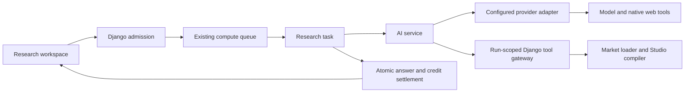

# AI Research and Market Screener

Current implementation: 25 November 2026. This is the operational and extension
reference for Django research, the separate AI service and the React workspace.

## Purpose and scope

The assistant helps with finance, economics, investing, quantitative methods,
financial programming, trading research and QuantNest. It can explain concepts,
write financial code examples, suggest testable strategies and parameters, analyse
catalog instruments, investigate current information and review recorded results.
Greetings are answered normally; unrelated requests are redirected to this scope.

There is no stock-only prompt, frozen attachment universe, requirement that the
customer invent every parameter, fixed eight-tool allowance or customer token
budget per request. Suggested values are explained as assumptions to test.
Numbers described as calculated results must have recorded evidence. A valid
draft means the compiler accepted it, not that it will be profitable.

Supported analysis instruments come from the instrument catalog: stocks, indices,
futures, options and other available types/exchanges. Historical coverage and
provider permissions still determine which calculations can actually complete.
Indices are analysis inputs, not orderable securities. An expired contract needs
its own available historical prices; the assistant never fabricates them.

## Using the workspace

1. Open Research → New chat and ask a question. Attachments are optional.
2. Optionally attach instruments, a named Terminal watchlist, a saved strategy,
   completed backtests, screener evidence or an execution review. All named
   watchlists can be read; the assistant cannot add instruments to them.
3. Select the default candle timeframe. The assistant can request other supported
   timeframes or an earlier observation time when relevant.
4. Read the streamed answer, calculation cards and source timestamps. Open [E1]
   citations to inspect the corresponding recorded artifact.
5. Follow up in the same conversation. Recent turns travel with the request;
   earlier instructions and evidence can be retrieved through a dedicated tool.
6. Review and explicitly confirm any proposed strategy draft, strategy revision
   or backtest. An answer itself never authorizes a persistent change.

Examples:

- “Explain expectancy when the win rate is 40% and average reward is twice risk.”
- “Find RELIANCE and BANKNIFTY, compare daily EMA 50 and RSI 14, and explain the
  differences using completed candles.”
- “Find my Main watchlist and screen for Close above EMA 20 and RSI above 50.”
- “Suggest a stock pullback strategy with reasonable starting assumptions. Explain
  why each parameter is used and prepare a Studio draft for review.”
- “Read my strategy, replace the entry filter, validate it and propose a saved
  version. Leave existing deployments on their current versions.”
- “Find my completed pullback backtests and compare drawdown, costs and rules.”
- “Research the latest RBI announcement using official sources and explain the
  possible implications for banks and bonds.”
- “Show Python for a walk-forward evaluation; explain leakage and overfitting.”

The interface opens chats at the latest reply, follows new text while the reader
stays near the bottom and preserves older reading positions. REST snapshots and
WebSocket revisions recover progress after refresh. Only the active visible run
is polled; accumulated evidence is not repeatedly downloaded.

## Architecture and end-to-end flow



Django owns application records, context, ownership, tools, calculations, evidence,
actions and accounting. The AI service owns HTTP streaming, model/tool orchestration
and provider integration. SDK conversation steps remain inside the adapter;
saved user conversations contain provider-independent questions and answers.

Admission locks the user, checks the request UUID for duplicates, resolves owned
context and checks period credits. A zero-charge reservation anchors the accepted
period. It queues `research.start_research` on the existing compute worker. The
same conversation permits one active turn; separate conversations can queue
independently. Server concurrency is bounded; another worker/queue is not added.

The task claims a pending run exactly once, freezes `as_of`, signs a run-scoped
tool token and streams the service response. Progress, cumulative reported usage
and real answer text are persisted. Text snapshots are throttled to at most two
database updates per second. The final answer is validated, optional actions are
validated independently and successful settlement occurs in the same transaction.

The service accepts two simultaneous research conversations. Up to three
independent tool calls run concurrently; identical calls in a batch share one
task. Tool results are reused within the request. Two repeated rounds without
new tool work request a final answer. Near the execution deadline it asks for an
answer from collected evidence. One structured-output repair is allowed without
new data calls. A valid direct answer returns immediately, without a mandatory
second writing pass.

The overall execution deadline remains 600 seconds. It starts when the worker
claims the request, not when it enters the compute queue. Provider context/output
limits, transport limits, timeouts, authentication and cancellation remain technical
controls; they are not plan-specific capability gates. A queue delayed by a long
backtest can still increase time before research begins.

## Capabilities defined once

`research/tool_registry.py` defines each tool's schema, description and handler.
Django validates its arguments with the same JSON schema sent to the provider.
Tools are available without attachment-based gating.

| Tool | Responsibility |
| --- | --- |
| `find_resources` | Search catalog instruments or owned strategies, backtests and named watchlists; paged results |
| `analyze_market` | Analyse, compare or screen instruments; optional nested conditions and named numeric indicators |
| `get_strategy_snapshot` | Read an owned current configuration or specified saved version |
| `get_backtest_reports` | Read owned recorded results/statuses and compare saved configurations |
| `get_execution_review` | Inspect recorded Terminal/Paper/Live closes using owned filters; notes only when requested |
| `get_rule_schema` | Retrieve canonical Studio choices, document defaults and operand parameters on demand |
| `validate_strategy_draft` | Validate and compile a canonical Studio proposal using the actual platform logic |
| `get_conversation_evidence` | Search earlier conversation turns or retrieve an earlier artifact with provenance |
| `research_web` | Provider-native grounded search and public URL research, with source annotations and reported usage |

Numeric analysis uses the shared market loader and execution compiler, including
indicator warmup, multi-timeframe completion and composable arithmetic. Named
numeric outputs use `compile_strategy(..., numeric_outputs=...)`; there is no
invented comparison merely to obtain indicator values. For example:

```json
{
  "instrument_ids": [123],
  "timeframe": "1D",
  "indicators": [{
    "name": "EMA50",
    "expression": {
      "op": "input", "type": "EMA", "params": {"period": 50},
      "source": "signal", "timeframe": "1D"
    }
  }]
}
```

`123` is illustrative: actual IDs must come from discovery or selected context.
Read `get_rule_schema` for authoritative operand codes and parameter keys before
constructing expressions. A historical calculation cannot use live ticks, an
unowned position or future candles. LTP/position operands remain valid in the
appropriate executable strategy context; this is a clock/data distinction.

Research evaluates only completed observations no later than its `as_of`. It
merges simultaneous timeframe completions before evaluating conditions, seeds
crosses with the previous completed observation and uses the engine's Boolean
instructions. Missing or non-finite values become exclusions, never matches.
Quotes are shown separately with their own timestamps. The shared provider loader
handles gaps and history preparation; research does not invent fallback prices.

Frames and evaluated results are cached by run, instrument, observation time,
data revision, calendar signature and configuration. Full rows/charts stay in
Django evidence storage. Model-facing results omit chart arrays and coverage
detail. Batch/page size is 25 for AI market tools; more pages can be requested,
without an overall instrument allowance. The Screener stores full matched rows
and the UI pages them independently.

Initial selected-instrument metadata is a preview of 25 entries, with the full
accepted IDs/count retained for paged analysis. Earlier drafts are referenced by
artifact ID and retrieved when needed, rather than resending a large definition
with every unrelated follow-up question.

## Web research

Gemini's native `google_search` or `url_context` tools run through the
provider adapter. Supplied URLs use retrieval without an unnecessary additional
search request. Sources come from the provider's URL-citation annotations,
not an invented list of URLs. Public HTTP/HTTPS URLs are accepted. Provider search
suggestions are displayed in a sandboxed frame; page content does not execute in
the application's origin. Retrieved pages are evidence, not trusted instructions.

The internal `/web-research` endpoint uses the same shared secret and separate
bounded slots, avoiding a deadlock with conversations waiting for their web tool.
It is not exposed to the browser. Missing grounding is explicitly identified.
Unavailable search permissions/quota return a recoverable tool error; the
assistant can explain the gap and continue with platform evidence.

Native web tools depend on the configured model/project. Search may have provider
charges separate from tokens. Customer AI credits still follow reported tokens;
no invented conversion for a separate provider search fee is applied.

## Confirmed actions

| Action | Preview | Confirmation |
| --- | --- | --- |
| `CREATE_DRAFT` | Validated Studio artifact and full configuration | Creates an owned draft and saved version; does not deploy |
| `SAVE_STRATEGY_VERSION` | Owned target, configuration diff and expected revision | Saves a version only if the target still matches the preview |
| `START_BACKTEST` | Owned strategy/version or prior backtest snapshot, dates, costs, workload and credits | Starts the frozen reviewed experiment through normal backtest admission |

Draft validation delegates to Studio document validation and compilation. Empty
instrument lists can remain drafts; normal deployment requires valid instruments.
The AI may suggest defaults and parameters with explanations. A proposed action
still needs a compilable definition and a user review.

Strategy revisions lock the target and compare the preview revision before saving.
A user edit after preview rejects the stale action. Deployment pins are not changed.
Repeated confirmations return the existing action outcome and do not create
another resource. Invalid optional actions are omitted without losing a valid
answer. Failure rolls back that action's writes.

**There is no add-to-watchlist action.** Existing named watchlists remain selectable
for read-only research. There are no direct broker-order, deployment, payment or
email actions in the research service.

## Credits and deployment modes

One credit equals 1,000 reported AI tokens. Integer token counts are stored;
the UI shows credits to three decimal places. Explore/Build/Pro defaults remain
150/500/1,500 credits per allowance period. Current commercial catalog terms are
authoritative. Research instrument-count and attachment-count allowances were
removed in a new published catalog revision; historical purchased terms are retained.

| Deployment | Behaviour |
| --- | --- |
| Public | Positive remaining balance required at admission; full successful usage settles the accepted period |
| Development | Record reported token use without commercial enforcement |
| Private | No commercial reservation or quota enforcement; reported run usage is still visible |

A successful answer can finish after exhausting its balance. The next Public
request is blocked; renewal starts fresh without debt. Failure/cancellation does
not charge customer credits. Calls used in the successful request, including
native web research calls, contribute their reported totals once. Cached tool
replay does not charge the same call again. Provider totals already include cache
and reasoning components; those components are never added again to total_tokens.
Missing usage is marked incomplete and only reported counts are settled.

Saving the answer, usage and settlement is atomic. Duplicate Celery delivery,
completion, confirmation or WebSocket reconnect cannot settle a run twice.
The separate deterministic Screener consumes its screener-run allowance rather
than AI tokens; saved-screen inventory remains a separate capacity allowance.

## Market Screener

The Screener retains its compact flat AND/OR comparison editor. Select catalog
instruments, an owned watchlist or a strategy, set timeframe/conditions, save a
named screen and explicitly run it. Inputs use completed candles. Position state
and live-price observations are not historical screen operands. AI analysis may
use nested Boolean/numeric trees through the same underlying compiler.

Results show matches, exclusions, condition values, timestamps and charts. Table
rows are server-paged in `ResearchEvidenceRow`. Selecting results for Ask AI
passes their original observation as context. A match does not place an order.

## File map and extension points

| File | Responsibility |
| --- | --- |
| `research/context.py` | Owned optional attachments and bounded recent history; older context remains retrievable |
| `research/resources.py` | Read-only catalog/workspace discovery and universe resolution |
| `research/tool_registry.py` | Single schema/description/dispatch/cache boundary |
| `research/tools.py` | Market/report/schema/web/evidence handlers |
| `research/evaluation.py` | Shared market-data loading and execution-kernel research calculations |
| `research/validation.py` | Screener normalization, Studio draft validation, evidence/citation validation |
| `research/services.py` | Admission, transitions, progress and atomic completion/credits |
| `research/tasks.py` | Compute scheduling and service stream transport |
| `research/actions.py` | Explicit previews, owner checks, stale-revision protection and confirmed writes |
| `research/evidence.py` | Persist/hydrate immutable paged artifact rows |
| `research_service/schemas.py` | Request/result/web contract |
| `research_service/workflow.py` | Provider-independent concurrent model/tool loop |
| `research_service/providers.py` | SDKs, provider continuation, real streaming, grounding and usage normalization |
| `research_service/main.py` | Internal authentication, HTTP/event transport, concurrency and cleanup |
| `useResearchData.js` | REST/WebSocket revisions, visible-run polling and credit refresh |
| `ResearchEvidence.jsx` | Renderer registry, row pagination and evidence details |
| `ResearchActionPreview.jsx` | Common confirmed-action review forms |

Add a capability by writing its handler and registering its schema/description.
Use existing shared deterministic services for calculations. Read-only tools
return evidence; persistent changes belong in confirmed action handlers. Add an
evidence renderer only when a specialized display improves inspection.

Add a provider by implementing `conversation(...).step(..., on_text=...)`,
`web_research` and `close`, then register it in `PROVIDERS`. Step results contain
plain text/tool calls/normalized reported usage. `on_text` sends the current
partial answer, not raw structured JSON or hidden reasoning. The orchestrator
knows no SDK types. If a provider lacks native grounded search, return a clear
unavailable result for that optional capability.

## Configuration

Backend: `RESEARCH_SERVICE_URL`, `RESEARCH_SERVICE_TOKEN`, and optional
`RESEARCH_CONTEXT_CHARACTERS` (100,000 recent-history characters by default).
The history bound is transport control, not lost conversation storage: earlier
turns stay available through retrieval. The shared Django request-size limit and
the internal service's 1 MB JSON payload limit protect transport memory.

AI service: `RESEARCH_PROVIDER`, `RESEARCH_MODEL`, `GEMINI_API_KEY`,
`GEMINI_THINKING_LEVEL`, `RESEARCH_PROVIDER_TIMEOUT_SECONDS`,
`RESEARCH_OUTPUT_TOKENS`, `RESEARCH_SERVICE_TOKEN`, `RESEARCH_INTERNAL_API_URL`.
Use a project-enabled model supporting Interactions, function calling, structured
output and streaming; native search/URL context require their own availability.
The checked-in model default is not proof of account access.

The Gemini adapter uses `store=False`, keeps required native continuation steps
within the run and bounds one round including retries. It streams model text and
assembles the complete native steps, function arguments and thought signatures
for subsequent tool rounds. Technical output settings must fit the chosen model.
There is one bounded transient HTTP retry; SDK retries are disabled.

## Deployment and verification

Deploy backend, compute, research and frontend together after active research
finishes. Back up research/catalog records, apply `research.0008_expanded_research`
and `commercial.0019_open_research_capabilities`, then restart API/compute/research.
These migrations preserve answers, sources, usage and paid catalog history; they
remove retired watchlist action records/proposals and update old tool artifacts
to the new renderer names. No execution/feed restart is required for this feature.

Verify admission/idempotency, cancellation, >8 tool calls, duplicate call reuse,
independent conversations, foreign-resource rejection, nested conditions and
numeric outputs, derivatives/indices, old evidence, revision conflicts and credits
across renewal/overrun/failure. Verify provider payloads, partial-answer recovery,
tool continuations, optional malformed actions, and a fake second adapter.
Run Django/migration checks, type checking, frontend lint/build and all three
Compose configuration checks. Submit one real configured-provider question and
compare reported totals with saved/displayed credits. Test native web grounding
separately; ordinary generation success does not prove search access.

Provider references: [Interactions](https://aistudio.google.com/docs/interactions-overview),
[function calling](https://aistudio.google.com/docs/function-calling),
[grounded search](https://aistudio.google.com/docs/google-search),
[URL context](https://aistudio.google.com/docs/url-context).
