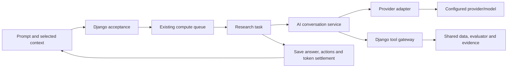

# AI Research and Market Screener: complete user and technical guide

**Source reviewed: 7 November 2026.** This guide covers current conversations,
context, deterministic calculations, evidence, confirmed actions, the non-AI
screener, period credits and the separate provider service. It replaces earlier
workflow descriptions; it is not the future research-product roadmap.

Related references: [Strategy Studio](strategy-configuration.md),
[Backtesting](backtesting.md), [commercial operations](commercial-operations.md),
[research-service setup](../research_service/README.md), and
[integration instructions](../infra/shared/INTEGRATIONS.md).
The [separate research-product proposal](ai-financial-research-transformation.md)
and [quantitative roadmap](quantitative-research-roadmap.md) describe future work,
not features implicitly available in this assistant.

## Contents

- [What the assistant does](#what-the-assistant-does)
- [Conversations and accepted context](#conversations-and-accepted-context)
- [Research execution lifecycle](#research-execution-lifecycle)
- [Tools and evidence](#tools-and-evidence)
- [Confirmed actions](#confirmed-actions)
- [Market Screener](#market-screener)
- [Period credits](#period-credits)
- [Service and provider architecture](#service-and-provider-architecture)
- [Requests, events and prompts](#requests-events-and-prompts)
- [Frontend state and pagination](#frontend-state-and-pagination)
- [API contracts](#api-contracts)
- [Implementation ownership and extension](#implementation-ownership-and-extension)
- [Worked examples](#worked-examples)
- [Deployment and verification](#deployment-and-verification)
- [Troubleshooting and limits](#troubleshooting-and-limits)

## What the assistant does

The assistant combines model-written explanations with deterministic backend
tools. It does not calculate a price/indicator merely by predicting plausible text.

| Workflow | Current implementation |
| --- | --- |
| Explain a concept or answer a greeting | Model response without unnecessary market tools/complete builder metadata |
| Analyze a stock | Closed-candle price/indicator/return/volatility evidence, with a separate labelled display quote where available |
| Compare selected stocks/watchlist | Shared completed-candle calculations over the accepted stock universe |
| Screen technical conditions | Deterministic rule evaluation; the separate Market Screener does not call an AI provider |
| Explain an attached strategy | Frozen owned configuration, sources, expressions, schedule and sizing |
| Draft user-specified strategy rules | Canonical Studio definition validated/compiled before a proposed create action |
| Review/compare backtests | Owned completed snapshots, recorded trades/metrics/cost and data assumptions |
| Review execution | Bounded owned report with source/account/date/fee basis and optional journal notes |
| Add selected stocks to a watchlist | Preview and explicit user confirmation for an owned named list |
| Configure/start a backtest | Preview exact snapshot/dates/capital/costs/workload, then explicit confirmation |

Direct market analysis and screening currently focus on **active NSE stocks**.
Do not infer option-chain research, fundamental filings, unrestricted web search,
portfolio optimization, news feeds or broker trading from the assistant's name.
An attached report can describe derivative trades; that does not broaden the
direct-analysis data universe to every instrument.

The prompt restricts the assistant to educational research and customer-defined
logic. It should ask for missing thresholds/rules instead of inventing a supposedly
profitable strategy or personalized buy/sell instruction. Current strategy-drafting
prompt guidance emphasizes stock strategies; backend draft validation uses the
canonical Studio compiler and accepted context. Full arbitrary F&O strategy
generation is not promised by this interface.

## Conversations and accepted context

Open **Research & Analysis → AI Research Assistant**, choose an existing chat or
create one. Enter a prompt, select the timeframe and attach only the context needed.
The default assistant timeframe is the research schema's current default, initially
one day; change it deliberately for intraday calculations.

Supported context inputs are:

| Input | Accepted meaning |
| --- | --- |
| Selected instruments | Owned request's active NSE-stock analysis universe |
| Terminal watchlist | One selected owned list, including its saved name; only eligible stocks enter direct analysis |
| Strategy | Owned definition frozen at request acceptance |
| Completed backtests | Owned snapshots/reports; compare requires at least two |
| Saved screen / source run | Reuse selected earlier evidence with original provenance |
| Execution review | Explicit source, account/date/report selection and optional user review content |

All named Terminal watchlists are individually selectable; there is no single
ambiguous global Terminal watchlist. Index/derivative members are not silently
analysed as stocks. Use readable names and exact resource selectors; server
ownership checks remain authoritative.

`resolve_context()` validates ownership and produces the immutable accepted request
context. Changing a conversation's attachments affects later turns, not the facts
used by a previously accepted turn. A run has its own `as_of`, request ID, context,
evidence, usage, status and result.

Draft eligibility can include instruments from an attached owned frozen strategy
or backtest. That bounded draft permission is separate from permission to fetch
new market analysis for arbitrary IDs. A fabricated/foreign attachment or evidence
reference is rejected.

Recent completed turns supply a compact conversation history. Older full evidence
is retrieved on demand through an authorized tool; every old artifact is not
attached to every question. This reduces context size and keeps evidence provenance
explicit.

## Research execution lifecycle



1. The browser generates a UUID `request_id` and submits prompt/context. Prompt
   length is bounded to 6,000 characters.
2. `accept_run()` locks the user, checks exact request-id/payload idempotency,
   resolves context, validates relevant request limits and ensures only one
   active research/screen request for the user.
3. It creates `PENDING` work and a zero-charge AI accounting reservation tied to
   the accepted allowance period, then queues `research.start_research` on `compute`.
4. The task claims `PENDING` → `RUNNING` once. A duplicate delivery does not make
   another paid provider call for an already claimed run.
5. Django creates a deadline/run-scoped tool token and sends compact accepted
   context, available tool definitions and up to six recent completed turns to
   the separate service.
6. The service orchestrates model/tool turns. Tools call back to Django; their
   results are stored as evidence and only compact projections return to the model.
7. Progress, cumulative usage, result/error and heartbeat events stream to the
   task. The browser receives Django's user-scoped revisions, not the provider API.
8. `complete_run()` locks the active run, validates answer/citations, validates
   optional actions separately, and commits result/usage/actions/credit settlement
   in one transaction.
9. WebSocket revision and REST recovery update the conversation and balance.

Research and backtests intentionally share **the compute queue**. A PENDING request
can wait behind other compute work; this is not a Gemini response time. The
ten-minute execution deadline is tied to started work, not time spent waiting in
that queue. Expiry cleanup catches excessively long RUNNING work.

### Cancellation and failures

Pending/running cancellation marks the owned run cancelled; the task and tool
gateway reject subsequent active work. A provider request already in flight can
still have consumed provider resources before disconnect/cancellation is observed.
Customer credits are not charged for a failed/cancelled answer.

Failure text belongs to the run; it must not erase earlier successful turns.
Deletion of a conversation with active work is blocked until cancellation/cleanup.
Refreshing the page recovers the accepted run instead of starting the same prompt
again automatically.

## Tools and evidence

Tool name, argument schema, description, handler and compact output are defined
once in `backend/research/tool_registry.py`. Django selects only tools allowed by
that run's context. The service does not maintain another handwritten list of
the same arguments.

| Tool | What it reads/calculates | Boundary |
| --- | --- | --- |
| `resolve_instruments` | Eligible stock identity search | Does not broaden the accepted research universe automatically |
| `get_rule_schema` | Relevant Studio operand/parameter metadata | Detailed builder metadata only when needed |
| `screen_instruments` | User conditions on completed bars | Accepted stocks and valid screening inputs |
| `compare_instruments` | Common return/volatility/price observations | Accepted universe; deterministic calculated facts |
| `analyze_stock` | Bounded indicator observations and charts | Selected eligible stocks; compact model-facing observations |
| `get_strategy_snapshot` | Frozen attached strategy | No foreign/current mutable strategy substitution |
| `get_backtest_report` | Completed attached result | Recorded historical execution/data assumptions retained |
| `compare_backtests` | Comparison of attached completed results | At least two; no claim that different dates/costs are comparable |
| `get_execution_review` | Explicit bounded execution report | Owned source/account/date scope and fee basis |
| `get_conversation_evidence` | Earlier owned conversation artifact | Preserve original observation time and source turn |
| `validate_strategy_draft` | Canonical document validation and compile preview | No strategy is saved/deployed by this read/validate tool |

### Shared calculations

Research uses `marketdata/candles.prepare_frames()` and calendar-aware completed
bars, then `research/evaluation.py` and the shared execution compiler/evaluator.
There is no second AI-only EMA/RSI implementation. An analysis timeframe refers
to completed candles rather than the newest forming price displayed in Terminal.

`_closed_data()` and completion projection prevents current unfinished bars or future
history from being treated as evidence at the accepted clock. Coverage, missing
data and rejected rows are preserved. A separate quote is labelled with its own
time/source; it does not replace the historical closing price used in an analysis.

### Evidence identity and provenance

Every successful tool artifact receives a run-local evidence ID such as `E1`, a
tool name, arguments, data and observation/source time. `E1` in another conversation
is not the same artifact. Reusing prior evidence preserves its original `as_of`
and source run, while the current run records its own reference.

- Model-facing compact output excludes large chart arrays and full trade tables.
- Django retains full evidence for the user's tables/charts and validation.
- Evidence rows are stored separately and server paginated; opening a chat does
  not repeatedly download every historical row and chart.
- Citations must resolve to artifacts calculated/accepted for the run. A valid
  inline citation is normalized even if the model omitted a redundant declaration.
- An invalid citation/answer fails validation. An invalid **optional action** is
  filtered/reported independently rather than discarding an otherwise valid answer.
- A repeated identical successful tool call reuses its run-local artifact/cache
  instead of spending another tool execution.

The shared maximum is eight uncached tool attempts per run. Failed attempts count;
the orchestrator does not loop endlessly on identical failures. At the limit it
requests a final answer from collected evidence, including limitations, rather
than discard useful completed work. Cached numerical results do not become new
market observations just because a user asks again.

## Confirmed actions

The model can propose an action; only a backend-validated preview plus an explicit
user confirmation can persist it. No tool silently deploys, places trades or sends
customer messages.

### Create strategy draft

1. Supply the intended logic/thresholds. Missing business rules should produce
   clarification questions rather than invented trading advice.
2. `validate_strategy_draft` validates the canonical Studio document, owned/accepted
   active instruments, entry plus exit/stop/target logic, expression sources,
   dependencies and compile requirements.
3. Open the draft action preview and inspect the definition.
4. Confirm. The normal strategy create/snapshot services save the reviewed draft;
   Paper is enabled, Live is disabled and automatic version saving is disabled.
5. Open Studio, review/validate/save as needed and deliberately choose any later
   backtest/deployment. Creating the draft does not activate execution.

One run reuses its already created strategy on repeated confirmation instead of
creating duplicate drafts. Strategy capacity is enforced at the normal create
boundary, separately from AI credits.

### Add stocks to a Terminal watchlist

Choose evidence-supported stock rows, open **Add to watchlist**, select the exact
owned named destination, and preview additions. The preview displays its name.
Only then confirm. Adding existing members is idempotent. The server rejects IDs
outside the accepted research universe or a foreign destination list.

### Configure and start a backtest

Choose an attached strategy, newly created reviewed draft, or attached completed
backtest as the source. Select dates, capital, slippage and charge profile.

The preview freezes the exact source definition and cost assumptions and returns
the normal workload/credit estimate. An attached completed source uses its saved
effective configuration rather than silently taking the strategy's latest edits.
Confirming calls the standard backtest create/start workflow. Backtest credits are
independent from the AI tokens consumed explaining/configuring it.

Preview defaults are provided by `research/schema/`; they are editable assumptions,
not recommendations. A preview is not an order or a free bypass of backtest quotas.

### Action states and rollback

Actions are PROPOSED, COMPLETED or FAILED. `confirm_action()` locks user/run/action,
requires a completed research run and wraps persistent work in a transaction.
Repeated confirmation returns the already settled action. A failed action leaves
the valid research answer available and rolls back its persistent changes; create
a corrected fresh preview to retry. Do not resubmit the entire research prompt
merely to repair a selected watchlist/date/profile.

## Market Screener

Market Screener is deterministic historical analysis and does not require an AI
provider response for its screen result. Its period run allowance is separate
from research token credits.

1. Select manual eligible stocks, an owned strategy's relevant stock universe, or
   a specific named Terminal watchlist.
2. Choose timeframe and AND/OR combination.
3. Add active operand comparisons using the shared Studio metadata. The current
   schema allows up to 12 screening conditions.
4. Save a named screen to reuse its settings; saved screens consume saved-screen
   capacity. There are no built-in trend/momentum/EMA preset cards anymore.
5. Run with a new observation. The server accepts a SCREEN run, obtains shared
   completed-bar evidence and evaluates the configured comparisons.
6. Inspect matched/excluded/data-limited outcomes and calculation details. A data
   error is not interchangeable with a known false comparison.
7. Select results and **Ask AI about selected results** if an explanation is useful.
   The subsequent AI request has its own prompt/context/credit lifecycle.

Screening permits completed-candle operands and their validated math inputs.
LTP, position state and captured runtime values are not screening data. It is a
flat AND/OR screen, not the full Studio nested/capture execution state machine.

Named screen edits affect later runs. Reopening a stored result is not automatically
a new live screen. Saved screens retain their SCREEN type; they cannot be converted
to CHAT to evade saved-screen capacity. Delete an eligible saved screen to release
its inventory slot.

## Period credits

**1 credit = 1,000 reported AI tokens.** Internally usage is an exact integer
token count; UI credits use three decimals, not currency/two-decimal rounding.

| Current default plan | Research credits per allowance period |
| --- | ---: |
| Explore | 150 |
| Build | 500 |
| Pro | 1,500 |

The accepted subscription/catalog terms are authoritative; a historical catalog
record is not rewritten merely because the current default offering changed.
Example: 88,654 reported tokens consume **88.654 credits**.

| Situation | Behavior |
| --- | --- |
| Public admission | Must have positive period balance and no other active run |
| Admission reservation | Zero-charge record tied to the accepted period; no predicted per-request token reservation |
| Successfully validated/saved answer | Charge summed provider-reported usage once |
| Answer exceeds remaining balance | Finish/save it and record full usage; remaining display clamps to zero; block new requests |
| Failed/cancelled request | No customer AI credit charge |
| Period rollover during work | Charge the original accepted bucket, not the new period |
| New period | Fresh allowance; no usage debt carried forward |
| Missing provider usage | Deliver a valid answer, flag incomplete accounting and record known reported totals; do not invent token counts |
| Development | Record usage without commercial enforcement |
| Private | No commercial quota recording/enforcement |

Input/output/cached/reasoning fields are diagnostics. The provider's reported total
already includes components it accounts for; cached/reasoning tokens must not be
added to that total again. Sum reported totals across model calls needed for the
successful request, including a required repair pass, once each.

There is no cumulative customer token budget per request and no separate plan-
specific hourly research cap. Normal API throttling, one active request, deadlines,
tool limits, provider context/output constraints and concurrency bounds still
protect the service. Removing a customer budget does not remove technical controls.

The composer shows remaining period credits and completed replies show consumed
credits. Completion, focus/reconnect and renewal refresh allowance state. Billing
and Research read the same backend usage accounting rather than calculate competing
balances in browser state.

## Service and provider architecture

| Boundary | Owns | Must not own |
| --- | --- | --- |
| Django `research/` | Ownership, accepted context, deterministic data/tools, evidence, actions, admission/completion and credits | Provider SDK conversation objects |
| `research_service/main.py` | HTTP authentication, request schema, concurrency, streaming and disconnect cleanup | User database ownership or direct trade creation |
| `research_service/workflow.py` | Supplied-tool selection, evidence/tool loop, limits, final answer/repair | Gemini-only request fields or another tool registry |
| `research_service/providers.py` | Provider calls/formats, continuation state, usage normalization and provider errors | Django models or application action persistence |
| Frontend | Context selection, run display, evidence navigation and explicit confirmations | Provider secrets or authoritative credit settlement |

The current adapter is Gemini using its native SDK/Interactions flow. `Provider`,
`Conversation`, `ProviderStep` and `ToolCall` define the service-facing protocol.
Provider/model are configuration. Provider-specific SDK state stays inside the
adapter; saved application conversations are plain application data.

The service currently permits two concurrent requests. A third can wait for a
slot within its absolute deadline. The default provider-call timeout is 60 seconds;
the orchestration deadline is 600 seconds. SDK hidden retry chains are disabled;
only bounded transient retry within the configured time applies. A timed-out
call is not endlessly retried because it may have consumed unreported resources.

Current defaults/examples select `gemini-3.5-flash` and low thinking level. This
documents the configured code default, not a claim that the provider currently
offers every model to every account. Select an actually accessible model and
verify its technical capabilities with your configured credentials.

## Requests, events and prompts

### Internal request

The Celery task sends one documented Pydantic `ResearchRequest` to `POST /research`:

| Field | Meaning |
| --- | --- |
| `prompt` | User request, 1–6,000 characters |
| `run_token` | Signed run/user-scoped tool authorization |
| `as_of` | Accepted observation context |
| `context` | Compact frozen instruments/attachments/cached evidence |
| `tools` | Definitions generated by Django's registry |
| `deadline` | Absolute execution deadline |
| `max_tool_calls` | Remaining allowed uncached attempts, at most eight |
| `history` | At most six compact previous completed turns |

Unknown request fields are forbidden. Service HTTP authentication uses the
constant-time checked `X-Research-Service-Token`; requests also have a bounded
serialized size. The internal tool callback requires that secret **and** a signed,
unexpired token for an active RUNNING owned run.

The service streams newline-delimited JSON progress/usage/result/error events and
heartbeat messages approximately every 15 seconds. **HTTP 200 means streaming
started, not that research completed.** The task must read the terminal event.
`/health` indicates service startup/configuration, not a successful paid provider
request or functioning data tool.

### Final result

The structured result contains a nonblank `answer`, evidence IDs, optional draft
artifact, next steps, limitations, clarification questions, artifact references
and optional proposed actions. Lists/text sizes are bounded. Django validates
citations against its own artifacts, not the model's asserted references.

A valid structured model answer is returned directly. There is no unconditional
second writing call. One malformed final can receive a bounded final-only repair;
the repair cannot invent extra untracked tool executions. Exhausted tools should
produce the best evidence-supported answer and its limits.

### Prompt policy and factual quality

- General questions do not carry every platform enum/indicator parameter schema.
- Detailed schemas are retrieved only when the user is constructing rules.
- Quantitative claims about selected data need calculated evidence references.
- Old evidence must disclose its original source time; refresh is deliberate.
- Missing data/tool failure is a limitation, not a fabricated numeric conclusion.
- Customer-defined strategy rules are preserved; missing thresholds require
  clarification rather than an arbitrary optimized-sounding number.
- No provider can directly place trades, deploy a strategy or mutate the database
  through text. Confirmed actions remain a separate application boundary.

These controls reduce specific failure modes; model output still needs user review.
Data, prompts and selected context reach the configured AI provider. Do not attach
unnecessary secrets or describe the service as fully local model inference.

## Frontend state and pagination

`useResearchData` is the common owner of REST snapshots, WebSocket revisions,
active-run polling and reconnect recovery for chat/screener pages.

- `/ws/research/` carries authenticated user-scoped run revisions.
- Older snapshots cannot overwrite a newer revision or another selected chat.
- While a run is active, a ten-second fallback poll fetches that run, rather than
  repeatedly downloading the conversation's full evidence.
- Reconnect recovers the selected conversation and allowance; opening an existing
  chat scrolls to its latest content.
- Conversations, run history, resource selectors and evidence rows use shared
  server paging. The normal defaults are 25 rows with 10/25/50/100 choices.
- Evidence opens in a wider detail view with independent table paging/overflow
  and chart area. Citations can navigate to the calculated artifact.
- Type-specific evidence renderers handle screen, stock, strategy, backtest and
  execution artifacts without one growing conditional for every feature.
- Action previews display exact persistent changes and completion links. An
  action failure remains distinct from an answer failure.

Shared enums/`StrategyStudio` metadata come from `/api/v1/common/enums/` through
the common provider/hook. `research/schema/` adds account research limits, screener
defaults, editable backtest defaults and default charge-profile ID. It does not
maintain another full operand-definition catalog.

## API contracts

Authenticated application prefix: **`/api/v1/research/`**.

| Method/path | Purpose |
| --- | --- |
| `GET schema/` | Research limits/defaults/configuration availability |
| `GET allowance/` | Period usage/remaining credits from common accounting |
| `GET/POST sessions/` | Search/page conversations/screens or create one |
| `GET/PATCH/DELETE sessions/{id}/` | Owned title/context changes and eligible deletion |
| `GET/POST runs/` | Owned run history or accept a RESEARCH/SCREEN request |
| `GET runs/{id}/` | Snapshot, status, answer/usage, evidence descriptors and actions |
| `POST runs/{id}/cancel/` | Cancel active owned work |
| `GET runs/{id}/evidence/{Eid}/` | Owned evidence detail |
| `GET runs/{id}/evidence/{Eid}/rows/` | Server-filtered/paged evidence table |
| `GET runs/{id}/evidence/{Eid}/rows/{ordinal}/` | One row/detail artifact |
| `POST runs/{id}/propose-action/` | Validate and store preview |
| `GET actions/`, `GET actions/{id}/`, `POST actions/{id}/confirm/` | Inspect/confirm owned action |
| `POST tools/` | Internal service-token plus signed-run-token gateway; not ordinary browser access |

Run request context fields include `strategy_id`, `backtest_ids`, `instrument_ids`,
`watchlist_id`, `timeframe`, `screen`, `source_run_id`, `execution_review`, plus
`session`, UUID `request_id`, `mode`, `prompt` and deliberate `refresh`.
Unsupported fields/foreign resources are rejected. Reusing an identical request ID
with a different payload is a conflict, not permission to replace accepted work.

## Implementation ownership and extension

Backend paths below are relative to `backend/`. Begin with
[`research/services.py`](../backend/research/services.py) and
[`tool_registry.py`](../backend/research/tool_registry.py); provider orchestration
starts in [`research_service/workflow.py`](../research_service/workflow.py).

| File/symbol | Responsibility |
| --- | --- |
| `research/views.py`, `serializers.py`, `urls.py` | HTTP input, scoped lists/actions, schema/allowance/tool gateway |
| `research/services.accept_run`, `complete_run`, `update_active_run` | Admission, state transitions and atomic completion |
| `research/context.py` | Accepted ownership/universe/snapshot resolution |
| `research/tool_registry.py` | Single definitions, availability, attempt/cache/artifact boundary and compact output |
| `research/tools.py`, `evaluation.py` | Feature handlers and shared deterministic calculations |
| `research/validation.py` | Screening, canonical draft, citations, output and customer-rule validation |
| `research/evidence.py`, `models.py` | Paginated evidence rows, runs, conversations and actions |
| `research/actions.py` | Three preview/execute handler pairs and transactional confirmation |
| `research/tasks.py` | Compute scheduling, internal stream consumption, expiry and failure handling |
| `commercial/usage.py`, `catalog.py` | Actual-token period accounting and plan definitions |
| `research_service/schemas.py`, `main.py`, `workflow.py`, `providers.py` | Wire contract, HTTP, provider-independent orchestration and adapters |
| `AIResearchAssistant.jsx`, `MarketScreener.jsx`, `useResearchData.js` | User workflows and common state recovery |
| `ResearchEvidence.jsx`, `ResearchActionPreview.jsx`, `ResearchUniverse.jsx` | Evidence rendering, explicit actions and accepted context UI |

To add a **read/calculate capability**, implement a handler, register its schema/
context availability/compact projection, validate ownership/data/time semantics,
and add a renderer only if it introduces a new artifact presentation. Do not add a
provider-specific tool copy.

To add a **persistent action**, add a preview/execute pair, explicit UI confirmation,
normal service validation/allowance calls and transaction/idempotency behavior.
Do not give the model direct mutable service access.

To add a **provider**, implement/register the protocol adapter, normalize reported
usage correctly, isolate native continuation/SDK errors and verify schema/tool/
final behavior. Django tools/actions and saved conversations should remain unchanged.

## Worked examples

### Ask without unnecessary context

Prompt: “Explain what an EMA crossover means.” No selected market is needed to
explain the concept. A factual claim about today's crossover for a named stock
would require selected instruments/timeframe and calculated evidence instead.

### Customer-defined draft

Select a stock and specify: “Use 5-minute completed close crossing above EMA(20)
for long entry, exit below EMA(20), one unit, entries 09:30–14:30 IST. Ask me for
any missing required stop-loss detail.” Inspect the validated draft preview,
confirm creation, then open Studio. It is not automatically a running session and
does not promise the rule is profitable.

### Review two experiments

Attach two owned completed backtests and ask how costs, trade count, drawdown and
data assumptions differ. The assistant retrieves both reports. Different dates,
capital or template lot assumptions must be disclosed rather than comparing only
raw net P&L. A proposed rerun still needs the exact workload preview/confirmation.

### Credit overrun and renewal

An admitted Public request has 2.000 credits left. A valid saved answer reports
3,750 tokens (3.750 credits). It completes, records 3.750 in its original period,
shows zero remaining and blocks the next request. Renewal grants its fresh
allowance without charging that overrun into the new period. Failure instead
produces no customer charge even if the provider incurred work internally.

## Deployment and verification

Run the existing compute worker and the separate AI service; do not introduce
another research queue. From repository root for native development:

```powershell
uvicorn research_service.main:app --host 127.0.0.1 --port 8001 --env-file research_service/.env
```

Configure actual values using environment examples without committing secrets:

| Setting | Owner/purpose |
| --- | --- |
| `RESEARCH_SERVICE_URL` | Django → reachable service address |
| `RESEARCH_SERVICE_TOKEN` | Same private internal secret on both sides |
| `RESEARCH_INTERNAL_API_URL` | Service → reachable Django `/api/v1/research/tools/` |
| `RESEARCH_PROVIDER`, `RESEARCH_MODEL` | Adapter/model selection |
| Provider API secret, e.g. `GEMINI_API_KEY` | Service-only provider credential |
| `RESEARCH_PROVIDER_TIMEOUT_SECONDS` | Provider technical call timeout, default 60 |
| `GEMINI_THINKING_LEVEL` | Gemini-specific adapter control, default low |

Django centrally defines the 600-second run and eight-tool bounds. The service's
context/output sizes and concurrency are technical controls, not plan token
budgets. Hostnames differ inside Compose; `localhost` in a service container is
that container, not automatically Django or the host.

Deploy Django and service contracts together after active research finishes; apply
prepared migrations with the deployment procedure. New catalog revisions must
preserve old catalog/payment history. The retired turn allowance is not restored
as a second charge, and token accounting does not invent historic token totals.
Do not rerun an old migration procedure blindly on an already updated database.

Release validation includes general/no-tool prompts, multi-tool stock analysis,
screens, validated drafts, named watchlist actions, backtest previews, execution
reviews, invalid optional actions, foreign attachments/citations, duplicate
delivery/confirmation, cancel/failure refunds, rollover/overrun and missing usage.
Check an actual Django request against the service schema and exercise a second
fake adapter without changing orchestration/tools.

Then run one deliberate configured-provider request and compare its reported
totals with saved usage, reply credits and Billing. A successful local schema or
`/health` check alone does not establish model access, response quality or latency.
Setup/cutover commands for all modes remain in [infrastructure](../infra/README.md).

## Troubleshooting and limits

| Symptom | Investigate |
| --- | --- |
| PENDING for a long time | Shared compute worker, queue binding and preceding backtests; not automatically a slow provider |
| HTTP 422 from service | Actual payload versus `schemas.py`, deployment version mismatch; do not add arbitrary fallback fields |
| HTTP 200 but failed turn | Terminal NDJSON error/result and Django run error; HTTP only opened the stream |
| Provider timeout | Model access, network, slot wait, per-call timing and bounded retries; a greeting should not load every builder schema |
| Tools denied | Internal secret, signed token user/run/deadline and active run status |
| No screen matches | Accepted NSE-stock universe, active conditions, completed timeframe, sufficient history and missing-data outcomes |
| Draft rejected | Canonical document/compile error, context instruments, missing customer rules or invalid source clocks |
| Watchlist action fails | Explicit owned destination preview and selected accepted stock IDs |
| Backtest action fails | Owned source, exact snapshot, dates/profile/workload acceptance and independent backtest allowance |
| Balance seems unchanged | Successful saved answer, reported usage completeness, original-period bucket and frontend allowance refresh |
| Old evidence shown | Original `as_of`, source turn and explicit refresh/reuse semantics |

AI prose is not an execution guarantee or investment recommendation. Current
analysis uses selected technical history and bounded attached reports; it does
not become a full institutional research database simply by changing the model.
Useful extensions should preserve deterministic evidence, clear scope and explicit
confirmation rather than create another opaque autonomous workflow.
