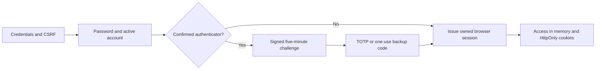

# Authentication, account security and browser sessions

**Source reviewed: 7 November 2026.** This is the current end-to-end guide for
registration, password/Google sign-in, browser sessions, authenticator recovery,
profile identity and administrator access. It replaces the earlier authentication
description. Configuration commands for each deployment remain in
[infrastructure](../infra/START-HERE.md).

Related guides: [customer website/workspace](customer-site.md),
[commercial operations](commercial-operations.md),
[support and account records](customer-support.md).

## Contents

- [Separate credentials and identities](#separate-credentials-and-identities)
- [Register and verify email](#register-and-verify-email)
- [Password login](#password-login)
- [Browser sessions and refresh](#browser-sessions-and-refresh)
- [Logout, revocation and password changes](#logout-revocation-and-password-changes)
- [Authenticator and backup codes](#authenticator-and-backup-codes)
- [Google sign-in](#google-sign-in)
- [Profile and avatar](#profile-and-avatar)
- [Account shutdown and export](#account-shutdown-and-export)
- [Administrator access](#administrator-access)
- [Origins, cookies, CSRF and sockets](#origins-cookies-csrf-and-sockets)
- [API contracts](#api-contracts)
- [Implementation ownership](#implementation-ownership)
- [Configuration and troubleshooting](#configuration-and-troubleshooting)

## Separate credentials and identities

| Credential/session | Purpose | Independent boundary |
| --- | --- | --- |
| QuantNest user password / Google identity | Sign into the user workspace | Does not authorize broker orders |
| QuantNest access/refresh tokens | Short-lived API access and renewable browser session | Must match an active owned `UserSession` |
| User authenticator / backup code | Complete local two-factor sign-in | Not an emailed OTP or broker code |
| Django Admin session + staff OTP | Operations Admin permissions | A customer JWT alone is insufficient |
| Market-data source authorization | Operator's shared provider data access | Not the user's workspace session |
| Individual broker authorization | Owned trading-account connection | Separate from market data and Google sign-in |
| Internal service/proxy secrets | Trusted infrastructure transport | Never browser `VITE_` values or user API keys |

Development, Public and Private share the same website, registration and sign-in
flows. There is no Private signup licence lookup or separate hidden homepage.
Execution scopes and commercial policy control product access independently of
authentication. Current Private use is personal/operator use; it does not imply
customer Live availability.

Account API-key management has been removed. The current user-facing account
authentication is the browser-session flow described here.

## Register and verify email

1. Open `/register`, provide first/last name, username, email and matching passwords,
   and complete the form's required acknowledgements.
2. The frontend obtains CSRF state and posts to the custom registration endpoint.
3. Allauth/dj-rest-auth validate registration and Django password rules. Names are
   required; email and username uniqueness are server constraints.
4. Successful session-enabled registration uses the same session-issue service as
   login. Verification email delivery uses the configured Django mail backend.
5. Follow the verification link. Use the resend action if needed; it returns a
   generic message rather than disclose whether a particular email exists.

`ACCOUNT_EMAIL_VERIFICATION` is currently **optional** for ordinary sign-in. That
does not make verified ownership optional everywhere: checkout requires verified
email, and guest support tickets are associated with an account only after its
email is verified.

The profile exposes verification status. Email is read-only through profile edit;
editing a name is not an email-change/verification flow. SMTP delivery problems
do not justify marking an arbitrary address verified to bypass ownership.

## Password login

The login form accepts the configured username/email login methods and a password.
It calls `/api/v1/users/auth/login/` through the shared HTTP client.



`login_response()` handles password and Google logins consistently. Inactive
accounts fail. A confirmed TOTP device produces a signed challenge instead of a
fully authorized workspace session.

The challenge includes a user identifier, random cached nonce and password-state
hash. It expires after five minutes. Verification locks the user/device, checks
the active account and unchanged password, then consumes the nonce on success.
Changing a password or TOTP configuration invalidates an incompatible pending flow.

Current dedicated throttles are 10/minute for login-related anonymous actions and
5/minute for 2FA challenge attempts; security mutations use a 5/minute user
throttle. These are application controls, not a guarantee against all abuse.

## Browser sessions and refresh

`UserSession` is a revocable database authorization record, not just an analytics
entry. It stores a stable UUID session ID, current refresh JTI, expiry and bounded
browser/OS/device/IP metadata.

### Issue a session

`issue_login_response()` locks the user and verifies that the authenticated password
state has not changed. An HttpOnly `quantnest-device` cookie identifies that browser
profile for the user; it is not a hardware fingerprint. Signing in again in the
same profile replaces its refresh credentials and reuses its session relationship.
Another browser/profile has a separate session.

The current defaults are:

| Item | Default behavior |
| --- | --- |
| Access lifetime | 15 minutes |
| Refresh lifetime | Seven days from the latest successful rotation |
| Access cookie | `quantnest-auth`, HttpOnly |
| Refresh cookie | `quantnest-refresh-session`, HttpOnly, scoped to `/api/v1/users/` |
| Cookie SameSite | Lax |
| Secure cookies | Enabled outside DEBUG; production requires HTTPS |
| Browser-profile device cookie | HttpOnly, up to one year; not authorization by itself |

The response supplies access token, expiry, CSRF token and, on login, serialized
user information. Browser application state keeps access credentials in memory.
Refresh tokens are not returned for frontend localStorage persistence.

### Reload and refresh

On page reload, `initializeAuth()` uses the refresh cookie to obtain fresh access
and fetch the current profile. Protected routes wait for initialization and offer
retry on recoverable load failure rather than assume every network failure is a
signed-out account.

`refresh_session()` verifies signature/expiry/blacklist, active user, password
state, owned session and the exact current refresh JTI. It blacklists the old
refresh, rotates JTI/expiry and updates that same session. It does not create a
new session per refresh or revive a revoked record.

`SafeJWTAuthentication` checks session validity for bearer and cookie-authenticated
REST requests. Activity timestamps are updated at most on the bounded activity
cadence rather than written for every call. Removing a session invalidates access
even if a JWT signature and its short expiry remain valid.

### Concurrent tabs and stale requests

The HTTP client shares in-flight refresh work within a tab. Web Locks, where the
browser supports them, serialize cookie-changing login/logout/refresh across tabs.
Only non-secret login/logout events use localStorage; auth-generation checks
discard responses started under an earlier login.

`useAuthSession()` checks visible-session freshness every 30 seconds and on focus/
visibility change, refreshing access when near expiry. Other tabs recover after
a login signal and clear private state after logout. This does not permit an old
refresh JTI to be reused indefinitely; outdated concurrent refreshes can fail.

The regular API interceptor retries an eligible 401 once with current/refreshed
access. A persistent authorization failure ends authentication rather than loop
forever. Download JSON errors returned as blobs are decoded for useful messages.

## Logout, revocation and password changes

| User action | Server effect |
| --- | --- |
| Logout | Revoke current owned browser session, blacklist refresh and clear auth cookies; already ended logout is idempotent |
| Security → end selected session | Delete only that user's selected session |
| End other sessions | Preserve the authenticated current session and revoke the others |
| Change password | Validate current password/new password; revoke others, issue replacement current credentials and reconnect current sockets |
| Forgot-password reset | Validate reset token under a user lock, save new password, revoke sessions and require fresh sign-in |
| Enable/disable 2FA | Keep the current session and revoke other browser sessions |
| Deactivate/erase identity | Validate safe account shutdown, then revoke all sessions |

The reset-email request has a generic result; the React reset-confirm route carries
UID/token and posts to the backend confirmation endpoint. The dummy backend URL
name supports email generation, not another password-reset screen.

Active-session list shows current session first, with browser metadata and expiry.
An IP/browser label helps recognition but is not proof of a physical person's
identity. Trusted ingress normalizes IP metadata; arbitrary forwarded headers are
not an accepted identity source.

## Authenticator and backup codes

From **Profile Settings → Security**:

1. Choose setup; the server creates/reuses an unconfirmed TOTP device.
2. Scan the QR or enter the secret in an authenticator privately.
3. Confirm a valid code. Only then is the device confirmed and 2FA enabled.
4. Save the ten generated backup codes securely. Plaintext is returned once;
   later list/status calls return remaining counts, not the old code values.
5. Use the authenticator or one unused backup code during a challenged login.

Backup codes are random eight-digit values displayed as `XXXX-XXXX`. Only hashes
are stored. Verification normalizes separators and atomically marks an unused
matching code used. Reuse fails. TOTP verification also uses device replay rules.

Regenerating backup codes requires the account password and replaces all old codes.
Disabling 2FA requires the account password, removes devices/codes and ends other
sessions. A user who normally signs in with Google still needs a valid local
password for these password-protected management actions; use password recovery
to establish/recover one rather than bypass the check.

Do not send QR secrets, recovery codes, tokens or cookies in support tickets.
Loss of all recovery factors needs deliberate operator identity/recovery handling;
there is no public endpoint that disables another user's authenticator.

## Google sign-in

Google is a server-mediated authorization-code/PKCE flow:

1. `google/start/` accepts only an allowed local return path.
2. Django creates random state and a PKCE verifier, stores signed five-minute
   HttpOnly flow state, and returns Google's authorization URL.
3. Google redirects to the exact backend `google/callback/` address.
4. The backend checks/consumes same-browser state and exchanges the code using
   the server-side client secret/verifier.
5. A signed one-use result cookie is set; the browser redirects to `/google-callback`.
6. The frontend posts CSRF-protected `google/complete/`.
7. The shared login service issues the QuantNest session or requires local 2FA.

Provider tokens are not put into the frontend return URL. Inactive/changed
accounts, expired/used state, cancelled authorization or invalid return paths
cannot finish the flow. Retrying begins a new start request.

Configure a Google SocialApp against the correct Django Site and register the
exact `BACKEND_URL` callback. No frontend Google secret is required. A matching
email on an existing password account is not silently linked to a new Google
identity; use its existing login path instead of assuming email equality proves
account-link consent.

## Profile and avatar

Profile supports username, first/last name, bio, avatar and frontend appearance
settings. Email, staff status, 2FA flag, plan and join date are server-owned/read-only.
Names have 30-character limits; a nonblank bio must meet the validated length.

Avatar upload accepts JPEG/PNG/WebP up to 2 MiB. The profile returns an API-relative
signed URL for the current active user's current file, valid for up to 30 minutes.
Replacing/removing that file invalidates old-name capabilities. The image view
serves the small file without exposing the whole media directory. A holder of the
unexpired image URL can fetch that specific image; it is a scoped capability.

`UserAvatar` shares bounded failed/expired-link recovery between Profile and the
sidebar. It must not add an access JWT into image query parameters. Theme follows
the shared light/dark/system preference; it is not an authentication credential.

## Account shutdown and export

Account settings link Billing, Support and user documentation and provide export,
deactivation and sign-in identity erasure.

Before shutdown, the backend checks actual Terminal/Paper/Live positions and
pending orders plus automatic renewal. Users must settle exposure and cancel
renewal first. Account disable does not force market exits or pretend unresolved
broker orders are absent. The confirmation path repeats these checks under locks.

Erasure anonymizes sign-in identity and schedules selected optional-content
cleanup; required financial/execution history is retained. It is not a database
row deletion or a promise to erase every historical record. See the complete
[account-record workflow](customer-support.md#account-export-shutdown-and-retention).

## Administrator access

`/admin/` is **QuantNest Operations**, implemented with `OTPAdminSite`. It requires
an authorized active staff user and an OTP-verified Django session. Logging into
the React customer workspace is not an Operations Admin login.

For a new installation, from `backend` with the correct environment:

```powershell
python manage.py createsuperuser
python manage.py enrol_staff_otp --username YOUR_ADMIN_USERNAME
```

The enrollment command prints a secret authenticator provisioning URI. Import it
privately, then use username/password/current authenticator code in Admin. The
command refuses to replace an existing confirmed device; it is initial bootstrap,
not a routine reset mechanism. Keep its output out of shared logs/screenshots.

Configure the Django Site using the selected deployment procedure. Admin model
permissions govern catalog publication, refunds and support replies. An end-user
Support page is not a staff-wide ticket browser.

## Origins, cookies, CSRF and sockets

Browser API requests use same-origin `/api/v1/` and sockets use same-origin `/ws/`.
Development proxies, Public edge gateway and Private ingress route them to the
backend; there is no need to expose a refresh token to another origin.

Public ingress requires the configured proxy token. The proxy overwrites trusted
client metadata; a direct request with an untrusted gateway returns
`untrusted_ingress`. Only the run-authorized internal research tool endpoint has
its explicit internal ingress exception. Server proxy secrets must never become
`VITE_` build variables.

Cookie-changing login, refresh, logout and related anonymous auth actions enforce
CSRF too. The client obtains `csrf_token` and `has_refresh_cookie` from `auth/csrf/`
and supplies `X-CSRFToken` for unsafe requests. Auth/login rotates CSRF state.
A stale Admin form after another-tab login or browser Back can have an old token:
reload the canonical Admin page rather than disable CSRF.

Secure cookies require HTTPS outside DEBUG. `localhost` and `127.0.0.1` are distinct
cookie hosts; consistent `FRONTEND_URL`, `BACKEND_URL`, trusted origins and callbacks
matter. Protected API/Admin/stream paths are not public-cache content.

WebSockets authenticate the HttpOnly access cookie and allowed Origin, then join
the owned auth-session group and check revocation/expiry. No access JWT belongs in
a socket query string. Expiry/credential-change closes with a refresh/reconnect
path; revocation ends access. Reconnect also reloads financial/run snapshots,
because reconnecting a transport is not replay of every missed event.

Market source and broker OAuth remain separate flows with their own state/cookies,
ownership and provider expiry. Use [integration setup](../infra/shared/INTEGRATIONS.md)
and [broker execution](live-trading.md); refreshing a QuantNest session does not
renew a provider token automatically.

## API contracts

Prefix: **`/api/v1/users/`**. Mutations use the shared CSRF/session handling.

| Method/path | Purpose |
| --- | --- |
| `GET auth/csrf/` | Bootstrap CSRF and refresh-cookie presence |
| `POST auth/registration/`, `auth/registration/resend-email/` | Register/resend confirmation |
| `POST auth/login/`, `auth/verify-2fa/`, `2fa/backup-codes/verify/` | Password plus challenged verification |
| `POST auth/token/refresh/`, `auth/logout/` | Rotate/revoke current browser authorization |
| `POST auth/password/reset/`, `auth/password/reset/confirm/`, `auth/password/change/` | Password lifecycle |
| `POST auth/google/start/`, `GET auth/google/callback/`, `POST auth/google/complete/` | Google redirect lifecycle |
| `GET auth/2fa/status/`, `2fa/backup-codes/` | Enabled state and remaining backup count |
| `POST 2fa/create/`, `2fa/verify/`, `2fa/disable/`, `2fa/backup-codes/regenerate/` | TOTP/recovery management |
| `GET auth/sessions/`, `DELETE auth/sessions/{id}/`, `POST auth/logout-all/` | List/revoke owned sessions; logout-all means other sessions |
| `GET/PATCH profile/`, `POST avatar/delete/`, `GET avatar/?token=…` | Profile and scoped image |
| `GET account/preflight/`, `POST account/deactivate/`, `DELETE account/` | Safe shutdown |

Account export is `POST /api/v1/support/account/export/`; see Support for its
bounded complete-file semantics. Included allauth routes support email-confirmation
and provider plumbing; the application custom routes take precedence where listed.

## Implementation ownership

| Source | Responsibility |
| --- | --- |
| [auth_views.py](../backend/users/auth_views.py) | Shared login/challenge, password, refresh/logout and session endpoints |
| [sessions.py](../backend/users/sessions.py), [tokens.py](../backend/users/tokens.py) | Issue/rotate/revoke one owned browser session |
| [authentication.py](../backend/users/authentication.py) | Session-aware REST authentication |
| [google_auth.py](../backend/users/google_auth.py) | State, PKCE, code exchange and common-login completion |
| [views.py](../backend/users/views.py), [serializers.py](../backend/users/serializers.py) | Profile and authenticator/account management |
| [privacy.py](../backend/users/privacy.py) | Account export/shutdown preconditions |
| [websocket.py](../backend/users/websocket.py), [jwt_auth.py](../backend/backend/middleware/jwt_auth.py) | Socket session validity/expiry/revocation |
| [ingress.py](../backend/backend/middleware/ingress.py) | Trusted edge and response-cache/security boundaries |
| [api.js](../frontend/src/shared/services/api.js), [authSession.js](../frontend/src/shared/services/authSession.js) | CSRF, cookie rotation, request generations and tab coordination |
| [useAuthSession.js](../frontend/src/shared/hooks/useAuthSession.js), [authSlice.jsx](../frontend/src/shared/store/authSlice.jsx) | Initialization, visible-session refresh and private state |
| [Admin site](../backend/backend/admin.py), [staff enrollment](../backend/users/management/commands/enrol_staff_otp.py) | Separate operations authentication |

## Configuration and troubleshooting

Use environment examples and the mode-specific setup guide for actual secrets,
hosts, SMTP and Google Site/SocialApp settings. `users.cleanup_expired_sessions`
prunes expired browser sessions, Django sessions and expired token history daily;
expiry/revocation checks do not wait for that cleanup task to deny access.

| Symptom | Inspect |
| --- | --- |
| Reload logs user out | Refresh-cookie host/path/Secure policy, actual session expiry/revocation and failed initialization result |
| Repeated CSRF errors | Canonical host/origin, fresh token, duplicate cookies, recently rotated login/Admin form |
| Direct Public API gives 403 | Trusted ingress token/header routing; not automatically a wrong user password |
| Google fails/redirects unexpectedly | Exact backend callback, Django Site/SocialApp, state/result cookie host, one-use expiry and local return path |
| OTP fails | Correct enrolled authenticator, device time, challenge expiry and replay; broker/email OTP is unrelated |
| Backup codes unavailable | Plaintext is intentionally shown once; counts are not recoverable old secrets |
| Email verification/reset missing | SMTP credentials/sender, chosen mail backend and delivery; no inbound-email webhook is required |
| Avatar expires | Obtain a fresh signed current-file URL; do not publish media to bypass it |
| Account disable blocked | Settle exposure/pending orders and automatic renewal; recheck server preflight |

Before rollout, verify registration, optional email confirmation/checkout gating,
password and Google login with/without 2FA, refresh/reload/concurrent tabs,
selected-session revocation, password reset/change, socket expiry, avatar ownership
and settled-account shutdown through the actual gateway. Source inspection alone
does not prove Google/SMTP delivery or the deployed browser's cookie policy.
