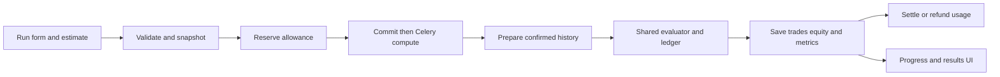

# Backtesting: complete workflow and technical reference

Reviewed against the source on 23 October 2026. This guide describes the implemented engine. Examples illustrate mechanics; they are not performance or profitability claims.

## Contents

- [Purpose and boundaries](#purpose-and-boundaries)
- [Create and run a backtest](#create-and-run-a-backtest)
- [API and admission](#api-and-admission)
- [Historical data preparation](#historical-data-preparation)
- [Compilation and rule evaluation](#compilation-and-rule-evaluation)
- [Replay, orders and fills](#replay-orders-and-fills)
- [Sizing, capital and charges](#sizing-capital-and-charges)
- [Results and Monte Carlo](#results-and-monte-carlo)
- [Operations and troubleshooting](#operations-and-troubleshooting)
- [Source map and extension points](#source-map-and-extension-points)

## Purpose and boundaries

Backtesting evaluates a saved strategy over historical candles with simulated capital. It shares compilation, rule evaluation, order matching and financial calculations with Paper/Live execution. Its market clock is historical and its prices inside a candle are synthetic.

The shared kernel does **not** make an OHLC backtest equivalent to actual tick replay or broker execution. Historical candles do not reveal the real sequence of transactions, liquidity, queue position or broker rejections.

Related guides: [strategy authoring](strategy-configuration.md), [Paper](paper-trading.md), [Live](live-trading.md), [Terminal](trading-terminal.md), [allowance administration](commercial-operations.md).

## Create and run a backtest

### 1. Prepare the strategy

In Strategy Lab, create a strategy and configure its instruments, entry direction/order, position sizing, entry schedule and active rule groups. Configure stop-loss, target and exit rules as needed. Save a version when you want an explicit reproducible configuration.

The execution configuration contains:

| Configuration | Responsibility |
| --- | --- |
| Watchlist and execution routes | Identify instruments and resolve the side/sizing used for each instrument |
| Entry configuration | Direction and entry order behaviour |
| Time rule | Entry weekdays, dates/time window and timezone |
| Position sizing | Convert the sizing rule and available capital into valid quantity |
| Rule groups | ENTRY, STOP_LOSS, TARGET and EXIT conditions |
| Exit configuration | Configure the exit order; strategy exits request the full position |

Automated snapshots use DIRECT routing to the selected catalogue instrument. Admission requires an active, tradable instrument and excludes indices, mutual funds and underlying-reference instruments. Historical coverage, contract validation and supported data adapters still determine what can actually be replayed; a derivative enum alone is not proof of usable history or dynamic contract selection.

Instrument identity is its database relation and unique `sym_ticker`. Display names are not identifiers. Saving a strategy is separate from deploying it. A backtest does not create a Paper or Live session.

### 2. Choose the run inputs

Open the backtesting feature and select the strategy/configuration to test. Set start/end dates, initial capital, slippage and whether to include charges. If charges are enabled, select an owned charge profile. Review any supported parameter overrides before estimating.

The backend rejects reversed/future date ranges, nonpositive capital, invalid slippage, foreign charge profiles and malformed overrides. Date-range workload estimation also bounds the span. A run keeps a configuration and charge-profile snapshot, so editing the current strategy/profile does not silently change that run.

The ordinary create/estimate endpoint snapshots the current editable strategy; `strategy_version` is read-only in its serializer. A rerun uses the original run's effective frozen configuration and charge snapshot. Do not send a different version ID and assume it overrides this contract.

### 3. Review usage, create and start

Request the workload estimate, review the credits/source data involved, then create and start the run through the UI. Creation reserves usage; starting queues execution. These are separate backend actions, even when the screen performs them consecutively.

Watch progress in the backtest workspace. On completion, inspect trades, equity, metrics, data quality and diagnostics. Cancel through the application if the run is no longer needed. A rerun creates another run rather than overwriting the original results.

### 4. Use the result

Compare runs using identical dates, configuration, initial capital, slippage and charge assumptions. Inspect individual trades before relying on aggregate ratios. To practise with current observations, deploy the chosen saved version from the strategy list to [Paper](paper-trading.md).

## API and admission

All paths below are authenticated and scoped to the owner. The prefix is `/api/v1/backtest/` (singular).

| Action | Endpoint |
| --- | --- |
| List/create a run | `GET/POST runs/` |
| Read/delete a run | `GET/DELETE runs/{id}/` subject to lifecycle restrictions |
| Review workload | `POST runs/estimate/` |
| Start an existing pending run | `POST runs/{id}/start/` |
| Estimate/recreate a rerun | `POST runs/{id}/estimate-rerun/`, `POST runs/{id}/rerun/` |
| Cancel | `POST runs/{id}/cancel/` |
| Results | `GET runs/{id}/trades/`, `equity_curve/`, `metrics/` |
| Monte Carlo | `GET/POST montecarlo/`, then `POST montecarlo/{id}/start/` |
| Monte Carlo results/cancel | `GET montecarlo/{id}/results/`, `POST montecarlo/{id}/cancel/` |

See [views](../backend/backtesting/views.py), [serializers](../backend/backtesting/serializers.py) and [routes](../backend/backtesting/urls.py) for exact payloads and filters.

`create_backtest()` locks the user/strategy, validates ownership and the effective execution snapshot, captures costs and saves the run. When using the current strategy rather than a linked version, it creates the corresponding version snapshot. `backtest_configuration()` produces the effective configuration by applying the run's overrides to its frozen base.

`reserve_usage()` is the common commercial admission function. Backtest pricing uses the estimated source workload and the reviewed estimate token. The key/payload prevents a reservation being reused for different work. The quota categories are:

| Deployment mode | Behaviour |
| --- | --- |
| Public | Enforce period credits and per-request source-candle limits |
| Development | Record usage without numeric enforcement |
| Private | No numeric quota/usage buckets; personal deployment with ordinary input and ownership validation |

The reservation counts while work is pending. Success settles it; failure/cancellation releases it through common completion handling. Queue publication failure is also handled there. The numerical replay does not repeatedly check the subscription or debit credits.

`start_backtest()` changes PENDING to QUEUED and uses `queue_compute_work()` to publish after transaction commit. The task conditionally claims QUEUED as RUNNING; duplicate task delivery must not start a second simulation of an already claimed run.

## Historical data preparation

`BacktestEngine.load_data()` resolves saved instrument IDs, loads each instrument's exchange/segment calendar, calculates required timeframes and indicator warmup, and calls `prepare_frames()`.

The data path is:

1. `strategy_requirements()` identifies the operand sources/timeframes and required completed-bar depth.
2. `source_windows()` expands the requested period far enough for warmup, using the market calendar.
3. `prepare_frames()` obtains confirmed one-minute/daily source data through the common history service.
4. `ensure_history()` fetches missing provider windows under a source lock and request budget. Valid rows and successful coverage are persisted together.
5. Calendar-aware aggregation produces the requested strategy timeframes.
6. `candles_from_frame()` creates typed candles and `contract_from_instrument()` prepares contract facts.
7. The engine checks that coverage is complete, frames are nonempty and enough candles completed before the test start.

`HistoryCoverage` records successful acquisition windows. It is not a promise that every minute contains a trade. Provider errors are not treated as successful empty history. Historical data stays in TimescaleDB; the replay receives prepared data rather than querying the database for every evaluation.

Internal historical ranges are timezone-aware `[start, end)`. The engine derives date boundaries using the market/strategy timezone. Intraday aggregation respects exchange/segment opening times, breaks, holidays and overnight sessions. Daily/weekly/monthly sources use the daily family; intraday intervals use minute sources.

An incomplete warmup fails the run visibly instead of allowing indicators to start from arbitrary zeros. `data_quality` retains per-instrument acquisition information and the simulation policy.

## Compilation and rule evaluation

`compile_strategy()` converts validated JSON into a `Program` containing operands, rules, groups, schedule and execution requirements. `FeatureGraph` registers required indicator calculations and stores completed history. `EvaluationUnit` owns the rule state for one `(BACKTEST, run, instrument)`.

| Input | Meaning |
| --- | --- |
| LTP | Current observed price; in backtesting this is a synthetic OHLC observation |
| CLOSE and candle values | Completed candle values available at that event time |
| Indicators | Features computed from their configured completed-candle sources |
| Position operands | The unit's acknowledged position state |
| Cross comparisons | Compare sequential operand samples; they require a previous sample |

Rules are evaluated through the same `EvaluationUnit.evaluate()` logic used by running strategies. An open position is checked for protective/exit conditions; new entry conditions apply when the unit is eligible to enter. Pending intents and position revisions prevent duplicate signals from opening the same exposure twice.

The schedule's end time stops **new entries**. It is not an automatic intraday square-off time. Existing positions remain subject to configured exit rules. The end-of-backtest close described below is a distinct simulation policy.

Each instrument has independent rule and position state. Instruments share the simulated account's funds, so simultaneous signals can compete for remaining capital. Historical events are merged chronologically with deterministic tie ordering; the replay does not pretend all same-time signals have unlimited capital.

## Replay, orders and fills

`Replay._events()` merges completed-candle events and synthetic observations. For the strategy side, the assumed path is **open → adverse extreme → favourable extreme → close**. A long-side candle visits low before high; a short-side candle visits high before low. The extreme timestamps are synthetic.

`Replay._observe()` first matches previously admitted orders, updates financial/position state, and then evaluates the strategy. Consequently, a new order cannot fill on the exact observation that generated it. A decision based on a completed candle can fill no earlier than a later observation, normally the next bar.

| Order | BUY behaviour | SELL behaviour |
| --- | --- | --- |
| Market | Eligible next observation | Eligible next observation |
| Limit | Price at or below limit | Price at or above limit |
| Stop Market | Trigger at or above stop, then market | Trigger at or below stop, then market |
| Stop Limit | Trigger first, then respect buy limit | Trigger first, then respect sell limit |

This table describes the shared matcher. The current automated strategy builder admits MARKET entries; the manual Terminal exposes all four types. A general matcher capability is not an additional strategy route/order feature.

`OrderBook` indexes working orders. `match_order()` applies trigger state, price conditions, tick rounding and adverse simulated slippage without violating a limit price. A stop-limit can activate and still remain unfilled. No matching code invents missing liquidity observations between the supplied synthetic points.

Example: a completed 5-minute CLOSE crosses above a moving average at 10:00. The signal is evaluated with that completed bar. The resulting market order becomes eligible on the following observation, rather than receiving the same candle's closing price automatically.

At `Replay.finish()`, unfilled orders are cancelled. Residual positions are explicitly closed using the last completed candle price with configured slippage and charges. Trades identify this as `END_OF_BACKTEST`; do not interpret it as a strategy-generated exit.

## Sizing, capital and charges

`size_order()` applies the saved sizing rule and instrument lot/tick constraints. `accept_intent()` checks current position/version/pending state and available capital before creating an order. `apply_fill()` adjusts cash, reserved/position margin, quantity, average price and completed trade data.

The numerical ledger uses typed contracts and Decimal financial values. Contract multipliers and segment semantics affect turnover; a derivatives quantity is not interchangeable with a number of lots. Rule evaluation and reporting may use floating-point numerical arrays where appropriate.

`TradingCostCalculator` owns brokerage, transaction taxes, exchange/SEBI fees, stamp duty and GST calculations using the run's profile snapshot. Actual entry/exit dates determine same-day versus delivery tax classification. Strategy type does not force an INTRADAY broker product; instrument classification selects CNC or MARGIN in execution contracts.

Charges are calculated for the completed trade, not shown as a guaranteed charge at admission. When charges are disabled, the replay receives an empty charge profile. Slippage changes fill price and is reported separately; do not subtract it again from an already slipped trade's P&L.

Illustrative stock trade: buy 10 at 100, sell 10 at 105 gives gross P&L 50 before configured charges. Net P&L is gross minus the calculated round-trip fees. This example assumes a unit multiplier of one and excludes price slippage.

## Results and Monte Carlo

### Stored results

| Record | What it stores |
| --- | --- |
| `BacktestRun` | Owner, configuration/version, dates, costs, status, progress, quality and diagnostics |
| `BacktestTrade` | Instrument, direction, prices/times, quantity, gross/net P&L, fees, MAE/MFE and reason |
| `EquityCurvePoint` | Replay equity and drawdown at recorded boundaries |
| `BacktestMetrics` | Aggregate performance calculated after replay |

The engine bulk-writes results, calculates metrics and marks the run COMPLETED. It publishes throttled progress and final events through the backtest consumer/user group. These messages update presentation; they are not financial state.

Metrics include win/loss counts and streaks, win rate, profit factor, expectancy, holding duration, final capital, returns, drawdown, monthly returns and per-instrument results. Sharpe/Sortino/volatility derive from daily equity returns; annualization currently uses 252 trading days. Undefined ratios may be null. CAGR over a very short sample is especially sensitive to the chosen period.

Backtest results are separate from the Terminal/Paper/Live journal sources. They are not deposited into a user's trading wallet or counted as realized Live profit.

### Monte Carlo

Choose a completed owned backtest with trades, set simulations/confidence, review the relevant allowance and start. `MonteCarloSimulator.run_simulation()` bootstraps recorded **net trade P&Ls with replacement** in chunks of 128. Its seed comes from the Monte Carlo run ID.

Outputs include terminal-capital/return/drawdown distributions, win rate, profit factor, expectancy, a **per-trade** Sharpe ratio, percentiles and a histogram. Minimum simulations are 100; confidence is 90–99%, with additional Public per-request and period limits.

This resamples outcomes. It does not re-evaluate market rules, reconstruct liquidity or prove future market probabilities. Cancellation and failure use the same completion/refund infrastructure.

## Operations and troubleshooting

Backtests require the API, PostgreSQL/TimescaleDB, configured Redis/Celery services, the compute worker and a valid history-provider connection when data must be fetched. They do not require a running live execution worker for historical replay. Follow the selected [infrastructure deployment guide](../infra/README.md) for exact worker commands and environment files.

| Symptom | Inspect first |
| --- | --- |
| PENDING indefinitely | The start action has not been accepted |
| QUEUED indefinitely | Celery compute queue/worker and publication logs |
| History/warmup failure | Provider authorization, contract/date availability, calendar and `data_quality` |
| No trades | Active entry groups, operand readiness, schedule, routing, sizing and rejection diagnostics |
| Unexpected price | OHLC path, next-observation rule, slippage and limit behaviour |
| Different rerun | Frozen snapshot/overrides, changed provider history, dates and charge assumptions |
| Cancel not immediate | Replay checks cancellation periodically (currently throttled to five seconds) |
| Usage still reserved | Final status and common completion handling, not a manual debit in the engine |

## Source map and extension points

| Source | Methods and reason |
| --- | --- |
| [Frontend backtesting feature](../frontend/src/features/backtests) | Forms, progress, result inspection and Monte Carlo presentation |
| [Services](../backend/backtesting/services.py) | `create_backtest`, `start_backtest`, `estimate_source_workload`, frozen configuration and notifications |
| [Tasks](../backend/backtesting/tasks.py) | Claim queued work and run orchestration outside HTTP |
| [Engine](../backend/backtesting/engine.py) | `load_data`, `run_simulation`, `_finalize_run`, reporting and cancellation boundaries |
| [Replay](../backend/execution/replay.py) | Historical clock adapter for the shared numerical kernel |
| [Compiler](../backend/execution/compiler.py), [evaluator](../backend/execution/engine.py) | Compile once and evaluate typed rules |
| [Matching](../backend/execution/matching.py), [ledger](../backend/execution/ledger.py) | Shared order and financial semantics |
| [History](../backend/marketdata/history.py), [candles](../backend/marketdata/candles.py) | Confirmed source acquisition and calendar-aligned aggregation |
| [Usage](../backend/commercial/usage.py) | Admission, reservation and terminal-outcome accounting |

Add an operand in shared compiler/evaluation/metadata validation, not only in the backtest engine. Add a matching rule in the shared matcher. A different historical simulation policy belongs in the replay adapter and must be recorded in results. Keep provider I/O and ORM reporting outside numerical evaluation.
