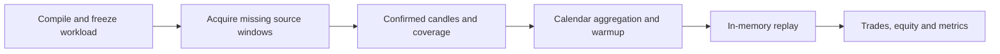

# Backtesting: complete user and technical guide

**Source reviewed: 7 November 2026.** This guide describes the current checkout,
including its simulation assumptions. It replaces the earlier backtest plans and
dated trade audits. It is not a claim of real broker execution or future returns.

Use [Strategy Studio](strategy-configuration.md) for the complete rule language,
all inputs/operators, contract policies, capture/re-entry, schedules and worked
strategy definitions. This guide owns the historical-data and replay adapter.

## Contents

1. [Scope and prerequisites](#scope-and-prerequisites)
2. [Create, preview and start a backtest](#create-preview-and-start-a-backtest)
3. [Snapshots, admission and credits](#snapshots-admission-and-credits)
4. [Historical data preparation](#historical-data-preparation)
5. [Stocks and derivative contracts](#stocks-and-derivative-contracts)
6. [Replay, orders and fills](#replay-orders-and-fills)
7. [Rules, sizing and schedules](#rules-sizing-and-schedules)
8. [Charges, settlement and equity](#charges-settlement-and-equity)
9. [Read results and metrics](#read-results-and-metrics)
10. [Monte Carlo](#monte-carlo)
11. [Cancellation, deletion and reruns](#cancellation-deletion-and-reruns)
12. [Frontend and API contracts](#frontend-and-api-contracts)
13. [Implementation ownership](#implementation-ownership)
14. [Worked examples](#worked-examples)
15. [Operations and troubleshooting](#operations-and-troubleshooting)
16. [Verification and limits](#verification-and-limits)

## Scope and prerequisites

Backtesting runs a saved strategy configuration against provider-confirmed
historical candles. It uses the same compiled expressions, setup state, sizing and
financial kernel as running strategies, with a historical observation generator.

| Supported | Current boundary |
| --- | --- |
| Fixed stock/ETF and qualified derivative instruments | Exact instrument identity, orderability and economic terms must be available |
| Automatic future/option selection | Underlying prices drive configured expiry and strike policies; the exact selected contract needs its own prices |
| Multiple instruments and signal/traded instrument separation | Each strategy unit owns its position and setup state; account capital is shared |
| Indicators, formulas, rolling windows, LTP and capture/confirmation | Historical LTP means a simulated OHLC observation; it is not recorded exchange tick replay |
| Costs, slippage, equity, trade metrics and Monte Carlo | Simulation assumptions remain visible in saved configuration/data quality |
| Reviewed derivative settlement inputs | No invented official prices, physical delivery or automatic rollover |

Before starting:

1. Create a strategy and save its Studio changes. Validate its current definition.
2. Confirm the instrument, signal source, entry direction, size and schedule.
3. Configure a charge profile if charges are enabled.
4. Configure a working historical-data provider connection and exchange calendars.
5. Run the API and a Celery worker consuming `compute`; keep Redis/PostgreSQL
   available. Initial data acquisition may use the provider even if some history
   already exists locally.

**`python -m quantnest_runtime execution` is not needed for backtests.** Backtests
execute in the Celery task. The market-data runtime is needed for live observations,
not as the backtest replay clock. Exact environment and worker commands are in
[infrastructure](../infra/README.md) and [integration setup](../infra/shared/INTEGRATIONS.md).

## Create, preview and start a backtest

From **Strategy Lab → Backtesting Lab → New Backtest**:

1. Select an owned strategy. The form shows its identifying information.
2. Enter a useful run name and inclusive start/end dates. The backend translates
   these dates into timezone-aware replay windows. End cannot precede start or
   be in the future; the workload estimator caps the requested span at 3,660 days.
3. Enter positive initial capital and slippage from zero to less than 100 percent.
   Small values are normal assumptions; the accepted range is not a recommendation.
4. Choose an owned charge profile, or disable simulated charges.
5. Select **Preview workload and credits**. This compiles the effective definition,
   resolves required markets/history and returns the acceptance estimate.
6. Review the estimated workload and assumptions. If the strategy or dates change,
   get a fresh preview.
7. Submit and start. The create operation produces `PENDING`; start atomically
   changes it to `QUEUED` and schedules the existing compute queue.
8. Follow the progress message, then inspect results, trades and charts.

The UI's status and progress mean different things:

| Status | Meaning |
| --- | --- |
| `PENDING` | Saved and admitted, but not yet queued |
| `QUEUED` | Waiting for a compute worker; other backtests/research can delay it |
| `RUNNING` | Worker owns the run; history preparation and replay occur here |
| `COMPLETED` | Final trades, metrics and curve were saved successfully |
| `FAILED` | Work stopped with an error; inspect the recorded message |
| `CANCELLED` | Cancellation accepted; an already running worker still needs to observe it and finish cleanup |

Progress is stage based. History acquisition occupies roughly 1–15%, frame
preparation 15–21%, replay 22–94%, and saving the remaining portion. A provider
request can leave the percentage unchanged while its progress message remains
useful. `RUNNING` at 1% is not evidence that rule evaluation is slow.

## Snapshots, admission and credits

`create_backtest()` locks the user/strategy boundary and freezes the effective
configuration. A run does not read the mutable Studio definition on every bar.

- The normal create path captures the strategy's current saved definition and
  associates a version snapshot. `strategy_version` is output, not an arbitrary
  client-controlled replacement for the validated snapshot.
- The accepted effective configuration includes validated parameter overrides
  where supplied by an integration. The standard UI exposes its own form fields;
  arbitrary JSON overrides are not a separate visual builder.
- Cost rates are copied into a charge-profile snapshot. Editing/deleting a user's
  profile later does not rewrite an existing run's rates.
- The workload preview signs the user/configuration/date/workload acceptance.
  Creation verifies it and retains the accepted contract/history plan.
- Admission reserves the estimated backtest credits. Successful work settles that
  reservation; failed/cancelled work releases it through the completion handler.
- Duplicate task deliveries cannot rerun a run already claimed from `QUEUED`.
  Accounting settlement also has its own idempotent state transition.

| Deployment mode | Commercial behavior |
| --- | --- |
| Public | Enforce the account's period credits and applicable request limits |
| Development | Record allowance usage without enforcing commercial caps |
| Private | Bypass commercial quota recording/enforcement; keep correctness, ownership, data and funds checks |

The same `commercial/usage.py` functions serve all callers. Workers do not
repeatedly check a subscription or reserve credits inside candle evaluation.
Current limits come from the account/catalog; do not copy a plan's number into the
engine. See [commercial operations](commercial-operations.md).

## Historical data preparation



The common data path is:

1. `backtesting/preparation.build_plan()` compiles the actual inputs and determines
   required source history, warmup and candidate contract windows.
2. `acquire_plan()` fetches bounded independent windows with limited concurrency.
   Provider requests share the platform's rate/budget controls.
3. `marketdata/history.ensure_history(HistoryRequest(...))` checks stored coverage
   and requests only missing completed source ranges.
4. Provider rows are validated for identity, timestamp, range, OHLC and volume.
   Confirmed candles and successful coverage commit together. Invalid rows are
   excluded and recorded; a failed request is not marked successfully covered.
5. `marketdata/candles.prepare_frames()` reads the confirmed source rows and
   builds requested timeframes with the shared segment calendar.
6. `execution/preparation.compile_markets()` supplies the feature graph and
   prepared markets; replay then runs without ORM/provider calls in its clock.

### What HistoryCoverage means

Coverage records **which provider/source window was successfully acquired**,
including a successful empty response. It does not assert that an illiquid
instrument traded in every minute. It prevents repeated downloads of a known
empty window while leaving failed requests eligible for retry.

`Candle` is the price record; coverage is acquisition evidence. Display quote
caches and live tick buffers have separate responsibilities and cannot substitute
for confirmed historical candles.

### Completion clocks and warmup

- Source rows are indexed by opening time. A bar becomes available to a rule only
  at its calculated completion time.
- Intraday buckets are anchored to the exchange/segment session, including breaks,
  holidays and special sessions. Daily/weekly/monthly buckets use those calendars.
- Higher timeframe values cannot use the current unfinished candle's eventual
  high/low/close.
- The compiler derives the needed history from indicator periods, shifts,
  arithmetic, rolling windows, crossings and setup expressions.
- Warmup precedes the requested trade interval. Warmup bars prepare values rather
  than create trades before the requested start.
- Missing/invalid history is reported. The system does not forward-fill imaginary
  trades merely to make a dense minute grid.

## Stocks and derivative contracts

### Fixed instruments

A fixed route trades the exact saved `instrument_id`; `sym_ticker` is its unique
provider/platform symbol. Names are display labels. A fixed expired future/option
can be replayed over its valid life when the provider supports its history.
It does not silently become the current contract.

### Automatic selection

For an automatic route, preparation resolves the configured underlying, family,
option right, expiry policy and strike rule. Historical underlying observations
choose the expiry/strike using the same selection logic as running execution.
The selected contract supplies execution prices; the underlying supplies signal
prices when configured.

The selector uses actual catalogued/provider-discovered expiries and strikes.
ATM/ITM/OTM offsets move through the listed strike grid; CE and PE moneyness have
opposite directions. A third ITM policy means three grid steps into the money,
not three arbitrary price points. An unavailable exact candidate is not replaced
with a different strike to force a trade.

An open position or working order pins its contract. A later entry, once flat,
can select another contract. Independent routes are not an atomic spread or
coordinated basket; automatic rollover is not implemented.

### Expired discovery and economic assumptions

The provider adapter can discover expired contracts and fetch their historical
prices. `instruments/history.py` links exact historical identities to the underlying;
current live tokens are not invented for history-only instruments.

Price history and contract economics are separate:

| Input | Source/policy |
| --- | --- |
| Expiry, right, strike, historical contract prices | Exact contract discovery/history |
| Lot, tick, multiplier, freeze quantity | Prefer sourced dated `ContractSpecification` rows |
| Missing/changing dated terms | The accepted plan can use an explicit current-template assumption and records its source/warnings |
| Historical strike availability | Reconstructed per-expiry grid; historical listing timestamps are not a point-in-time universe |
| Settlement | Reviewed imported record if available; missing daily MTM is not manufactured |

Using today's lot size with an expired contract's actual prices is supported as
a declared simulation assumption. It is not proof that the same units/notional
could have been traded historically. Lot changes, corporate actions and a
retrospective strike universe can materially affect results.

For better dated terms, import reviewed evidence from `backend`:

```powershell
python manage.py import_contract_specifications C:\data\contract-terms.json --dry-run
python manage.py import_contract_specifications C:\data\contract-terms.json
```

Exact format; all market values below are illustrative:

```json
{
  "schema_version": 1,
  "source": "Reviewed exchange contract specification reference",
  "specifications": [{
    "sym_ticker": "NSE:REPLACE_WITH_ACTUAL_CONTRACT",
    "effective_at": "2026-01-01T00:00:00+05:30",
    "lot_size": 50,
    "tick_size": "0.05",
    "qty_multiplier": "1",
    "qty_freeze": 1000,
    "strike_price": "24000",
    "expiry_date": "2026-01-29"
  }]
}
```

The instrument must already exist with its sourced identity. Decimal strings
preserve precision; a future can use `strike_price: null`. Imports validate the
whole batch and reject conflicting evidence rather than overwrite it silently.

## Replay, orders and fills

### Historical observations

`execution/replay.py` advances a common clock over prepared bars and events.
Within a base candle it generates an explicit OHLC path:

| Entry direction | Simulated path |
| --- | --- |
| Buy | Open → low → high → close |
| Sell | Open → high → low → close |

The extreme ordering is a declared simulation choice. It does not recover which
extreme really happened first. A one-minute candle assigns the interior
observations approximately 20 and 40 seconds into the interval. Those timestamps
explain second-precision entries/exits despite one-minute source history.
They are synthetic observation times, not a timestamp-conversion bug or measured
exchange fills. No continuous price interpolation occurs between OHLC points.

### Current fill policy: signal quote

Studio strategies currently generate market orders. On a valid entry/exit signal:

1. Resolve the **traded contract's** quote available at that replay clock.
2. Admit the intent through the shared account/funds/contract checks.
3. Execute at that signal reference price, adjusted for configured slippage and
   legal tick rounding.
4. Apply the fill, position, cash, costs and diagnostics before continuing replay.

There is no deliberate wait for a later candle high, low, close or next open after
the signal. The replay adapter supplies a local eligible execution sequence at the
same signal time/price; it does not insert another market observation into the
strategy evaluator.

For example, an exit signalled at 196.22 with zero slippage and an allowed tick
executes at 196.22. A later synthetic high of 196.38 cannot replace that exit price.
Tick size can still change a nonconforming reference into a valid execution price.

This policy differs from [Paper matching](paper-trading.md#tick-to-decision-to-fill):
Paper waits for a later eligible real observation. Live fills come from the broker.
Sharing numerical rules does not make these observation/fill models identical.

### Completed-bar signals and price gaps

Completed-bar rules become evaluable only after the bar closes. The replay cannot
trade before that completion. For an LTP confirmation, the condition is tested at
each available synthetic quote; a gap can satisfy it at the next open.

If a saved setup captured the previous session's high and remains unexpired, an
opening quote above that high can confirm at the open. If the quote is below it,
the next sampled high may be the first observation satisfying the comparison.
The engine does not invent an unseen exact crossing between open and high.

## Rules, sizing and schedules

The shared `compiler.py` builds dependency graphs from the saved document, with
reusable indicator/window calculations. `engine.EvaluationUnit` owns crossings, captured
values and position-dependent state for one `(mode, session_id, route_id, leg_id)`.

| Behavior | Replay meaning |
| --- | --- |
| Simple entry comparison | Evaluated when its dependencies update; can enter again while true once flat |
| Capture/confirmation | Known false→true arm, capture immutable values, confirm on a later observation; honor setup expiry |
| Open position | STOP_LOSS, then TARGET, then EXIT priority; strategy exits close its full quantity |
| Position operands | Refer to that route's traded position, never the signal index's imaginary position |
| Fixed units | Exact positive units and, for derivatives, a whole multiple of lot size |
| Fixed lots | Number of lots × selected contract lot size |
| Capital based | Percentage of available budget, rounded down to whole tradable lots |
| Entry schedule | Exchange/segment session, configured timezone, weekdays, windows and entry count constraints |
| Entry end | Stops new entries; does not mean automatic intraday square-off |

Long options use premium as the capital basis. Futures and option writing use the
configured simulation collateral model, not a broker SPAN/portfolio margin quote.
One account serializes reservations across instruments; capital is not duplicated
per route. A condition match can therefore be rejected for insufficient capital,
invalid units, absent contract prices or another admission constraint.

All detailed semantics and examples are in
[Studio rules](strategy-configuration.md#6-conditions-groups-and-decision-order)
and [capture/re-entry](strategy-configuration.md#10-capture-and-confirmation).

## Charges, settlement and equity

`execution/ledger.py` applies fills and the shared `common/costs.py` calculations.
Entry lots retain their opening timestamps and frozen cost assumptions. On close,
the system computes the applicable simulated round-trip charges, including the
same-session equity intraday/delivery distinction and segment-specific STT/CTT.
The order product label alone does not determine the holding-period charge basis.

Adverse slippage changes execution prices. Reported slippage amounts describe that
effect; do not subtract the same amount from already adjusted net P&L a second time.

```text
Gross P&L = direction × (exit − entry) × units × contract multiplier
Net P&L   = gross P&L − applied closing/round-trip charges
Equity    = account cash plus the account model's residual open-position value
```

Futures residual open P&L excludes previously paid `settled_pnl`. A daily settlement
cash movement must not be added again to the closed trade's lifetime P&L.

Reviewed daily/final settlement records are merged at `available_at`, when the
source became known, rather than exposing an evening report at its earlier cutoff.
Missing daily MTM is not fabricated. If qualified final settlement is unavailable,
the current backtest policy simulates liquidation at the last observed contract
candle by expiry, labels the policy, and records warnings. Residual positions at
the end of a test close at their last completed price with costs/slippage.

For import format, cash examples and supported product families, see
[derivative settlement in the Paper guide](paper-trading.md#derivative-settlement).
Physical delivery, exercise/assignment and commodity devolvement are not simulated.

## Read results and metrics

Open the completed run to inspect its saved effective configuration, data quality,
progress/outcome, metrics and equity. Open **Trades** for server-filtered trades
and **Charts** for equity/drawdown analysis. Research review can attach the completed
run without granting the AI permission to change it.

| Metric group | Definition/interpretation |
| --- | --- |
| Trade counts | Wins/losses/breakeven use net trade P&L, not gross price movement |
| Win rate | Winning closed trades / all closed trades |
| Average win/loss | Mean positive/negative net trade respectively; loss is negative |
| Profit factor | Sum of positive net P&L / absolute sum of negative net P&L |
| Expectancy | Mean net P&L per trade |
| Payoff ratio | Average win / absolute average loss |
| Return | `(final capital − initial capital) / initial capital` |
| Drawdown | Decline from the running equity peak, in money and percent |
| Recovery factor | Net profit / maximum drawdown amount |
| Sharpe | Daily equity-return mean / sample standard deviation, multiplied by √252; no risk-free offset |
| Sortino | Daily mean return / root mean squared negative daily returns, multiplied by √252 |
| Volatility | Daily return standard deviation × √252, displayed as percent |
| CAGR / Calmar | Annualized growth from elapsed test duration; Calmar relates CAGR to drawdown |
| MAE / MFE | Adverse/favorable excursion over sampled observations, in position money terms |
| Trade efficiency | Mean net P&L / MFE where MFE is nonzero; not a guaranteed 0–100% score |
| Breakdown | Monthly equity returns and instrument-level trade/P&L summaries |

Daily statistics resample observed equity to daily last values in the strategy
timezone. They do not describe an intraday latency distribution. Short runs, sparse
observations and zero variance can make annualized ratios uninformative. Undefined
ratios remain null/N/A instead of becoming fake infinity/zero.

Trade rows retain route/leg ownership, side, units, exact entry/exit timestamps,
prices, gross/net P&L, charges, excursions and exit reason. Holding duration in
minutes is an integer projection; seconds in the underlying times remain meaningful
within the simulation model.

## Monte Carlo

Monte Carlo starts from an owned **completed backtest with at least one trade**.
Choose the simulation count and outcome interval, then start the run. The serializer
requires at least 100 simulations and confidence-level input between 0.90 and 0.99;
the account's per-request simulation allowance can impose a lower maximum.

The implementation bootstraps the saved **net trade P&L** values with replacement.
Each synthetic path has the original number of trades and starts with the original
capital. It does not refit the strategy, replay new candles, recalculate position
sizes, enforce new margin paths or model serial dependence/regime shifts.

- A deterministic random generator seeded from the Monte Carlo run ID makes that
  saved run repeatable. Different run IDs produce different samples.
- Work runs in bounded chunks rather than keeping every full path simultaneously.
- Results include terminal capital, total return, maximum drawdown, win rate,
  per-trade Sharpe, profit factor and expectancy, plus terminal-capital distribution.
- Per-trade Sharpe is not the daily annualized Sharpe of the original backtest.
- Each metric reports its valid simulation count; undefined metrics are not
  silently included as zeros.
- Percentile outcome bounds describe these resampled outcomes, not guaranteed
  future returns or a statistical confidence interval for all market conditions.

Monte Carlo consumes its own run allowance. Cancellation is available while
`PENDING`/`QUEUED`; the current API rejects cancellation after it starts running.

## Cancellation, deletion and reruns

Backtest cancellation checks occur during preparation/replay and before final
commit. A provider call already in progress still has its transport timeout.
The final transaction locks the run and will not overwrite a cancellation with
`COMPLETED`. Failed/cancelled runs release their reservation.

Deletion is blocked while queued/running and while a started worker has not
acknowledged completion, including a newly cancelled run. Wait for cleanup rather
than deleting an active worker's records.

**Rerun preserves the old run's effective snapshot and frozen costs.** It creates
a new run, obtains/validates workload acceptance and charges it independently.
It does not automatically use today's Studio edits. Create a new backtest from
the strategy to test the latest saved definition.

## Frontend and API contracts

The list uses shared server pagination and filters. Common pagination accepts
`page` and `page_size` (10/25/50/100; default 25), returns `count`, `page`,
`page_size`, `next`, `previous`, `results`, and clamps a now-out-of-range page to
the last page. Summary endpoints operate on their full filtered population.

Authenticated prefix: **`/api/v1/backtest/`**.

| Method/path | Purpose |
| --- | --- |
| `GET runs/`, `GET runs/summary/` | Search/filter list and aggregate counts |
| `POST runs/estimate/` | Workload, assumptions and signed acceptance |
| `POST runs/` | Create frozen `PENDING` run |
| `GET runs/{id}/` | Owned run, metrics, configuration and diagnostics |
| `POST runs/{id}/start/` | Queue once |
| `POST runs/{id}/cancel/` | Request cancellation |
| `POST runs/{id}/estimate-rerun/`, `POST runs/{id}/rerun/` | Preview and start a new run from the old effective configuration |
| `DELETE runs/{id}/` | Delete eligible inactive run |
| `GET runs/{id}/trades/` | Paginated/filterable trades and instrument options |
| `GET runs/{id}/metrics/`, `GET runs/{id}/equity_curve/` | Metrics and chart projection |
| `GET/POST montecarlo/`, `GET montecarlo/{id}/` | Simulation list/create/detail |
| `POST montecarlo/{id}/start/`, `POST montecarlo/{id}/cancel/` | Queue/cancel where allowed |
| `GET montecarlo/{id}/results/` | Metric outcome summaries |

There is no edit endpoint for an accepted backtest. Large trade tables are not
embedded into each detail refresh. Equity curve responses are downsampled for
rendering; they are a projection of the saved run, not new market data.

## Implementation ownership

Backend paths below are relative to `backend/`. Start at
[`backtesting/services.py`](../backend/backtesting/services.py) for acceptance,
[`backtesting/engine.py`](../backend/backtesting/engine.py) for orchestration and
[`execution/replay.py`](../backend/execution/replay.py) for the historical clock.

| File/symbol | Responsibility and reason |
| --- | --- |
| `backtesting/views.py` | HTTP ownership, filters, start/cancel/rerun actions |
| `backtesting/serializers.py` | Request dates/capital/cost ownership and output contracts |
| `backtesting/services.create_backtest`, `backtest_configuration`, `start_backtest` | Immutable acceptance and transport-independent lifecycle |
| `commercial/usage.estimate_backtest_workload`, `reserve_usage`, `complete_usage` | One admission/accounting boundary shared with other callers |
| `backtesting/tasks.py` | Celery claim, run, outcome handling |
| `backtesting/preparation.build_plan`, `acquire_plan`, `restore_plan` | Freeze/acquire exact dependencies without hot-path I/O |
| `marketdata/history.py`, `candles.py`, `calendar.py` | Shared verified source data and bucket clocks |
| `instruments/history.py`, `selection.py`, `specifications.py` | Historical identities, selection and dated economics |
| `execution/compiler.py`, `expressions.py`, `features.py`, `engine.py` | Shared numerical rule behavior |
| `execution/replay.Replay` | Synthetic clock and same-observation signal fills |
| `execution/ledger.py`, `matching.py`, `settlements.py` | Financial transitions, tick rounding and settlement |
| `backtesting/engine.BacktestEngine` | Data quality, replay orchestration, atomic save and statistics |
| `backtesting/monte_carlo.py` | Resampling of completed net trade outcomes |
| `frontend/src/features/backtests/pages/` | Setup, list, progress/results, trades, charts and Monte Carlo |

## Worked examples

### Same-price signal execution

Assume a stock long entry signals at 100.00, exit at 101.20, 10 units, multiplier
one, no slippage. Gross P&L is 12.00. If the frozen profile produces 2.30 in total
charges, net P&L is 9.70. A later candle high cannot change either execution price.

### Lots and automatic contract prices

An automatic ATM CE entry selects an actual listed call priced at 120.00 with
lot size 30. Two lots become 60 order units. The signal index may be at 57,000;
that index price is not used as the call's execution price. At a 125.00 exit,
gross P&L is `(125 − 120) × 60 × multiplier` before costs.

### Re-entry after a captured breakout

An entry group arms when a completed close crosses above EMA and captures that
bar's high. A later LTP observation above the saved high confirms it. Closing the
trade does not create a new arm while the original arm condition remains true.
A new known false→true transition is required. A simple level-only entry does not
have that capture rule. This is shared with Paper/Live, not a backtest-only delay.

## Operations and troubleshooting

| Symptom | Check in this order |
| --- | --- |
| Queued indefinitely | Compute worker queue subscription, Redis broker and preceding tasks; research shares this queue |
| 1% while preparing history | Named symbol, provider transport/auth outcome, requested source window and coverage; the execution daemon is irrelevant |
| No qualified contracts | Underlying linkage, expiry discovery, option right/strike grid, dated/template economics; sync current master does not itself supply years of expired prices |
| No trades | Data completeness/warmup, saved snapshot, schedule, source assignment, setup arm/expiry, quantity/funds, diagnostic rejection counts |
| Seconds in trade times | OHLC replay interior timestamps; inspect the declared replay model |
| Results differ from Paper | Real ticks versus sampled OHLC, different available marks, fill timing, costs, capital, selected contracts and saved version |
| History error `-99` | Inspect the underlying provider/transport details; it can mask networking and is not automatically a reauthorization instruction |
| Charges differ from an old run | Frozen profile, dates/holding basis, segment, units/multiplier and changed configuration |
| Cancel still shows work | Running provider call/cancellation checkpoint; wait for worker cleanup before deletion |

Run appropriate Django/migration checks and deploy API/compute code together when
contracts change. Follow [deployment instructions](../infra/START-HERE.md), rather
than launching duplicate workers with conflicting queue/service ownership.

## Verification and limits

For a release, trace at least one stock and one qualified derivative through:
owned strategy → estimate → accepted snapshot → exact confirmed data → decision
→ admitted signal-price fill → closing charges → curve/metrics → refund/cancel
and rerun. Include a missing-history case, contract-grid change, lot-size failure,
cross-timeframe completion, capture expiry and an end-of-test position.

This documentation refresh checks source contracts and examples. It does not
prove provider availability, broker fills, production capacity or profitability.
OHLC replay cannot establish actual intrabar stop order, bid/ask spread, depth,
queue priority or execution latency. Historical contract-template assumptions and
retrospective strike grids must remain part of result interpretation.
