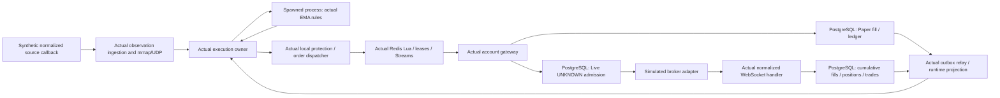

# Tick to order: integrated Paper and Live benchmark

Recorded 10 October 2026. Raw measurements: [order-e2e-2026-10-10.json](order-e2e-2026-10-10.json). The source hashes in that file were checked against the measured code after the run.

## Result and what it means

The four scenarios passed **480 recorded orders**, **240 completed round trips**, and **240 duplicate Live fill observations**. Of the orders, 440 were timed after 40 warmup orders. All expected orders filled, quantities and gross trade prices matched the fixture, Paper balances and margin converged, strategy versions and Live session ownership were retained, and no extra trades or orders were created.

This is an integrated local transport/financial test. It is **not a measurement of the real Fyers network, exchange fills, an Oracle A1 host, sustained capacity, high availability, or HFT performance**. Full simulated order submission currently takes hundreds of milliseconds and reaches seconds under simultaneous demand. The earlier [instrument benchmark](INSTRUMENT_LATENCY.md) measured the local owner loop; it did not establish order placement latency.

## Test path



- Python 3.11.9 and PostgreSQL on Windows, Intel host with 12 logical CPUs; private Redis 8.6.2 on WSL Ubuntu.
- One actual owner loop in a test thread, one real spawned calculation child, one gateway per scope with two account slots, and actual background control/outbox threads. Production services normally run in separate supervised processes.
- Real private Redis cache, ownership leases, atomic scripts, order streams and acknowledgement; real disposable PostgreSQL transactions and row locks. No development account or trading database was mutated.
- Fixed quantity one; actual close-above-EMA20 and close-above-100 rules; an actual five-point protective stop. Synthetic entry price 101 and exit price 94.
- Historical warmup was synthetic. Event time advanced a minute per entry to exercise completed candles; durations used the real monotonic clock. A fixture calendar allowed weekends and all-day trading, so these runs do not test real exchange calendar gates.
- Broker REST and source network were replaced with synthetic inputs. The broker adapter verified the committed `UNKNOWN` order, then emitted normalized cumulative fills through the real handler. A single simulated callback thread delivered fills and their duplicates; its serial processing contributes to fill timings under simultaneous demand.
- The normal UI quote coalescer and fresh quote checks remained enabled. Paper fill and balance assertions checked actual execution prices.
- Each wave waited for all fills, state and outbox convergence before the next wave. This is a finite round-trip batch, not a continuous stress workload. Warmup, authentication, initial data download, cold deployment and broker connection setup are excluded from the latency tables.

## Entry order timings

Values are **median / p95 in milliseconds**, rounded. p95 means 95% of the measured samples were at or below that value in this run. Samples are small; p99/max and per-actor distributions are in the JSON. Percentiles of individual stages must not be added together.

| Scenario | Total actors | Paper: tick to committed fill | Live: tick to broker adapter send | Live: tick to committed fill |
| --- | ---: | ---: | ---: | ---: |
| One Paper account, one Live account | 2 | 216 / 353 | 398 / 644 | 534 / 802 |
| Four accounts per scope | 8 | 985 / 1,520 | 690 / 1,571 | 1,279 / 2,158 |
| Four Paper accounts, four strategies on one Live account | 8 | 974 / 1,573 | 845 / 1,710 | 1,407 / 2,091 |
| One account per scope; broker ack delayed 250 ms, fill delayed another 100 ms | 2 | 265 / 325 | 250 / 612 | 734 / 1,113 |

For the first three scenarios the simulated broker's added acknowledgement/fill delays were zero, so adapter send and adapter acknowledgement were almost identical. The delays in the last scenario were **chosen test inputs**, not measured Fyers response times. Its Live tick-to-ack was **500 / 862 ms**, followed by fill observation and financial persistence.

## Protective exit timings

Values are **median / p95 in milliseconds**. Protective stops can dispatch from local ticks without waiting for numerical calculations; queue and financial work still follow.

| Scenario | Paper: tick to order request | Live: tick to order request | Paper: tick to committed fill | Live: tick to broker adapter send |
| --- | ---: | ---: | ---: | ---: |
| One account per scope | 1.15 / 4.28 | 2.09 / 5.70 | 160 / 270 | 118 / 269 |
| Four accounts per scope | 2.71 / 11.06 | 3.80 / 13.79 | 518 / 840 | 542 / 831 |
| Four strategies sharing one Live account | 2.17 / 8.04 | 2.03 / 8.76 | 363 / 676 | 741 / 1,389 |
| Added 250 ms broker acknowledgement delay | 2.27 / 2.78 | 2.19 / 3.63 | 138 / 220 | 131 / 301 |

The broker-delay scenario's Live exit tick-to-ack was **382 / 551 ms**. Its committed fill was **644 / 837 ms**.

## Observed constraints

1. **A local decision is not an executed order.** For one account per scope, a Live protective exit request took 2.09 ms at the median, while broker adapter submission took 118 ms. Durable admission and transport belong in the user-visible end-to-end budget.
2. **Latency is not equal between instruments.** Actors have separate state and finite fair calculation admission, but share CPU, publication/control work, PostgreSQL and gateway slots. Four simultaneous entries per scope produced 1.5-1.7 second p95 submission/fill tails before any real broker delay was introduced.
3. **One broker account is deliberately serial.** Concurrent strategies cannot bypass account capital locks or broker/account limits. In this test shared-account Live exit submission p95 was 1,389 ms, versus 831 ms for separate accounts. These samples do not prove a universal ratio or isolated causal effect.
4. **Publication/control work adds tail latency.** The real background control loop also publishes local requests. A local protective decision can wait behind snapshot/recovery work; the raw report exposes `request_to_stream`, `publication_to_gateway` and `tick_to_gateway` separately. A future improvement would give bounded request publication a dedicated supervised path while preserving ownership fencing and durability.
5. **Keep entry and protection latency separate.** Entry rules used completed candles plus a spawned numerical calculation. Protection used local ticks. An intrabar observation does not make a closed-candle entry valid before the candle completes.

Further optimization should measure calculation admission, cold context publications and financial SQL/serialization first, then repeat this test on Linux/A1 with realistic continuous tick rates and broker sandbox measurements. Do not promise a millisecond order placement SLA from these numbers.

## Defects found and corrected before the passing run

- Cache deletion of an already absent position/order returned `False`, which the financial outbox treated as a failure forever. Cache removal now reports successful idempotent completion; actual cache errors remain retryable.
- A calculation invalidated by a committed state generation change could be discarded without rechecking the current candle. The owner now reschedules that candle with current state.
- A previously blocked runtime-readiness gate could recover without rechecking the candle. Financial lifecycle messages now trigger cold gate refresh, and recovered/resumed actors recheck the current candle.
- Delayed fill projections could replace a newer local pending exit state and trigger another exit request. Pending and settled request IDs now fence local state; only settlement of that exact request releases its pending state. Paper gateway completion, Live gateway completion, broker observations and publication failures propagate the matching ID.

The owner decision path still makes no broker, ORM or Redis calls. Slow persistence and recovery stay outside the local tick/calculation application path.

## Reproduce

From `backend`, with the project virtual environment, configured local PostgreSQL and permission to create a test database:

```bash
python -m quantnest_runtime.e2e_benchmark --quick --output ../docs/benchmarks/order-e2e-smoke.tmp.json
python -m quantnest_runtime.e2e_benchmark --output ../docs/benchmarks/order-e2e-2026-10-10.json
python manage.py test quantnest_runtime.tests quantnest_runtime.test_latency_benchmark paper_trading.tests backtesting.tests marketdata.tests research.tests --settings=quantnest_runtime.test_postgres_settings --noinput
```

The benchmark starts its own password-protected loopback Redis server on a free port, checks a unique ownership marker before clearing or shutting it down, creates a uniquely named disposable PostgreSQL test database, uses temporary market buffers and blocks provider/broker access. Linux needs `redis-server`; Windows can use the installed WSL Ubuntu server. No Redis persistence is enabled for this private fixture. The calculation child also blocks database/socket connections after initialization.

### Verification scope

After the integrated run, **123 backend tests passed** on a disposable PostgreSQL database, and **2 private research-service tests passed**. Django system checks reported no issues, migration consistency reported no changes, and the changed Python modules compiled successfully. Deliberate failure-injection tests logged transport/cache/database errors while verifying recovery; those logs were expected test inputs.

The regression suite includes cumulative and partial fills, verified broker tags/session ownership, simultaneous WebSocket/REST observations, unknown submissions without blind retries, account capital locks, Terminal reservations/OCO, backtest execution and research contracts. Its database checks use real PostgreSQL with mocked transport; the benchmark above supplies actual local transports for the Paper/Live round trips.

Supervisor crashes, network partitions, Redis/DB failure during handoff, external broker reconnects, multi-node failover, account rate limits and actual Oracle throughput still need deployment-specific fault/load tests. This passing run does not establish those properties.

See [ORACLE_A1_WORKERS.md](ORACLE_A1_WORKERS.md) for the confirmed 2 OCPU / 12 GB VM profile, service counts and queue layout.
