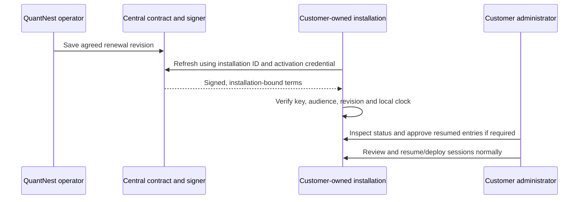

# QuantNest: complete customer and operator workflows

This guide explains the implemented customer website, accounts, subscriptions,
usage limits, support, custom projects and Private installations. For each
workflow it identifies **who acts, where to go, what to enter, what happens next,
what is automatic and what needs an operator decision**. It describes the code
as reviewed on **17 October 2026**, rather than promising unimplemented features.

You are the **QuantNest operator** in this document. Your customer is the
**workspace user**. A customer may also be the administrator of their own Private
installation. These are separate roles even if you perform them all during local
development. Business decisions stay in Operations Admin; routine bookkeeping
is generated by the workflows.

Start with the [deployment guides](../infra/README.md) for host/container setup
and [third-party setup](third-party-setup.md) for provider account configuration.
This document explains daily use after that setup. Exact prices, limits,
availability, contact details and support labels come from backend configuration
or the published database catalog. Check the current UI/Admin values; examples
below do not replace those live terms.

For strategy configuration use the [strategy guide](strategy-configuration.md);
for order/tick internals use the [execution reference](execution-technical-reference.md).
The [documentation index](README.md) separates implementation, deployment,
authentication and customer-site references from this operational workflow guide.

## Find the workflow you need

| I want to… | Read |
| --- | --- |
| Understand which login/server/page to use | [0. Roles and navigation](#0-roles-and-navigation) |
| Understand Development, Public and Private | [1. Deployment controls](#1-the-three-independent-controls) |
| Initialize a fresh installation | [2. First deployment](#2-first-deployment-required-database-initialization) |
| Change a plan or understand limits | [3. Catalog and allowances](#3-change-plan-limits-or-pricing-without-code) |
| Open a feature for customers | [4. Availability controls](#4-availability-controls) |
| Buy, renew, cancel, refund or download an invoice | [5. Billing](#5-payments-renewal-refunds-and-accounting) |
| Understand what limits do to running trading/analysis | [6. Execution and compute](#6-execution-admission-and-the-hot-path) |
| Ask for help, issue a quotation or collect a milestone | [7. Support and projects](#7-support-quotations-and-custom-work) |
| Provision, renew or administer Private | [8. Private installations](#8-private-contract-and-licence-lifecycle) |
| Manage consent, export or close an account | [9. Privacy and account closure](#9-consent-export-deletion-and-retention) |
| Find the responsible code and API | [10. API and ownership map](#10-api-and-ownership-map) |
| Know which database rows need human input | [11. Model ownership](#11-which-models-you-manage) |
| Follow an operator's daily checklist | [12. Operator checklist](#12-routine-operator-checklist) |
| Browse the site or use profile/security/notifications | [13. Website and account use](#13-customer-website-account-and-workspace-use) |
| Understand background jobs and status changes | [14. Background processing](#14-background-processes-and-status-reference) |
| Work out why something is blocked or delayed | [15. Troubleshooting](#15-troubleshooting-by-symptom) |

## 0. Roles and navigation

### Which place is for which action?

All paths below are relative to the appropriate frontend or API origin. Use the
origin configured for your mode, not a future domain that has not been deployed.
The Public frontend and API use the same browser origin through the Cloudflare gateway;
the Private origin belongs to the customer.

| Place | Who uses it | Main actions |
| --- | --- | --- |
| Public customer website, `/` | Visitor or signed-in customer | Understand features, compare plans, read guides, contact QuantNest, request custom work or Private |
| Public workspace, `/overview` | Signed-in Public customer | Research, build, backtest, practise in Terminal/Paper, review results, manage their account |
| Profile menu → **Billing and Usage**, `/settings/billing` | Signed-in customer | Read plan/period, inspect allowances, pay, manage renewal, view invoices and refund requests |
| Profile menu → **Support**, `/support` | Signed-in customer | Requests & replies; Projects & access; quotation acceptance; milestone payments; consented Private diagnostics |
| Profile menu → **Profile & Settings**, `/settings/profile` | Signed-in user on either installation | Profile, Account, Security and Notifications tabs |
| Profile menu → **User guide**, `/docs/getting-started` | Anyone | Public documentation; this is not a separate Getting Started workspace feature |
| Operations Admin, `/admin/` on the backend/gateway | Authorized staff with OTP | Pricing publication, actual permissions, support replies, agreed quotations/contracts, refund decisions, reviewed costs and controlled recovery |
| Customer-owned Private workspace | Customer users and their local administrator | Agreed modules, signed licence status and qualified broker execution when activated |
| Deployment host/container terminal | You or the customer's system administrator | Migrations, service control, provision commands, diagnostics and controlled recovery |
| Razorpay/Brevo/OCI/Cloudflare consoles | Account owner/operator | Merchant/sender/key/domain setup and investigation of actual provider outcomes |

**A normal customer never needs Django Admin.** A Private customer uses the
central customer account for quotations, payments and support, and the local
Private account for execution and licence administration. The two databases do
not synchronize user accounts, trading records or passwords automatically.

### First use in practice

**Customer:** read Product/Features → register or sign in → verify email → use
the supported Explore workflow → inspect Billing and Usage → pay for more
capacity if needed. For Live, submit a Private enquiry and agree the deployment;
purchasing Build or Pro does not activate Live.

**Operator:** deploy one mode → migrate → create/enrol staff → configure required
providers → review provider arrangements → publish the intended catalog → open
eligible features/checkout → respond to support and monitor background work.
An API key, a checked box or a database migration does not supply an external
merchant/data permission or an agreed customer contract.

## 1. The three independent controls

| Control | What you change | Where it applies |
| --- | --- | --- |
| `QUANTNEST_DEPLOYMENT_MODE` | `development`, `public` or `private` | Hosting, trusted ingress, commercial enforcement and licensing authority |
| `EXECUTION_ENABLED_SCOPES` | `paper`, `live` or both | Execution services, broker access and execution controls shown in the workspace; Public accepts Paper only |
| Database catalog or signed Private licence | Public numeric limits and Private licence validity | User actions and work admission; only session access/expiry refreshes in the background |

Development records usage but bypasses commercial allowances and catalog feature
gates. Execution scopes, account ownership, capital checks and valid
orders still apply. Public enforces hosted plan allowances. Private enforces its
unlimited software usage until licence expiry, with qualified broker access rather than Build/Pro checkout.

Changing a scope or deployment mode requires restarting the affected services.
Publishing catalog terms does not require a restart. The UI refreshes platform
configuration on page load and explicit billing/retry actions, without timer or
window-focus polling. Reload an already open page to see newly published terms.
Each API action reads current terms; existing paid periods use their purchased
snapshot.

## 2. First deployment: required database initialization

### Step 1: configure the selected environment

Follow exactly one of the [Development](../infra/development/README.md),
[Public](../infra/public/README.md) or [Private](../infra/private/README.md) guides.
Copy its examples and configure its real secrets. Do not combine mode files.

### Step 2: run migrations

The shared deployment script already runs migrations:

```text
python infra/shared/scripts/deploy.py --root . --mode public --build
```

Use `--mode development` or `--mode private` for that installation. Before an
update, stop or pause strategies and settle execution through the workspace.
The deploy script stops application services while applying migrations. The
following commands show the selected installation's migration entry point:

```text
docker compose --env-file infra/public/backend.env -f infra/public/compose.yaml exec api python manage.py migrate
docker compose --env-file infra/private/backend.env -f infra/private/compose.yaml exec api python manage.py migrate
docker compose --env-file infra/development/backend.env -f infra/development/compose.yaml exec api python manage.py migrate
```

Run only the command for your stack. For local non-Docker development, from
`E:\QuantNest\backend`, run:

```powershell
..\.venv\Scripts\python.exe manage.py migrate
```

Migration `commercial.0008_managed_catalog` initializes the active launch catalog.
The current migration chain removes the retired approval and maintenance-state
tables. Plan and payment snapshots remain intact. No approval or maintenance
records need manual insertion. Use the [deployment procedure](../infra/shared/scripts/README.md#2-initialize-or-upgrade)
when updating an installation.

Migration `customer_support.0007_remove_discovery_planning_record` removes the
unintegrated founder-interview notes table. If you manually stored interview
notes there, export them before migrating. Business interview notes belong in
your operating documents rather than the product support database.

Migration `brokers.0011_remove_charge_profile_broker_credential` removes the unused
broker-account link from charge profiles. Profiles are owned by users and can be
selected for backtests and Paper trading without a connected broker account.

The routine-workflow update adds `commercial.0009_payment_recovery`,
`customer_support.0008_quotation_workflow` and
`installations.0003_contract_validation`. Run the same `migrate` command above;
there is no separate data-entry script. The support migration freezes the current
scope of existing unaccepted quotations that have no snapshot. Accepted snapshots
are preserved. Ask customers with an old quotation page open to reopen it before
accepting. The payment migration records safe refund retry keys and stops future
reconciliation from moving an existing refund's first-observed date.

### Step 3: create your operator login

Use the selected stack's `createsuperuser` and `enrol_staff_otp --username NAME`
commands. For local development:

```powershell
..\.venv\Scripts\python.exe manage.py createsuperuser
..\.venv\Scripts\python.exe manage.py enrol_staff_otp --username YOUR_ADMIN_USERNAME
```

Import the printed provisioning URI into your authenticator privately. Use the
current authenticator code at Operations Admin. See [authentication](authentication.md).
For Public, open Admin through the configured gateway origin; direct untrusted
API access is intentionally refused.

### Step 4: inspect the seeded data

In Operations Admin, check:

1. **Commercial → Catalog revisions**: one published, active launch revision.
2. **Brokers → Broker charge profiles** and **Common → Exchange configs**:
   existing migrations provide their application defaults. Review actual charges
   before enabling paid features; exchange calendars still require synchronization.
3. Configure the Django Site and source instruments/holidays using the selected
   deployment guide. No commercial subscriptions need to be inserted for Explore.

## 3. Change plan limits or pricing without code

### Edit a new revision

1. Open **Commercial → Catalog revisions**.
2. Select the active revision and choose **Clone selected revision as an editable draft**.
3. Open the new draft. Give its revision a readable unique name, for example
   `2026-11-capacity-1`.
4. Edit Explore/Build/Pro fields. Prices are integer paise: `49900` means ₹499.
   Explore must stay free. All allowance fields accept non-negative integers.
5. Review the numeric allowances. Zero prevents new consumption of that allowance.
   Execution availability is configured with EXECUTION_ENABLED_SCOPES; the catalog
   has no separate feature-permission switches.
6. Save. Review the draft in the list before publishing it.
7. Select only that draft and choose **Publish selected revision for new purchases and Explore**.
8. Refresh Pricing and Billing and Usage. API requests use the new revision
   immediately; reload an open page or use its Refresh action to fetch the catalog.

Published snapshots cannot be edited. To reverse a publication, publish the
previous reviewed revision again. The active revision and publication timestamp
identify the current terms.

The customer site and workspace share the active catalog from
`GET /api/v1/public/catalog/`. It supplies plans, feature names,
execution scopes and support labels. Publishing prices or allowances does not require exporting JSON or rebuilding the frontend. Customer
explanations and illustrations remain in React; adding a new feature page still
requires frontend content and a release.

Allowance definitions come from `commercial/catalog.py` (`ALLOWANCES`);
`LIMIT_LABELS` is derived from those definitions for Admin,
Pricing and Billing and Usage. Contact details are configured once with backend
`QUANTNEST_LEGAL_NAME`, `QUANTNEST_SUPPORT_EMAIL` and `QUANTNEST_SUPPORT_HOURS`.
Restart the backend after changing environment values; open pages pick them up
on their next platform refresh. No duplicate frontend contact settings or data
insertion is required.

### What changes, and when?

| Item | Effect of publication |
| --- | --- |
| Explore limits | New user actions immediately use the active free plan; used/reserved work is retained |
| New Build/Pro purchase | Uses the reviewed active revision and total |
| Existing paid period | Keeps the purchased catalog snapshot until its verified next period |
| Active Paper above new capacity | Continues its admitted configuration; the next deploy/resume/version change must fit the current allowance |
| Backtest credit unit | New previews use the revised source-candle unit; successful work consumes its fixed reviewed price |
| Private | No numeric quotas. The central agreement defines licence validity, release/support terms and qualified broker access |

Adding a completely new feature, instrument class, currency or billing interval
still requires implementation. Increasing a quota does not add CPU, RAM or
broker capacity. Checkout remains blocked if a hosted plan promises more Paper
instruments than the configured per-user actor capacity. Futures/options remain
Coming soon until their execution support is implemented.

### Allowance types and request flow

Public plans use three allowance kinds, defined once in
backend/commercial/catalog.py as ALLOWANCES:

| Kind | Examples | Admission and release |
| --- | --- | --- |
| inventory | Saved strategies, saved screens, active Paper deployments/instruments | Count saved records before the user creates, deploys, resumes or replaces a version. Deleting/stopping releases capacity through the normal domain lifecycle. |
| per_request | Research instruments, attached backtests, source candles, Monte Carlo simulations | Validate the submitted size before saving/queuing work. No counter or refund exists for request size. |
| period | Backtest credits, research messages, screens, Monte Carlo runs | Reserve the reviewed amount at acceptance. Success consumes it; failure or cancellation restores it once. |

Private installations have **no numeric software quotas**, including saved
resources, compute credits, request allowances, user seats and broker-account
counts. No new usage buckets/reservations are created in Private mode. The
installation requires a valid licence; Live also requires its configured scope,
current qualification and supported broker. Finite host capacity, input validity,
market support, protective controls and external provider budgets still apply.

Development records period usage but bypasses numeric plan enforcement. Public
enforces the purchased/Explore values. EXECUTION_ENABLED_SCOPES controls execution
availability in every mode.

Each allowance kind has one admission function in `commercial/usage.py`:

| Kind | Function | Meaning of the submitted amount |
| --- | --- | --- |
| inventory | `require_inventory_capacity` | Additional saved items, or the proposed Paper snapshot/session/allocation |
| per_request | `require_request_limits` | Total size of this request; no reservation |
| period | `reserve_usage` | Credits/work units reserved until a final outcome |

| Action | Call at the view/serializer boundary |
| --- | --- |
| Save a strategy | `require_inventory_capacity(user, strategies=1)` |
| Save a screen | `require_inventory_capacity(user, saved_screens=1)` |
| Submit research | `require_request_limits(user, research_instruments=count, backtest_attachments=count)`; call inventory admission separately if this creates/converts a saved screen |
| Review/submit a backtest | `estimate_backtest_workload` checks the preview; `reserve_usage(user, "backtest_credits", ..., estimate_token=token)` validates its reviewed price and reserves credits at creation |
| Submit Monte Carlo work | `require_request_limits(user, mc_simulations=count)`, then `reserve_usage` at creation |
| Deploy/resume Paper | `require_inventory_capacity(user, paper_snapshot=snapshot, paper_session_id=existing_session_id)`; omit the session ID for a new session |
| Change an allocation's version | `require_inventory_capacity(user, paper_snapshot=new_snapshot, paper_allocation=allocation)` |

For saved resources, amounts mean **additional items**. For request sizes, they
mean **the submitted total**. All three functions use `_prepare_allowance` to
validate the allowance kind/amount, lock the active account, check its licence and
load one account policy. `_check_limits` applies that policy to each requested
total. A Public ceiling is a number; Development/Private ceilings are `None`.
Creation views and serializers do not branch on deployment mode for allowances.

For an action with several allowance kinds, reuse the returned policy inside the
same outer transaction. Research and Monte Carlo follow this pattern; the
backtest admission helper does it internally:

```python
with transaction.atomic():
    policy = require_request_limits(user, research_instruments=stock_count,
                                    backtest_attachments=backtest_count)
    # Only when this action saves a new screen:
    require_inventory_capacity(user, policy=policy, saved_screens=1)
    run = ResearchRun.objects.create(...)
    reserve_usage(user, "screens", request_key, payload, resource=run,
                  policy=policy)
```

The job row and its linked credit reservation commit together. If admission
fails, the outer transaction rolls both back. Queue work only after reservation
succeeds. There is no separate binding call or follow-up reservation update.

The policy is local to that submission. Never cache it between requests or pass
it to a worker: the next user action must read current account terms. Reusing it
avoids repeating the account/licence check and catalog lookup for every kind.
Each function still rejects keys belonging to a different allowance kind.
Keep the inventory check and resource creation inside the same outer
transaction so concurrent requests cannot both take the last available slot.
Period credits always use `reserve_usage`. Backtests, Monte Carlo, research and
screening all call this same function; there is no feature-specific reservation
entry point. The allowance definition determines how its amount is calculated:

| Pricing category | Calculation inside `reserve_usage` |
| --- | --- |
| Default | Reserve one unit, or the explicit `amount=` supplied by the caller. |
| `pricing="source_candles"` | Validate the reviewed source-candle preview in Public, or calculate it in Development, then reserve its credit amount. |

For source-candle pricing, the payload includes the effective strategy `config`,
the resource supplies its dates, and the caller supplies `estimate_token=`.
The same function prepares the account policy, checks the allowance, handles
idempotency and saves the linked reservation after calculating the amount.
Private licence admission returns without pricing or recording numeric usage.

`get_account_policy` is the single read interface for plan terms and effective
limits. Profile uses its `plan`, Research controls use its `limits`, and Billing
adds current counters through `get_account_usage`. Workload previews are reads:
they check the displayed workload ceiling but do not lock the account, validate a
Private licence or reserve credits. Actual creation performs admission checks.

Paper uses the same inventory admission function as strategies and saved screens.
Its private `_get_paper_usage` reader is also used by Billing; it does not enforce
anything. Deploy/resume excludes the existing session before counting the proposed
deployment, preventing double counting. A version change substitutes the proposed
watchlist for every active session using that allocation; it adds no deployment.
Changing the saved version of an inactive allocation consumes no active capacity.
Running, Paused, Stopping and Error sessions retain their capacity until stopped.

Research resolves and admits its selected instrument IDs before creating the run.
Tools and draft validation use only those frozen IDs. Symbol resolution can show
candidates and a Use button for the next request; it never expands the current
run's universe. Request ceilings come from Public catalog terms, not duplicate
3-attachment/50-stock validators. Private and Development request controls expose
no plan ceiling. Technical tool budgets and input validity remain separate.
Monte Carlo keeps its minimum of 100 iterations but has no fixed 1,000-iteration
ceiling in the serializer, engine or form; Public admission uses mc_simulations.
Paper allocation create/update bodies use deployed_version, matching the response
and serializer field. The deploy-version command continues to accept version_id.

### What happens when a customer submits work

1. The view/serializer validates ownership, inputs and the relevant execution scope.
2. The shared admission path checks account/licence validity and resolves the
   deployment policy once. Private proceeds without numeric accounting;
   Development records period credits without enforcing numeric ceilings.
3. Public checks inventory capacity or request size. For period work, the API
   reserves credits in the transaction that creates the job. The formula is
   **used + reserved + requested <= limit**.
4. The saved job is submitted directly to Celery after commit. A backtest/Monte Carlo job
   moves Pending → Queued → Running. Its own atomic status transition prevents
   duplicate execution; this transition does not inspect plans or credits.
5. The engine runs the admitted configuration. It does not look up reservations,
   check plan limits, heartbeat accounting records or compare work against credits.
6. A central completion handler receives the final task outcome. Completed work
   consumes the full reserved amount; Failed/Cancelled restores it. Repeated
   callbacks do not charge/refund twice.

The backtest price is the reviewed source-candle estimate, rounded to credits
before acceptance. Successful runs use that fixed reviewed price, without a
second calculation from measured candles inside the engine. Failed and cancelled
runs restore the reservation in full. Preview signatures bind the user,
configuration, dates and credit unit for 30 minutes; changing those inputs requires a new
preview. A Private preview displays Unlimited instead of a credit charge.

Pending unstarted work keeps its reservation until started, cancelled or deleted.
Cancelling a running backtest/research turn requests normal domain cancellation
and refunds its held credits. A running backtest must acknowledge termination
before deletion. Private follows the same job lifecycle without a credit ledger.

A refund restores the original period's bucket, even if the next month has begun.
There is no rollover or automatic paid overage. Usage-credit restoration is
separate from a Razorpay payment refund.

### Code ownership

| File | Responsibility |
| --- | --- |
| backend/commercial/catalog.py | ALLOWANCES: key, label, kind, seed values, saved-resource model/filters, and period-work resource type/model/task. Published catalog records supply actual Public values. |
| backend/commercial/usage.py | Shared account policy, all three admission kinds, backtest credit previews, reservations, direct compute submission after commit, final-outcome settlement/refunds and Billing usage reads. |
| backend/backtesting/serializers.py | Validate backtest inputs and reserve usage before the creation transaction commits; no deployment-mode or pricing branches. |
| backend/backtesting/services.py | Snapshot creation, source-work estimates and queue dispatch. No quota/reservation lookup. |
| backend/core/lifecycle.py | Automated-execution scope admission and settled-stop lifecycle; no background expiry checks, Terminal gates or numeric quotas. |
| backend/installations/licensing.py | Private licence validity, signed refresh and qualified Live broker access; no resource counters. |

CommercialConfig.ready imports usage.py to register completion handlers. Final model status
saves invoke accounting after their transaction commits, including research
timeouts. Celery task outcomes also cover bulk status updates and worker failures.
The callbacks are named `handle_saved_work_outcome` and `handle_task_outcome`;
both delegate final job accounting to `complete_compute_work`.
The Celery handlers use
task_postrun/task_failure signals, including tasks that save FAILED and return
normally. [Celery signal reference](https://docs.celeryq.dev/en/stable/userguide/signals.html#task-postrun).

There is no guard_compute_work, accounting heartbeat thread, worker quota
decorator or recover_compute command. Domain cancellation, job status transitions,
trade risk checks and execution-worker health monitoring remain separate.

### Admission entry points and verification

| User action | Admission path |
| --- | --- |
| Create a strategy, including a confirmed Research draft | StrategyCreateSerializer inherits the transactional creation/inventory check from StrategyDetailSerializer. |
| Clone a strategy | StrategyViewSet.clone checks strategy inventory before saving the copy. |
| Save or convert a saved screen | ResearchSessionViewSet checks saved-screen inventory; a type update reads the current kind under the owner lock. |
| Start research or screening | ResearchRunViewSet resolves attachments/universe, checks request size and any new saved-screen slot, then reserves the appropriate period allowance. |
| Create/rerun a backtest, including a confirmed Research backtest | BacktestRunSerializer calls reserve_usage; source-candle pricing validates the reviewed workload and current request ceiling before reserving credits. |
| Create Monte Carlo work | MonteCarloRunViewSet checks simulation count and reserves a period unit in the same transaction. |
| Deploy/resume Paper | The action checks proposed deployment/instrument totals through require_inventory_capacity. |
| Change a Paper allocation's version | PATCH and deploy-version both check the proposed active universe; inactive allocations consume no deployed capacity. |

Idempotency binds a reservation to one resource as well as its request inputs.
Reusing a request key for a different job is rejected. Duplicate completion
signals settle/refund a reservation once. Account policy and licence admission
are prepared once when several allowance kinds participate in one transaction;
ownership, job lifecycle and request-rate safeguards have separate purposes.

Verification on 18 October 2026 used an isolated PostgreSQL database and actual
ORM, view and serializer admission paths: 28 test cases and 77 parameterized
checks passed. It covered all 12 catalog allowances,
Explore/Build/Pro boundaries, zero allowances, paid catalog snapshots, Public
rejection, Development recording and Private unlimited accounting. It also
covered concurrent last-slot/last-credit admission, duplicate completion,
retries, cancellation/failure refunds, original-period refunds, Indian calendar
rollover and changed/expired backtest previews. Notification transport and Private
licence outcomes were substituted; this does not verify external billing,
licence signing services, broker execution or historical simulation results.
Temporary verification code and its database are removed after the audit.

### Change existing Public limits

1. Open Commercial → Catalog revisions in Operations Admin.
2. Clone the current catalog, edit the numeric plan fields and save the draft.
3. Publish it. Explore and new purchases use the new values; existing paid periods
   keep their purchased snapshot.
4. Refresh Billing and Usage. Inventory cards count actual saved/deployed items;
   period cards show consumed plus reserved; request cards show the maximum size.

Private contracts contain no allowance/seat/account-count fields. Renew the
licence's actual paid-through/continuing-use rights instead.

### Add an allowance or future feature

1. Add an ALLOWANCES definition: unique key, readable label, kind and seed values
   for Explore/Build/Pro. Labels, Admin fields and Billing kinds use this definition.
2. For inventory, register its Django model and optional filters; call
   `require_inventory_capacity(user, new_resource=1)` in the creating view/serializer
   transaction, using the allowance's actual key instead of `new_resource`.
   Paper uses its deployment/universe counter because its capacity spans sessions.
3. For per_request, use `require_request_limits` with the submitted
   count. Combine related sizes in one call. Do not add the check to an engine or
   tool loop.
4. For period work, add resource_type, model and task to its ALLOWANCES definition.
   In one transaction, create the resource and call
   `reserve_usage(user, allowance_key, request_key, payload, resource=resource)`.
   Supply `amount=` when the action consumes more than one unit; source-candle
   pricing calculates its amount internally. Reuse the admission policy when this action
   also checks request/inventory allowances. Task dispatch and completion derive
   their registration from those same definitions; no separate registry edit or
   accounting decorator is required. After successful reservation, call
   `queue_compute_work(task_name, resource.pk)` in the same transaction; it submits
   to Celery after commit. Define the actual task's computation in its owning app.
5. Keep the new job's own Pending/Queued/Running/final-state handling idempotent.
   Completion handlers consume the fixed reservation on success and refund on
   failure/cancellation. Queue failure and user cancellation use the same handler.
6. Clone/publish a catalog with the new values. Older purchased terms missing the
   new key grant zero for that key until updated terms apply. A numeric JSON
   allowance needs no new database column.
7. A genuinely new allowance kind needs its check semantics and Billing group
   added explicitly. Reuse inventory, per_request or period when they describe
   the resource; do not introduce a new kind merely for a new feature.

Private automatically bypasses these numeric allowances; no contract schema or
signed-licence changes are needed when a Public allowance is added.

### Upgrade an existing checkout

Finish or cancel current compute jobs before stopping the compute worker for this
upgrade. Run the deployment migrations, then restart API, Celery and runtime
processes. Commercial migration 0012 removes worker accounting metadata and
normalizes old running reservations to held credits. Backtesting migration 0020
adds Queued to normal job states. Private migration 0005 removes numeric resource
fields and advances contract revisions for signed schema_version=3.

Commercial migration 0013 removes the obsolete subscription resume flag. After
this cleanup, restart API and execution/Celery processes together. The runtime no
longer reads subscription/licence expiry or returns entry-permission flags to the
Paper/Live pages. Admitted strategies continue until an explicit lifecycle action
or ordinary execution/risk control stops them; licence/plan checks apply to new
user actions.

Update the central signer first, then refresh/import the new licence on each
Private installation. Old quantity-limited tokens are not accepted by the new
schema. Routine records are created automatically; no manual usage/subscription
insertion is required.

## 4. Availability controls

There is no separate database approval checklist. Use these existing controls:

| Control | Where to change it | Effect |
| --- | --- | --- |
| Deployment mode | `QUANTNEST_DEPLOYMENT_MODE` in the mode's backend environment | Selects Development, Public or Private hosting/licensing behaviour |
| Execution scopes | `EXECUTION_ENABLED_SCOPES` | Enables Paper, Live or both; Public allows Paper only |
| Plan allowances | Publish catalog limits; purchased periods retain their snapshots | Bounds saved resources, compute usage and Paper capacity at user-action entry points |
| Private access | Signed licence and its contract | Unlimited software usage until expiry; signed qualification, lease and continuing-use rights |
| Checkout | `BILLING_ENABLED` plus valid provider setup | Opens eligible hosted plan and central project checkout |

Change public prices/allowances by cloning and publishing a catalog. Set an
allowance to zero to prevent new consumption; existing saved work is retained.
Configure Paper/Live execution with EXECUTION_ENABLED_SCOPES. Private usage is unlimited while the signed licence is active. Provider configuration must be completed separately.
Reload an open page or use Refresh after publishing terms.

Execution-scope and allowance checks occur when users create or deploy work.
Running strategy evaluation does not query approval records or repeat quotas.
Time-bound session access refreshes outside the tick loop.

Development records usage without enforcing numeric plan limits. Execution
scopes, ownership and order/capital validation still apply. Billing
uses its explicit enabled setting in Development as well. Retention runs its
documented bounded cleanup automatically; it has no operator-approval gate.

Keep provider agreements and review evidence in your operations documentation.
Opening a feature in the software does not establish those external arrangements.

### Main request flow

1. The customer submits an action from the workspace.
2. The API validates the input, ownership and the relevant execution scope.
   Private new work also requires a current installation licence.
3. Saving a resource checks its capacity. Starting metered work reserves its
   allowance once. Backtests show the workload estimate before submission.
4. The API saves the resource and queues any background work. Workers claim each
   job once; strategy actors evaluate admitted sessions without repeating quotas.
5. Completion consumes the reserved price on success; failure/cancellation refunds it.
6. The workspace displays the saved result and the updated usage.

There is no require_capability function or per-module permission list. Paper and
manual simulated Terminal entries require the paper execution scope; Live user
actions require live. Shared chart/quote endpoints require authentication, without
an execution-scope or commercial feature gate. WebSockets keep authentication,
token expiry and session revocation; subscribing to charts does not query plans.

## 5. Payments, renewal, refunds and accounting

### Required configuration and data

1. Follow the Razorpay section of [third-party setup](third-party-setup.md): merchant
   account, mode-specific keys, signed webhook and real callback URLs.
2. Set applicable tax settings to your actual reviewed business arrangement.
3. Review the active catalog and runtime capacity. Set `BILLING_ENABLED=True`
   only when checkout can be offered.
4. Manual payment uses provider Orders and does not need a Price mapping.
5. Automatic renewal needs a monthly INR provider Plan for the exact total.
   In **Commercial → Price mappings**, choose the published catalog, Build/Pro,
   its provider `plan_...` identifier, captured total in paise and tax basis points.
    Admin verifies the provider amount/interval/currency before saving the mapping;
    checkout verifies them again before creating a subscription. Mappings are
    retained without edits or deletion; publish a new catalog for changed terms.
6. Create new mappings when you publish a new catalog or tax/price total changes.
   A protected founding price may require its own exact-total mapping. Do not edit
   old provider records or old purchased snapshots to change today's price.

The renewal checkbox is unavailable when the account's reviewed price has no
mapping. The customer can use manual payment when checkout is otherwise open.

No manual Subscription, Payment, Invoice, Usage bucket or Reservation insertion
is required for normal customer flows. These are generated by verified actions.
Manual subscription grants in Admin are privileged exceptions; review the
selected catalog and paid period carefully.

### Customer payment flow

#### Buy or manually renew a Public plan

1. Sign in and complete email verification. Open **Billing and Usage → Plan and
   renewal** (`/settings/billing`). The public Pricing page can direct the user
   here with their chosen plan after sign-in.
2. Choose **Build** or **Pro**. Read supported markets, the base price, applicable
   tax and the final total. Futures/options marked Coming soon are not activated
   by paying. Public plans still end at supported Paper simulation.
3. Leave automatic renewal unchecked for a single manual period. Check it only
   if the exact reviewed price has an available automatic-renewal mapping and
   the customer wants a monthly mandate.
4. Select **Continue to secure payment**. A second click/retry of the same
   checkout request reuses its identity rather than starting another payment.
5. Complete the provider checkout. On success, the browser submits the payment
   identifier for server verification, then refreshes plan/usage/invoices.
6. Confirm the current plan and period in the page header. If it says Awaiting
   payment provider or capture is pending, inspect payment activity and wait for
   reconciliation. Do not assume that closing the payment popup means failure.

**Code flow:** Public plans enter `commercial.billing.create_checkout`;
project/Private milestones enter `customer_support.services.create_milestone_checkout`.
Each validates its own terms and saves the attempt under the owner lock. Both then
call `commercial.billing.submit_checkout` outside that transaction. This is the
single provider-submission path for Orders and subscriptions. It records Pending
or an uncertain provider outcome; retrying an existing attempt does not create
another provider checkout. Authoritative verification and reconciliation are
unchanged.

The Billing account read reuses its already loaded account policy/subscription
and loads renewal price mappings in one query. It still displays purchased
allowances separately from current checkout prices.

A manual payment buys a period without creating a renewal mandate. Its start is
the later of the verified payment time and the existing paid-through time; it
extends by one calendar month. An automatic payment applies its own verified
provider invoice period. A duplicated callback does not extend either twice.
The six-month founding-price protection, where applicable, is recorded on the
first purchased workspace period and shown with its end date. It does not promise
a price freeze after that date or for a different plan.

**Automatic records:** Payment attempt → verified Payment → purchased
Subscription/period → Invoice. No customer or operator inserts those rows to
activate an ordinary paid workspace. If a previous unresolved checkout has
different terms, the server asks the user to resolve it before another purchase.

`BillingUsage.jsx` loads account usage, catalog and owned refund requests. It shows
the same reviewed total computed by backend billing code. The customer chooses
manual payment or expressly consents to automatic renewal, then confirms checkout.

```mermaid
sequenceDiagram
    participant UI as Billing UI
    participant API as Billing API
    participant DB as Database
    participant RP as Razorpay
    UI->>API: POST renew/ or checkout/ + revision, total, request key
    API->>DB: Owner lock; save unique attempt and reviewed terms
    API->>RP: Create order or subscription
    API-->>UI: Provider identifiers for secure Checkout
    UI->>RP: Customer completes payment
    UI->>API: POST verify/ with payment ID
    RP->>API: Signed webhook
    API->>RP: Fetch authoritative payment and period
    API->>DB: Apply captured payment once; save invoice/period
    API-->>UI: Updated purchased plan and allowance period
```

The browser callback does not grant entitlement. A webhook is authenticated on its
original bytes, deduplicated and queued. Verification checks ownership, amount,
currency and provider period. Duplicate webhook/browser verification is safe.

Cancel renewal via `billing/cancel/`; the paid period remains. Schedule a plan
change via `billing/change/`; accepted future terms are retained until the provider
period begins. Refund requests are owned customer records; staff approve eligible
requests, and a Celery task verifies the provider outcome. Full refunds and
chargebacks update access without deleting the financial history.

#### Change plans or stop renewal

| Customer wants | Where and action | Result |
| --- | --- | --- |
| Change an existing automatic subscription | Plan and renewal → select the desired plan → **Schedule [plan]** → review the future total → **Confirm change** | Saves future renewal terms; current purchased period remains. Requires a matching monthly provider plan |
| Stop future automatic charges | **Cancel future renewal** → read confirmation → **Confirm change** | Requests cancellation at the cycle boundary and keeps the paid period. It is not an immediate refund |
| Renew a manual workspace | Select the plan and complete another manual payment | Applies the newly verified purchased period; it does not silently enable a mandate |
| Stop using a manual plan | Do not buy another period | At paid-through, new admissions use Explore terms; saved work is retained |
| Change a Private agreement | Contact Support on the central account | Staff agrees and signs a contract revision; Build/Pro checkout is not the Private licence editor |

When a paid period expires, the workspace falls back to Explore allowances.
Existing items can remain above those allowances. New creates/deployments must
fit the current terms. Already running Paper sessions continue with their admitted
configuration; expiry, refund and renewal do not pause or restart them. User-driven
deploy, resume and version changes validate the current allowance. Normal
protective handling and access to saved records continue.

#### Invoices, refunds and payment references

**Invoices:** open **Payments and invoices**
(`/settings/billing?tab=payments`). After capture, choose **Printable invoice**
to open HTML, then use the browser's Print → Save as PDF if needed. **JSON record**
downloads the stored invoice data. A provider checkout/order ID is not an invoice
and does not prove payment capture.

**Refund request:** on the same tab:

1. Find the captured provider payment reference from the payment receipt/provider
   record; it starts with `pay_`. The checkout UUID and `order_` identifier shown
   in recent activity are different identifiers and cannot substitute for it.
2. Enter that reference and a reason of 5–3,000 characters. Submit the request.
3. Read **Your requests** for the recorded status and amount. The user can request
   a refund of their own captured payment only; an already-open request is reused.
4. Staff reviews it. The first captured workspace purchase within seven days is
   classified Eligible; other cases go to Review. Both still require an explicit
   staff approval before money is sent. Project/Private milestone payments go to
   review rather than automatically qualifying for that workspace window.
5. The refund task sends an approved request. A verified processed refund
   records a credit-note number and updates access for a full refunded period.

**Operator:** open **Commercial → Refund requests**, inspect payment, reason,
eligibility and actual provider history. Select the row and choose **Approve
or retry refunds for provider processing** or **Reject selected requests
awaiting review**. Approval queues work; it does not itself mean the bank has
received the money. Do not mark a request Processed yourself. If some money was
already refunded, the requested amount is limited to the remaining recorded
balance. A provider dispute is recorded from verified provider data, not created
as an ordinary customer refund request.

The customer page currently requests the `pay_` reference explicitly; it is not
a one-click refund against each invoice. It displays the saved credit-note
reference; it does not generate a separate downloadable credit-note PDF.

If an outbound creation result is uncertain, the scheduled reconciliation task
discovers its provider resource using the saved attempt UUID in provider notes.
Orders additionally use their receipt; subscriptions use a bounded creation-time
search and verified provider plan. It checks ownership identity, amount, currency
and terms before linking anything. Stale `creating` and `provider_unknown` rows
are included after two minutes. Discovery uses GET requests and never creates a
replacement order or mandate. Unknown plan changes are reconciled before invoices
at their new price are verified.

To request another read-only reconciliation now, select up to 20 rows in
**Commercial → Payment attempts → Discover and reconcile selected provider
checkouts**. The optional `reconcile_checkout <attempt_id> <provider_id>` command
remains available when a provider investigation supplies the exact identifier.
An absent, ambiguous or truncated provider result remains unresolved. Confirm the
actual remote outcome with the provider; do not insert a Payment/Invoice or mark
an attempt Captured yourself.

Approved refunds save a stable provider idempotency key before sending their
request. Interrupted delivery can retry the same key and unchanged amount. Older
uncertain refunds without a key are discovered by receipt/notes using GET; their
unkeyed POST is never repeated automatically. A verified provider webhook or
scheduled payment reconciliation links the Refund request, Refund record and
credit note automatically. Duplicate observations do not keep resetting renewed
access. A refund received before its capture notification records its verified
invoice and refund together, without granting refunded paid access.

Payment webhooks verify their signature and process authoritative provider state
directly during the HTTP request. No webhook inbox, event replay task or separate
commercial audit ledger is used. HTTP 503 means a provider lookup failed; check
API logs and credentials, then reconcile the saved Payment attempt. Payments,
refunds and disputes retain their provider identifiers and transactional updates,
so duplicate deliveries do not apply the same financial outcome twice.

Check API/Celery logs for failed refund submission or exhausted task retries.
In **Refund requests**, use **Approve or retry refunds for provider
processing** for an approved or provider-pending request after fixing the provider
configuration. This reuses its saved provider identity/idempotency key. Rejected,
failed or processed requests are not resubmitted by that action. Provider
identifiers, outcomes and credit notes are read-only.

Provider reference: [order discovery](https://razorpay.com/docs/api/orders/fetch-all/),
[refund idempotency](https://github.com/razorpay/markdown-docs/blob/master/api/refunds/normal-refunds-idempotent.md)
and [payment/refund fields](https://razorpay.com/docs/api/payments/entity/).

### Operator costs

Operator profit/cost reporting is deferred. Keep hosting, data, AI, email and
delivery expenses in your normal accounting records using actual provider bills.
The application records payments, invoices, refunds and disputes for its billing
workflows. Research runs retain their provider token/request usage in
`ResearchRun.usage`; there are no provider-rate or cost-review records to maintain
in Admin, and no background cost-pricing job.

## 6. Execution: admission and the hot path

### Paper and Live

1. A customer deploys/resumes a strategy or changes its deployed version.
2. The API checks scope, ownership and licence validity. Public Paper checks
   capacity across active sessions under the owner lock. Private has no numeric
   quotas; Live additionally requires current qualification for its broker.
3. Runtime assignments/outbox events reach the execution control thread.
4. Its background snapshot loads session/configuration, account state and market
   readiness. It refreshes roughly every three seconds, sooner after control events.
5. Each actor receives the account's active state in memory. Scope filtering uses
   EXECUTION_ENABLED_SCOPES. Runtime does not query subscriptions, licences or plan
   capacity; it does not evaluate commercial expiry while the strategy runs.
6. Protective exits are evaluated before the entry gate. Subscription, licence or
   qualification expiry does not automatically pause admitted sessions or stop
   their new entries. Stop or pause those sessions explicitly when needed.
7. The order gateway retains transactional capital/quantity reservations, session
   and version checks, ownership and duplicate-order protection. It does not repeat
   the removed per-order `require_order_permission`/licence-lock workflow.

There is no commercial background order cancellation. Paper, Live and Terminal
orders that were admitted remain in their normal fill/reconciliation lifecycle.
Manual Terminal simulation has no plan quota, open-order count cap, execution-scope
gate or Private-licence gate. Order creation/editing still validates implemented
instrument support, lot/tick sizes, available simulated capital and valid input.
`reserve_order` uses the account already locked by the creating service or editing
serializer; it does not fetch/lock it a second time. Closing an existing position
can bypass instrument-support admission, and eligible orders can still be
cancelled through normal actions. These are ordinary order/position operations,
not commercial allowance checks.

Licence validity and broker qualification are checked at the relevant user
actions, and Public capacity is checked at deploy/resume/version changes. There
is no background commercial revocation mechanism. A valid session can continue
opening trades after its original subscription/licence deadline until it is
stopped, paused or otherwise blocked by normal execution controls. Renewal does
not restart a stopped session. Financial, ownership, session/version, freshness
and signal-expiry checks remain; broker-submitted orders must be reconciled.

### Compute and usage

Requests reserve the fixed reviewed price before queueing. Jobs own their normal
execution status, and the engines contain no commercial accounting checks.
Backtest loading records per-instrument coverage and missing-data warnings. It
does not calculate a second aggregate source-candle charge; billing uses the
reviewed estimate captured before admission.
Celery completion/failure signals run the shared final-outcome handler: successful
work consumes its reservation; failed/cancelled work restores it. Failed queue
publication for eligible unstarted work and user cancellation call the same final accounting path. Private has
no numeric accounting. There are no accounting heartbeats or claim recovery
commands. See section 3 for request/worker boundaries and extension instructions.

## 7. Support, quotations and custom work

### Customer requests and replies

**Customer, from the website:** open `/contact` for a general/service enquiry or
`/feedback` for a suggestion. Enter name, email, request type, a short subject and
enough detail to reproduce the issue or understand the requested tool. Complete
form verification when required and select **Send request**. Keep its returned
reference. Signed-in requests use the account email and appear in workspace
Support. Guests receive an email acknowledgement; after signing in with a
verified matching email, their guest records link at login/session refresh.

**Customer, from the workspace:**

1. Open profile menu → **Support** → **Requests & replies** (`/support`).
2. Choose **New request**, select the request type and enter subject/message.
3. Submit. The new request opens in the conversation pane and appears in history.
   On a phone, use **All requests** to return to the list.
4. Open any owned request to read its original message and retained replies.
   Enter a follow-up and select **Send reply**. Use Refresh to fetch newer staff
   replies; this is not a real-time chat or an automatic response-time SLA.
5. History is paginated at 20 tickets. Older requests remain available through
   the page controls. The reference identifies a request; knowing someone
   else's reference does not grant access to their workspace conversation.

| Request type | Use it for | What is created |
| --- | --- | --- |
| General enquiry | General product or subscription questions | Ticket, acknowledgement delivery |
| Custom development | A customer-specific tool, integration or software project | Ticket; staff may later agree an Engagement and Quotation |
| Private deployment | Customer-owned installation and possible qualified Live use | Ticket; assessment precedes a contract/licence |
| Product support | A page, account, payment or workflow problem | Ticket and conversation |
| Feedback or suggestion | Product improvements | Ticket; it does not create a committed delivery date |
| Grievance | A formal issue needing review | Ticket retained under its purpose |
| Security report | A security concern | Ticket; do not send passwords or secret keys |

**Operator: reply and manage a ticket**

1. Open **Operations Admin → Customer support → Tickets**
   (`/admin/customer_support/ticket/`). Filter by request type/status or search
   the email/subject. Open the customer's ticket.
2. Assign a staff member when appropriate. Set **In progress** while investigating.
3. Under **Replies**, add the actual customer-facing response and save the page.
   Author and staff flag are automatic. The reply is retained, the ticket becomes
   Awaiting your reply for the customer, and email delivery is queued.
4. When the customer replies in the workspace, status becomes Awaiting support.
   Update Resolved/Closed when the issue is finished. These resolution decisions
   are staff decisions; no worker guesses that a problem has been solved.
5. If delivery fails, the saved reply is still in workspace Support. Investigate
   Celery logs, Brevo Email events and SMTP configuration. Task failures retry up to
   five times; an email notification is not required to read the saved reply.

Email replies are an additional channel only when the inbound integration is
configured. The customer replies to the signed Reply-To address using the ticket
email; accepted messages are deduplicated into the same conversation. Incoming
email to a Closed ticket is ignored. The current workspace reply action can
return an owned ticket to Awaiting support. Staff responses are composed in
Admin; an arbitrary email sent from a staff mailbox is not a staff-reply API.

- Guest enquiries post to `/api/v1/public/enquiries/`; form verification precedes
  Ticket creation. Signed-in public-site and workspace forms both post to
  `support/tickets/`, which attaches the account and uses its email address.
- At successful login or session refresh, guest tickets and consent records for
  the account's verified email are linked automatically. Unverified addresses
  cannot claim guest records. Linking preserves each consent's existing state;
  it does not confirm a pending newsletter subscription.
- Request and status labels come from `customer_support/catalog.py`, returned in
  the public catalog's `support` field. Public and workspace forms reuse the same
  platform request; there is no separate frontend copy or extra metadata request.
- Creating a ticket submits its acknowledgement email to Celery after commit.
  The default worker sends through configured Brevo SMTP. Failed publication is
  logged without undoing the saved ticket; there is no separate email replay table.
- Workspace history lists only owned tickets. Reply posts to `tickets/<id>/reply/`,
  updates status and returns the new reply immediately.
- Staff reply in Operations Admin → Ticket → Replies. The reply is retained and
  email delivery is queued. A configured signed Reply-To address can route a
  Brevo inbound reply to the correct ticket; sender and ticket signature are checked.
- Brevo delivery/unsubscribe events use authenticated webhook endpoints and deduplication.

Configure SMTP for acknowledgements and staff replies. Brevo API/DOI/list settings
are needed for newsletter; inbound-domain configuration is needed only for email
replies. Workspace replies work independently of inbound email configuration.

`customer_support.services.queue_support_email` is the shared after-commit email
entry point for ticket acknowledgements, staff replies and quotation notices.
Saving a customer reply and changing its waiting status share one transaction.
Newsletter consent withdrawal and account-erasure jobs both use
`customer_support.integrations.withdraw_newsletter`; signed inbound address
validation is also centralized in the integrations module.

### Quotation and milestone steps

1. Staff create an **Engagement** linked to the customer's ticket, recording scope,
   acceptance criteria, ownership, support and change-request terms.
2. Create a **Quotation**, selecting that engagement and entering its total in
   paise, INR currency, future validity and commercial terms. Revision, approving
   staff member and scope snapshot are generated automatically. A queued email
   directs the customer to workspace Support. Issued quotes are read-only;
   create another quotation for that engagement to issue the next revision.
3. Workspace Support loads `support/quotations/`; the customer opens
   `quotations/<id>/accept/`, reviews it and checks the acceptance box. The POST
   sends `{"accepted": true}` for that quotation ID. Issued quotation terms and
   scope are immutable, so acceptance needs no additional content hash. The issued
   scope stays unchanged if you later edit the engagement.
4. Acceptance creates 40% commencement, 40% acceptance and remaining handover
   milestones once, in one batch inside the acceptance transaction. The database's
   unique active slot enforces one active engagement; a conflict returns the
   project-capacity message and rolls back acceptance.
5. Staff set the agreed milestone **Approved for payment** when payable. Its
   sequence, title and amount are generated, not entered in Admin. A milestone
   with a checkout keeps its approved terms; payment results are read-only.
6. The customer confirms its amount and posts `milestones/<id>/checkout/`.
   Only the owned, accepted, approved, unpaid milestone can create an Order.
   `create_milestone_checkout` loads and locks that milestone once, checks the
   current amount/eligibility, and links its saved payment attempt. The view only
   passes the action to the service and returns the common checkout response.
7. Normal authoritative payment verification marks it paid and issues its invoice.

Project/private-deployment payments are managed centrally, not inside a customer's
Private installation. No subscriptions or milestones are fabricated during setup.

### Operator: prepare a real project agreement

1. Start from a **Custom development** or **Private deployment** ticket. Ask the
   customer for inputs, expected outputs, exclusions, environment, acceptance
   examples, ownership and support expectations in the conversation.
2. Open **Customer support → Engagements → Add**. Select that ticket. Enter:

   | Field | What you supply |
   | --- | --- |
   | Stage | Requirements initially; later the actual delivery stage |
   | Scope | The concrete deliverables and exclusions |
   | Acceptance criteria | How the agreed delivery will be accepted |
   | Ownership terms | Customer-specific work, licensed platform components and dependencies |
   | Support allowance | Agreed support channel, amount/scope and period |
   | Change requests | Optional agreed notes as a JSON list; `[]` is valid |
   | Delivery cost / maintenance amount | Agreement/planning references in paise; not automatically incurred costs or recurring charges |

3. Save the engagement. Its active-slot field is automatic. One ticket has one
   engagement. A general/support ticket must first be classified correctly or
   replaced by a suitable new service request.
4. Open **Quotations → Add**. Select the engagement; enter the **total in paise**,
   INR currency, a future validity date and a non-empty terms object. An example
   structure is `{"delivery": "Agreed schedule", "payment": "40/40/20 milestones",
   "exclusions": ["Work outside the written scope"]}`. Replace the example text
   with the real agreement before issuing.
5. Save to issue it. Revision starts at 1 and increments under the engagement
   lock. The approving staff member and issued scope snapshot are automatic.
   The customer receives the queued quotation-ready email.

**Customer: accept and pay**

1. Sign in to the central customer workspace using the ticket's email. Open
   **Support → Projects & access → Quotations and milestones**.
2. Open the quotation. Read the amount, validity, scope, acceptance criteria,
   ownership, support allowance and commercial terms.
3. Check the acceptance box and select **Accept quotation**. An expired quote
   requires another issued revision. The server checks explicit acceptance,
   account ownership, expiry and project capacity before saving acceptance.
4. Three milestones now appear: Commencement, Acceptance milestone and Handover.
   Their current split is fixed at 40%, 40% and the remaining balance, with paise
   rounding. The total must support three positive amounts. An arbitrary payment
   split written in terms does not reconfigure those generated amounts.
5. A milestone initially says **Awaiting milestone approval**. When staff approves
   it, select **Pay reviewed amount** and complete the secure checkout.
6. Verification marks the milestone **Payment captured** and creates its invoice.
   A second click does not create another milestone order. The customer can find
   the invoice in Billing and Usage; the project payment does not buy Build/Pro
   or automatically grant a Private licence.

**Operator: deliver and close**

1. Open the generated **Milestones** list. Approve the agreed unpaid milestone
   when its contractual payment condition is met. No milestone row or amount
   needs to be entered by hand.
2. Move the engagement to Implementation, then Acceptance as work progresses.
   Requirements gathering, delivery files, actual acceptance review and handover
   are performed through your agreed communication/delivery process; this app
   does not upload a release or certify deliverables automatically.
3. Record Completed after handover, or Paused/Cancelled when that is the genuine
   agreed state. Accepted/Implementation/Acceptance occupies the one active
   delivery slot. Completed/Paused/Cancelled releases it; paused work still needs
   a deliberate decision before it is activated again.

For an **unaccepted** quote with changed scope, update the engagement and issue
a new quotation. Its new snapshot does not alter the old issued quote. Issuing
a revision does not automatically withdraw an earlier still-valid offer; there
is no quotation-withdrawal button in the current workflow. For an **accepted**
engagement, another quote cannot be accepted as a silent amendment. Agree the
change explicitly; a separately billed scope needs a suitable new request and
engagement. Change-request notes do not create additional charges by themselves.

## 8. Private contract and licence lifecycle

### Central operator

This work happens on the **central QuantNest service**, not in the customer
database. First agree the actual deployment scope, commercial terms and any Live
qualification. A customer inquiry or captured project payment is not itself a
Live execution qualification.

1. Configure the OCI licence signing key/version/endpoint and verification-key
   distribution following [third-party setup](third-party-setup.md).
2. In **Installations → Private contracts**, select the real customer and contract
   reference. Choose renewable or perpetual rights; set the actual paid-through,
   support/offline period, releases and qualified brokers.
3. Record deployment scope and the agreed terms. Private software usage is
   unlimited while the licence remains valid; no numeric allowance fields apply.
   Qualified integrations use broker identifiers, for example `["FYERS"]`.
   Supported releases use exact `QUANTNEST_RELEASE` values, for example
   `["2026.10.1"]`; an empty release list imposes no release restriction.
4. Live additionally requires the actual approval reference, qualified broker
   and a future live_approved_until. The signed licence carries that qualification
   deadline. Enable live in EXECUTION_ENABLED_SCOPES on the customer deployment.
   There is no separate module checklist.
5. Approve only the agreed contract. Saving a change increments its revision.
6. Run `provision_installation --contract CONTRACT_ID` on the central service.
   The command validates the approved contract and creates the installation and
   activation-token hash in one transaction. Store the printed installation ID
   and one-time activation token privately; no activation hash needs to be
   computed or entered in Admin. Each invocation provisions another installation;
   run it once for the agreed deployment. Existing installations expose only
   their enabled switch in Admin; activation hashes are excluded from its form.

#### Contract fields: what to enter and what they control

| Contract field | Operator input | Effect |
| --- | --- | --- |
| Customer / Reference | The central customer account and unique agreed contract reference | Associates the installation, support access and agreement with the right customer |
| Rights | Renewable or Perpetual | Renewable use is time-bound; perpetual continuing-use rights are distinct from paid maintenance |
| Paid through | Actual agreed entitlement deadline for renewable rights | Caps renewable use and outage grace; it is not inferred from an arbitrary milestone payment |
| Maintenance through / Support terms | Agreed maintenance period and written support allowance | Records the support agreement; does not extend continuing-use rights or create a support session |
| Offline until | An explicitly agreed extended offline deadline, when applicable | Changes the signed offline lease boundary; it is still capped by renewable paid-through |
| Qualified integrations | Actual supported broker identifiers, e.g. `["FYERS"]` | Allows only qualified broker integrations; a display name/free-text agreement is not an adapter implementation |
| Supported releases | Exact approved release identifiers, or an agreed empty list | Non-empty list restricts the running `QUANTNEST_RELEASE`; empty means no release restriction |
| Deployment scope | Customer-owned environment, agreed markets/modules and exclusions | Required written scope for approval; it does not add a new market adapter by itself |
| Setup / Recurring amount | Agreed amounts in paise | Agreement references; do not automatically charge a card or extend paid-through |
| Approval reference / Live approved until | Real qualification/evidence and its future deadline | Checked for broker access and Live deploy/resume actions; running sessions have no background expiry gate |
| Approved | Your deliberate approval after reviewing the contract | Allows issuance if all required fields and dates are valid |
| Revision | Automatic | Increments when you save an agreement change; customers receive it through the next verified signed refresh |

For a paper-only Private contract, supported-release and qualified-broker lists
can be empty where the agreement permits it. Live approval requires qualified
integrations. All numeric feature limits must still be filled. Public plan
publication does not replace these contract limits.

#### Provision once, then pass the correct information to the installer

From the repository root on a running Public Compose stack:

```text
docker compose --env-file infra/public/backend.env -f infra/public/compose.yaml exec api python manage.py provision_installation --contract CONTRACT_ID
```

`CONTRACT_ID` is the integer ID of the approved central Private contract. The
command prints `LICENSE_INSTALLATION_ID` and `LICENSE_ACTIVATION_TOKEN`. The first
is the new installation UUID; the second is a credential. Give them to the
authorized installer through the agreed secure channel. The central database
stores the token's hash. Configure the customer's Private environment using
those values, the central HTTPS `LICENSE_SERVER_URL`, and the trusted public-key
file supplied through the release/key-distribution process.

Use the local non-Docker `manage.py` equivalent only when running that central
service locally. Provisioning is refused in Private mode. Do not run it again
just to renew a customer; renewal updates the existing contract and installation.

### Customer installation

1. Deploy the Private stack on the customer's platform using its guide.
2. Configure its installation identity, activation token, HTTPS licence server
   and trusted public-key file. Do not copy the OCI private key into it.
3. The scheduled refresh task fetches an installation-bound signed lease.
   A staff administrator can also import a signed token through Billing → Private licence.
4. Signature, audience, revision, issue/expiry interval, limits and clock rollback
   are verified before saving local state.
5. New entries/work require current signed terms. An ordinary renewable lease
   has a bounded 48-hour refresh grace, capped by paid-through. Approved offline
   leases/perpetual rights have their own explicit signed boundaries.
6. After expiry has been observed, refreshing payment/licence alone does not
   silently restart entries. The installation administrator refreshes and explicitly
   resumes through `installations/resume/`; sessions also need their normal resume.
7. Change central contract limits and let the new signed revision refresh to the
   installation. A central database edit is not effective at an offline installation
   until it receives the new signed terms. Already-issued offline rights cannot be
   remotely revoked instantly.

#### Customer administrator: activate and inspect the local licence

1. Complete the [Private deployment guide](../infra/private/README.md), including
   local migrations and administrator setup. The local administrator account is
   created on that installation; central login credentials are not copied there.
2. Start its API, required workers and scheduler. Automatic licence refresh calls
   the configured central HTTPS authority and saves a verified local token.
   First activation and later refresh both use `POST installations/refresh/`.
   There is no separate activation URL or additional activation state machine.
3. For an initial/on-demand refresh, the Private host administrator may run:

   ```text
   docker compose --env-file infra/private/backend.env -f infra/private/compose.yaml exec api python manage.py shell -c "from installations.tasks import refresh_installation_licence_task; print(refresh_installation_licence_task())"
   ```

   It reports the accepted revision, not an automatically granted new contract.
   An unapproved/expired central agreement, wrong activation credential, missing
   signing configuration or untrusted key must be resolved at its responsible side.
4. Sign in to the **Private workspace** → **Billing and Usage → Plan and renewal**.
   The Private licence card shows whether new entries are permitted, its reason,
   revision, rights, lease expiry, paid-through and Live qualification.
5. Use **Refresh status** to reread local status. This button reads the local
   entitlement endpoint; it does **not** make the remote six-hour refresh run now.
6. If supplying an approved offline/signed token, a local staff administrator can
   paste it into **Import an approved signed licence** → **Verify and import**.
   Ordinary users can inspect status but cannot import or approve resumption.
7. When renewal is valid but explicit resumption is required, choose **Approve
   resumed entries**, then use the normal session deploy/resume controls after
   reviewing current capacity and configuration.

For manual signed-token delivery, an authorized central host operator can issue
one using the existing signing service from a Django shell:

```python
from installations.models import Installation
from installations.licensing import issue_installation_licence

installation = Installation.objects.select_related("contract").get(pk="INSTALLATION_UUID")
token = issue_installation_licence(installation)
print(token)
```

Run that only in the configured central signing environment. Deliver the token
privately to the intended installation administrator; never put it in source
control/support tickets. Calling the signer still validates approval and dates,
records an issuance digest and requires the configured OCI signing identity.
Do not create a `LocalLicenseState` or edit token/revision fields in Admin.

#### Renew, expire or change the installation



An ordinary renewable lease normally lasts up to 24 hours. Refresh is scheduled
every six hours. Its outage grace can extend the lease boundary by up to 48 hours,
but never beyond paid-through. Explicit offline/perpetual leases do not receive
that ordinary extension. If expiry has already been observed, refresh keeps the
explicit-resume requirement until an administrator approves it.

Perpetual continuing-use rights do not mean perpetual maintenance or an unlimited
Live qualification. Signed broker/release restrictions and a Live
qualification deadline remain applicable. Private usage has no numeric quota.

Disabling an Installation in central Admin prevents future signing and central
diagnostics use. It does not reach into an offline customer server and rewrite
an already-issued token. Revoking approval or ending paid-through likewise takes
effect through the signed lease/refresh rules, rather than remote liquidation.

Support access is a separate customer action: choose an owned installation,
named staff member and explicitly approve a two-hour diagnostics window. The
diagnostics endpoint returns central contract/release/refresh metadata only.
It does not provide SSH, host credentials, trades or remote customer-server access.
The customer may revoke the grant immediately at the central service.
Disabled installations cannot receive a new diagnostics grant or use an old one.
Revocation is idempotent, and malformed identifiers return a validation response.

#### Customer and staff: use the two-hour diagnostics grant

1. The customer signs in to their **central account**, opens **Support → Projects
   & access** and finds **Private support access**. A provisioned, enabled owned
   Installation is needed before there is an installation to select.
2. Select the installation and a named active support member. Explicitly approve
   the diagnostics-only scope, then select **Approve support window**. The server records
   the owner, staff member, scope and two-hour end time automatically.
3. The assigned staff member uses their authenticated API client to call
   `GET /api/v1/installations/support-access/AUTHORIZATION_ID/diagnostics/`.
   This is an API-only diagnostic view; there is no React staff Operations page.
4. The response contains central installation/refresh metadata, approved releases,
   entitlement revision and scope expiry. It contains no private-server shell,
   credentials, strategy positions or trading P&L.
5. The customer can select **Revoke access** in the same workspace card before two hours.
   After revocation, expiry, installation disablement or loss of the named staff
   role, that diagnostic access is refused. A new investigation needs a new
   explicit grant when no current valid authorization remains.

This grant does not install a remote-support agent on the customer host. Any
separately agreed host access uses the customer's own access process; it is not
silently enabled by this button.

Private milestone payments are recorded and invoiced automatically. Contract
approval, an agreed renewal paid-through date and support/maintenance terms
remain deliberate staff decisions; a project payment does not guess those dates
or silently qualify Live execution. Contract price fields are agreement references,
not a second automatic charging system. Record actual delivery costs in your
accounting records when incurred; engagement estimates do not create expenses.

## 9. Consent, export, deletion and retention

### Customer: product update email consent

| Choice | Where the user acts | What it permits |
| --- | --- | --- |
| Product update emails | `/newsletter` or Account → Product update emails | Marketing only after email confirmation; separate from necessary service replies |

Product usage and website visits are not tracked. Browser storage supports
sign-in and preferences such as the selected theme. Transactional account,
support and payment messages are separate from product update email consent.

When updating an existing installation, run `python manage.py migrate` from the
backend directory using its configured environment. Migration
`customer_support.0009_remove_product_analytics` removes the retired event and
visitor-consent tables, analytics consent records and obsolete analytics delivery
jobs. Product update email consent and service error reporting remain available.

**Newsletter signup**

1. Open `/newsletter`, enter an email, explicitly choose to receive updates and
   complete verification when required. Select **Send confirmation email**.
2. The consent is Pending. A durable job requests Brevo double opt-in using the
   configured list/template; it does not mark the person subscribed immediately.
3. Open the confirmation email and complete Brevo's link. Its redirect returns
   to `/newsletter/confirmed` with a signed request token.
4. QuantNest checks the current request, token age and provider list membership
   before changing the consent to Confirmed. A withdrawn/replaced/expired request
   cannot be revived by an old link. The application confirmation token has a
   24-hour validity window.
5. Use the message's unsubscribe link or the signed-in account email preference
   to withdraw. Authenticated Brevo unsubscribe/spam/hard-bounce events also update
   the recorded marketing state. Guests cannot withdraw another email address
   simply by submitting its text to a public form.

**Account preferences**

Open `/settings/profile?tab=account` and find **Product update emails**.
**Send confirmation** starts opt-in; the preference
stays Off while Pending. If you recently confirmed it, refresh/reopen preferences
to read the current state. Guest consent records link to a matching verified
account at login/session refresh without changing their consent decision.

**Operator:** configure Brevo SMTP for transactional messages, its API/list/DOI
template for newsletters, and authenticated delivery events as documented in
[third-party setup](third-party-setup.md). Inbound support email is a separate
optional setup. Inspect Consent and Email event rows for proof/state; these are
not forms for manually marking people as subscribed. Publish the real privacy
notice and set its matching backend revision when the notice changes. An old
revision submitted by a page must be reviewed again.

### Customer: export your own data

1. Open **Profile & Settings → Account** and use the export action.
2. The server collects owned account, strategy/version, research, journal,
   backtest/Monte Carlo, execution, invoice, refund and support ticket records.
3. The browser downloads `quantnest-account-export.json`. Store it appropriately
   for its personal/trading content. It is an export record, not a complete
   restorable infrastructure/database backup or an automatic migration package.
4. Current self-service bounds are two requests per day, 100 strategies, up to
   1,000 rows in each exported collection and 10 MiB overall. If those bounds are
   exceeded, the API asks the user to contact Support for a scoped export.

The export omits authentication secrets and other customers' data. It is not an
export of every internal table: for example, the ticket export includes ticket
fields rather than all reply rows, and the avatar image is not embedded. A
customer needing additional retained material should identify it in Support.
Operator infrastructure backups remain in the deployment/backup guide.

### Customer: deactivate or erase sign-in identity

1. Export wanted material first. Cancel automatic renewal in **Billing and Usage**.
2. Settle open positions and pending orders through their normal Terminal, Paper
   and Live screens. An unknown broker outcome needs reconciliation; account
   closure is not a shortcut to cancel/forget it.
3. Open **Profile & Settings → Account** and choose the appropriate danger-zone
   action. The dialog fetches a preflight check and lists unsettled activity.
4. If blocked, finish that activity, cancel renewal if needed, and select **Check
   again**. The backend repeats the checks when confirming, so an old preflight
   cannot authorize shutting down newly created exposure.
5. For erasure, type `DELETE` and confirm. For deactivation, confirm its own action.
   On success the browser is signed out and returns to Login.

| Action | Immediate result | Later result |
| --- | --- | --- |
| Deactivate | Sets the account inactive, stops flat execution sessions, disables broker connections, cancels analysis and revokes browser sessions | There is no self-service Reactivate button; contact Support for an account review. Nothing silently reconnects brokers or restarts trading |
| Erase sign-in identity | Also removes direct profile identifiers/avatar, email/social links, 2FA/backup devices, makes the password unusable, clears saved broker/session secrets, makes strategies private and withdraws consent | Creates one Erasure request for background optional-content processing under the documented retention policy |

Neither action force-closes trades or invents a refund. Reserved unstarted work
is released; claimed work settles after worker acknowledgement. Cancellation of
automatic renewal is a prerequisite even if the user intends permanent erasure.

### Operator: retention after an erasure request

1. Review and publish the policy implemented below before accepting customers.
   No approval row or manual Erasure request is required; account erasure creates
   the request automatically.
2. Keep Beat and the default worker running. The retention task runs every five
   minutes in bounded batches, without a separate approval gate.
3. For an inactive account with no claimed running work, the task removes research
   sessions, clears optional journal text, removes optional ordinary support text
   and withdraws remaining consent data, then stamps the Erasure request complete.
4. Private/custom/grievance/security support records and financial/contract
   records are retained for their purpose. An Erasure request marked complete
   means this programmed optional-content process completed, not that every
   database row and legally retained record was physically deleted.

These account workflows live in `users/privacy.py`; support supplies the consent
and erasure records. The browser error endpoint accepts predefined categories
only, not arbitrary customer messages or stack dumps. See section 13 for what
the user and operator should do after an application error.

## 10. API and ownership map

All paths below follow `/api/v1/`.

These are the implemented interfaces used by the preceding workflows. Customers
normally use the React forms; operators use Admin for decisions. API-only staff
operations need an authorized API client. Browser/checkout confirmation messages
are not a substitute for the API's ownership and verified-state checks.

| Method and endpoint | Frontend/caller | Backend and automatic result |
| --- | --- | --- |
| `GET public/catalog/` | `PlatformProvider`; website/workspace | `commercial.views.get_public_catalog`; plans, labels, availability, contact and current policy revision |
| `GET billing/account/` | `BillingUsage` | `commercial.views.AccountView` → `get_account_usage`; current terms, counters, invoices, attempts and reviewed checkout totals |
| `POST billing/renew/` | Manual plan checkout | `RenewalView` → `create_checkout(manual=True)`; unique provider Order attempt |
| `POST billing/checkout/` | Consented automatic renewal checkout | `CheckoutView` → `create_checkout`; exact-price plan verification and unique subscription attempt |
| `POST billing/verify/` | Checkout success handler | `verify_payment`; owned captured payment, period/invoice or milestone paid state applied once |
| `POST billing/change/` | Schedule plan confirmation | `schedule_plan_change`; reviewed future Renewal terms and provider change request |
| `POST billing/cancel/` | Cancel future renewal confirmation | `cancel_subscription_renewal`; cycle-boundary cancellation and retained paid period |
| `GET/POST billing/refund-requests/` | Billing refunds list/form | Owned history or `request_refund`; reused/open reviewed request, no immediate bank refund |
| `GET billing/invoices/<id>/` | JSON record download | Owned invoice snapshot |
| `GET billing/invoices/<id>/?download=html` | Printable invoice | `commercial.invoices`; escaped printable HTML from retained snapshot |
| `POST billing/webhooks/razorpay/` | Razorpay | Raw-body signature verification → provider state lookup → direct payment/refund/dispute/subscription processing; HTTP 503 on provider unavailability |
| `POST public/enquiries/` | Guest `EnquiryForm` | Form verification → unowned Ticket and acknowledgement job |
| `GET/POST support/tickets/` | Signed-in `EnquiryForm` or Support | Owned paginated history, or account-linked Ticket and acknowledgement |
| `GET support/tickets/<uuid>/` | Support conversation | Owned original ticket and replies |
| `POST support/tickets/<uuid>/reply/` | Customer reply form | Reply plus Awaiting support state |
| `GET support/quotations/` | `CustomerProjects` | Owned issued quotations; currently at most the latest 50 |
| `GET support/quotations/<id>/accept/` | Open quotation | Frozen issued scope, terms, acceptance and milestones |
| `POST support/quotations/<id>/accept/` | Acceptance checkbox/button | `accepted: true` + ownership/expiry/capacity checks → accepted quote and three milestones |
| `POST support/milestones/<id>/checkout/` | Pay reviewed amount | `create_milestone_checkout` → one linked attempt → shared `submit_checkout` |
| `GET/POST support/consent/` | Account email preference/newsletter | Read or save current-revision marketing consent; requests queue DOI/withdrawal work |
| `POST support/newsletter/confirm/` | Newsletter confirmation page | Signed current request plus provider-list verification → confirmed marketing consent |
| `POST support/webhooks/brevo/` | Authenticated Brevo events | Deduplicated Email event; suppression/unsubscribe updates marketing state |
| `POST support/webhooks/brevo-inbound/` | Configured authenticated inbound email | Signed address/sender checks → deduplicated customer reply and waiting state |
| `POST support/client-errors/` | Error boundary/global client reporting | Allowed category in logs; does not create a support Ticket |
| `POST support/account/export/` | Account export button | `users.privacy.AccountExportView`; owned bounded JSON download |
| `GET users/profile/`, `PATCH users/profile/` | Profile bootstrap/save | `UserProfileView`; validated user fields/file and refreshed profile response |
| `GET users/avatar/` | Shared `UserAvatar` signed URL | Signed avatar-content response from backend storage |
| `GET users/account/preflight/` | Deactivation/erasure dialog | Current exposure and automatic-renewal blockers |
| `POST users/account/deactivate/`, `DELETE users/account/` | Confirmed account action | `shutdown_account`; repeat preconditions, revoke/stop, optionally erase identity and queue retained-purpose cleanup |
| `POST installations/refresh/` | Provisioned installation credential | Central `RefreshLicenseView` handles first activation and later refresh → signing → License issuance history and signed token |
| `GET installations/local/` | Private licence card | Verified local signed-term status |
| `POST installations/local/` | Local staff import form | Signature/audience/revision/clock verification and Local licence state |
| `POST installations/resume/` | Local staff explicit resume | Valid current lease required before clearing the local resume flag |
| `GET/POST/DELETE installations/support-access/` | `PrivateSupportAccess` | Owned installation/staff list, explicit two-hour authorization, or owned revocation |
| `GET installations/support-access/<id>/diagnostics/` | Named staff API client | Current authorized central metadata only |
| `GET notifications/preferences/`, `PATCH notifications/preferences/<id>/` | Notifications settings | Ensure missing defaults, then save owned in-app preference |
| `GET notifications/items/`, `GET notifications/items/summary/` | Notification Center/header | Owned notifications and aggregate counts |
| `POST notifications/items/<id>/mark-read/`, `POST notifications/items/mark-all-read/` | Notification read actions | Updates owned read state |
| `DELETE notifications/items/<id>/`, `DELETE notifications/items/delete-read/` | Notification delete actions | Removes the selected owned notification records |

For authentication/OTP/session endpoints use `users/urls.py` and the
[authentication reference](authentication.md). Original execution, builder,
research and journal APIs remain in their corresponding apps; this table
documents the added customer/commercial/control flows without duplicating the
complete execution reference.

General ingress is in `backend/middleware/ingress.py`; general deployment checks
are in `common/checks.py`. These module paths are under the backend source root;
the repository-relative ingress path is
`backend/backend/middleware/ingress.py`. Shared immutable Admin behavior is in
`common/admin.py`.
All admission, capacity, reservation, settlement and session-access helpers live
in `commercial/usage.py`; there is no separate `policy.py`. `workloads.py` only
estimates/validates backtest previews, while `work.py` manages durable worker
claims and completion. No execution app has a commercial order-cancellation loop.
Normal user cancellation, protection and broker reconciliation remain execution
responsibilities.

### Function naming

Use the same action prefix for functions with the same role. Include the domain
or resource in the name so a caller can understand it without opening its module.

| Role | Convention | Examples |
| --- | --- | --- |
| Retrieve an object, collection or status | `get_*` | `get_active_catalog()`, `get_account_policy()` |
| Return a boolean | `is_*`, `has_*`, `are_*` | `is_webhook_signature_valid()` |
| Reject an action unless access/capacity is available | `require_*` | `require_inventory_capacity()`, `require_request_limits()`, `require_verified_email()` |
| Validate input shape or configuration | `validate_*` | `validate_catalog_specification()` |
| Calculate a result | `calculate_*`, `estimate_*` | `calculate_billing_totals()`, `estimate_backtest_workload()` |
| Change saved state or handle work | Explicit action + resource | `reserve_usage()`, `settle_usage()`, `queue_compute_work()` |
| Call a third-party API | `request_<provider>` | `request_razorpay()`, `request_brevo()` |
| Registered Celery entrypoint | Action + resource + `_task` | `process_refund_task()`, `refresh_installation_licence_task()` |

The active catalog lookup lives in `commercial/catalog.py`; import
`get_active_catalog()` directly. Avoid duplicate wrappers or aliases that rename
the same operation at different call sites. Framework callbacks retain Django's
names (`handle`, `get`, `post`, `clean`, `save`, `get_queryset`, etc.). API URLs,
response fields and explicitly registered Celery task identifiers remain stable
when Python helpers are renamed. The `_task` suffix distinguishes task entrypoints
from the services they call.

React uses the equivalent camelCase convention: `formatCurrencyMinorUnits()` and
`formatDateTime()` format values; `loadBillingData()` and `loadSupportRequests()`
fetch data into component state; `submitSupportRequest()` and
`startPlanCheckout()` name customer actions. Provider loaders use
`loadRazorpaySdk()` and `loadTurnstileSdk()`. Formatter names distinguish minor
currency units and Unix timestamps from ordinary amounts and date strings.

## 11. Which models you manage

| Records | Created/updated by | Operator responsibility |
| --- | --- | --- |
| CatalogRevision | Seed migration; draft/publish Admin actions | Review and publish public terms; never edit a purchased snapshot |
| PriceMapping | Admin | Supply the real provider plan and exact amount for automatic renewal |
| Subscription | Verified captured payment, expiry and renewal actions | Normally no manual insert; any privileged manual grant must use valid catalog/period data |
| PaymentAttempt, RenewalTerms | Reviewed checkout/plan-change actions and scheduled reconciliation | Investigate only unresolved provider conflicts; use the read-only reconciliation action |
| Payment, Invoice | Authoritative verification through checkout callback, signed webhook or reconciliation | Read/reconcile; do not invent paid records |
| RefundRequest, RefundRecord, Dispute | Customer request, staff approval and provider verification | Review eligibility and actual provider state |
| UsageBucket, UsageReservation | Public/Development admission and final outcomes | Inspect held, consumed and refunded usage; Private creates neither |
| Ticket, Reply | Enquiry/workspace/email actions and staff replies | Assign/respond; customer and staff replies update waiting status |
| Engagement, Quotation | Staff agrees terms; quotation revision, reviewer, snapshot and email are automatic | Agree project scope, price, acceptance criteria and delivery slot |
| Milestone | Accepted quotation | Approve each agreed payable milestone; payment verification sets paid state |
| Consent | Product update email choices and verified opt-in | Retain proof; do not mark newsletter consent confirmed manually |
| EmailEvent | Authenticated email delivery events | No manual insertion; records support delivery and unsubscribe state |
| ErasureRequest | Owned account deletion | Keep the background worker running to process optional content under the documented policy |
| PrivateContract | Central operator Admin | Unlimited software usage, licence validity and payment/release/broker/support scope |
| Installation | Validated central provision command | Protect the one-time activation token; enabled state controls future issuance and diagnostics |
| LicenseIssuance | Successful central signing | Retain issuance digest/history; no manual insert |
| LocalLicenseState | Verified import/refresh and explicit resume | No direct token/clock/revision editing |
| SupportAuthorization | Explicit customer grant/revocation | Named staff use only the current authorized diagnostic scope |

These records support active workflows. General infrastructure behavior has no
duplicate billing-specific model. The unused `DiscoveryRecord` and provider-rate
`future_price_multiplier` were removed; historical migration files remain needed
to create and upgrade databases correctly.

### Creation requests and deployment update

Strategy creation, cloning, backtest creation and Monte Carlo creation no longer
save a separate request receipt or return an earlier resource on retry. Each
accepted request creates a new resource. The UI submits an ordinary POST. After
a network error, inspect the resource list before submitting again.

Saved-item capacity and compute reservations still run inside the creation
transaction. A rejected capacity/credit check rolls back the resource. Backtests
and Monte Carlo keep their linked usage reservation and final-outcome refund
handling. Payment checkouts retain their own provider identity and request keys;
repeating a payment verification cannot grant the same payment twice.

When upgrading to this simplified workflow:

1. Stop the API and Celery workers/Beat using the relevant deployment guide.
2. From `backend`, run `python manage.py migrate`. Commercial migration `0015`
   drops the old creation-request, payment-webhook inbox and commercial audit
   tables and their saved rows. Financial, usage and licence records remain.
3. Restart the API and workers/Beat with the same code version. There is no
   payment-event worker or event replay step to configure.
4. Confirm Pricing/Billing reads, create a strategy, review/start a backtest and
   inspect its usage. For billing-enabled deployments, use the provider's Test
   mode to exercise signature rejection and verified payment application before
   accepting real payments. Use the Payment attempts reconciliation action for
   unresolved payments.

## 12. Routine operator checklist

- **New deployment:** configure providers → migrate → create operator/OTP → publish
  reviewed numeric limits → configure source/calendar → verify readiness → enable checkout when ready.
- **Change limits:** clone catalog → edit fields → save → publish → inspect Pricing
  and Billing → provision capacity before selling larger execution allowances.
- **Change subscription pricing:** publish terms → create/verify matching provider
  mappings → confirm checkout totals; do not rewrite historical purchases.
- **New Private customer:** agreed contract → central approval/signing → provision
  identity → customer-owned deployment → signed refresh/import → qualification → explicit activation.
- **Renew Private:** record agreed paid-through and revision centrally → refresh
  signed terms → customer explicitly resumes where required.
- **Customer request:** review Ticket → staff reply → scope Engagement/Quotation
  when needed → customer accepts → staff approves milestone → verified payment.
- **Failed background work:** inspect durable job/claim and logs; reconcile the
  actual provider result or stop all compute processes before manual claim recovery.
- **Update code:** use the mode deployment guide, migrate and restart API/workers/
  Beat/runtime together. Catalog-only publication requires no deployment.

External merchant activation, data-use permissions, a real paid contract, sender
verification and signing-key access remain operator/provider tasks. The software
records their evidence and applies the gates; successful local checks cannot
prove those external arrangements are active.

## 13. Customer website, account and workspace use

### Website: what each page is for

| Page | Customer action | Result / operator responsibility |
| --- | --- | --- |
| Home `/` and Product `/product` | Understand the research → rules → test → practise → review workflow | Continue to a feature, registration, documentation or service enquiry |
| All features `/features` and `/features/:slug` | Open a specific tool explanation, its guide or workspace entry | Feature names/availability come from the catalog; page explanations describe implemented scope |
| Pricing `/pricing` | Compare Explore/Build/Pro, markets and allowances; choose a plan | Continue to registration/sign-in/billing as appropriate; final reviewed totals are computed by the backend |
| Private `/private` | Read customer-owned installation and Live scope; submit a Private request | Starts the assessment/ticket workflow, not instant broker activation |
| Services `/custom-development` | Describe a custom software/tool requirement | Starts the custom-ticket/quotation workflow |
| Documentation `/docs`, `/docs/:document` | Choose and read a workflow guide | Public, readable without Admin or a paid plan |
| Contact `/contact`, Feedback `/feedback` | Send an enquiry, suggestion or support message | Ticket plus acknowledgement; signed-in ownership is preserved |
| FAQ `/faq` | Open the relevant question | Static guidance; unresolved cases go through Contact/Support |
| About `/about`, Trust `/trust`, Security `/security` | Understand identity, responsibilities and controls | Read the published explanation; these are not independent configuration consoles |
| Privacy `/privacy-policy`, Terms `/terms-of-service`, Refunds `/refunds`, Methodology `/methodology` | Review terms, simulation assumptions and choices | The operator maintains the real content and matching policy revision |
| Product updates `/newsletter` | Explicitly request updates and confirm email | Pending → verified opt-in, as described in section 9 |
| Changelog `/changelog` | Read published changes | Editorial content maintained in the frontend; it does not auto-publish Git commits |
| Status `/status` | Find service-help guidance and report an issue | Current page points to notifications/support; it is not a live uptime/SLA monitoring dashboard |

There is no product-demo account, demo video player or interactive demo workflow
to configure. Public subscriptions support the currently implemented NSE-stock
workflow. Derivatives shown Coming soon are explanatory plan content, not working
Futures/Options execution. New markets still need implementation and qualification.

### Register, sign in and recover access

1. Open **Create account** (`/register`) or **Sign in** (`/login`). Complete the
   shown account fields. Google sign-in is available only when its provider is
   configured; it still uses the same QuantNest session/2FA checks.
2. Complete email verification using the received account email. Use the resend
   action if needed. Checkout requires a verified address matching the account.
3. If 2FA is enabled, complete the authenticator challenge or the offered backup-
   code path. Registration, newsletter confirmation and broker authentication
   are different processes; none substitutes for account 2FA.
4. After sign-in, open the workspace. Its profile menu displays the backend's
   current workspace plan, not a hard-coded Starter label.
5. For a forgotten password, open `/password-reset`, request the reset email,
   follow its link and set the new password in the confirmation page. Sign in
   again using the new credentials. A user cannot view an old password in Admin.

Browser tabs in the same browser profile share one revocable session. Access
tokens refresh through the account session flow. This application-session
refresh is distinct from discontinued broker/source refresh-token flows.
See [authentication](authentication.md) for detailed login/session/API behaviour.

### Profile, avatar and appearance

1. Open profile menu → **Profile & Settings → Profile**
   (`/settings/profile`). Change first name, last name, username and optional bio.
   A filled bio must be at least 10 characters and at most 500.
2. Choose a PNG/JPEG/WebP image no larger than 2 MiB for the avatar. The preview
   is local until **Save changes**. **Remove** also needs Save changes to persist.
3. Select **Save changes**. The backend validates fields, persists the profile/
   file and returns the updated user. The shared avatar/profile menu use that
   response. Avatar content is fetched through the backend's signed avatar URL;
   the user does not copy the file into the frontend public directory.
4. Email is shown as read-only here, with verification status. Contact Support
   if it needs changing; this page is not a self-service email-change form.
5. Under **Appearance**, choose **Light**, **Dark** or **System**. The choice is
   for that browser/device; System follows its operating-system preference.
   It does not change a customer's subscription or another device's settings.

On a phone, open the navigation drawer from the header, choose the same page and
use its tabs/stacked cards. The profile menu's whole item is the navigation
target. Long labels/notes use their existing truncation/tooltips; they are not
extra clickable routes.

### Security: password, authenticator and sessions

Open `/settings/profile?tab=security`.

| Task | Customer steps | What happens |
| --- | --- | --- |
| Change password | Enter current password, matching new password/confirmation; submit Update Password | Server validates strength/current password, ends other sessions and issues the current browser's updated session |
| Enable 2FA | Start setup, scan QR or enter secret in an authenticator, continue, enter the current code, confirm | Pending device becomes confirmed and 2FA is enabled only after verification |
| Save recovery codes | At successful setup, copy/download the displayed backup codes before leaving | Plaintext codes are shown once; stored hashes support one-time use rather than later plaintext retrieval |
| Disable 2FA | Open the disable dialog and confirm the account password | Server checks the password and disables/removes the associated second-factor material according to the account flow |
| Revoke another browser | Under Authorized Sessions, identify the device/browser and revoke it | Its server-side session/refresh access is ended; it cannot continue by reusing an old refresh token |
| End other sessions | Select **End All Other Sessions** | Keeps this browser's session and revokes the other ones; it does not stop strategy execution sessions |
| Log out this browser | Use profile menu → Logout | Ends the authenticated browser session and clears the workspace's signed-in state |

The backend also exposes remaining-code count/regeneration with password
verification; the current Security tab does not provide a separate plaintext
backup-code viewer or general regeneration screen. Use the documented account
recovery process if codes were lost. Staff Admin requires a confirmed OTP device;
bootstrap it using `enrol_staff_otp`, not by trying an unrelated broker OTP.

### Notifications and activity history

**Preferences:** open `/settings/profile?tab=notifications`. Switch in-app
Information, Warning or Critical categories as appropriate. Missing preference
rows are ensured by the backend automatically; nobody needs to insert one row
per new user in Admin. These switches control in-app preferences, not newsletter
consent, SMTP configuration or the bank's payment receipt.

**Read notifications:** open profile menu → **Notification Center**
(`/notifications`). Refresh, filter by severity, search loaded records, open the
related workflow when provided, mark messages read, mark all read, or delete the
selected/read messages using the available actions. Removing a notification
does not delete its underlying trade, support ticket, invoice or audit event.

**Read account activity:** open **Activity History** (`/activity`). Review the
account's recorded actions using its filters/details. This is account audit
history. Trade execution logs remain under the relevant execution pages.
Neither page is a staff inbox for answering support requests; use Support/Admin
Tickets for conversations.

### Use the product tools with these commercial controls

| Workspace entry | Normal user flow | Related guide |
| --- | --- | --- |
| Research & Analysis → AI Research Assistant, `/research` | Choose supported context/stocks, attach allowed backtests, submit own question, inspect recorded answer/evidence and usage | [Research guide](../frontend/src/features/site/content/docs/research.md) |
| Research & Analysis → Market Screener, `/screener` | Configure explicit conditions/universe, run a screen, inspect results, save when capacity permits | [Screener guide](../frontend/src/features/site/content/docs/screener.md) |
| Strategy Lab → My Strategies, `/strategies` | Create own logic; configure instruments, entry/exit/time/sizing/risk; save named versions with notes; review changes before deployment | [Builder guide](../frontend/src/features/site/content/docs/builder.md) |
| Strategy Lab → Backtesting Lab, `/backtests` | Configure dates/capital/costs, review workload, start, inspect results/trades/charts, optionally run Monte Carlo | [Backtesting guide](../frontend/src/features/site/content/docs/backtesting.md) |
| Trading Tools → Trading Terminal, `/terminal` | Select a supported instrument, inspect chart, practise manual simulated orders and review order/position changes | [Terminal guide](../frontend/src/features/site/content/docs/terminal.md) |
| Trading Tools → Charge Profiles, `/brokers/charge-profiles` | Create/edit a cost profile, then select it in supported backtest/Paper forms | Profiles are user-owned; no broker-account foreign key is required. This historical URL does not make them broker-specific |
| Paper Trading → Capital & Wallet / Deployments / Portfolio / Analytics | Fund/allocate simulated capital, select strategy version and costs, deploy within capacity, monitor, pause/resume/change version/stop through normal controls | [Paper guide](../frontend/src/features/site/content/docs/paper.md) |
| Broker Integration / Live Trading | On qualified Private, connect the customer's supported broker and deploy the agreed strategy configuration; monitor reconciliation and execution | [Private guide](../frontend/src/features/site/content/docs/private.md) |
| Journal & Reports → Trade Journal / Performance Reports | Choose the relevant Terminal/Paper/Live source, review recorded trades, add personal reviews and inspect performance | [Journal guide](../frontend/src/features/site/content/docs/journal.md) |

Navigation visibility does not grant execution rights. Broker/Live entries may
remain visible while their page explains the Private/scope requirement. Do not
change deployment mode to bypass a real entitlement problem on production.
Simulation capital is not a deposit, and Paper/backtest results are not real fills.
For tick/order processing details, use the
[execution lifecycle reference](execution-technical-reference.md).

### If a page fails

The rendering boundary offers **Try again**, **Reload page** and **Home**.

- Try again clears the boundary and attempts rendering the page again.
- Reload page reloads the document and its JavaScript/data bootstrap.
- Home navigates to `/`; it does not erase saved work or cancel orders.
- Vite development builds can show Development error details; production builds
  hide those details. This setting is separate from the backend's Django DEBUG.

A rejected API request (for example, an exhausted allowance) normally appears as
an inline message/toast or a page retry state. A React rendering boundary is not
the handler for every server rejection or asynchronous network failure.

The client reports only `render_failure`, `app_failure` or `load_failure` to the
error endpoint. A 200 response to that report means the category was received;
it does not prove the original error was fixed. Operator logs do not receive a
full browser stack through this endpoint. Ask for the affected route, time,
reproduction steps and a sanitized console/network error when investigating.
These reports do not automatically open a support Ticket.

### Operator: where to update website material

| Change | Edit/manage here | Release/restart behaviour |
| --- | --- | --- |
| Current plan names/prices/allowances | Catalog draft/publish in Admin | No frontend rebuild; current and purchased-snapshot rules in section 3 apply |
| Request-type/status labels | `backend/customer_support/catalog.py` | Code release; both site/workspace read the backend result |
| Legal identity/contact/support hours | Backend `QUANTNEST_LEGAL_NAME`, `QUANTNEST_SUPPORT_EMAIL`, `QUANTNEST_SUPPORT_HOURS` | Restart backend; next catalog refresh updates consumers |
| Home layout/sections | `frontend/src/pages/LandingPage.jsx`, site section components/styles | Frontend build and deployment |
| Detailed feature narratives | `frontend/src/features/site/content/features.js` and related components | Frontend build and deployment; do not duplicate mutable plan limits here |
| About, service explanations, policies, FAQ/changelog material | `frontend/src/features/site/content/general.js` and the relevant page components | Review actual claims, then frontend build/deployment |
| User documentation | `frontend/src/features/site/content/docs/*.md`, documentation component | Add title/description/order frontmatter; the importer discovers guides automatically, then rebuild/deploy |
| Privacy consent revision | Backend `PRIVACY_POLICY_REVISION` and the actual published notice text | Publish the reviewed matching notice/revision; this is not an automatic legal-policy generator |
| Canonical public origin | Frontend `VITE_SITE_URL` | Frontend rebuild using the deployed real origin |
| Newsletter list/template, sender verification | Brevo plus documented backend settings | Provider setup and backend restart for changed environment values |

There is no Admin CMS that edits all public page prose, no automatic blog/news
publisher and no independent Astro site. Public pages and the workspace are
built from the main React application.

## 14. Background processes and status reference

### What must run after a user clicks

| Process | Responsibility | What breaks if it is missing |
| --- | --- | --- |
| Frontend | Forms, pages, status reads, provider popup and authenticated requests | User cannot navigate/submit/read results |
| Django API | Ownership, input validation, admission, durable records and provider callbacks | Forms/actions/callbacks cannot complete |
| PostgreSQL | Persistent agreements, usage, financial/workflow records | No reliable record creation or transaction boundary |
| Redis / Celery broker | Transport/cache used by configured services | Queued processing or real-time/cache-backed features can be delayed/unavailable |
| Celery **default** worker | Payment/refund tasks, support email/newsletter tasks, reconciliation, licence refresh, retention and other control jobs | A saved Ticket/approval can exist while email/payment processing waits |
| Celery **compute** worker | Admitted backtest, AI research and Monte Carlo work | A reservation/job may stay queued without producing its result |
| Celery Beat, one scheduler per installation | Schedules periodic work | Tasks are not periodically enqueued merely because the API is running |
| Execution runtime services | Market data, evaluation, Paper/Live/Terminal execution and their own projection/control work | A licence/plan can be valid while no market/execution process is advancing |

Use the selected mode's [deployment guide](../infra/README.md) to start services.
Do not replace that guide's commands with a second improvised worker layout.
The API saving an admitted job, submitting it to Celery and the worker completing
it are separate events. Submission happens after commit, with no polling relay.

### Schedules currently defined in backend settings

| Task | Scheduled interval | Work performed |
| --- | --- | --- |
| `commercial.reconcile` | Every five minutes | Reads provider outcomes, discovers uncertain checkouts, recovers matching renewal terms and stamps expired subscriptions |
| `customer_support.retention` | Every five minutes | Applies documented bounded optional-content erasure |
| `installations.refresh` | Every six hours | On configured Private, fetches and verifies its own signed lease over HTTPS |

These are scheduling intervals, not completion-time guarantees. Queue backlog,
provider availability and per-task bounds can delay a particular record. Payment
events, refunds, support email and newsletter tasks use Celery retries with
increasing delays and a maximum of five retries. Compute tasks use their existing
execution and final-outcome handling. The default worker must consume the queues
used by background tasks, including retention. There is no separate dispatch
record, claim or failed-delivery Admin page.

### Meaning of common internal states

| Record | State | Meaning / next step |
| --- | --- | --- |
| Payment attempt | `creating` | Local attempt exists; provider creation response is not yet saved |
| Payment attempt | `pending` | Provider resource is known; captured payment has not yet been applied for this attempt |
| Payment attempt | `provider_unknown` | Creation outcome is uncertain; discover/reconcile rather than POST another resource blindly |
| Payment attempt | `captured` | A captured payment was verified; inspect Payment/Invoice/current period for the resulting access |
| Usage reservation | `reserved` | Reviewed amount held until a final outcome |
| Usage reservation | `settled` | Fixed reserved amount consumed once on success |
| Usage reservation | `refunded` | Zero consumption settled against the original period; this is a usage credit, not a bank refund |
| Refund request | `eligible` / `review` | Awaiting a deliberate staff refund decision |
| Refund request | `approved` / `provider_pending` / `pending` | Approved for dispatch, uncertain/submitted provider work, or a verified pending provider refund |
| Refund request | `processed` / `failed` / `rejected` | Verified provider completion/failure, or staff declined before submission |
| Engagement | Requirements/Quoted | Gathering or offering the agreed work; stage is staff-managed |
| Engagement | Accepted/Implementation/Acceptance | Holds the one active custom delivery slot |
| Engagement | Completed/Paused/Cancelled | Does not hold that slot |
| Consent | `pending` / `confirmed` / `withdrawn` | Requested but unconfirmed, valid opt-in, or opt-out |
| Local licence | `allow_entries`, `reason`, `in_grace` | Derived signed-terms state, rather than an Admin flag that grants arbitrary new work |

Ticket labels are defined centrally: Received, Awaiting support, Awaiting your
reply, In progress, Resolved and Closed. Assigned staff/resolution are human
workflow decisions. Waiting statuses change automatically on the relevant reply.

### Owner runbook: recover an interrupted operation

**Email or provider delivery**

1. Check API/Celery logs and the saved ticket, consent, Payment attempt or refund.
2. Check the default worker, SMTP/API credentials and required provider endpoints.
   A queued email is not proof of delivery; email tasks retry up to five times.
3. Payment reconciliation retrieves checkout/payment/refund state directly from
   the provider. For approved or
   provider-pending refunds, use **Approve or retry refunds for provider processing**.
4. Saved support replies and quotations remain available in the workspace when
   their email notification fails. Newsletter confirmation can be requested again
   through the existing subscription form. There is no email replay Admin page.

**Payment uncertainty**

1. Find its attempt UUID in **Payment attempts** or the customer's activity.
2. Use **Discover and reconcile selected provider checkouts**. This fetches the
   actual provider identity/terms; it does not charge again.
3. If a provider investigation supplies a specific order/subscription identifier,
   the existing central command is available:

   ```text
   python manage.py reconcile_checkout ATTEMPT_UUID PROVIDER_RESOURCE_ID
   ```

4. A mismatch/ambiguity remains unresolved. Inspect the actual provider outcome
   and respond through Support. Do not reset Unknown to Captured or insert an
   Invoice merely because the customer reports that the bank debited money.

**Interrupted computation**

1. Inspect the saved job status and API/Celery errors.
2. Normal failed tasks and failed publication of eligible unstarted work invoke
   the refund handler. There is no accounting heartbeat or dispatch claim to recover.
3. For a stopped host with an unfinished saved job, confirm that its old compute
   process is stopped. Cancel the job through the workspace to release its hold,
   then submit a fresh request. Do not replay a cancelled or failed job.
4. Inspect Billing after the final outcome. Private has no held credits.

For host/container commands, prefix these `manage.py` actions with the selected
mode's Compose `exec api python` command, or use the activated local environment
from `backend`. Do not execute them against the other installation's database.

### Owner runbook: an application update

1. Stop or pause strategies and settle execution through the workspace.
2. Finish existing background tasks before the update; back up the installation
   and preserve its environment files and encryption keys. The migration removing
   the old dispatch table does not replay its pending messages. Cancel any stranded
   compute request through the workspace to release its reservation before
   submitting a fresh request.
3. Run the selected mode's deploy command. It stops application services, applies
   migrations, collects static assets and starts the services again.
4. Run diagnostics and inspect sessions, queued work and broker reconciliation.

There is no application maintenance switch or enter/leave command. Session
statuses remain saved across service restarts: a session left Running can recover
automatically when execution restarts. Use normal workspace controls for any
session that should stay paused or stopped.

## 15. Troubleshooting by symptom

| Symptom | Customer action | Operator checks / actual cause |
| --- | --- | --- |
| Plan says Available but action returns 403 | Read the actual error and Billing usage, not only the feature badge | Availability, request size, inventory, balance, ownership, scope and licence are independent checks |
| Limits are exceeded but creation still works locally | Read the development banner | `QUANTNEST_DEPLOYMENT_MODE=development` bypasses commercial limits; changing DEBUG alone does not turn Public enforcement on/off |
| Free/old plan appears after payment | Refresh Billing and inspect capture status | Check attempt, signed webhook/delivery and authoritative payment application; a popup close or order ID does not grant access |
| Every request fails with 403/Network Error | Reopen via the configured frontend/gateway and inspect the actual HTTP response | Review ingress token/origin/proxy settings, auth and CSRF; do not label every 403 an allowance failure |
| Checkout says Plan not open yet | Use Explore or contact Support | BILLING_ENABLED, merchant configuration and promised actor capacity must be ready |
| Automatic renewal checkbox is unavailable | Use manual payment if checkout is otherwise open | Missing exact published-catalog/plan/total/tax mapping, including any protected price |
| Payment says Awaiting provider | Keep the attempt reference; avoid duplicate payments | Default worker/Beat and read-only discovery; real identity/terms/conflicts must be resolved |
| Refund stays Eligible/Review | Wait for the reviewed decision | A staff approval is required; classifying eligibility does not automatically send money |
| Refund is Approved/Pending for a long time | Ask Support with the refund/payment reference | Delivery state, provider refund lookup/idempotency, signed events and scheduled reconciliation |
| A refunded amount changed access repeatedly | Report the affected payment/period | Duplicate reconciliation should preserve processed state and not reapply an old access reset; investigate before editing a ledger |
| Invoice is absent | Check whether capture was verified | Invoice creation follows verified application, not checkout creation; project payments follow the same invoice principle |
| Saved items show a count above the new plan | Remove unwanted items or obtain capacity for new work | Downgrade/publication retains saved work; no automatic data deletion |
| Credits appear Reserved after cancel | Refresh Billing and inspect the job outcome | Cancellation uses the completion/refund handler; inspect API/Celery errors if the terminal outcome was not saved |
| Backtest preview fails despite remaining credits | Reduce range/universe/warmup or obtain a suitable allowance | Per-request candle limit and remaining credit balance both apply; saved configuration must be supported |
| Backtest says estimate changed/expired | Recalculate preview and review it | Configuration/date hash mismatch or 30-minute signed-preview expiry |
| Paused Paper still consumes a slot | Finish stopping it if replacing it | RUNNING, PAUSED, STOPPING and ERROR count until properly stopped |
| Renewed Paper is not opening entries | Review session status, market readiness and risk settings | Commercial expiry no longer blocks running entries in the background. Resume a paused/stopped session explicitly within current capacity; payment is not an automatic restart |
| Private licence shows unavailable | Ask the local administrator to refresh/import and inspect the reason | Installation identity/token/server/key, central approval/paid dates, supported release, signature/revision/clock checks |
| Private Refresh status did not fetch a new lease | Use the scheduled/on-demand refresh or import an approved token | UI button reads local state; it is not a remote refresh dispatcher |
| Live is shown but disabled | Request a qualified Private installation or ask its administrator | Public does not provide Live. Private also needs enabled live scope, valid licence, qualified broker, unexpired Live approval and normal broker authentication |
| Diagnostics dropdown has no installation | Use the central customer account and contact Support | Approved contract alone is not a provisioned enabled owned Installation |
| Named staff cannot open diagnostics | Check grant identity, expiry and revocation | Correct central staff account, current staff role, enabled installation and owner authorization are all required |
| Ticket is missing from workspace | Sign in with its verified matching email; refresh/login as needed | Guest association occurs at successful login/session refresh; unrelated or unverified emails cannot claim it |
| Reply exists but email did not arrive | Read the workspace conversation | Durable email state, SMTP/sender, inbound address where relevant and provider suppression/delivery events |
| Newsletter stays Off after requesting email | Complete the DOI link, then reread preferences | Pending is not Confirmed; list/template/API setup and matching unexpired request token are required |
| Profile photo falls back to initials | Save a valid image and reload profile | Signed avatar URL, backend media storage/content response and proxy path; do not add another frontend image copy |
| Cannot deactivate/delete | Cancel automatic renewal and settle all listed activity | Preflight plus confirmation-time exposure checks; no force-exit path exists in this action |
| Export is rejected as too large | Request a scoped export through Support | Per-collection, strategy-count, total-size and daily request bounds protect the self-service action |
| Retained records remain after erasure | Read the purpose/retention explanation | Financial/contract/incident history is retained; optional-content cleanup runs for inactive accounts after claimed work finishes |
| A client error report returns 200 | Use Retry/Reload or submit a reproducible support request | This acknowledges a category log, not a successful page render or a repaired application |
| Financial margin is missing/null | No customer action needed | Complete reviewed costs/FX and price known provider observations; never substitute invented token use or zero-cost assumptions |

### Complete examples to follow

**A self-service Public customer:** register/verify → create own strategy → review
backtest preview → start and inspect result → deploy within Paper capacity →
review journal → see consumed/reserved allowance → purchase a reviewed plan if
more capacity is needed → download captured-payment invoice. You manage genuine
catalog prices/allowances, capacity and provider setup; no customer Subscription/Usage rows
need hand creation.

**A custom-development customer:** submit Custom request → you clarify and record
Engagement → issue Quotation → customer accepts → generated milestones → you
approve the payable milestone → customer pays → invoice/paid state appear → you
deliver/review/handover and record the real delivery stage. Agreement and delivery
judgement remain yours; revision numbers, reviewer, snapshots and financial
bookkeeping are automatic.

**A Private Live customer:** central Private request → actual scope/qualification
and contract approval → central provision command → customer-owned deployment →
verified local lease → local account/broker configuration → authorized qualified
Live deployment. At renewal you update the agreed contract, the local server
refreshes signed rights, and the customer explicitly resumes where required.
For help, the central owner grants a named two-hour metadata-diagnostics window;
that does not transfer customer execution infrastructure to QuantNest.
