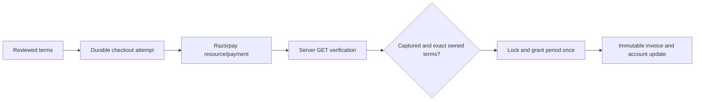

# Commercial operations: catalogues, allowances and billing

**Source reviewed: 7 November 2026.** This guide describes the current commercial
model and end-to-end customer/operator workflows. It replaces the accumulated
commercial implementation notes and retired feature descriptions.

Use [Authentication](authentication.md) for identity/session controls,
[Customer Support](customer-support.md) for requests/replies/account records,
[Customer site](customer-site.md) for frontend/metadata, and
[infrastructure](../infra/START-HERE.md) for deployment commands. Execution details
belong to [Backtesting](backtesting.md), [Paper](paper-trading.md),
[Live](live-trading.md), [Terminal](trading-terminal.md) and [AI Research](ai-research.md).

## Contents

- [Scope and records](#scope-and-records)
- [Deployment mode, execution scope and allowance](#deployment-mode-execution-scope-and-allowance)
- [First installation and operator setup](#first-installation-and-operator-setup)
- [Publish plan changes without code](#publish-plan-changes-without-code)
- [All current allowances](#all-current-allowances)
- [Admission, reservations and completion](#admission-reservations-and-completion)
- [Customer billing and checkout](#customer-billing-and-checkout)
- [Captured payment and paid period](#captured-payment-and-paid-period)
- [Renewal cancellation and plan changes](#renewal-cancellation-and-plan-changes)
- [Invoices, refunds and disputes](#invoices-refunds-and-disputes)
- [Provider uncertainty and reconciliation](#provider-uncertainty-and-reconciliation)
- [API contracts and implementation ownership](#api-contracts-and-implementation-ownership)
- [Worked examples](#worked-examples)
- [Routine operation and release checks](#routine-operation-and-release-checks)

## Scope and records

Public plans are Explore, Build and Pro, currently monthly INR offerings. Explore
is free. Paid checkout uses Razorpay and is off until explicitly configured/enabled.
Pricing/market descriptions come from a published database catalogue.

The current public catalogue advertises NSE stocks, with F&O marked Coming soon;
customer Live/Private is not offered. This commercial boundary is separate from
internal runtime contract capabilities. Do not change marketing availability by
editing a frontend badge alone.

| Model | Why it exists |
| --- | --- |
| `CatalogRevision` | Immutable published plan/limit/market/price snapshot; exactly one active revision |
| `Subscription` | User's purchased catalogue/plan, paid interval and renewal state |
| `PriceMapping` | Verified Razorpay monthly plan matching a published INR/tax-inclusive total |
| `PaymentAttempt` | Local reviewed checkout and stable idempotency identity before provider creation |
| `RenewalTerms` | Explicitly reviewed future automatic-renewal price/plan terms |
| `Payment` | Verified provider capture and once-applied access period |
| `Invoice` | Immutable buyer/seller/terms/amount/period receipt snapshot |
| `RefundRequest` | Customer request and operator approval/processing state |
| `RefundRecord` | Verified provider refund, including refunds initiated outside the app |
| `Dispute` | Verified provider dispute and access consequence |
| `UsageBucket` | One feature's used/reserved amount in the accepted period |
| `UsageReservation` | Work/resource accounting link, finalized once |

There is no current CreationReceipt, ProviderEvent, CommercialAudit, DeliveryJob,
OperationalApproval, MaintenanceState, customer-installation licence or operator
profit/cost-reporting workflow. Ordinary audit logs and required financial records
remain separate. Historical migrations are not removable just because a model's
active functionality was retired.

## Deployment mode, execution scope and allowance

Three independent questions must not be combined into scattered feature checks:

| Control | Decides | Source |
| --- | --- | --- |
| Deployment mode | Whether commercial limits are enforced/recorded | `QUANTNEST_DEPLOYMENT_MODE` |
| Execution scope | Whether Paper/Terminal and/or Live paths are enabled | `EXECUTION_ENABLED_SCOPES` |
| Account plan/allowances | Current resource/period/request limits | Purchased/active catalogue via `get_account_policy()` |

| Mode | Limits | Usage | Billing |
| --- | --- | --- | --- |
| Public | Enforced at admission | Recorded | Optional configured checkout |
| Development | Not commercially enforced | Recorded for inspection | Can use deliberately configured payment setup |
| Private | No commercial resource caps | No commercial quota ledger | No public checkout/renewal |

Private is currently an operator's personal deployment. All modes retain the same
registration/site UI; execution scopes determine applicable pages. Private does
not bypass ownership, account-active state, contract/session validity or actual
funds checks. It has no customer licensing/installations dependency.

An active paid account uses its purchased catalogue and paid period. Otherwise the
effective Public/Development plan is Explore from the active catalogue, with a
calendar-month allowance period in **Asia/Kolkata**. Paid eligibility is calculated
from verified `paid_through` and refund/dispute state; it does not wait for a nightly
status label to change.

Unused period credits do not roll over. Saved work/results are not deleted at a
downgrade. New over-limit work is rejected; inventory already over the new limit
can remain visible. A lower plan is not permission to automatically liquidate
positions or remove financial records. Explicit Paper resume/deploy/version actions
use current capacity rules; there is no subscription query in every runtime tick.

## First installation and operator setup

1. Follow the selected mode's infrastructure guide, create protected environment
   files, and start the backing stores/services.
2. Apply current migrations. A fresh database receives its catalogue seed through
   migration; do not use raw SQL to manufacture subscription/payment history.
3. Create the staff account and enroll Operations Admin OTP as described in
   [Authentication](authentication.md#administrator-access).
4. Confirm one active catalogue exists. Inspect plan names, limits, public market
   flags, source-candle credit unit and policy text before accepting customers.
5. Set the actual legal/contact/support values and email delivery configuration.
6. Keep `BILLING_ENABLED=false` until provider credentials, amounts, webhook,
   refund/recovery handling and customer acceptance checks are ready.
7. For automatic renewal, create/verify exact provider plan mappings after publishing
   the relevant catalogue. Manual payment does not need a recurring mapping.
8. Test with a normal owned customer account; Admin permissions are not a substitute
   for customer ownership/verified-email behavior.

Required billing settings are `RAZORPAY_KEY_ID`, `RAZORPAY_KEY_SECRET`,
`RAZORPAY_WEBHOOK_SECRET`, optional previous webhook secret for rotation,
`BILLING_TAX_BPS`, `BILLING_TAX_ID`, `BILLING_ENABLED` and operator identity.
Configure actual tax/legal values appropriately; code defaults are not a tax
determination. Secrets stay server side; the browser receives only the public
checkout key ID and its owned checkout identifiers.

## Publish plan changes without code

From **Operations Admin → Commercial → Catalog revisions**:

1. Select the published revision and **Clone selected revision as an editable draft**.
2. Open the draft and give it a unique revision name.
3. Edit each plan's readable name, monthly price in paise, and allowance fields.
   Explore must remain free. AI credits are entered as credits to three decimals;
   the form converts them to exact integer tokens.
4. Edit source candles per backtest credit if intentionally changing that unit.
5. Save. Validation requires complete allowed plans/features/limits, monthly INR
   pricing and permitted market availability.
6. Select exactly one revision and **Publish selected revision for new purchases
   and Explore**. This switches the active revision atomically.
7. Refresh pricing/Billing in the browser and verify new checkout totals/mappings.

Published specifications/revision names are immutable. Clone rather than edit
history. Only drafts can be deleted. Existing purchased paid terms retain their
catalogue; Explore and new purchases use the active revision. Open browser catalogue
state is refreshed explicitly or on reload, not continuously polled.

`catalog.py` constants seed a fresh database and define the schema. Changing those
constants is not a runtime update to an existing published revision. Default
prices/allowances below are code-seed values, not a live database quote.

## All current allowances

There are three allowance kinds, each with one common entry point:

| Kind | Meaning | Shared function |
| --- | --- | --- |
| Inventory | Current saved/deployed capacity | `require_inventory_capacity()` |
| Per request | Size of one accepted operation | `require_request_limits()` |
| Period | Successful work plus pending reservations in an accepted interval | `reserve_usage()` and final `complete_usage()` |

### Default catalogue values

| Feature key | Meaning / kind | Explore | Build | Pro |
| --- | --- | ---: | ---: | ---: |
| `strategies` | Saved strategies / inventory | 3 | 10 | 50 |
| `saved_screens` | Saved SCREEN sessions / inventory | 2 | 10 | 30 |
| `paper_deployments` | Active deployment capacity / inventory | 1 | 1 | 3 |
| `paper_instruments` | Active configured route capacity / inventory | 1 | 5 | 20 |
| `backtest_credits` | Accepted source-workload credits / period | 5 | 20 | 100 |
| `research_tokens` | Reported AI tokens, displayed as credits / period | 150 credits | 500 credits | 1,500 credits |
| `screens` | Deterministic screener runs / period | 10 | 100 | 300 |
| `monte_carlo` | Monte Carlo runs / period | 1 | 5 | 10 |
| `research_instruments` | Stocks in one research request | 5 | 20 | 50 |
| `backtest_attachments` | Completed reports attached to one request | 3 | 3 | 3 |
| `backtest_workload` | Source candles in one historical request | 100,000 | 250,000 | 1,000,000 |
| `mc_simulations` | Simulations in one Monte Carlo run | 1,000 | 1,000 | 1,000 |

The Paper capacity count includes RUNNING, PAUSED, STOPPING and ERROR sessions;
STOPPED does not occupy active capacity. Instrument capacity counts saved configured
watchlist routes in the deployed snapshot, not every nearby option-chain candidate
temporarily subscribed for selection. Saved strategies count saved records, not
only the Active tab. Saving a SCREEN session consumes inventory independently from
running that screen.

Default paid monthly prices are Build **49900 paise** and Pro **149900 paise**,
before configured tax. Current account/catalog responses must drive the UI.

### Backtest credits

The default credit unit is 100,000 source candles including warmup. Reviewed
source workload, not all output timeframes independently, determines the estimate:

```text
credits = max(1, ceil(source candles / catalogue credit_candles))
```

`estimate_backtest_workload()` freezes the prepared plan in cache for 30 minutes
and returns a signed user/config/date/credit-unit reference. Admission verifies it,
copies the accepted plan to the run, and checks per-request workload plus remaining
period credits. Changing strategy/dates/credit terms or expiring the cached plan
requires another preview. Private still prepares a valid plan even though it has
no commercial credit charge.

### AI research credits

One credit is 1,000 **reported tokens**, exact internally and displayed to three
decimals. Public admission requires a positive remaining balance but reserves zero
estimated tokens. A successfully validated/saved answer charges actual reported
totals once. It may finish above the remaining balance; then new work is blocked
until renewal. The original accepted period pays even if completion crosses into
another period. No debt rolls into the next period.

Failed/cancelled answers cost no customer credits. Missing usage is flagged as
incomplete; only known reported totals are charged. Cached/reasoning counts are
not added again to a provider total already including them. No cumulative customer
token budget is enforced per request. See [AI Research](ai-research.md#period-credits).

## Admission, reservations and completion

`get_account_policy()` resolves mode, plan, period and effective limits once for
the action. `_prepare_allowance()` validates allowance kind/amount, locks the owner
when needed and prevents cross-user policy reuse. A policy is reused only within
the same action/outer transaction, not cached as permanent user access.

| User action | Checks/accounting at acceptance |
| --- | --- |
| Create/clone a strategy, confirm research draft | Saved-strategy inventory |
| Save a named screen / convert CHAT to SCREEN | Saved-screen inventory |
| Deploy/resume Paper, change relevant deployed version | Scope and proposed Paper deployment/route inventory |
| Preview/create backtest or confirmed research backtest | Exact workload, request cap, signed preview, period reservation |
| Accept AI Research | Owned context/request size, one active request, positive token balance/zero-charge period anchor |
| Accept deterministic screen | Context/request validation and screen-run reservation |
| Create Monte Carlo | Owned completed source/trades, simulation request cap and period reservation |
| Manual Terminal order | Financial/contract/session checks; no period-credit charge |
| Personal Live | Scope, account, contract and actual funds checks; no Public customer subscription entitlement |

Resource creation and reservation belong in one outer transaction. A stable
idempotency key/fingerprint prevents reusing one accounting identity for different
work/resources. It is not a universal receipt system that deduplicates every
arbitrary HTTP create automatically.

`queue_compute_work()` dispatches after commit to the existing compute queue. A
definite unstarted publication failure marks the accepted work failed and settles
its reservation; callers inspect status before creating another request.

`complete_usage()` acts only on COMPLETED/FAILED/CANCELLED and an existing reserved
record. Success moves reserved units to used; failure/cancellation releases them.
Actual-token success uses the saved usage total. Duplicate model/task completion
is harmless because the reservation leaves `reserved` only once.

Completion handlers connect saved outcomes and Celery failure/postrun. They do
not recheck a new plan at each candle, tool iteration or fill. A killed process
that never records a terminal outcome can still need operator inspection; a
completion hook is not proof that every infrastructure interruption self-heals.

There are no licence/module gates or allowance guards in the numerical tick path.
Do not remove account/funds/position-revision checks merely because commercial
allowances are checked at acceptance; those protect different invariants.

## Customer billing and checkout

Open **Profile → Billing and Usage** (`/settings/billing`). Tabs are Plan and renewal,
Usage and limits, Payments and invoices. The account endpoint supplies the effective
plan/period, usage, recent checkouts/invoices and reviewed new-checkout totals.

To buy or manually renew:

1. Verify the account email.
2. Select Build/Pro and review current catalogue revision, base, tax and total.
3. Choose manual payment or explicitly opt into monthly automatic renewal when a
   matching provider mapping is configured. Manual is the current UI default.
4. Start checkout with a stable `Idempotency-Key`, approved total and catalogue
   revision. The API refuses stale terms, wrong total, inactive/unavailable billing,
   an unresolved conflicting checkout, or missing automatic-renewal consent.
5. The service saves the local `PaymentAttempt` before creating a provider order
   or subscription. Provider notes/receipt carry its exact attempt identity.
6. The browser loads Razorpay Checkout using that owned order/subscription ID.
7. After provider success, the browser asks the backend to verify the payment ID.
   It does not directly set a paid plan.
8. Reload account/invoices to see verified capture/application. Pending/unknown
   results remain visible and are reconciled before another payment attempt.

Automatic mappings are verified against amount, INR, monthly period and interval
one. Base price and configured tax use integer minor units. Optional API billing
details are bounded buyer name/address/tax-ID strings; the current normal checkout
UI primarily reviews plan/totals/renewal. Do not imply a complete tax-invoice buyer
editor exists merely because the backend accepts a bounded details object.

## Captured payment and paid period



`verify_payment()` fetches provider payment state and links the exact local
order/subscription, validates ownership, amount/currency and capture, then locks
and applies access once using unique payment ID/`applied_at`.

An authorized/created payment is not captured access. A recurring payment needs
its **own paid provider invoice** and verified billing start/end; the provider's
latest subscription period cannot be guessed for an older payment. A captured
manual payment grants one calendar month from the later of capture and existing
paid-through. A delayed older payment cannot shorten a newer period.

The latest applied manual extension updates the subscription's plan/catalogue
snapshot. It is not the automatic cycle-end scheduled-change mechanism; switching
manual plans is not a general prorated upgrade/downgrade workflow. Current periods
and displayed terms should be reviewed rather than inferred from marketing text.

The first applied workspace purchase establishes the current six-month same-plan
price-protection fields. The eligible protected base is at most the current base;
tax is still calculated from configured basis points. This is implemented pricing
behavior, not permission to advertise terms beyond the published agreement.

## Renewal cancellation and plan changes

Cancel future renewal from Billing. For a provider subscription, the API requests
cycle-end cancellation, then records `cancel_at_end`. Existing paid-through access
is retained. Cancellation is not an immediate refund or deletion of saved work.

Automatic plan changes:

1. Review the desired plan's total.
2. Validate an active provider subscription and a matching published price mapping.
3. Save `RenewalTerms` before requesting the provider's cycle-end change.
4. Mark accepted only after provider success/reconciliation.
5. Apply the matching purchased terms when the later verified payment/invoice
   begins the approved period.

An unknown previous change blocks conflicting changes until reconciliation. Choosing
Explore uses cancellation rather than a paid prorated conversion. Manual subscriptions
use another reviewed manual checkout; they cannot call the automatic schedule API
without the provider relationship.

## Invoices, refunds and disputes

### Invoice records

Each applied captured payment creates one `QN-…` invoice with immutable seller,
buyer, catalogue, plan, amounts, currency and period. JSON or downloadable printable
HTML is available only to its owner. Provider payment/order/subscription references
are different identifiers; a refund needs the actual `pay_…` payment reference.

The account snapshot intentionally bounds recent history (up to 50 invoices and
10 checkout attempts). Refund list is a small current API array, not the common
paged financial-history contract. Do not describe these as unlimited complete
historical exports. Account export/support handles broader record needs.

### Refund request and processing

1. Customer selects an owned captured payment and supplies a 5–3,000 character reason.
2. The first applied workspace purchase within seven days is labelled `eligible`;
   other captured requests enter `review`. This does not automatically send money.
3. An existing non-rejected request is reused. Pending/nonfailed provider refunds
   reduce the remaining refundable amount.
4. An authorized operator reviews the request in Admin and approves/rejects.
5. Approval queues `commercial.process_refund`; a stable provider idempotency key
   is saved before POST. Unknown previous refunds are discovered rather than blindly
   sent again.
6. A verified provider refund updates request/record. Processed refunds produce a
   credit-note snapshot. Full processed refund recomputes subscription access;
   partial refunds do not automatically mean the whole period disappears.

`eligible` is not `approved`, and `approved/provider_pending` is not money returned.
Provider processing is authoritative. A rejected unsubmitted request does not
reverse a provider refund already made. Tax/refund policy text needs appropriate
operator review; these are application states, not legal advice.

### Disputes

Signed events lead to provider verification of the dispute's payment/currency.
`Dispute` stores status, amounts/deductions and response deadline. Access is
recalculated from the latest undisputed captured period; an open/under-review/lost
payment cannot simply grant ordinary paid access. Required financial history is
retained rather than erased to remove the event.

## Provider uncertainty and reconciliation

Razorpay callbacks require a valid HMAC over the raw bounded request body using
the current or configured previous webhook secret. The handler validates shape,
then **fetches provider state**. A signed event payload alone is not an access
grant; duplicates/out-of-order events cannot apply a payment twice.

`provider_unknown` means remote creation may have succeeded despite a lost response.
Reposting a new mandate/order can duplicate money movement. Reconciliation searches
by saved attempt notes/receipt and validates exact terms; it does not match solely
by email, approximate amount or the latest provider record.

The current scheduled `commercial.reconcile` runs every five minutes outside
Private. It processes a bounded batch/time budget, resolves old uncertain attempts,
checks pending/captured payments/refunds/renewal terms and updates expired status.
Operator **Discover and reconcile selected provider checkouts** handles at most
20 selected attempts without creating new provider mandates/orders.

Reconciliation is bounded: truncated/ambiguous searches remain unresolved, provider
outages remain errors, and it does not guarantee discovery of arbitrary records
unrelated to the saved identity. Refund history uses its own verified bounded read.

## API contracts and implementation ownership

Public read: `GET /api/v1/public/catalog/` returns sanitized published terms,
support specification, limit labels/divisors, checkout state, scopes and contact.
No account/provider secret is part of that payload.

Authenticated prefix: **`/api/v1/billing/`**.

| Method/path | Purpose |
| --- | --- |
| `GET account/` | Effective plan/period, usage, renewal, recent receipts and checkout totals |
| `POST checkout/` | Reviewed automatic-renewal checkout |
| `POST renew/` | Reviewed manual payment |
| `POST verify/` | Verify an owned provider payment ID |
| `POST change/` | Reviewed automatic cycle-end plan change |
| `POST cancel/` | Cancel future renewal |
| `GET/POST refund-requests/` | Owned refund history/request |
| `GET invoices/{id}/` | Owned JSON invoice; `download=html` for printable response |
| `POST webhooks/razorpay/` | Provider-signature authentication, not customer JWT |

| Source | Responsibility |
| --- | --- |
| [catalog.py](../backend/commercial/catalog.py), [models.py](../backend/commercial/models.py) | Schema/seeds, published and purchased records |
| [admin.py](../backend/commercial/admin.py) | No-code catalogue publication, verified mappings, refund approval and reconciliation |
| [usage.py](../backend/commercial/usage.py) | Shared policy, three allowance kinds, queue/completion accounting |
| [billing.py](../backend/commercial/billing.py) | Reviewed checkout, verified capture/period, renewal, refunds/disputes |
| [provider.py](../backend/commercial/provider.py), [reconciliation.py](../backend/commercial/reconciliation.py) | Provider transport and safe uncertain-state recovery |
| [tasks.py](../backend/commercial/tasks.py) | Refund work and periodic reconciliation |
| [views.py](../backend/commercial/views.py), [invoices.py](../backend/commercial/invoices.py) | Public/account API and receipt rendering |
| [BillingUsage.jsx](../frontend/src/features/billing/pages/BillingUsage.jsx), [razorpay.js](../frontend/src/shared/services/razorpay.js) | Customer review/checkout/recovery UI |

To add an allowance, define its kind/model/pricing/display divisor in `ALLOWANCES`,
add the correct admission call at the resource service boundary, connect terminal
outcome settlement for period work, publish a complete new catalogue revision and
update UI labels/examples. Do not add scattered deployment-mode branches inside
engines or a second Billing counter.

## Worked examples

### Price and tax review

With an illustrative base of 49,900 paise and configured tax 1,800 basis points,
tax is `(49,900 × 1,800 + 5,000) // 10,000 = 8,982` paise and total 58,882 paise.
Those are arithmetic examples, not a tax recommendation. An approved total of
49,900 would be rejected because it excludes that configured tax.

### Backtest reservation

A 150,000-source-candle request with the 100,000 unit costs two credits. A Public
account with one remaining credit cannot start it; three remaining can reserve
two. Success settles two, failure/cancellation releases them. Changing higher
display timeframes does not itself multiply the already shared source count.

### Actual AI usage

88,654 reported tokens settle 88.654 credits. If only 2.000 remained when accepted,
the answer can still finish, consume its actual total in that original period and
block later requests. This is not an automatic money overage or next-period debt.

### Provider creation timeout

The local attempt exists before Razorpay creation. A timeout leaves it unknown.
The customer sees its reference; an operator/scheduled read finds the exact saved
provider note/receipt. It links/verifies that resource instead of creating another
order just because the first response was lost.

## Routine operation and release checks

| Concern | Routine check |
| --- | --- |
| Catalogue | Exactly one active revision; published records immutable; browser and checkout show reviewed terms |
| Mappings | Exact plan amount/currency/monthly interval and configured tax context |
| Queue/Beat | Default queue handles commercial/support tasks; compute handles accepted backtest/research/Monte Carlo work |
| Checkout uncertainty | Old creating/provider_unknown attempts, rejected provider fetches and reconciliation result |
| Refunds/disputes | Approved/provider-pending requests, processed records/credit notes and deadlines |
| Allowances | Correct accepted period/resource, reserved versus settled/refunded, no duplicate completion |
| Account lifecycle | Renewal cancelled and exposure settled before disable/erasure |
| Secrets | Protected provider/proxy/email credentials; previous webhook secret only for an intentional rotation window |

For release, verify all three deployment modes, each allowance kind, concurrent
admission, estimate expiry, successful/failed/cancelled work, AI overrun/renewal,
catalogue publication versus purchased terms, manual/automatic captures, duplicate
and delayed callbacks, failed/unknown creation, refund reconciliation and ownership.
Use deliberate provider test facilities before real money. This documentation
refresh does not create payments, publish a catalogue or prove merchant approval.
