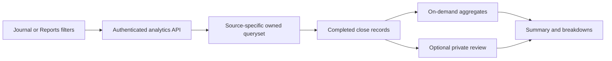

# Execution journal, reports and activity

**Source review: 16 October 2026.** This guide explains the data and request flow
behind /journal, /reports and /activity. Customer/operator account workflows are in
[Commercial operations](commercial-operations.md).

## 1. Select the correct source

| Source | Authoritative completed records | Realized P&L basis |
| --- | --- | --- |
| TERMINAL | trading.ClosedPositionLog | Manual simulation, before fees |
| PAPER | paper_trading.PaperTrade | Net of recorded simulated brokerage and taxes |
| LIVE | live_trading.LiveTrade | Recorded Live closes, before fees |

Reports never combine these ledgers or include backtests. A partial exit counts
as its own stored close. Cash transfers are not trading results.

Source access is validated for the user. Availability of new execution is separate
from the ability to inspect owned historical records. A Public account does not
gain Live execution by changing the report source.

## 2. Customer flow

1. Open Journal or Reports and choose a source.
2. Set the date range and optional account, strategy, instrument/search and review filters.
3. Read the displayed P&L basis before comparing results.
4. Open a completed close to inspect its financial record.
5. Add private notes, lessons, optional rating and mistake tags; save the review.
6. Use Reports for totals and daily/instrument/strategy breakdowns.
7. Export the filtered closes or create a research evidence attachment.
8. Use Activity History to inspect configuration/lifecycle changes separately.

Desktop source controls appear in page actions; smaller layouts use a compact
control. The review dialog scrolls its body while retaining usable actions.

## 3. Request and calculation flow

The query uses the source's ownership path and financial field. There is no
second derived financial ledger populated solely for reports.

Default dates are the last 30 calendar dates including today. Date bounds use the
application's active timezone and the close's exit_time. The maximum selected
range is ten years. A Terminal strategy filter is invalid because manual trades
have no strategy.

List filters do not authorize a detail record: detail ownership is always checked
independently.

## 4. Metric definitions and limits

- Total realized P&L sums the source's recorded close field.
- Win rate is winning closes divided by all closes, including breakeven closes.
- Profit factor is positive P&L divided by absolute negative P&L.
- Missing/undefined ratios display unavailable rather than infinity or invented zero.
- Average values and holding durations derive from the selected closes.
- Daily breakdowns group closes; they are not a complete equity curve.
- Tags/ratings are user assessments rather than objective financial evidence.

Historical equity returns, Sharpe and equity drawdown are unavailable without a
verified historical equity series. Do not label cumulative closed P&L as equity.

Current unrealized P&L is a separate mark of current owned positions. It uses cached
quotes no older than 60 seconds. If any included position is unpriced, the combined
unrealized total is unavailable and reports the missing coverage.

Historical date/review-status filters apply to closes, not current position marks.
Report generation does not call the broker or write position prices.

## 5. Review records

A JournalEntry belongs to the user and links to exactly one completed source close.
The link must match its selected source and be owned. Financial fields are read-only.

Saving creates/updates notes, lessons, optional execution rating and mistake tags.
Deleting a review removes the assessment; it does not delete the trade. Deleting
a source close cascades to its review. There is no unlinked general-note archive.

A close can have multiple mistake tags. Grouped tag P&L overlaps and must not be
summed as if each group were disjoint.

Review coverage uses the same source/filter context to distinguish reviewed and
unreviewed closes. The Journal lists actual closes even before a review exists.

## 6. Exports

The report export returns CSV for the selected source and filters. It rejects more
than 50,000 closes; narrow the date range instead of expecting a truncated export.

Rows include source, P&L basis, symbol, strategy/account, side, quantity, prices,
timestamps, realized P&L and recorded charges where available. Text is escaped
against spreadsheet formula execution. Unavailable Live/Terminal fees are not
replaced by hypothetical Paper charges.

The close list is paginated at 25. Exports are separate from page pagination.

## 7. AI execution review

Ask AI creates an owned research conversation with a frozen, dated execution
snapshot. It prepares a question/context; no model request is started until the
user sends the message.

Evidence contains selected-source totals, bounded daily/group breakdowns and
selected or strongest/weakest closes. Saved journal notes are excluded unless the
user explicitly includes them. Save edits first; unsaved notes are not attached.

Sending the research turn uses normal research availability, request bounds and
usage reservation. A context attachment is not a quota bypass.

Research references are validated against backend evidence. Unknown citations are
rejected across answer and auxiliary sections. The response must distinguish
recorded observations from hypotheses and self-reported notes.

Refreshing analysis creates a new snapshot. Reloading a saved turn retains its
original evidence/date. Removing the execution context chip excludes it from
subsequent turns. These reports are evidence review, not investment advice.

## 8. Activity History

Activity is private and read-only. It covers allowlisted configuration changes,
strategy versions, supported lifecycle transitions, broker configuration, capital
allocations, Paper account resets and explicit authentication events.

Orders, quote ticks, financial balances changed by fills and position updates do
not create an activity row for every hot-path event. Credential changes record
field names without secret values.

Supported resource categories include strategies, broker accounts, Paper accounts,
Paper/Live allocations, Paper/Live sessions and authentication. Labels and choices
come from backend metadata even if the user has no existing events.

Payments, invoices and licence issuance records have their own workflows and
should not be assumed to appear in the customer's Activity History API.

## 9. API map

| Method and path | Purpose |
| --- | --- |
| GET /api/v1/analytics/reports/ | Filtered report and current marks |
| GET /api/v1/analytics/reports/trades/ | Paginated owned closes and saved review data |
| GET /api/v1/analytics/reports/export/ | Filtered source CSV |
| POST /api/v1/analytics/reports/research-context/ | Frozen evidence and owned research conversation |
| GET/POST /api/v1/journal/entries/ | List/create private reviews |
| GET/PATCH/DELETE /api/v1/journal/entries/<id>/ | Read/update/delete owned review |
| GET /api/v1/journal/entries/summary/ | Review coverage and assessments |
| GET /api/v1/audit/logs/ | Private activity history |

Closed-record filter names: source, date_from, date_to, account_id, strategy_id,
instrument_id, search and reviewed. Source values are TERMINAL/PAPER/LIVE;
reviewed is all/reviewed/unreviewed.

## 10. Source navigation and troubleshooting

| Concern | Source |
| --- | --- |
| Filters, ownership and aggregates | [analytics/services.py](../backend/analytics/services.py) |
| Pagination, CSV and research action | [analytics/views.py](../backend/analytics/views.py) |
| Review link/ownership validation | [trade_journal/serializers.py](../backend/trade_journal/serializers.py), [models.py](../backend/trade_journal/models.py) |
| Review coverage | [trade_journal/services.py](../backend/trade_journal/services.py) |
| Audit writes/API | [audit app](../backend/audit) |
| Shared frontend review state | [useReviewWorkspace.js](../frontend/src/features/journal/hooks/useReviewWorkspace.js) |
| Pages/dialog | [journal feature](../frontend/src/features/journal) |

If totals differ, compare source, date/timezone, partial-close count, fees basis and
saved filters first. If a current mark is missing, check quote age/coverage rather
than altering historical closes. If a review cannot save, confirm the source close
is complete, owned and not already linked through another review.

Apply normal migrations when upgrading. Removed marketplace/community/report-cache
features are not runtime prerequisites. Historical migrations remain required;
do not reintroduce retired permissions, unlinked reviews or generated insight
stores to make a current page work.
