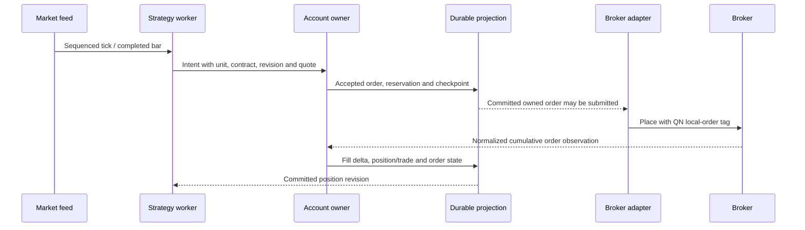

# Live trading: complete user and technical guide

**Source reviewed: 7 November 2026.** Live deploys saved strategies to a connected
broker account. Signals are calculated locally; only broker-confirmed order fills
create real executed exposure in the platform. This guide describes implemented
behavior and identifies the remaining broker/settlement qualification boundaries.

Use [Strategy Studio](strategy-configuration.md) for authoring and shared rules,
[Paper](paper-trading.md) to exercise those rules with simulated fills, and
[integration setup](../infra/shared/INTEGRATIONS.md) for provider dashboards and
connection configuration. Public deployment is Paper scope; current Private use is
the operator's separate instance, not a public customer Live offering.

## Contents

- [Scope and prerequisites](#scope-and-prerequisites)
- [Connect the broker and prepare funds](#connect-the-broker-and-prepare-funds)
- [Deploy a saved version](#deploy-a-saved-version)
- [Account and strategy ownership](#account-and-strategy-ownership)
- [Signal to broker order](#signal-to-broker-order)
- [Broker events and cumulative fills](#broker-events-and-cumulative-fills)
- [Order reconciliation and timestamps](#order-reconciliation-and-timestamps)
- [Manage running sessions](#manage-running-sessions)
- [Data and contract lifecycle](#data-and-contract-lifecycle)
- [Valuation, charges and reporting](#valuation-charges-and-reporting)
- [Operations and recovery](#operations-and-recovery)
- [API contracts](#api-contracts)
- [Implementation ownership](#implementation-ownership)
- [Worked examples](#worked-examples)
- [Release checks and unsupported behavior](#release-checks-and-unsupported-behavior)

## Scope and prerequisites

| Requirement | Why it matters |
| --- | --- |
| Instance includes `live` in execution scopes | Backend deployment control; hiding/showing a button is not authorization |
| Active owner, owned eligible strategy, Active status and Live flag | Prevent deploying another user's or unavailable strategy |
| Saved owned version | Runtime executes a deliberate snapshot, not every unsaved Studio edit |
| Entry and stop-loss logic passing Live validation | Live validation requires both; a valid authoring document alone is not deployment eligibility |
| Verified broker connection and valid broker session | Broker APIs must be authorized for that account |
| Usable broker funds snapshot and fixed allocation | Account/session budget admission remains necessary |
| Market data/history and exchange/segment calendar | Correct prices, warmup, bar clocks and session availability |
| Execution, market-data, broker-events, API and supporting stores | Each handles a separate part of the lifecycle |

FYERS is the current broker adapter. Broker-specific authentication, request keys,
response normalization and order-stream formats belong to that adapter. The common
service consumes normalized contracts so a new broker does not require changes to
the numerical rule engine.

Broker approval, account/API eligibility, network access and any applicable use
requirements must be established independently. An enabled Live screen or passing
local fixtures is not proof of a qualified real broker deployment.

## Connect the broker and prepare funds

1. Open **Broker Integration → Connections** and select the available broker.
2. Complete its broker-specific connection configuration and authorization flow.
   Use the connection details returned for that broker; do not copy another
   broker's credential fields or callback format.
3. Verify the connected identity/account and current authorization state. Secret
   credentials belong on the server, not in frontend bundles or documentation.
4. Refresh/read broker funds and confirm the net-equity/margin information is
   plausible for that exact account.
5. Configure the separate market-data connection used by the shared feed.
   A trading broker session and the platform's market-data authorization are
   separate boundaries even when both use FYERS.
6. Run the required runtime services before expecting the deployment to execute.

`BrokerService` is the common facade. `ensure_session()` retrieves a usable broker
session; adapter methods handle the actual profile, funds, orderbook, placement,
cancellation and stream creation. Disconnect/reconfigure operations reject unsafe
changes while related active work/exposure must be settled.

Fund synchronization creates a timestamped `BrokerFundsSnapshot` and a durable
`FUNDS` command. The account owner applies it with checkpoint/revision fences;
an old external observation must not erase more recent local commitments.

New exposure currently requires a broker funds observation within **90 seconds**
of the intent clock. This is a broker-account funds rule, not a market tick-age
rule. Protective closing is not blocked solely by that funds freshness check.

## Deploy a saved version

From **My Strategies → Live deployment**:

1. Select the saved version and connected owned broker account.
2. Enter a fixed capital budget. Percentage allocation is removed.
3. Review selected markets, automatic contract policies, entry direction, size,
   stop/exit rules and schedule before confirming.
4. The service validates the version/definition, connection and funds. Other
   allocations plus the new budget cannot exceed observed broker net equity.
5. A session/allocation is created and a runtime refresh is requested.
6. Open **Live Trading → Deployments**, filter status and inspect applied version,
   broker connection, open exposure, pending work and any application error.

Multiple versions do not permit duplicate deployment of the same strategy to the
same broker account. The current unique relationship is **strategy + broker
credential**. Deploying the strategy to a different owned broker account is
allowed. Paper instead permits different saved versions of one strategy.

Allocation is a local risk budget; it is not a transfer of real money to a new
broker subaccount. Real broker cash and all sessions using that connection remain
shared. A successful deploy request is not a signal, submission or fill.

## Account and strategy ownership

The financial account owner is keyed by Live mode and broker credential. Each
automated unit has `(mode, session_id, route_id, leg_id)` ownership and a separate
signal/traded-contract binding.

- Each unit's conditions, crossing samples, captures and position state remain
  independent of another strategy's state.
- Shared market feature calculations may be reused without sharing private setup
  state or duplicating available account cash.
- The account owner serializes reservations, fill deltas and releases across all
  allocations on that broker account.
- An open or pending unit pins its exact contract. A new ATM selection cannot
  retarget an already submitted order or change a position into another strike.
- Only platform-owned orders contribute to those session-level projections.

Broker aggregate positions may include manual trades, other systems and offsetting
sessions. They cannot identify the platform's individual strategy ownership and
therefore do not overwrite it. Users must reconcile external/manual activity
deliberately instead of assuming the platform has assigned it to a strategy.

## Signal to broker order



1. `market-data` writes canonical observations to local buffers. Completed source
   bars advance the prepared graph; LTP inputs read live observations.
2. The shared evaluator runs only on available dependencies, without ORM, network
   or broker access in the numerical tick path.
3. The unit emits an intent carrying ownership, selected contract, current position
   revision, signal clock and traded reference price.
4. The account owner checks status, duplicate/pending work, quantity/lot/tick/session,
   funds and allocation, then accepts/reserves or rejects with a reason.
5. The controller persists the financial transition and owned `LiveOrder` before
   broker I/O. It exists durably in an unresolved/`UNKNOWN` submission state.
6. `controller.broker_call()` validates authentication before placement. A definite
   local auth failure becomes a rejected observation because no order was sent.
7. `BrokerService.place_order()` calls the adapter with symbol, side, quantity,
   market order type, product type and tag **`QN{LiveOrder.pk}`**.
8. Placement acknowledgement binds broker order ID/state. It is not treated as
   the requested quantity having filled.
9. Order-stream or REST observations produce cumulative fill changes through the
   same account writer. Only those confirmed changes update positions/trades.

The current Studio execution generates market orders. Manual limit/stop ticket
matching belongs to the simulated Terminal; it is not a hidden Live strategy
setting. Equity product mapping uses CNC and derivatives MARGIN rather than
switching product merely because the strategy is called Intraday.

### Ambiguous submission

A timeout after placement starts can mean the broker accepted the order but the
response was lost. The system keeps that owned order/reservation unresolved and
reconciles it by broker ID or exact local tag. It does not blindly submit another
order. A real unknown order is a state to resolve, not a failed fill to fabricate.

Submission runs outside numerical workers. DB commit, broker HTTP transport,
exchange processing and order-stream delivery are additional stages after signal
calculation; no single latency number represents all of them.

## Broker events and cumulative fills

`python -m quantnest_runtime broker-events` manages the active broker order streams.
Its manager refreshes the required connection set periodically, so deployments and
connection lifecycle changes do not need one stream per strategy or instrument.

The normalized observation includes broker ID, tag/identity, symbol/side/quantity
when supplied, order state, cumulative filled quantity, cumulative average,
broker timestamps, exchange ID and rejection text.

`live_trading/order_processor.py` finds an **owned** order:

1. Scope to the same user and broker credential.
2. Match the exact stored broker order ID first.
3. Otherwise parse the exact `QN` plus positive local-order-ID tag and validate
   that the candidate is owned by this credential/session/allocation.
4. Reject conflicting IDs or supplied symbol/side/quantity inconsistencies.
5. Ignore unmatched external orders rather than import an unrelated position.
6. Queue a `BROKER` command to the account owner.

The owner calculates incremental execution from cumulative totals. Example:

```text
Report 1: 10 cumulative units, average 100.00 -> 10 units at 100.00
Report 2: 15 cumulative units, average 101.00 -> 5 new units at 103.00
```

The second delta price is `(15×101 − 10×100) / 5 = 103`. Applying 15 units again or
using 101 as the second fill would corrupt the position and cash.

Duplicate observations do not fill twice. Regressive/contradictory quantities,
turnover or terminal states require reconciliation rather than silent rewriting.
Filled/cancelled/rejected terminal outcomes release the appropriate remaining
reservation through the committed transition. Partial fills remain owned exposure
even if the unfilled remainder is later cancelled.

## Order reconciliation and timestamps

REST orderbook reconciliation is the recovery complement to the order WebSocket.
Both paths feed the same normalized observation writer; there is no second
financial implementation that independently rebuilds trades from a broker tradebook.

- Scheduled reconciliation runs approximately every 60 seconds when Live scope
  is enabled. It groups by credential rather than calling the broker per session.
- It includes active/paused/stopping/error work and accounts with unresolved orders
  or open exposure, rather than assuming only RUNNING sessions need recovery.
- User **Sync** requests an owned orderbook reconciliation for the session's broker
  account. It does not import all broker positions/trades.
- Funds snapshots refresh the financial ceiling separately from order fills.
- WebSocket disconnects can increase confirmation delay until REST catches up;
  they do not justify marking an order filled locally.

### Broker timestamps

FYERS normalization parses documented `orderDateTime` with
`%d-%b-%Y %H:%M:%S` in `Asia/Kolkata` and converts to an aware UTC timestamp.
Its available event epoch supplies the normalized update time; exchange order ID
is retained where supplied. A missing event timestamp falls back to the local
observation receipt time, not a fabricated historical fill time.

The projections keep order/submission, broker event/fill and local persistence
facts separately where the model supports them. Local `created_at` is not proof
of exchange execution time. UI formatters render aware timestamps consistently;
do not remove timezone information when correlating logs.

## Manage running sessions

| Action | Behavior and constraints |
| --- | --- |
| Pause | Stop new entries, retain protective/exit handling and owned exposure; pending unfulfilled setup state is reset as applied |
| Resume | Revalidate version/strategy/scope, broker session/funds and current budget, then request runtime refresh |
| Stop without close | API default `close_positions: false`; stop entries/cancel entry work while keeping owned positions managed |
| Stop & close | Explicit `close_positions: true`; close through real broker orders and wait for confirmed fills |
| Change fixed allocation | Sync funds, validate total account budget and committed margin/reservations, then queue the owner change |
| Change saved version | Validate same-strategy snapshot, open owners/contracts and pending orders before asynchronous application |
| Sync | Read broker orders and queue their normalized observations |

Stopping a process or session does not prove broker positions are flat. With close
requested, a submitted exit can remain partial/unresolved while the broker is
unavailable. Repeated Stop without close is idempotent for STOPPING/STOPPED;
explicit close can request the remaining cleanup.

The API's 2xx response acknowledges the user action, not a completed broker fill
or instant version install. Requested/applied version, command errors, open orders
and positions provide the actual state. Keep the service running to apply accepted
commands; normal capital/version edits do not require a restart.

### Version and capital fences

New configuration cannot delete/rebind an open unit or replace its contract.
Working orders must settle before a conflicting change. Setup changes around open
positions can require flat exposure; initial-risk edits are not retroactive entry
prices/stops for an already filled position.

Live allocation reduction must preserve committed margin/reservations and the
account's current realized basis. Only one allocation-change operation can be
pending. Multiple sessions cannot each allocate the same free broker funds as if
their budgets were independent real deposits.

Public/Development/Private commercial rules are centralized at usage admission.
Private has no commercial resource caps, but ownership, execution scope, data,
contract validity and actual account funds remain necessary. There is no
per-tick licence/subscription query.

## Data and contract lifecycle

Live uses the same history preparation, calendar, local observation buffers,
compiler, indicators, rolling/formula semantics and setup state machine as Paper.
See [shared data preparation](paper-trading.md#live-data-preparation).

- Completed-bar rules wait for completion; LTP rules react to received observations.
- Separate signal/traded instruments are joined causally. An index quote cannot
  serve as an option fill or a future's margin reference price.
- Simple level conditions and capture false→true re-arming remain different.
- A new automatic contract can be selected only for eligible flat/pending-free
  entry. Historical preparation is selective rather than the full option chain.
- Open/pending contracts retain subscriptions and ownership after the underlying
  moves to another ATM or a new desired expiry.
- No tick is rejected merely for exceeding a fixed age in seconds; reconnect
  generations, missing observations and graph readiness still matter.
- Entry-end schedule prevents new local entry admission; it does not mean
  intraday square-off or proof that an already accepted broker order was cancelled.

Active/tradable status, expiry, listed strike availability, whole lots, price tick,
freeze constraints and exchange/segment sessions are checked. Current simulation
collateral rates are not a substitute for the broker's actual margin/risk rules;
the broker can still reject an otherwise locally admitted order.

## Valuation, charges and reporting

Live Portfolio combines overview, positions, orders, trade history and performance.
Deployments manages sessions/versions/capital; Execution Logs exposes scoped
execution events. Detailed broker-account balance cards were removed from the
portfolio; connection/funds administration belongs to Broker Integration.

Open P&L uses the same shared quote/valuation layer as Paper/Terminal:

```text
Open P&L = direction × (mark − entry average) × units × multiplier − settled MTM
```

The backend supplies full-filter `valuation_positions`; frontend valuation updates
rows and aggregate cards from the same quote store, including off-page exposure.
Financial events/reconnects refresh exposure, not every price tick. Missing marks
are incomplete/N/A, not a claim of zero exposure.

**Current Live closing does not integrate actual broker charges.** The Live ledger
does not apply the simulated profile as a broker invoice; its closing charge
dictionary is empty. A field labelled net cannot be interpreted as independently
reconciled after-broker-fee profit. Use the displayed before-charges basis and the
broker's actual statement until a qualified charge-report adapter is implemented.
Paper/Backtest/Terminal simulated close-cost profiles have a different role.

Recorded trades derive from owned order fills. Journal reviews add notes/tags/
ratings without changing fills. Performance reports preserve source/account/date
and fee basis; AI research can review an explicitly attached owned report.

Daily broker MTM, final settlement, assignment and physical delivery are not
automatically posted from public settlement prices. Those require account-specific
broker/clearing evidence. The
[simulation settlement importer](paper-trading.md#derivative-settlement) deliberately
rejects Live accounts instead of fabricating exchange cash movements.

## Operations and recovery

Required runtime commands from `backend`:

```powershell
python -m quantnest_runtime market-data
python -m quantnest_runtime execution
python -m quantnest_runtime broker-events
```

Also run API/ASGI, PostgreSQL, Redis and the configured Live/background Celery/Beat
tasks. Service topology, environment and production cutover instructions are in
[infrastructure](../infra/README.md). Do not launch a separate Terminal/orders
daemon; execution already owns those account paths.

At restart, the controller recovers committed account checkpoints/projections,
restores pending financial state, prepares required markets and reconciles owned
broker observations. It does not erase UNKNOWN work or recreate every order.
One execution group and one relevant provider service must own their leases.
If a numerical worker dies, the group stops for committed-state recovery instead
of leaving a subset of financial owners silently absent.

| Failure | Correct operational interpretation |
| --- | --- |
| Market feed unavailable | No invented execution observations; repair feed/history and readiness |
| Broker stream lost | Keep unresolved orders; REST reconciliation can recover reports |
| Placement HTTP timeout | Broker acceptance uncertain; match broker ID/local tag before any new action |
| Broker auth definitely invalid before send | Local rejection; reauthorize and inspect remaining exposure |
| Stale funds | Refresh account observation for new exposure; it is not a tick-age warning |
| UI socket disconnected | Refresh/reconnect display; broker/runtime may still be running |
| Version/capital pending | Inspect command/preparation state, do not assume browser values already govern trades |
| External/manual broker activity | Review account funds and owned orders; aggregate broker positions cannot establish strategy ownership |
| Final settlement/delivery occurred | Reconcile broker-specific evidence; simulation import cannot repair Live cash |

Stop services for incompatible schema changes according to the migration/cutover
instructions. Never clear checkpoints or remove unresolved orders as a substitute
for reconciling actual broker exposure.

## API contracts

Authenticated prefix **`/api/v1/live/`**. Lists use shared server pagination
(`page`, `page_size` 10/25/50/100, default 25) and owned server-side filters.

| Method/path | Purpose |
| --- | --- |
| `GET sessions/`, `sessions/summary/`, `sessions/{id}/` | Deployment list, state counts and detail |
| `POST sessions/{id}/pause/`, `resume/` | Lifecycle commands |
| `POST sessions/{id}/stop/` | Stop; explicit boolean `close_positions` controls requested liquidation |
| `POST sessions/{id}/sync/` | Reconcile that credential's owned orders |
| `GET allocations/`, `allocations/{id}/` | Owned budgets and deployed versions |
| `POST allocations/{id}/update-allocation/` | Fixed amount change |
| `POST allocations/{id}/deploy-version/` | Request validated saved-version change |
| `GET orders/`, `orders/summary/` | Order state/history and full-filter counts |
| `GET positions/`, `positions/summary/` | Owned exposure and full-filter realtime valuation inputs |
| `GET trades/`, `trades/summary/` | Derived close records and aggregates |
| `GET execution-logs/`, `slippage/` | Scoped execution and reference-versus-fill diagnostics |

Initial deployment uses the strategy deployment API. Broker configuration,
authorization, connection status, API logs and charge profiles use
`/api/v1/brokers/`, not the Live order list as writable broker CRUD.

`/ws/live/` delivers user financial/session events. `/ws/marketdata/` delivers
prices/charts. Broker order WebSockets are separate server-to-broker connections;
closing a browser tab does not intentionally stop them.

## Implementation ownership

Backend paths below are relative to `backend/`. Start at
[`live_trading/services.py`](../backend/live_trading/services.py), follow
[`controller.broker_call`](../backend/execution/controller.py), then
[`order_processor.py`](../backend/live_trading/order_processor.py) for broker reports.

| File/symbol | Responsibility |
| --- | --- |
| `strategies/services.StrategyDeploymentService` | Mode validation and safe saved-version changes |
| `live_trading/services.LiveExecutionService` | Deployment, lifecycle, allocation and fund synchronization |
| `live_trading/views.py`, `serializers.py`, `models.py` | HTTP commands, scoped lists and financial projections |
| `execution/preparation.py`, `compiler.py`, `engine.py`, `worker.py` | Shared prepared-market numerical decisions |
| `execution/owner.py`, `ledger.py` | Account ordering, reservation and fill-delta accounting |
| `execution/controller.broker_call` | Durable-before-send broker transport boundary |
| `execution/repository.py`, `recovery.py` | Transactional projections, checkpoints and recovery |
| `live_trading/order_processor.find_owned_order`, `apply_order_observation`, `reconcile_orders` | Common stream/REST matching and command ingestion |
| `live_trading/websocket_manager.py`, `tasks.py` | Required broker streams and periodic recovery/funds tasks |
| `brokers/base.py`, `services.py`, `fyers.py`, `websocket/` | Common normalized interfaces and provider-specific authentication/wire formats |
| `common/valuation.py`, shared `useLivePositionsPnL.js` | Consistent full-scope display valuation |
| `frontend/src/features/live/` | Portfolio, deployments, orders, positions, performance and logs |

## Worked examples

### Two strategies on one account

Broker net equity is 100,000. Strategy A allocates 30,000 and B 40,000. A new
40,000 allocation fails the total budget check. If A has pending orders, its
reserved resources cannot also fund B. Distinct unit state does not imply
distinct real broker cash.

### Timeout followed by stream recovery

An order is persisted locally as ID 321, tagged `QN321`, then placement times out.
The broker stream later reports that tag with broker ID X and cumulative fill 20.
The owned order is bound to X and filled once. It is not replaced with a second
market order merely because the HTTP result was uncertain.

### Flat route selects another ATM

An index route buys an ATM call and holds it while the index rises. The held call
stays the same. After its confirmed exit and no outstanding order, the next valid
entry can select the new ATM. It still needs an observed quote, applicable history,
whole-lot quantity and account/broker admission.

## Release checks and unsupported behavior

Before real use, verify the full path with the configured broker/account:
saved version → exact prepared markets → signal → durable reservation/order →
submission acknowledgement → partial/cumulative fills → protection/exit →
REST/stream duplicate recovery → funds/report agreement. Test user pause/resume,
stop with/without close, capital/version fences, reconnect and ambiguous placement.
These checks require deliberate controlled broker access; code inspection alone
does not establish real broker acceptance or exchange latency.

Current boundaries include no atomic multi-leg execution, automatic rollover,
broker portfolio-margin qualification, actual broker-fee accounting, general
external-position attribution, or complete Live delivery/assignment settlement.
Do not market these as implemented simply because their contracts can be selected
or their numerical expressions can be compiled.
