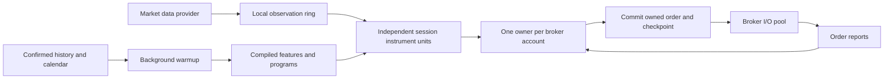

# Live trading: complete workflow and technical reference

Reviewed against the source on 23 October 2026. Live trading evaluates saved strategies locally and submits real orders through an owned broker connection. Broker order observations determine actual fills. This guide describes the current FYERS integration and shared execution architecture, not unimplemented broker support.

## Contents

- [User setup and deployment](#user-setup-and-deployment)
- [Admission, allocations and funds](#admission-allocations-and-funds)
- [Market data and rule evaluation](#market-data-and-rule-evaluation)
- [Signal to broker order](#signal-to-broker-order)
- [Order reconciliation and timestamps](#order-reconciliation-and-timestamps)
- [Session management](#session-management)
- [Portfolio, charges and review](#portfolio-charges-and-review)
- [API map](#api-map)
- [Operations and recovery](#operations-and-recovery)
- [Source map and extension points](#source-map-and-extension-points)

Related: [strategy configuration](strategy-configuration.md), [Backtesting](backtesting.md), [Paper](paper-trading.md), [Terminal](trading-terminal.md), [provider setup](third-party-setup.md).

## User setup and deployment

### Connect the broker

Open Broker Connections, select the supported broker and complete its credential/authorization flow. FYERS uses the individual user's app credentials and configured callback. The broker-specific form and adapter own these requirements; another broker need not use the same credential fields.

The callback URL shown during setup must match the registered application callback. It is a routing address, not an API secret. Credentials and tokens are stored through the encrypted credential layer. The user's trading connection is separate from the operator's market-data connection.

See [third-party setup](third-party-setup.md) for account registration and environment configuration. Browser login to QuantNest does not authorize a broker trading account by itself.

### Prepare a strategy

Create/configure the strategy, save the version to deploy, activate it and enable Live trading. Configure valid instruments, side, sizing, time rule and active entry rules. **Live validation requires an active stop-loss rule.** Unsupported/incomplete rules are rejected before a worker installs them.

Automated snapshots use DIRECT routing to an explicitly selected active, tradable catalogue instrument. Indices, mutual funds and underlying references are excluded. Actual broker/product support, contract validity and market data remain additional requirements; accepting a concrete derivative instrument does not provide dynamic futures/options selection routes.

Use Backtesting/Paper to inspect the same strategy semantics. Neither a good backtest nor a successful Paper fill establishes that a broker will accept or fill a real order.

### Deploy

From the strategy list choose Live deployment, select a saved version and owned broker account, and enter a fixed capital allocation. The backend verifies broker access, authorization, funds, strategy/version and uniqueness before creating the allocation and RUNNING session.

Multiple deployments of one strategy are supported across **different broker accounts**. Another allocation for the same strategy and broker is rejected even if an older session is stopped; manage the existing deployment. Unlike Paper, selecting another version does not allow another deployment on the same broker account.

Use Live Deployments to filter sessions by status and manage them. Live Portfolio displays session/position/order/trade aggregates; detailed broker-account cards belong in Broker Connections rather than the portfolio workspace.

## Admission, allocations and funds

### Three separate controls

| Control | Meaning |
| --- | --- |
| Installation execution scope | `EXECUTION_ENABLED_SCOPES` must contain `live`; Public mode forbids enabling Live |
| User/scope/broker access | Owned active account, enabled strategy, Live scope and valid broker authorization |
| Financial capacity | Broker funds and per-allocation commitments limit new exposure |

Development disables numeric plan enforcement. Personal Private has no commercial quotas, licence dependency or subscription expiry. Ownership, instrument validity, enabled Live scope, broker authorization and real broker funds remain required. Public cannot enable Live. There is no commercial lookup in tick evaluation.

`LiveExecutionService.deploy_session()` locks the broker credential and strategy, validates the selected snapshot, calls `BrokerService.ensure_session()`, synchronizes funds and creates `LiveStrategyAllocation` plus `TradingSession`. `request_session_refresh()` then queues runtime installation.

### Allocation is a budget, not a transfer

`_allocation_terms()` requires positive broker net equity and checks total allocations against that equity. Allocating 20,000 does not transfer 20,000 out of the broker account; it creates a strategy budget inside QuantNest.

All sessions on one broker account share a single financial owner keyed by `(LIVE, broker_credential_id)`. The owner's available amount is constrained by both the session budget and broker-wide available funds after reservations/known spending. Independent evaluators therefore cannot spend the same funds simultaneously without serialization.

`sync_funds()` obtains the broker snapshot outside the tick path and queues a FUNDS command. It carries ordering information so a response started before a fill cannot incorrectly release money spent while the request was in flight.

New exposure requires a recent broker-funds observation (the ledger currently allows a 90-second interval). **This is a funds check, not the removed tick-age rule.** Closing exposure is not blocked by the new-entry funds-age condition.

Margin calculations in the shared kernel are an admission model. The real broker remains authoritative and can reject an order for its own margin, product, session or instrument rules.

## Market data and rule evaluation



### Preparation

The controller loads the deployed snapshot, resolves instruments/routes and prepares contracts/calendars. `strategy_requirements()` derives indicator/timeframe dependencies; `source_windows()` determines warmup. The common history service acquires only missing source windows, then calendar-aware aggregation prepares completed bars.

`prepare_symbol()` runs outside numerical evaluation. `compile_strategy()` produces typed programs; `FeatureGraph` shares feature calculations per symbol/configuration within a worker. Warmup is not a database query inside every rule.

### Independent evaluation and shared capital

An evaluation unit is `(LIVE, session_id, instrument_id)`. It owns its rule samples, pending signal and acknowledged position view. Separate sessions on the same symbol can evaluate independently without waiting for the other session's signal result.

CPU workers still run bounded actor turns; a process does not execute infinitely many instructions at the same instant. Features are shared where possible, and account financial changes are serialized. Worker count should follow actual cores and measured workload, not user count alone.

### Price and candle semantics

- LTP reads the latest observed tick for the event being processed.
- CLOSE and indicator inputs use completed candles, aligned to exchange/segment sessions.
- Sequence/generation tracking prevents replaying an old observation as a new one.
- Cross rules compare sequential samples and need history before they can assert a cross.
- The strategy end time blocks new entry; it is not automatic square-off.
- Automated exit signals request the full remaining position. Broker partial fills may still happen.
- No fixed tick-age threshold rejects a quiet instrument's observed price. A detected disconnect invalidates execution observations until a new one arrives; silent feed freezes are not solved by this policy.

## Signal to broker order

### 1. Evaluate and propose

`EvaluationUnit.evaluate()` emits an `Intent` with account/unit, version, position revision, observation and direction. It does not submit HTTP or write ORM models. The intent describes a decision, not a completed trade.

### 2. Admit through the account owner

`AccountOwner.accept()` and `ledger.accept_intent()` verify current version/position/pending state, entry calendar, contract constraints, sizing, allocation and funds. The ledger reserves the required capital and creates an order transition.

Live orders begin as UNKNOWN because a local intent is not evidence of broker acceptance. The controller commits the owned `LiveOrder` and account checkpoint before submitting it externally.

### 3. Submit outside the numerical path

`Controller.receive()` dispatches a newly committed order to its broker thread pool. `broker_call()` calls `BrokerService.place_order()` with the canonical instrument symbol, side, quantity, order/product type and a correlation tag `QN{LiveOrder.pk}`.

The current automated FYERS placement adapter is market-order oriented and supplies zero limit/stop prices. Do not infer that the manual Terminal's full limit/stop order ticket is available for automated broker placement simply because both use shared order types. The adapter's supported payload is the implementation boundary.

`Contract.product` chooses CNC for the supported cash instrument types and MARGIN for derivatives; strategy type does not switch it to INTRADAY. Actual same-day closing and broker accounting are separate matters. FYERS submission currently uses DAY validity internally; there is no Terminal validity selector.

### 4. Observe acceptance and fills

The response is normalized into an order observation command. Broker acceptance can provide an order ID without a fill. Subsequent order reports carry cumulative filled quantity, average price and status.

`AccountOwner.broker_observation()` uses `observe_order()` to derive the **incremental** fill from cumulative broker reports. Only that incremental fill reaches `apply_fill()`. Repeated reports must not double quantity, P&L or capital effects.

### 5. Persist and acknowledge

`persist_transition()` updates the checkpoint and Live order/position/trade projections in a transaction, then the controller acknowledges the committed revision. Filled exposure can be protected immediately, but uncommitted gains/released collateral cannot be spent prematurely.

Example: a broker reports 4 of 10 shares filled, then 10 of 10. QuantNest applies fills of 4 and 6, not 4 and 10. A repeated report of 10 creates no additional fill. A full-position exit can consequently produce more than one recorded close as fills arrive.

## Order reconciliation and timestamps

### What is synchronized

QuantNest synchronizes **owned broker orders**. It derives its own session positions and trades from their fills. Broker aggregate positions or broker trade lists do not overwrite local strategy/session exposure: the broker may net several strategies and manual activity differently.

The order-event service provides prompt updates. `reconcile_all_active_accounts` periodically performs REST order reconciliation and funds refresh once per credential. Its queryset includes paused/stopping/error sessions and unresolved exposure, so a websocket failure does not stop reconciliation.

The session Sync action calls `reconcile_orders()` for its credential. Synchronization matches an owned order through its broker ID or validated QuantNest tag. It does not import arbitrary manual broker orders as strategy trades.

### Ambiguous submission

If a network timeout occurs after submission, the order may already exist at the broker. It remains unresolved for reconciliation rather than being blindly submitted again. `find_owned_order()` can use the `QN` tag to associate an order whose broker ID was not saved from the first response.

On recovery, pre-existing ambiguous orders are reconciled. They are not treated as newly accepted intents eligible for another submission. Inspect broker and local order state before manually intervening.

### Broker timestamps

The FYERS adapter parses documented `orderDateTime` using `%d-%b-%Y %H:%M:%S` in the broker timezone and normalizes event timestamps. Broker order time and the available broker update time are preserved separately. A newly discovered REST fill without an execution-event timestamp uses local observation time; its exact exchange fill time is unavailable from that snapshot. Whole-second broker clocks are compared with order eligibility at the same precision.

The data available in an order snapshot can be coarser than exchange transaction-level history. Preserve the distinction between broker order time, available execution event time and local observation time; do not claim unavailable trade-level timestamps.

## Session management

| Action | Behaviour |
| --- | --- |
| Pause | Stop new entries; existing positions and broker reconciliation remain relevant |
| Resume | Revalidate strategy/version, broker access/session and funds; enqueue refresh |
| Stop without close | Default API option; request STOPPING and stop new execution while preserving the requested exposure policy |
| Stop with close | Explicit `close_positions=true`; request liquidation and wait for broker completion |
| Sync | Reconcile owned orders; does not copy broker aggregate positions |
| Change version | Validate and refresh the existing allocation/session |
| Change allocation | Recheck broker equity and committed capital, then queue owner application |
| Disconnect/change broker credentials | Reject while sessions run/stop, exposure or unresolved orders exist, or account commands await application; disconnect only after those are settled |

STOPPING is a transition, not a guarantee all broker orders are cancelled or positions flat. Closing orders can be rejected or partially filled. Continue inspecting unresolved records and broker state.

The worker marks STOPPED only once the session has no positions and no active orders. Stopping without requesting liquidation can therefore remain STOPPING while exposure exists. The UI/API stop request is not a way to hide or detach an open broker position.

### Version changes

Use the allocation's deploy-version action. The version must belong to the strategy and satisfy Live validation, including a stop-loss rule. It must retain instruments with open positions. Outstanding PENDING/PLACED/PARTIAL_FILL/UNKNOWN orders block the change.

The allocation is updated and refresh commands are queued. The controller compiles/prepares the replacement and installs it through the existing session; the user does not need to stop and relaunch the runtime. Session `applied_version` and `applied_at` acknowledge application. Existing positions remain attached to the same session. Editing an unrelated draft does not update an already deployed snapshot.

### Capital changes

The amount is fixed, not a percentage. `update_allocation()` refreshes funds, checks the proposed total allocation and prevents reductions below committed position/order capital. It rejects overlapping pending allocation changes and queues a REFRESH carrying the proposed values.

The owner applies the change and persistence updates the records. An accepted HTTP request and a worker-applied budget are different stages. Inspect command/session errors when they diverge.

## Portfolio, charges and review

Live Portfolio shows owned session/order/position/trade data. Broker funds snapshots support account health and admission; they are not a replacement for strategy-level P&L. Summary reads use stored/cached values instead of calling broker REST on every screen refresh.

`LiveTrade.realized_pnl` and shared Live reports are **before fees**. The platform does not replace unavailable broker charges with hypothetical Paper fees. Recorded slippage compares signal/reference and execution prices; it is different from a broker fee.

Choose **LIVE** in Journal/Reports. Filters use ownership, source, exit dates, account/strategy/instrument/search and review status. The current open-position mark is separate from historical closed P&L and may be unavailable if quote coverage is missing.

Private reviews store notes, lessons, optional rating and mistake tags against completed owned closes. Deleting a review leaves the trade. A close tagged twice contributes to both tag groups; grouped results overlap.

CSV export uses the same filters and rejects exports above 50,000 closes. Ask AI creates a frozen evidence context and owned research conversation; no model request begins until the user sends a message. Including saved private journal notes is explicit and research usage still applies.

Activity History records supported configuration/lifecycle changes without producing one audit event per tick or fill. Reports aggregate existing closes rather than maintaining a second financial ledger. A cumulative closed-P&L series is not a verified historical equity curve.

## API map

Paths below are relative to `/api/v1/`.

| Endpoint | Purpose |
| --- | --- |
| `POST strategies/strategies/{id}/deploy-live/` | Deploy selected version to owned broker account |
| `GET live/sessions/`, `sessions/{id}/`, `sessions/summary/` | Deployments and aggregate state |
| `POST live/sessions/{id}/pause/`, `resume/`, `stop/`, `sync/` | Lifecycle/reconciliation |
| `GET live/allocations/` | Allocation records |
| `POST live/allocations/{id}/update-allocation/`, `deploy-version/` | Budget/version changes |
| `GET live/orders/`, `positions/`, `trades/` | Owned execution records |
| `GET live/orders/summary/`, `positions/summary/`, `trades/summary/` | Source summaries |
| `GET live/execution-logs/`, `slippage/` | Execution diagnostics and price differences |
| `GET analytics/reports/`, `reports/trades/`, `reports/export/` | Shared reports using `source=LIVE` |
| `POST analytics/reports/research-context/` | Frozen execution evidence |
| `GET/POST journal/entries/`; `GET/PATCH/DELETE journal/entries/{id}/` | Private journal reviews |
| `GET audit/logs/` | Supported configuration/lifecycle history |

See [Live routes](../backend/live_trading/urls.py) and [views](../backend/live_trading/views.py) for supported filters and payloads. Reading an owned historical record is distinct from permission to start new Live execution.

## Operations and recovery

From `backend/`, run the following as separate managed processes, alongside the API/database/Redis and configured Celery/Beat services:

```bash
python -m quantnest_runtime market-data
python -m execution
python -m quantnest_runtime broker-events
```

The [infrastructure guides](../infra/README.md) own installation commands and service files. Enable Live only in an allowed deployment mode. Keep the scheduled active-account reconciliation/funds task enabled; the order socket and REST reconciliation serve complementary purposes.

`EXECUTION_WORKERS` controls persistent CPU workers. One launcher owns the group through a local OS lock. Market-data and workers share local mapped files; multi-server replication is not part of the current implementation. A second hidden execution group is not a capacity upgrade.

The controller handles ORM, command polling, warmup preparation and broker I/O outside numerical actors. Workers process bounded observation batches and share indicator features. More cores can support more partitions, but broker/API limits, persistence, data rates and strategy complexity also constrain capacity. There is no verified fixed number of users per VM.

### Recovery sequence

1. Start one configured market-data service and one execution group.
2. Controller restores account/evaluation checkpoints and session configuration.
3. Warm required data and reconnect observation generations.
4. Restore unresolved Live orders and reconcile them; do not resubmit ambiguous placements.
5. Start/inspect broker-events and REST reconciliation, then confirm broker funds and session state.

If a worker child fails, the launcher stops the group for a coherent restart from committed state. A detected generation/revision change triggers preparation rather than inventing missing observations. Lost buffered ticks mark affected strategy sessions ERROR for review/resume. Provider reconnection, failed evaluation and broker submission ambiguity are different recovery cases.

| Symptom | First investigation |
| --- | --- |
| No signal | Enabled scope, session/rules, market demand, completed warmup and entry window |
| Signal rejected locally | Version/position revision, pending intent, quantity/contract, allocation and broker funds |
| UNKNOWN order | Correlation tag/order ID, broker order book, websocket/REST reconciliation |
| Duplicate-looking report | Cumulative fill quantity and order identity; do not reapply manually |
| Position differs from broker | Local session ownership versus broker net account exposure/manual activity |
| STOPPING persists | Outstanding cancellation/fill, broker rejection and selected close option |
| Displayed P&L differs | Before-fee basis, realized/open split, partial closes and selected source/filter |

## Source map and extension points

| Source | Responsibility |
| --- | --- |
| [Live UI](../frontend/src/features/live), [broker UI](../frontend/src/features/brokers) | Deployment/portfolio and account authorization |
| [Live services](../backend/live_trading/services.py) | Deploy/resume/stop, allocation, funds and summaries |
| [Controller](../backend/execution/controller.py) | `broker_call`, installation, commands and persistence boundary |
| [Worker](../backend/execution/worker.py), [engine](../backend/execution/engine.py) | Independent numerical actors and rule decisions |
| [Owner](../backend/execution/owner.py), [ledger](../backend/execution/ledger.py) | Capital ownership and incremental financial effects |
| [Order reports](../backend/execution/order_reports.py) | Normalize cumulative status/fill progress |
| [Order processor](../backend/live_trading/order_processor.py) | Match owned orders and enqueue normalized broker observations |
| [Reconciliation task](../backend/live_trading/tasks.py) | Background order/funds reconciliation |
| [Broker service](../backend/brokers/services.py), [FYERS adapter](../backend/brokers/fyers.py) | Common dispatch and provider-specific payload/response contracts |
| [Repository](../backend/execution/repository.py) | Durable order/checkpoint and Live record projection |

For a new broker, implement broker-specific authorization, placement, order normalization, funds and events behind its adapter. Keep common execution intents/accounting unchanged. Validate cumulative fill transitions and uncertain submission recovery before enabling real orders. Extending a provider is not just adding another credential form.
