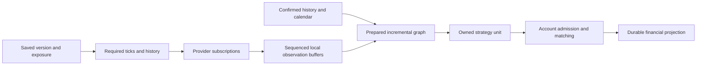

# Paper trading: complete user and technical guide

**Source reviewed: 7 November 2026.** Paper trading deploys saved strategies against
live observations and simulates orders, positions, cash and charges. This guide
owns its end-to-end workflow, runtime operations, shared live-data boundaries and
reviewed simulated derivative settlement. Earlier dated data/P&L reviews are folded
into the relevant sections here.

For every operand, expression, setup, schedule and contract policy, use
[Strategy Studio](strategy-configuration.md). Related modes:
[Backtesting](backtesting.md), [Live](live-trading.md),
[manual Terminal](trading-terminal.md).

## Contents

- [Scope and records](#scope-and-records)
- [Fund the wallet and deploy](#fund-the-wallet-and-deploy)
- [Saved versions and ownership](#saved-versions-and-ownership)
- [Live data preparation](#live-data-preparation)
- [Tick to decision to fill](#tick-to-decision-to-fill)
- [Runtime operations and scaling](#runtime-operations-and-scaling)
- [Size, funds and charges](#size-funds-and-charges)
- [Manage a running session](#manage-a-running-session)
- [Realtime P&L and reports](#realtime-pl-and-reports)
- [Derivative settlement](#derivative-settlement)
- [API contracts](#api-contracts)
- [Implementation ownership](#implementation-ownership)
- [Worked examples](#worked-examples)
- [Troubleshooting and release checks](#troubleshooting-and-release-checks)

## Scope and records

Paper is automated simulation. The separate Terminal is manual simulation; Live
sends broker orders. A Paper wallet deposit does not move real money and does not
fund either of those other accounts.

| Record | Responsibility |
| --- | --- |
| `Portfolio` | User's free simulated wallet capital |
| `FundTransaction` | Deposit, withdrawal and allocation-related wallet movements |
| `CapitalAllocation` | Fixed target capital and selected strategy/version relationship |
| `PaperAccount` | Session financial balance, margin, reservations and realized results |
| `PaperTradingSession` | Requested/applied configuration, status and frozen execution costs |
| `PaperOrder` | Accepted/rejected simulated order and fill projection |
| `PaperPosition` | Current owned exposure |
| `PaperTrade` | Closed trade, gross/net result and charges |
| Execution checkpoint/command | Durable account recovery and pending user operations |
| Settlement price/posting | Reviewed source evidence and an applied simulated cash movement |

The user creates a deployment from **My Strategies**. There is no independent
Paper account-creation or allocation-creation page. The deployment creates these
records together; the generated name uses the strategy and session identifier,
such as `Example Strategy · S42`.

Paper permits multiple sessions for the same strategy with **different saved
versions**. The same strategy/version pair cannot be deployed twice, even if the
earlier deployment is stopped and still exists. Live uses a different uniqueness
rule: strategy plus broker account.

## Fund the wallet and deploy

1. Open **Paper Trading → Wallet** and deposit a positive simulated amount.
2. Create/edit a strategy, validate it and save a version in Studio.
3. Ensure the strategy is Active and Paper use is enabled.
4. In **My Strategies**, choose Paper deployment and select the saved version.
5. Enter a fixed capital amount within the free Paper wallet balance. Percentage
   allocation is not supported.
6. Choose slippage, whether to apply charges, and an owned charge profile where
   required. Costs are copied to the deployment rather than looked up on each tick.
7. Confirm deployment. The backend validates ownership, version, snapshot, scope,
   inventory allowance and wallet funds, then creates the account/session.
8. Open **Deployments**, filter by session status, and check requested versus applied
   version/readiness. A `RUNNING` request does not mean all history has finished warming.
9. Select the session in **Portfolio** to inspect positions, orders, closed history
   and settlements. Analytics summarizes recorded performance.

Withdrawing wallet capital is limited to **free wallet funds**. Allocated account
capital and margin are separate. Reduce an allocation through its command flow
before expecting that capital to become withdrawable in the simulated wallet.

## Saved versions and ownership

A saved version freezes the Studio definition. Editing the strategy or saving a
new version does not automatically change a running deployment. Use **Change
version** explicitly.

An evaluation unit is identified by:

```text
(mode, session_id, route_id, leg_id)
```

Its binding separately records signal and traded instrument IDs. This matters when
an index creates a signal and an option supplies execution prices. Each unit owns
its captured setup values, crossing history and position. Different units may use
the same market data without sharing their setup state.

The account is the single writer of funds, reservations, fills and position
transitions. Numerical workers can evaluate different instruments independently;
financial admission still serializes access to a finite shared budget. A matched
condition is not permission to overspend or duplicate an open position.

An open position/working order pins its exact contract. Underlying movement or an
automatic selector refresh cannot replace an owned option with a new ATM option.

## Live data preparation



### Demand and source history

`execution/demand.py` combines requested/applied deployments, open positions and
working orders. `LiveMarketDataRegistry` prioritizes execution/exposure over
optional browser demand. It subscribes only needed markets within provider limits.
Automatic contracts can retain candidate ticks while history preparation is
restricted to selected/nearby and owned contracts. Moving to a new candidate
requests its required history without downloading the entire option chain.

Provider-confirmed historical candles go through the same `history.py` validation,
coverage and `candles.py` calendar aggregation used by backtests/research/charts.
Only completed bars populate the feature graph. The compiler derives history depth
from actual indicators, shifts, windows and expression dependencies.

`HistoryCoverage` proves a source window was acquired, including successful empty
windows. It does not promise a trade occurred every minute. Failed provider calls
do not create successful coverage. Invalid candle rows are excluded and recorded.

### Live observations and corrections

The feed normalizes provider observations, assigns sequence/generation identity
and writes them to local mmap/shared-memory buffers. Historical publication does
not manufacture a new live quote. Execution consumes these buffers directly;
Redis/Channels/browser display fanout runs separately.

History corrections and reconnect generations can require graph preparation.
Replacing a graph does not append an old completed candle twice. Execution waits
for the required source readiness and preserves owned financial exposure.

There is **no fixed tick-age timeout** that rejects an otherwise valid price merely
because an instrument trades infrequently. Missing observations, ring-buffer
overrun, connection generation and source readiness remain correctness concerns.
A cached REST/display close cannot repair a missing execution observation.

### Calendars

Market hours come from `ExchangeConfig` keyed by exchange/segment and the holiday
calendar, including weekdays, breaks and special sessions. Instrument timing fields
are not an alternative schedule. Source bar completion and order admission use
those same session definitions.

## Tick to decision to fill

1. A new provider observation reaches the local sequenced buffer.
2. `Worker.read_market()` / actor scheduling makes it available to subscribed units
   without SQL, provider calls or broker requests in the numerical path.
3. Completed candles advance the incremental graph; LTP updates live-price inputs.
   Multi-timeframe values use only bars completed by that observation's clock.
4. `engine.EvaluationUnit` evaluates the relevant conditions and its private setup state.
5. Flat units may emit one entry intent. Open positions prioritize STOP_LOSS, then
   TARGET, then EXIT. Strategy exits close that unit's full quantity.
6. The account owner checks current position/order revision, contract/session,
   tradable quantity, risk basis and available funds, and reserves accepted entry
   capital. This is financial admission, not another period-credit check.
7. Accepted simulated orders wait for a **later eligible observed traded price**.
   The matcher requires a valid sequence/time boundary and matching generation.
8. A fill updates account cash, reservations, entry lots, exposure, costs and
   trade state. The controller persists its revision/checkpoint and projections.
9. Commit acknowledgement permits newly released resources to be reused safely.
   User notifications/portfolio events refresh browser snapshots.

The signal price and eventual Paper fill can differ. A signal at 100.00 may fill
on a later eligible observed 100.05. No new quote means the simulator has no new
execution price; it cannot claim an exchange fill from an old mark.

This does **not** establish the latency of a real market order in a broker app.
Broker apps route orders to an exchange; Paper consumes the available observed
feed. Provider quote frequency, calculation, transport, persistence and UI refresh
are separate latency components.

### Entry and re-entry semantics

Simple level conditions can enter again while true after the unit becomes flat.
Capture/confirmation groups require a new known false→true arm, save their captured
values, and confirm on a later observation before expiry. Closing a position is not
itself a new arm. Pausing/lost observations reset an unfulfilled setup; filled
position state retains the owned captured values needed to manage that position.

Entry end does not square off a position. For simulated strategy entries still
waiting to fill, the owner rechecks the entry schedule at matching: an order
that would fill outside its allowed window is cancelled. This is not an
instant timer that cancels every order at the entry-end clock boundary. Live
orders already accepted by the broker follow broker confirmation instead.

For the complete state machine and boundary rules, see
[capture and confirmation](strategy-configuration.md#10-capture-and-confirmation).

## Runtime operations and scaling

The current runtime has three service commands from `backend`:

```powershell
python -m quantnest_runtime market-data
python -m quantnest_runtime execution
python -m quantnest_runtime broker-events
```

| Service | When needed | Job |
| --- | --- | --- |
| `market-data` | Paper, Terminal or Live observations | Provider connection, required subscriptions/history and local buffers |
| `execution` | Paper, Terminal or Live execution | Controller, numerical workers, account owners and durable projections |
| `broker-events` | Live only | Broker order-stream connections; not a Paper requirement |
| API/ASGI + Redis/PostgreSQL | User/API/WebSocket operation | CRUD, commands, display delivery and persistence |
| Celery/Beat | Scheduled acquisition/reconciliation and other queued features | Background tasks; historical backtests/research use `compute` |

`python -m execution` is the direct execution entry point; the QuantNest runtime
command delegates to it. There are no separate orders, Terminal or outbox daemons.
One execution owner group must own the configured worker partition set. Provider
services also use renewable singleton leases to prevent accidental duplicate feeds.

### Cold path versus hot path

| Boundary | Operations |
| --- | --- |
| API/controller preparation | ORM ownership/configuration, contract/calendar reads, commands, graph preparation |
| Feed preparation | Provider history acquisition, confirmed storage, buffer publication |
| Numerical worker | Read local observations, advance features, evaluate rules, account transitions/matching |
| Controller output | Database commit, broker transport for Live, user events, settlement preparation |

The controller polls commands on its control cadence, approximately 100 ms. Worker
idle scheduling and CPU contention add normal scheduling time. These are not
per-tick database polls. Background configuration preparation is asynchronous; a
slow history provider can delay applying a version without making its graph a
valid ready program prematurely.

`EXECUTION_WORKERS` controls worker processes (default 1). Units/account ownership
are assigned deterministically. Work is scheduled in bounded turns so a backlog
does not let one actor monopolize the loop. Workers share reusable features for
overlapping market requirements but keep each unit's strategy state independent.

Multiple actors on one CPU cannot execute literally simultaneously. Increase
workers within available CPU/RAM after measuring event backlog, graph memory,
preparation load and account commit/broker latency. There is no documented
universal users-per-worker number. Keep heavy backtests/research from saturating
the CPU needed for live execution; the compute queue remains shared between those
two research workloads.

Current deployment uses **one execution server with local shared-memory data**.
Moving an execution worker to another server without a new data/distribution
design is not supported. More processes on the same server are supported. Exact
Compose/environment instructions belong to [infrastructure](../infra/README.md).

## Size, funds and charges

- Fixed `Units` are actual order units. A 30-unit derivative lot accepts 30/60
  units, not 1. Fixed `Lots` multiplies by the selected contract's lot size.
- Capital sizing uses a percentage of available session/account budget and rounds
  down to a whole lot. A result below one tradable lot does not create an order.
- Long options use premium; futures/short options use configured simulation
  collateral. This is not an actual broker portfolio-margin calculation.
- Quantities, price ticks, freeze constraints, expiry, active/tradable status and
  calendar remain relevant even when Private has unlimited commercial allowances.
- Stop/risk initial basis must be available at entry when configured. Position
  operands refer to the traded route, not the signal index.

Entry funds move from free to reserved, then to the account model's position
collateral/value. Released funds wait for durable commit acknowledgement before
being reused by another order. A shared balance is not spendable independently
by every instrument.

Charges use the frozen profile and common close-accounting logic. Opening a Paper
position does not deduct a guessed final holding-period fee. Closing computes
the applicable round-trip charges, with entry timestamps and segment/product
economics. Same-session equity can use intraday rates even when its product code
is CNC. Costs are simulated configured assumptions, not a broker bill.

Slippage adversely adjusts buy/sell prices, then applies tick rounding. The
financial kernel uses exact Decimal money rather than UI-rounded values.

### Commercial allowance points

Public checks Paper deployment/instrument capacity on deployment, resume and
relevant version changes. Saved-strategy capacity belongs to strategy creation.
Development records rather than enforces limits; Private bypasses commercial
limits. Execution scope still determines available Paper/Live functionality.
There is no period allowance query inside every tick, indicator or fill.

## Manage a running session

Actions are durable requests. API success means the request was accepted, not
that a process already applied it or that an order already filled. Check applied
version/time, pending state, errors and resulting positions/orders.

| Action | Current behavior |
| --- | --- |
| Pause | From RUNNING: stop new entries, reset unfilled setup observations and cancel entry work as applied; keep exit/protective management active |
| Resume / Start | From PAUSED/STOPPED/ERROR: revalidate saved version, strategy eligibility, scope/capacity and rebuild/apply runtime inputs |
| Stop & close | Request STOPPING, cancel relevant work and close owned exposure on eligible observations; STOPPED only after completion |
| Increase capital | Reserve additional free wallet funds immediately, then send the balance command |
| Decrease capital | Ask the owner to prove the reduction fits committed exposure/orders, then return approved funds to the wallet |
| Change version | Validate new snapshot and preserve open owners/bindings; application occurs asynchronously |
| Configure costs | Available only when stopped and flat; copy selected rates and slippage into the session |
| Reset balance | Stopped/flat only; reconcile to the target allocation using wallet funds rather than erase losses |
| Remove | Stopped, flat, no working orders or pending commands; return remaining account balance and delete the deployment |

Paper's Stop API uses **close positions by default**. Live's Stop defaults to
preserving positions unless `close_positions` is requested; do not interchange
those defaults.

### Capital changes

Only one balance change can be pending for the account. The owner checks the
latest state, not the earlier browser estimate. It can reject a decrease that
would invade committed funds. An accepted increase/decrease normally needs no
manual session restart. If the execution process is stopped, the command waits.

Resetting an account does not clear trade history or create free money. Losses
must be funded from the wallet; excess remaining balance can return through the
same command/ledger flow. Removing a deployment deletes its related projections;
export required records before removal rather than assume it archives history.

### Version changes

The version must belong to the same strategy. Working orders must settle before
a conflicting change. An open route cannot disappear or change its owned contract.
Capture/setup changes that are incompatible with an open position require flat
exposure. New initial-risk settings are not retroactively reinterpreted as the old
position's entry basis. Applied and requested versions are separate so the UI can
show **Version pending** rather than falsely label old execution as new.

## Realtime P&L and reports

Paper Portfolio provides overview, positions, orders, history and settlements.
Deployments shows selected version, status, capital and performance; Analytics
shows realized history and the current open valuation.

The shared valuation path deliberately separates **financial events** from
**display prices**:

1. `common.valuation.position_totals()` reads the owned/filtered open exposure and
   batches quote reads. It returns `valuation_positions` for the full scope.
2. `useLivePositionSummary()` and `usePaperPositionsPnL()` subscribe distinct
   `sym_ticker` values through the shared market-data WebSocket.
3. Row and summary values are recalculated from the same quote store, including
   positions on other table pages. Tick updates do not reload the table or write P&L
   into the database on every price change.
4. Financial events refresh exposure snapshots. Reconnect also refreshes them to
   recover a missed position open/close. The latest accepted mark is retained
   during a display disconnect instead of reverting to an older snapshot.

```text
Open P&L = direction × (mark − average) × units × multiplier − settled MTM
```

For 30 units at 729.00 and a mark of 734.75, multiplier one, no settled MTM, open
P&L is 172.50. Summary and row must show that same value when based on that mark.
Missing valid pricing is N/A/incomplete coverage rather than zero-risk exposure.
Live marks do not rewrite recorded closed results or charge amounts.

`quotes.py` chooses observed/REST snapshots by receipt time, with a labelled
confirmed-close fallback for display. Historical/REST display availability does
not authorize an execution fill. Browser display coalescing is separate from
the numerical observation reader.

Trade Journal and Performance Reports filter Terminal/Paper/Live sources, dates,
accounts and reviews. Recorded partial closes are distinct close records; journal
notes/ratings are user input and do not change the trade. Reports preserve source,
gross/net/fee basis and full-scope open valuation. AI review attaches a bounded
owned report, not unrestricted access to every user's trading data.

## Derivative settlement

This section is the canonical reference for the shared **simulation** settlement
kernel used by Paper, Terminal and historical replay.

| Mode | Daily futures MTM | Final cash settlement |
| --- | --- | --- |
| Backtest | Consume available reviewed events at their publication clock | Qualified sourced event; otherwise explicit simulated expiry liquidation policy |
| Paper / Terminal | Ordered account command with transactional posting | Qualified NSE/BSE equity index futures/options |
| Live | No automatic posting from market-wide settlement prices | Requires an account-specific broker/clearing adapter |

Final stock delivery, commodity delivery/tender, option devolvement and
account-specific exercise/assignment are not implemented. A last quote is not an
official settlement price. No automated official settlement downloader is present.

### Import reviewed evidence

Obtain and review the exact contract, source, cutoff, publication time and fees.
The source import accepts the following exact format. Values are illustrative,
not market data or prescribed rates:

```json
{
  "schema_version": 1,
  "source": "Reviewed exchange report reference and publication identifier",
  "prices": [{
    "sym_ticker": "NSE:REPLACE_WITH_ACTUAL_CONTRACT",
    "kind": "DAILY",
    "effective_at": "2026-11-02T15:30:00+05:30",
    "available_at": "2026-11-02T18:00:00+05:30",
    "value": "24000.00",
    "cash_settled": false,
    "fee_per_unit": null
  }]
}
```

From `backend` with its environment loaded:

```powershell
python manage.py import_settlement_prices C:\data\settlement-prices.json --dry-run
python manage.py import_settlement_prices C:\data\settlement-prices.json
```

Rules enforced by `prepare_price()` / `import_prices()`:

- The instrument exists by exact `sym_ticker`. The batch has 1–5,000 complete rows.
- Decimal values are finite strings; timestamps include timezone offsets.
- `effective_at` equals the configured segment's actual trading-session close.
  `available_at` cannot precede it. Do not alter calendars to make bad input pass.
- `DAILY` applies to futures before expiry, positive value, no final cash flag/fee.
- `FINAL` is the actual expiry session and a qualified NSE/BSE equity-index
  derivative family, with `cash_settled: true`.
- Final futures `value` is the settlement price. Final options `value` is the
  underlying's settlement value; the kernel derives CE/PE intrinsic payoff.
- Final `fee_per_unit` is explicitly provided, nonnegative cash per order unit,
  including unpaid entry costs under charge-on-close. Zero explicitly models no
  fees; it is not inferred broker exercise tax.
- Identical imports are no-ops. Conflicting evidence for the same contract/cutoff/
  kind is rejected. Applied records cannot be silently revised in admin.

### Runtime posting

The controller prepares settlement work approximately every ten seconds, outside
the numerical worker. Expired simulated working orders receive deterministic
cancellation commands before a final settlement is queued, even without a quote.

For each available source/position cycle, one deterministic command reaches the
account owner. `apply_settlement()` checks source publication, unit identity,
contract, quantity, opening time and later fills before mutation. Live accounts
are rejected here. The controller's `persist_settlement()` transaction saves the
journal, cash/exposure/trade projections, checkpoint and command completion.
Acknowledgement makes credited resources available to new orders.

A final settlement creates a closed-trade record, not an exchange market order
or a fictional tick fill. The Settlements tab shows source, effective time,
gross payment, fees and cash change. Duplicate commands cannot pay twice.

A late report after a quantity-changing fill needs reconciliation; applying the
old cutoff to today's quantity is rejected. Automatic historical reconstruction
across intervening trades and a correction workflow are not implemented.

### Cash and P&L example

For 50 long futures units at 20,000, daily settlement 20,100, later exit 20,140,
multiplier one and no fees:

```text
Daily cash payment        = (20,100 − 20,000) × 50 = 5,000
Lifetime gross trade P&L  = (20,140 − 20,000) × 50 = 7,000
Additional cash on exit  = 7,000 − 5,000           = 2,000
```

The entry average remains 20,000 for rules/reporting. `settled_pnl` stores the
already paid amount; residual unrealized P&L subtracts it. Partial closes release
the proportional paid amount. New position cycles do not inherit old settlement
credits. Negative MTM is posted even if free collateral is exhausted; an actual
simulated loss cannot disappear because new entry admission would fail.

Closed-trade results describe lifetime P&L. Settlement postings describe cash
movements. Adding both again overstates performance.

## API contracts

Authenticated prefix: **`/api/v1/paper/`**. Shared server pagination defaults to 25
rows and supports 10/25/50/100, direct page navigation and full-scope summaries.

| Method/path | Purpose |
| --- | --- |
| `GET portfolios/me/` | Obtain/create the user's simulated wallet |
| `POST portfolios/{id}/deposit/`, `withdraw/` | Owned free-wallet changes |
| `GET transactions/` | Filtered wallet transaction history |
| `GET accounts/`, `accounts/summary/` | Read-only account projections and totals |
| `GET sessions/`, `sessions/summary/`, `sessions/{id}/` | Status-filtered deployment list, totals and detail |
| `POST sessions/{id}/pause/`, `resume/`, `stop/` | Lifecycle commands |
| `POST sessions/{id}/update-allocation/` | Fixed capital change |
| `POST sessions/{id}/deploy-version/` | Select a saved version |
| `POST sessions/{id}/configure-costs/` | Stopped/flat cost settings |
| `POST sessions/{id}/reset/`, `DELETE sessions/{id}/` | Eligible reset/removal |
| `GET positions/`, `positions/summary/` | Owned exposure and full-filter valuation |
| `GET orders/`, `orders/summary/` | Owned simulated order history/status counts |
| `GET trades/`, `trades/analytics/` | Closed results and performance aggregates |
| `GET settlements/` | Paginated owned settlement journal |

Initial strategy deployment uses the strategy service/API, not direct writable
Paper account CRUD. The common version dialog sends a saved version ID and handles
pending application. Authentication/ownership is enforced on the server, regardless
of which buttons are visible.

`/ws/paper/` carries financial/lifecycle updates; `/ws/marketdata/` carries shared
price/chart updates. They have different purposes. Page snapshots and reconnect
recovery complement WebSocket messages; a socket connection alone does not prove
that the feed, evaluator and account projections are all healthy.

## Implementation ownership

Backend paths below are relative to `backend/`. Start at
[`paper_trading/services.py`](../backend/paper_trading/services.py) for user actions,
[`execution/controller.py`](../backend/execution/controller.py) for control and
[`execution/worker.py`](../backend/execution/worker.py) for numerical scheduling.

| File/symbol | Responsibility |
| --- | --- |
| `paper_trading/services.PortfolioService` | Wallet, allocation, reset and cost operations |
| `paper_trading/services.PaperExecutionService` | Deploy, pause, resume, stop and notifications |
| `paper_trading/views.py`, `serializers.py` | HTTP actions, paginated records and account/position summaries |
| `strategies/services.py` | Shared version-change validation/application request |
| `commercial/usage.require_inventory_capacity` | Capacity at deployment/resume/version boundaries |
| `execution/demand.py`, `preparation.py`, `controller.py` | Required markets, graphs and durable control-plane operations |
| `marketdata/live_feed.py`, `history.py`, `shared_memory.py` | Subscriptions, confirmed history and sequenced buffers |
| `execution/worker.py`, `engine.py`, `compiler.py` | Bounded event scheduling and shared numerical evaluation |
| `execution/owner.py`, `ledger.py`, `matching.py` | Single-writer financial admission, fills and close accounting |
| `execution/repository.py`, `recovery.py`, `snapshots.py` | Transactional projections and restart state |
| `execution/settlement_records.py`, `settlements.py` | Source validation, queueing and pure settlement transition |
| `common/valuation.py`, `quotes.py` in marketdata | Exposure snapshot and display mark boundaries |
| `useLivePositionsPnL.js`, `positionValuation.js` | Common browser row/full-scope realtime valuation |
| `frontend/src/features/paper/` | Deployment, wallet, portfolio, cost dialog and analytics UI |

## Worked examples

### Wallet, allocation and realized loss

Deposit 20,000 and allocate 5,000: wallet free capital is 15,000. If the session
loses 200 including charges, its balance becomes 4,800. Resetting to the target
5,000 needs another 200 from the wallet. Stopping/removing it returns the remaining
balance after outstanding work/exposure is settled, not a guaranteed 5,000.

### Different signal and execution source

An index breakout selects an ATM call. The index graph triggers the intent; its
call contract must have an eligible price and sufficient prepared history if the
rules require traded-candle inputs. Buying one lot of size 30 creates 30 units at
the option's price. A new index ATM does not change an existing position's contract.

### Capital edit during execution

Raise a 5,000 allocation to 6,000. The API reserves the wallet delta and queues a
balance command. The account owner applies the new budget and the UI refreshes
the applied projection. Restart is unnecessary. If the process is unavailable,
the pending command remains observable rather than silently changing an unrelated
browser-only number.

## Troubleshooting and release checks

| Symptom | Inspect |
| --- | --- |
| RUNNING but no trades | Applied version, history readiness, scope/calendar, setup state, exact selected contract, quantity and funds |
| No entry after a close | Simple level versus capture arm semantics; false→true, expiry and max-trade schedule constraints |
| Stops seem ignored | Traded-contract source, tick versus completed-bar input, direction/comparison, owned route, pending exit and new eligible prices |
| Fill seconds after candle close | Separate candle completion, signal event, order admission, eligible quote, commit and display times; do not blame a single stage without evidence |
| P&L row changes but totals do not | Full `valuation_positions` summary, account filter and shared quote subscriptions; avoid snapshot-only totals |
| Version/capital pending | Execution command status/error and graph readiness; restarting does not fix invalid snapshot/funds |
| Duplicate owner / worker crash | Stop the group cleanly, inspect lease/partition ownership and recover committed accounts; do not run a hidden duplicate |
| Missing history | Provider transport/response, failed coverage window and current subscription demand; no fake warmup |
| Settlement not applied | Reviewed record, publication time, qualified family, owned cycle, quantity changes and command rejection |

Release validation should cover deploy → warmup → signal → reservation → later
eligible fill → protection/exit → costs → full-scope realtime P&L, then pause,
resume, capital/version change, stop-and-close, reconnect and recovery. Include
multiple users/units competing for one account budget and sparse tick streams.
No real broker order is needed to test Paper, and isolated checks are not a
production latency/user-capacity guarantee.
