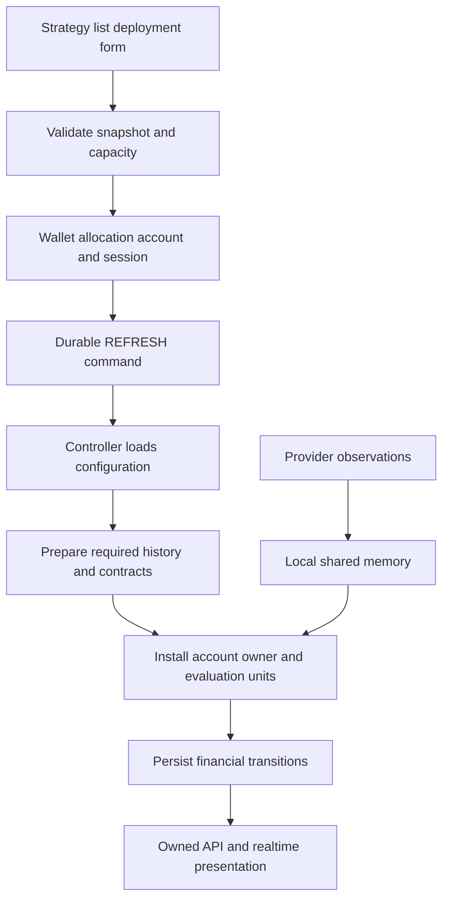

# Paper trading: complete workflow and technical reference

Reviewed against the source on 23 October 2026. Paper is automated strategy execution against observed market prices using simulated money. No Paper order is sent to a broker.

## Contents

- [User workflow](#user-workflow)
- [Accounts, allocations and admission](#accounts-allocations-and-admission)
- [From deployment to a ready evaluator](#from-deployment-to-a-ready-evaluator)
- [From a tick to a completed trade](#from-a-tick-to-a-completed-trade)
- [Managing a running session](#managing-a-running-session)
- [Charges and financial presentation](#charges-and-financial-presentation)
- [Journal, reports and activity](#journal-reports-and-activity)
- [API map](#api-map)
- [Runtime operations and scaling](#runtime-operations-and-scaling)
- [Troubleshooting and source map](#troubleshooting-and-source-map)

Related: [strategy authoring](strategy-configuration.md), [Backtesting](backtesting.md), [Live](live-trading.md), [manual Terminal](trading-terminal.md), [commercial controls](commercial-operations.md).

## User workflow

1. Create a strategy in Strategy Lab. Configure instruments/routes, entry direction, sizing, schedule and rule groups; save a version.
2. Activate the strategy and enable Paper trading. Review it with a backtest if required by your workflow; a backtest does not itself deploy a session.
3. From the strategy list, choose Paper deployment and the saved version. Enter a **fixed capital amount**, slippage and charge settings.
4. Ensure the Paper wallet has enough unallocated simulated money. Use the wallet deposit operation when additional simulated funds are needed.
5. Confirm deployment. The backend creates the allocation, session account and RUNNING session together, then requests runtime installation.
6. Open Paper Deployments. Filter by status and inspect the session, version, allocation and controls.
7. Use Paper Portfolio/session views for positions, orders and trades; use analytics and Journal for completed results.
8. Pause, resume, stop, change version or adjust capital through the existing deployment. Do not create a replacement account to manage an existing session.

Automated snapshots use DIRECT routing to an explicitly selected active, tradable catalogue instrument. Indices, mutual funds and underlying references are excluded. Contract metadata, available history and live observations remain prerequisites. Dynamic futures/options selection routes are not implemented by accepting a concrete derivative instrument.

Paper allows the same strategy to have multiple deployments **with different saved versions**. It rejects another allocation for the same strategy/version, including an existing stopped deployment: manage that deployment instead. This differs from Live's strategy/broker uniqueness.

Standalone account/allocation creation and percentage allocation are not customer workflows. Account names are generated from the strategy plus a unique session suffix, such as `Momentum · S42`.

## Accounts, allocations and admission

### The records represent different things

| Record | Meaning |
| --- | --- |
| `Portfolio` | User's Paper wallet; unallocated simulated funds |
| `FundTransaction` | Deposits, withdrawals and allocation movements |
| `CapitalAllocation` | Fixed capital assigned to a strategy and deployed version |
| `PaperAccount` | Session trading balance and financial history |
| `PaperTradingSession` | Lifecycle, start/end times, costs and execution configuration |
| `PaperOrder`, `PaperPosition`, `PaperTrade` | Orders, current exposure and completed trades |

A wallet deposit is not trading profit. Allocating money moves it from the wallet into a session; it does not create profit. Fees and realized trades affect the session ledger. Unallocated wallet funds are what the withdrawal operation can remove.

`PaperExecutionService.deploy_session()` locks ownership/configuration, checks the active strategy/version, validates its snapshot and reserves inventory capacity before creating the records. `PortfolioService.update_allocation()` handles the wallet movement. `request_session_refresh()` records the command for execution.

### Allowances

`require_inventory_capacity()` is the shared capacity check for Paper deployment, resumption and version changes. It computes the proposed active-session/instrument usage rather than consuming a period credit on each tick. Saved-strategy capacity is checked when strategies are created through their own CRUD flow.

| Mode | Numeric allowance behaviour |
| --- | --- |
| Public | Enforce configured active Paper deployment/instrument capacities |
| Development | Usage can exceed published plan numbers; numeric limits are not enforced |
| Private | No numeric allowances; personal deployment with ownership, valid inputs and enabled execution scope |

`EXECUTION_ENABLED_SCOPES` must include `paper`. User ownership, valid contracts, available capital and order correctness remain required in every mode. They are not subscription quotas. The numerical engine does not perform plan queries on every observation.

## From deployment to a ready evaluator



### Cold preparation

The controller reads commands and ORM configuration outside evaluation. `recovery.py` assembles the session from its deployed version and restores committed state. `compile_strategy()` produces typed programs. Each resolved instrument has its own evaluation unit keyed by `(PAPER, session_id, instrument_id)`.

`strategy_requirements()` and `source_windows()` calculate required candle sources, timeframes and indicator warmup. Market demand registers only the necessary live symbols and historical source depth. The provider registry prioritizes execution demand and tracks browser demand separately.

The common history service fetches missing confirmed one-minute/daily data. `HistoryCoverage` prevents unnecessary repeated acquisition; it describes successful requested windows, not a guaranteed candle for every minute. Calendar aggregation uses the instrument's exchange **and segment**, holidays, breaks and timezone.

`prepare_symbol()` builds the feature graph from prepared history and the current shared-memory snapshot. Warmup occurs in background preparation; the numerical worker does not call the provider or query the database to calculate a moving average. A session's saved RUNNING status alone does not prove every instrument has finished warming.

### State ownership

| State | Owner and purpose |
| --- | --- |
| Completed candles/features | Per-worker symbol feature graph; shared across matching feature requirements |
| Rule samples/cross state | Independent `EvaluationUnit` per session/instrument |
| Balance, orders, positions | One `AccountOwner` for the session's Paper account |
| Commands/checkpoints | Database durability and restart recovery |
| Tick observations | Local shared-memory writer/ring |

The feature graph avoids repeating identical indicator calculations for every user. Separate evaluation units avoid mixing one session's rule samples or position state into another.

## From a tick to a completed trade

1. The market-data service validates a provider observation and writes it to the symbol's local shared-memory ring with sequence/generation information.
2. `Worker.read_market()` reads bounded batches. Shared market features are updated; completed candles become available only at their valid close boundary. Clock-generated decisions use that exact boundary, not the slightly later worker polling time. FYERS quotes use the exchange-feed timestamp; simulated fills still need a subsequent eligible observation.
3. `Worker.actor_turn()` gives each ready actor a bounded turn. Evaluation units use the observations assigned to them; account owners match eligible simulated orders.
4. `EvaluationUnit.evaluate()` checks the program against completed features, current LTP and acknowledged position state.
5. A signal creates a typed intent containing unit/account/version, observation and position revision. It is sent to the account owner, not directly to a broker or database.
6. `AccountOwner.accept()` validates the entry calendar/window and delegates sizing/capital checks to `accept_intent()`.
7. The shared `OrderBook` matches the admitted order against a later eligible observation. `apply_fill()` updates balances, position quantity/average and completed trade data.
8. The controller/repository writes the transition, application records and account checkpoint transactionally. A committed acknowledgement releases the corresponding runtime hold.
9. APIs/realtime updates show the stored order, position and trade. UI latency includes persistence and transport, not just rule computation.

### Evaluation semantics

- LTP means the observed tick price. Existing LTP rules were intentionally given this meaning.
- CLOSE/OHLC operands and indicators use completed candles for their configured timeframe.
- Cross rules need sequential samples; a reconnect/generation change must not manufacture a cross from unrelated observations.
- Entry conditions apply only while the session is eligible to enter. Existing positions remain subject to protective/exit handling while paused.
- The strategy end time is the end of the **entry window**, not an automatic square-off instruction.
- Automated exits request the full current position. There are no user-configured fractional exit actions, trade cooldown or auto-disable feature.

### Matching example

A MARKET entry signalled at 1,240 is admitted against its observation, then fills using a later eligible observed price. It does not receive 1,240 automatically or fill retroactively on the signal observation. The current strategy builder uses MARKET entries. Limit/stop matching is shared kernel functionality exposed in the manual [Terminal](trading-terminal.md#order-workflow-and-matching), not an extra Paper strategy order option.

Paper fills approximate execution from observed prices. They do not simulate exchange queue priority, market depth or the real broker's partial execution. [Backtesting](backtesting.md#replay-orders-and-fills) uses the same matcher with synthetic historical observations; Live uses broker-confirmed fills.

### Tick-age behaviour

There is no fixed tick-age expiry. A quiet symbol's latest observed price is not invalidated merely because a number of seconds passed. An observed disconnect/generation change invalidates the execution observation until a new one arrives. Duplicate/out-of-order processing protections remain.

An unchanged last price does not create imaginary new fills. A silent frozen connection that never signals disconnection can leave its last observation available; removing the age rule does not make that situation detectable automatically.

## Managing a running session

| Action | Effect and constraints |
| --- | --- |
| Pause | RUNNING → PAUSED; prevents new entries while existing exposure remains managed |
| Resume | From PAUSED/STOPPED/ERROR; revalidate strategy/version and capacity, request runtime refresh |
| Stop | Request STOPPING; cancel/settle outstanding work and optionally close positions, then mark STOPPED when settled |
| Change capital | Queue a BALANCE change; apply through the account owner with commitment checks |
| Change version | Validate selected snapshot, outstanding orders, retained instruments and capacity, then refresh runtime |
| Configure costs | Only while stopped and without open positions |
| Reset | Requires stopped sessions and no positions/pending commands; restore allocated balance through a wallet/account movement |
| Delete | Requires stopped sessions and no positions, active orders or pending commands; return remaining funds and remove associated account state |

The current Paper stop endpoint calls the service with its default `close_positions=True`; it does not expose Live's optional stop-without-close control. STOPPING is not proof positions have already closed; a fill may require an eligible observation/session.

### Capital changes

Increasing allocation debits the wallet before queuing the owner command. Decreases are not credited back until the runtime confirms the change. Concurrent pending balance changes are rejected. The owner cannot release capital committed to positions/working orders.

Example: allocate 20,000 from a 50,000 wallet. The wallet retains 30,000. Increasing allocation to 25,000 requires another 5,000 available in the wallet. Reducing allocation is allowed only when the account's commitments permit it; the API request is not permission to bypass the owner.

### Version changes

The selected version must belong to the strategy and cannot duplicate another Paper deployment's version. Open-position instruments must remain in the new snapshot. Outstanding PENDING/PLACED/PARTIAL_FILL/UNKNOWN orders must settle before changing version.

`StrategyDeploymentService.change_version()` updates the deployed version and enqueues refreshes. The controller prepares the new configuration and installs it after the relevant control transition. Positions are preserved; changing version is not closing/reopening a trade.

No manual process restart is required for an accepted capital/version change. Application is asynchronous: check command errors and session `applied_version`/`applied_at` rather than assuming the HTTP response means every worker already switched. There is no promised fixed three-second refresh contract.

A version/configuration refresh preserves a pending stop-and-close request. Resume clears that prior request. Stopped sessions release their rule evaluators. Rejected asynchronous user changes are reported through the existing notification system.

## Charges and financial presentation

Paper stores slippage, include-charges and a charge-profile snapshot on the session. The shared ledger uses `TradingCostCalculator` on closing trades. Tax classification uses actual entry/exit dates; CNC/MARGIN product selection does not by itself decide whether a completed stock trade was same-day.

Positions show current exposure and a mark from available quotes. Completed `PaperTrade.net_pnl` is after recorded simulated fees. Current unrealized P&L is before eventual exit costs. Wallet movements are excluded from realized trading results.

For 10 stock units bought at 100 and sold at 105, gross P&L is 50 before fees. Net P&L deducts the profile's calculated round-trip costs. Slippage already changes execution prices and must not be deducted a second time.

A default QuantNest charge profile is provisioned by the common profile flow. The default cannot be deleted; the user can edit it or create another profile and make that default. Existing session snapshots do not silently become the newly edited rates.

## Journal, reports and activity

Choose source **PAPER** in Journal/Reports. The authoritative closes are `PaperTrade`, filtered by ownership and exit time. Reports aggregate `net_pnl`; they do not build another financial ledger or combine backtests with Paper results.

Use date, account, strategy, instrument/search and reviewed filters. Default reporting dates cover the last 30 calendar dates. Current open-position marks are separate from historical close filters and disclose missing quote coverage. No fixed quote-age rule is applied.

You can save private notes, lessons, rating and mistake tags against an owned completed close. Deleting a review does not delete the financial trade. A close with multiple tags appears in multiple tag groups, so tag totals are not additive.

CSV exports use the same source/filter context and reject more than 50,000 closes. Ask AI creates a frozen execution-evidence attachment; sending a research message is a separate action subject to research limits. Saved private notes are included only when explicitly selected.

Activity History records supported lifecycle/configuration changes, not every tick or fill. Reports' cumulative closed P&L must not be labelled a complete historical equity curve.

## API map

Paths are relative to `/api/v1/`; ownership is checked server-side.

| Endpoint | Use |
| --- | --- |
| `POST strategies/strategies/{id}/deploy-paper/` | Create deployment from a saved strategy version |
| `GET paper/portfolios/me/` | Obtain/create the user's Paper wallet |
| `POST paper/portfolios/{id}/deposit/`, `withdraw/` | Wallet movements |
| `GET paper/sessions/`, `sessions/{id}/` | List/filter/inspect deployments |
| `POST paper/sessions/{id}/pause/`, `resume/`, `stop/` | Lifecycle controls |
| `POST paper/sessions/{id}/update-allocation/`, `deploy-version/` | Capital/version changes |
| `POST paper/sessions/{id}/configure-costs/`, `reset/` | Stopped-session management |
| `DELETE paper/sessions/{id}/` | Delete when account cleanup constraints permit |
| `GET paper/accounts/`, `positions/`, `orders/`, `trades/`, `transactions/` | Owned financial records |
| `GET paper/trades/analytics/` | Paper trade analytics |
| `GET analytics/reports/`, `reports/trades/`, `reports/export/` | Shared reporting with `source=PAPER` |
| `POST analytics/reports/research-context/` | Frozen research evidence |
| `GET/POST journal/entries/`; `GET/PATCH/DELETE journal/entries/{id}/` | Private close reviews |
| `GET audit/logs/` | Supported activity history |

The strategy router is defined in [strategies/urls.py](../backend/strategies/urls.py); the Paper router in [paper_trading/urls.py](../backend/paper_trading/urls.py). Read serializers for current field names and API envelopes.

## Runtime operations and scaling

### Required processes

Use [infra](../infra/README.md) for the selected deployment mode's installation, environment and service definitions. From `backend/`, the native runtime commands are:

```bash
python -m quantnest_runtime market-data
python -m execution
```

Run these as separate managed processes alongside API, database, Redis and the required Celery/Beat services. `python -m quantnest_runtime execution` is an alias for the same execution service. There are no separate Paper, Terminal, order or outbox execution commands.

Market-data and execution workers must share the same local mapped-data files. Only one market writer and one execution worker group should own that state. `execution_ownership()` uses an OS lock; a duplicate launcher fails rather than creating competing account owners.

### Configuration and capacity

| Setting/component | Purpose |
| --- | --- |
| `QUANTNEST_DEPLOYMENT_MODE` | Public, Development or Private admission policy |
| `EXECUTION_ENABLED_SCOPES` | Enable Paper and, where permitted, Live strategy execution |
| `EXECUTION_WORKERS` | Number of persistent CPU worker processes; minimum one |
| `MARKET_DATA_PROVIDER` | Provider adapter for common market acquisition |
| Database and Redis settings | Durable records, commands, queues, Channels and registry state |

Increase CPU workers after measuring representative load. Evaluation units are deterministically partitioned; account ownership is independently partitioned so its financial changes remain serialized. Two sessions reading AXISBANK do not have a designed dependency on one another's rule result, but actors on one CPU still take turns.

Shared-memory reads, precompiled programs, shared features and indexed matching reduce repeated work. Persistence, provider calls and broker I/O are outside numerical evaluation. Commit acknowledgement still affects when financial state can progress; DB-free evaluation does not mean end-to-end execution is independent of database performance.

There is no documented guaranteed user capacity or microsecond latency. Measure tick bursts, active units, indicator complexity, warmup, queue depth and commit time. More workers than useful CPU capacity can increase contention. The current architecture uses one execution host; horizontal multi-host market replication is not implemented.

### Restart and recovery

Stop the managed execution group cleanly and restart one group. `AccountCheckpoint` stores financial state; `EvaluationCheckpoint` stores rule progress. Controller bootstrap restores state and reloads market preparation. A failed child stops the group so restart happens from committed ownership.

Detected ring loss, source revision or generation changes trigger market re-preparation. Do not synthesize missing ticks. A reconnect can recover once current data is ready. Lost buffered observations mark affected strategy sessions ERROR and require review/resume; calculation errors are also recorded for investigation. Deployment status and provider connectivity should both be inspected after restart.

### Operator checks and maintenance

Use `python manage.py deployment_health --workers` to check readiness and active workers, or `--metrics` to inspect bounded operational metrics. Investigate rejected subscriptions, pending history and unapplied/error commands rather than treating a live process as proof that every session is executing.

| Operation | Owning command and reason |
| --- | --- |
| Refresh instrument catalogue | `sync_instruments`; supplies canonical identity, type, lot/tick and expiry facts |
| Refresh trading holidays | `sync_market_holidays`; see [calendar policy](trading-terminal.md#calendar-and-holiday-configuration) |
| Configure historical storage | `setup_timescale`; maintenance-window conversion/compression of candle storage |
| Expand a local source buffer | `resize_market_buffer SYMBOL --capacity N --timeframe 1m` (or `1D`) |

Read each command's `--help` before operation. Buffer resizing is **offline**: stop all runtime owners and let their leases expire. The command holds the execution ownership lock, replaces only the selected local source buffer, and history reloads on feed startup. Restart market-data before execution. A new larger rule warmup does not safely resize a mapped buffer while other processes are using it.

Apply schema migrations with incompatible old processes stopped, using the selected infrastructure upgrade procedure. Back up durable state before maintenance. Do not delete execution checkpoints, pending commands or live order correlations as a routine restart step.

## Troubleshooting and source map

| Symptom | Check |
| --- | --- |
| RUNNING but no signal | Market-data authorization/demand, warmup, session calendar, rule sources, entry time and sizing |
| Signal but no fill | Later eligible observation, limit/trigger conditions, account funds and pending persistence |
| Version/capital appears delayed | Durable command, preparation errors and owner acknowledgement |
| STOPPING persists | Open positions/orders, available observations, session hours and command errors |
| Cannot delete/reset | Existing exposure, pending commands and non-stopped sessions |
| Profit differs between screens | Gross versus net, open versus closed, source, date/timezone and account filters |

| Source | Responsibility |
| --- | --- |
| [Paper frontend](../frontend/src/features/paper) | Deployments, portfolio, wallet and analytics |
| [Strategy frontend](../frontend/src/features/strategies) | Deploy/version dialogs and saved strategy selection |
| [Paper services](../backend/paper_trading/services.py) | Wallet/allocation and session lifecycle, not rule evaluation |
| [Strategy deployment service](../backend/strategies/services.py) | Shared snapshot validation and version changes |
| [Controller](../backend/execution/controller.py) | Commands, cold preparation, persistence and worker installation |
| [Worker](../backend/execution/worker.py) | Bounded observation processing and independent actors |
| [Engine](../backend/execution/engine.py), [compiler](../backend/execution/compiler.py) | Rule semantics and typed programs |
| [Owner](../backend/execution/owner.py), [ledger](../backend/execution/ledger.py), [matching](../backend/execution/matching.py) | Capital serialization, financial transitions and simulation fills |
| [Repository](../backend/execution/repository.py) | Atomic checkpoints/application records and control acknowledgements |
| [Analytics](../backend/analytics/services.py), [journal](../backend/trade_journal/services.py) | Owned reports and private assessments |

Extend rule semantics in the shared execution engine, financial behaviour in the ledger and Paper presentation in its adapter. Keep new ORM/provider work in admission, preparation or persistence rather than in `EvaluationUnit.evaluate()`.
