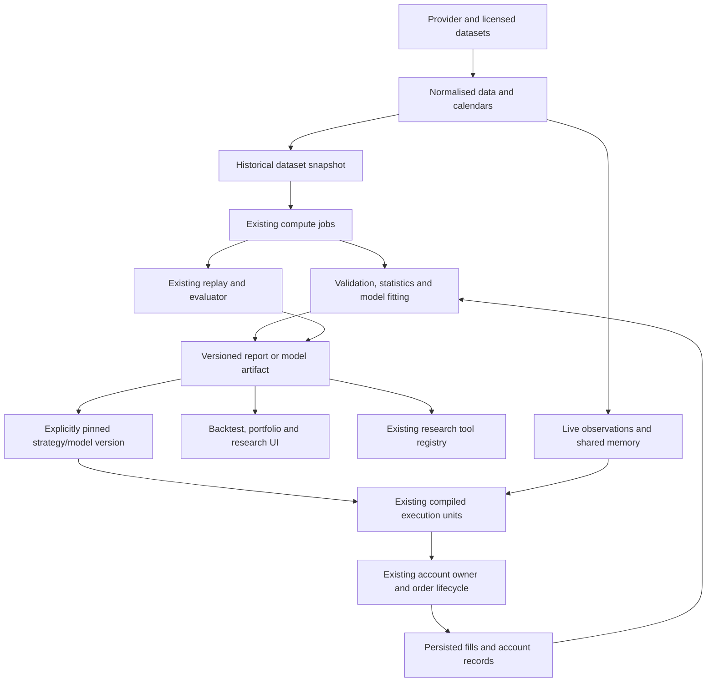

# QuantNest: quantitative trading, research and finance roadmap

**Research and repository review: 27 October 2026.**

**Status: proposed product and technical roadmap, not implemented functionality.** This document combines a review of the current QuantNest source with primary research, official library documentation, exchange/regulator publications and actual quantitative job descriptions. Existing execution behaviour remains documented in the [four trading guides](README.md#trading-and-execution-guides).

The objective is to make QuantNest useful for making better trading decisions, while producing credible evidence of quantitative engineering, research and analytical skill. Neither a model nor a substantial project guarantees profitable trading, CV selection or an offer. The achievable goal is a platform whose results can be explained, reproduced and challenged.

## How to read this document

- For the product decision, start with the [recommendation](#1-the-recommended-direction), [priorities](#4-prioritisation-build-investigate-and-defer) and [delivery roadmap](#18-delivery-roadmap).
- For methods, start with [data](#5-foundation-trustworthy-research-data), [validation](#6-a-strategy-validation-workbench), [portfolios](#8-portfolio-mathematics-that-users-can-actually-use), [ML](#9-ml-choose-the-problem-before-choosing-the-model) and [derivatives](#10-quantitative-finance-and-derivatives-workbench).
- For implementation, read [architecture](#13-minimal-architecture-for-the-extensions), [performance](#15-performance-and-deployment-on-a-small-server) and [correctness](#17-correctness-evidence-and-acceptance-criteria).
- For career preparation, read [roles](#19-what-employers-need-to-see), [learning and interviews](#20-learning-plan-and-interview-preparation) and [CV evidence](#21-cv-portfolio-and-interview-presentation).
- For launch decisions, read [startup value](#22-startup-value-and-simplicity) and [data/release boundaries](#23-india-specific-data-and-release-boundaries).
- Finish with the [first implementation tickets](#24-the-first-implementation-tickets). Sources are linked beside the claims they support; the [reference guide](#25-reference-guide-and-terminology) explains how to interpret them.

## 1. The recommended direction

Build QuantNest into a **research-to-execution platform that helps a user determine whether a strategy survives realistic testing, how it interacts with other strategies, and whether actual execution matches its assumptions**.

Start with three capabilities:

1. **Strategy validation:** reproducible datasets, chronological out-of-sample tests, simple benchmarks, parameter stability and realistic cost sensitivity.
2. **Portfolio understanding:** combined equity, overlapping exposures, correlated losses, capital usage and understandable risk scenarios.
3. **Execution review:** explain the difference between a signal, its simulated fill and its real broker fill, using measured latency and verified costs.

Then add narrowly defined ML tools and derivatives analytics where the required data and a measurable benefit exist. A user should not need to understand ML to use a volatility estimate, and should not have to configure a research framework to compare two strategies honestly.

The first useful question is not “Which advanced algorithm can we include?” It is:

> What decision will the user make better, what evidence will support that decision, and what happens if the method is wrong?

For example, identifying that five apparently different strategies all lose during the same market move may be more valuable than adding a sixth strategy generated by an LLM.

### 1.1 What “quant firm quality” should mean here

Adopt the research discipline:

- Data has provenance, availability times and explicit limitations.
- The experiment records what was tried, including failures.
- Performance is measured after relevant costs and against a sensible alternative.
- Results outside the development period matter more than the best fitted chart.
- Models are reproducible, versioned and evaluated against simpler baselines.
- Execution state, account ownership and financial accounting remain correct.
- Conclusions communicate uncertainty and can survive independent review.

Do not copy the infrastructure of a large trading firm before there is a corresponding workload. QuantNest does not currently need an exchange-colocated stack, a distributed ML cluster, a custom feature-store product, or dozens of microservices to satisfy these principles.

### 1.2 Best fit for your dual objective

Your current platform gives you the strongest immediate foundation for **quantitative developer / research engineer** roles: data pipelines, shared evaluation, concurrent execution, broker integration and reproducibility. Add rigorous empirical studies to strengthen a **quantitative researcher** application. Add portfolio attribution, risk estimation and pricing validation to strengthen a **quantitative analyst** application.

These are related but different evidence sets. One large repository does not automatically demonstrate all three.

## 2. What QuantNest already has, and what to build on

The following observations come from the current checkout. They are not a new certification of every runtime path.

| Existing area | Current foundation | Useful quantitative extension |
| --- | --- | --- |
| [Market data](../backend/marketdata/) | Provider-specific candles, provider-confirmation fields, history coverage, session calendars, shared history preparation and live data | Point-in-time research datasets, corporate-action treatment, dataset manifests and historical universes |
| [Shared execution](../backend/execution/) | Compiled rules and features, evaluation units, account ownership, matching, ledger and replay | Reuse the evaluator for validation; add versioned model outputs only when justified |
| [Backtesting](../backend/backtesting/engine.py) | Historical replay; trade statistics, costs, MAE/MFE, drawdown, monthly and instrument results | Out-of-sample evaluation, benchmark conventions, uncertainty and experiment comparison |
| [Monte Carlo](../backend/backtesting/monte_carlo.py) | Resampling recorded net trade P&Ls with replacement | Clearly distinguish trade resampling from dependence-aware return-path analysis |
| [Execution analytics](../backend/analytics/services.py) | Reports derived from source-specific trading records | Comparable gross/net bases, exposure analysis and execution shortfall |
| [Research tools](../backend/research/tool_registry.py) | Registry of deterministic tools, evidence references, owned context and confirmed actions | Expose validated quantitative reports through the same registry |
| [Strategies](../backend/strategies/) and [rules](../backend/rules_engine/) | Saved definitions, versions, conditions and sizing | Research hypotheses, pinned experiments and later model-based conditions |
| Paper, Live and Terminal | Existing account/order/position lifecycle and user interfaces | Surface new analytics without creating another trading ledger |

### 2.1 Important limits of the existing foundation

**OHLC backtesting is not historical tick replay.** The replay constructs an observation sequence from candles. It cannot reconstruct the true intrabar order of prices, bid/ask liquidity or queue position. Keep the useful shared evaluation logic while making the observation and fill assumptions available in report details and exports.

**The existing Monte Carlo feature is a trade-outcome resampler.** It samples recorded net P&Ls and adds them to starting capital. It does not recreate the underlying market, correlated strategy paths or the effect of resizing positions after each simulated outcome. Its outcome percentiles should not be presented as confidence that the next live period will produce those returns.

**Metrics already exist.** Extend them rather than introducing a second inconsistent calculator. In the reviewed backtest code, daily Sharpe calculation uses a zero risk-free reference and square-root annualisation. Make that convention explicit and support appropriate alternatives before using the number to rank unrelated strategies.

**Current Live analytics are before verified broker fees.** Paper and Terminal can report their recorded simulated charges. Do not compare these net values with Live gross values without a visible basis. Missing broker fees must remain unknown, not silently become zero.

**Independent instrument evaluation is not a coordinated portfolio strategy.** A cross-sectional ranker or pairs strategy needs decisions across instruments and coordinated capital allocation. Add that responsibility explicitly; do not make each independent instrument invent the portfolio result from partial information.

Dedicated point-in-time universe, corporate-action research and immutable dataset-snapshot systems were not found in the reviewed execution, market-data and analytics paths. These should be designed as new capabilities, not assumed to exist because historical candles are stored.

Concrete reuse points for implementation are `history.ensure_history()` and `data_revision()` for preparation/invalidation; `compiler.strategy_requirements()` and `compile_strategy()` for declared feature requirements and compiled programs; `EvaluationUnit` and `Replay` for shared decisions; `AccountOwner` and `repository.persist_transition()` for account transitions; and the existing backtest `_calculate_metrics()` implementation for financial reporting. Their presence is a reason to extend the current flow, not build another evaluator, ledger or report formula set.

### 2.2 Preserve the decisions already made

This roadmap does not require restoring removed operational-approval systems, trade cooldowns, automatic strategy disablement, a separate risk-management app, or partial automated exit policies. Risk **analysis** can be added without introducing automatic trading controls.

Keep the current execution scopes and deployment policy. Private remains the operator's separate instance; this document is not a proposal to begin selling customer Live deployments. Keep the existing numerical hot path free of database and network work.

## 3. Design around user decisions

| User | Real question | Useful feature | What would be unnecessary |
| --- | --- | --- | --- |
| Beginner testing a rule | “Does this work beyond the period I selected?” | Guided chronological validation and a clear comparison baseline | A screen full of statistical scores without explanations |
| Discretionary trader | “What makes this trade attractive, and what risk am I taking?” | Scenario analysis, trade review and exposure context | An unexplained buy/sell probability |
| Strategy builder | “Which setting is stable rather than accidentally best?” | Parameter neighbourhoods, holdout results and cost stress | Thousands of optimiser combinations by default |
| Multi-strategy user | “Am I diversified, or repeating the same bet?” | Combined returns, holdings overlap and common drawdowns | A sophisticated optimiser before reliable portfolio returns exist |
| Options user | “What changes if spot, volatility or time changes?” | Payoff, Greeks, implied volatility and expiry scenarios | A premium-selling strategy labelled safe because of its win rate |
| Experienced researcher | “Can I reproduce and challenge this result?” | Dataset/version manifests, trial history and downloadable evidence | A proprietary score with an undisclosed formula |
| Developer/operator | “Why did the actual order differ from the research result?” | Signal-to-fill trace and execution-cost attribution | More dashboards without causally useful timestamps |

Start with the strategy builder and multi-strategy user. They fit the current product and can benefit before you acquire expensive alternative data or options-chain history.

## 4. Prioritisation: build, investigate and defer

| Priority | Capability | User benefit | Main prerequisite | Recommendation |
| --- | --- | --- | --- | --- |
| P0 | Reproducible research dataset and data-quality report | Avoid conclusions based on corrected, missing or unsuitable data | Dataset contract and provenance | Build first |
| P0 | Chronological validation, benchmarks and cost stress | Reject attractive but fragile backtests | Existing replay plus dataset manifests | Build first |
| P0 | Consistent portfolio/trade metrics | Compare like with like | Correct equity and charge basis | Build first |
| P1 | Parameter stability and experiment history | Understand sensitivity and selection bias | Validation workflow | Add before a large optimiser |
| P1 | Portfolio overlap, correlation and stress | Make allocation decisions with better information | Aligned equity/exposure series | Add next |
| P1 | Execution shortfall and latency analysis | Diagnose implementation losses | Reliable event timestamps and fill provenance | Add to existing reports |
| P1 | Guided evidence interpretation through AI | Make quantitative outputs accessible | Deterministic reports with provenance | Extend existing research tools |
| P2 | Volatility forecasting and allocation research | Test more consistent risk exposure | Good return histories and baselines | Begin with EWMA; compare alternatives |
| P2 | Tabular ML ranking/filter research | Test nonlinear relationships economically | Point-in-time features and leakage-safe validation | One focused research project |
| P2 | Options risk and pricing workbench | Understand derivatives exposures | Correct contracts, quotes and pricing inputs | Read-only analytics first |
| Later | Coordinated portfolio and pairs execution | Trade a portfolio decision consistently | Planner, capital arbitration and leg handling | Separate implementation project |
| Defer | RL trading, large transformers, LLM-generated live signals | Unproven incremental benefit for current users | Large suitable data and much stronger validation | Do not prioritise |
| Defer | Order-book market making and high-frequency alpha | Requires execution/data advantages not established here | Depth/order-event data, suitable access and infrastructure | Do not market as current capability |

Priority reflects dependencies and likely utility, not a claim that every P1 feature has already demonstrated customer demand. Validate that demand with actual users before building a large interface.

## 5. Foundation: trustworthy research data

### 5.1 One data contract, different consumers

Retain a common provider-normalised market-data layer. A chart, a screen, a model and a backtest should not independently reinterpret provider fields. However, “same data” does not mean every consumer needs the same representation:

- A chart can display a forming candle.
- A completed-candle rule must not consume its eventual final close early.
- A live LTP rule uses observed ticks.
- A historical experiment uses a pinned dataset with an explicit observation model.
- A portfolio report needs marks, holdings, cash flows and costs together.

The contract should make these distinctions explicit instead of coercing everything into one ambiguous `price` value.

### 5.2 The four times that matter

For data that can be released or revised, distinguish:

| Time | Meaning | Example |
| --- | --- | --- |
| Observation time | When the market event occurred | Exchange timestamp of a trade |
| Publication/availability time | When the information became usable | Financial result released after market close |
| Ingestion time | When QuantNest received it | Provider response received later |
| Revision time/version | Which correction or revision this is | Historical financial statement restated next quarter |

For historical research, select information **available at the simulated decision time**, not information eventually known about that period. A result for the quarter ending March is not automatically available on 31 March.

This principle also applies to index constituents, sector classifications, contract sizes, borrow availability and corporate actions. An as-of join selects the latest eligible record whose availability time is no later than the decision; it must not select the newest row in today's database.

### 5.3 Instrument identity and universe bias

Keep `sym_ticker` as the current provider-facing unique symbol and use the instrument's name for display, as already intended. For long historical research, add stable instrument identity and dated symbol mappings where needed. A company rename, symbol reuse or contract expiry must not merge unrelated histories or lose continuity.

A universe is also a dated dataset. Testing only today's surviving stocks over old periods creates survivorship and selection problems. At minimum, record:

- How securities entered and left the eligible universe.
- Whether delisted, suspended and renamed securities are covered.
- Liquidity eligibility computed from information then available.
- What happens when an instrument cannot trade or its data disappears.

Until historical constituents are available, describe a study honestly as a **fixed, selected-universe experiment**. Do not label it an unbiased test of the entire Indian equity market.

### 5.4 Raw prices, adjustments and corporate actions

Preserve distinct uses:

1. Raw tradable prices for order/fill accounting.
2. Split-adjusted series for appropriate historical continuity.
3. Dividend/total-return treatment for investment-return comparisons.

Apply holdings and cash-flow changes correctly. Do not both use a total-return series and credit the same dividend again. Do not execute an old order at today's back-adjusted historical price while retaining the old share quantity.

Large existing platforms explicitly distinguish raw and adjusted normalisation modes. This is a useful design reference, not a recommendation to copy US-equity assumptions into Indian contracts. [QuantConnect equity normalisation documentation](https://www.quantconnect.com/docs/v2/writing-algorithms/securities/asset-classes/us-equity/requesting-data)

Back-adjustment is not automatically appropriate for every strategy: absolute-price thresholds, historical lot sizes and point-in-time features need special care. Store the adjustment methodology and version in the experiment.

### 5.5 Missing data and quality

`HistoryCoverage` answers a retrieval/coverage question; it does not establish that a dataset is economically complete or suitable for a hypothesis. Its current empty-response caution is important.

A compact quality report should distinguish:

- Market closed according to the exchange/segment calendar.
- No observed trade in an eligible interval.
- Provider did not return the interval.
- Candle received but not provider-confirmed.
- Duplicate/corrected observation.
- Instrument suspended, expired or otherwise not tradable.
- Corporate action requiring price/holding treatment.

Do not invent a zero return or executable price to hide a gap. Forward filling a valuation mark can be a declared reporting convention; it does not create a fillable quote.

This is not a proposal to reintroduce a universal tick-age rejection threshold. Data suitability should follow the operation and available evidence, including market state, continuity and observation ordering.

### 5.6 Minimal reproducibility manifest

Each experiment should pin:

```text
experiment_id
strategy_version_id and configuration hash
dataset_id and content/revision fingerprint
provider and universe definition/version
date range, timezone and session-calendar version
price normalisation and corporate-action policy
feature definitions and data availability policy
observation/fill model and cost-profile snapshot
training/validation/test boundaries, when applicable
source commit and numerical-library versions
random seed, when randomness is used
all attempted parameters and outcome status
```

A dataset hash identifies content; it does not prove that the content is correct. Reproducibility additionally requires retaining the pinned content or an immutable retrievable revision. A mutable TimescaleDB query plus a hash is insufficient if corrected rows overwrite the old values.

Start with database metadata and an immutable exported artifact where licensing permits. Parquet is a useful columnar artifact format for offline research; it is not a replacement for the operational candle store or live shared memory.

### 5.7 What different data can support

| Available data | Defensible initial use | What it cannot establish |
| --- | --- | --- |
| Daily OHLCV | Slow trend/momentum experiments, daily portfolio returns | Intraday queue position, exact stop execution |
| Minute OHLCV | Intraday rule research with declared path/fill assumptions | True within-minute event order and spread |
| Trade ticks | Observed last-trade sequence and tick-rule evaluation | Full bid/ask liquidity or your order's queue priority |
| Timestamped top-of-book quotes | Spread-sensitive analysis and quote-side execution models | Full-depth impact or exact passive-fill probability |
| Order-book/event history | More detailed microstructure experiments | Guaranteed replication of the live venue's matching outcome |
| Point-in-time fundamentals | Value/quality/fundamental models | An unbiased study if revised values replace original releases |
| Historical option chains with quotes | Volatility surfaces and option-strategy research | Reliable fills from stale last-traded prices alone |

Do not buy or ingest every dataset first. Select one research question, identify the minimum adequate data, and verify storage, use and redistribution rights.

## 6. A strategy validation workbench

This is the most valuable first product extension. It should improve the existing Backtesting Lab, not create a second backtesting engine.

### 6.1 The user workflow

1. Select a saved strategy version and an eligible universe.
2. Select an overall research period and the decision frequency.
3. Choose chronological validation using sensible defaults.
4. Review data suitability and costs.
5. Run a bounded set of experiments through the existing compute worker.
6. Compare training, validation and untouched test results.
7. Review stability, exposure and cost sensitivity.
8. Save the research conclusion and, if appropriate, begin a prospective Paper observation period.

Do not turn “the optimiser found a winner” into an automatic Live deployment action.

### 6.2 Chronological evaluation

An illustrative daily-data study, if suitable data is available:

| Period | Use |
| --- | --- |
| 2018–2023 | Develop hypotheses and training procedures using internal chronological folds |
| 2024 | Validation for choosing between a small number of approaches |
| 2025 | Locked final historical test after choices are fixed |
| 2026 onward | Prospective observation after the strategy is frozen; already-inspected 2026 data is not prospective |

These are examples, not required dates. A short dataset may not support this division. Never suggest that merely naming a period “holdout” makes it untouched if the developer has repeatedly inspected it.

For walk-forward research, fit on an earlier window, evaluate on the next window, advance the boundary and concatenate only the resulting out-of-sample observations. Any retraining schedule must be reproducible. QuantConnect's documented walk-forward workflow is a useful product reference. [Walk-forward optimisation](https://www.quantconnect.com/docs/v2/writing-algorithms/optimization/walk-forward-optimization)

### 6.3 Prevent the common leakage routes

- Fit scaling, imputation, feature selection and model parameters on training data only.
- Use the same preprocessing fitted on that training window for its validation/test window.
- Keep all instruments for the same decision date on the appropriate side of a cross-sectional split.
- Do not train on a label whose outcome period extends into the evaluation interval.
- Compute ranks using the eligible universe at that date, not the eventual complete dataset.
- Let indicator warmup use earlier observations, but do not count warmup returns as test performance.
- Make bar-close signals eligible only after that bar has completed.
- Keep future corporate actions, revised fundamentals and later news out of earlier features.

Scikit-learn pipelines help prevent preprocessing leakage. `TimeSeriesSplit` offers forward splits and a row-based gap, but is not automatic financial label-overlap purging. For variable-horizon trade labels, compare actual label intervals. An embargo is useful only when the validation design creates a corresponding information-overlap risk; do not add arbitrary exclusions by ritual. [Common pitfalls](https://scikit-learn.org/stable/common_pitfalls), [TimeSeriesSplit](https://scikit-learn.org/stable/modules/generated/sklearn.model_selection.TimeSeriesSplit.html)

### 6.4 Baselines before sophistication

Every study should answer “better than what?” Depending on the hypothesis, compare against:

- Cash/no trading, with an explicit interest assumption.
- Buy-and-hold or a suitable total-return benchmark.
- An equal-weight eligible portfolio.
- The original strategy without the proposed extra filter.
- A simple linear or constant prediction before ML.

Use matching dates, capital conventions, cost treatment and investment constraints. Comparing leveraged intraday gross P&L with an unleveraged net index return is not an informative superiority claim.

### 6.5 Cost and execution sensitivity

Show a base case and clearly labelled stress cases, for example base, twice the assumed spread/slippage, and a delayed decision/fill. These are scenarios, not forecasts.

Separate brokerage/taxes, spread crossing, slippage, market impact, financing, borrow costs and futures rollover where relevant. If execution prices already include slippage, do not subtract it again in the P&L report.

An illustrative strategy earning 20 basis points gross per round trip loses money if its all-in round-trip cost is 22 basis points. High classification accuracy does not repair this arithmetic.

Liquidity-aware impact models should be introduced only with supporting data. Start by reporting turnover, position size relative to observed volume and cost sensitivity. Institutional studies show that costs and capacity differ materially across strategy families; their estimates cannot simply be copied into Indian retail trading. [Frazzini, Israel and Moskowitz, trading costs study](https://pages.stern.nyu.edu/~afrazzin/pdf/Trading%20Cost%20of%20Asset%20Pricing%20Anomalies%20-%20Frazzini%2C%20Israel%20and%20Moskowitz.pdf)

### 6.6 Parameter stability and multiple attempts

Prefer a broad region of reasonable results over one isolated maximum. Show neighbouring settings using the same validation protocol. Keep the trial history, including failed and disappointing trials, so later statistical corrections and human review know the actual search effort.

The Deflated Sharpe Ratio addresses selection effects and non-normal returns under its assumptions; it is not a probability of future profit. The Probability of Backtest Overfitting framework is another useful advanced diagnostic. Neither replaces a properly controlled temporal evaluation and genuine prospective results. Add these after the experiment log exists, not as unexplained first-release badges. [Deflated Sharpe Ratio](https://www.davidhbailey.com/dhbpapers/deflated-sharpe.pdf), [Probability of Backtest Overfitting](https://www.davidhbailey.com/dhbpapers/backtest-prob.pdf)

### 6.7 Uncertainty and the current Monte Carlo feature

Retain the existing trade bootstrap as an explicitly labelled exploration of resampled recorded trade outcomes. Add a separate return-series method when needed:

- Use daily marked-to-market returns with a consistent account/cash-flow convention.
- Use stationary or block bootstrap methods to retain some serial dependence.
- For portfolios, resample the same date blocks across all strategies so joint dependence is retained.
- Show sensitivity to block length and limited sample size.
- Distinguish an outcome distribution under a resampling model from a confidence interval for an estimated statistic.

Block bootstraps are available in `arch`; the library provides mechanics, not a guarantee that a stationary historical resampling model describes future markets. [Time-series bootstrap documentation](https://arch.readthedocs.io/en/stable/bootstrap/timeseries-bootstraps.html)

### 6.8 Improve financial reporting conventions

Use marked account equity, including open positions, rather than closed-trade P&L alone for portfolio returns. Handle external deposits/withdrawals explicitly: time-weighted return measures strategy performance independently of external cash timing; money-weighted return answers a different investor experience question.

For Sharpe, state sampling frequency, excess-return reference, sample dates and annualisation. Serial dependence can invalidate a naive square-root scaling interpretation. Include uncertainty and use a suitable dependence-aware method when making inferential claims. [Andrew Lo, The Statistics of Sharpe Ratios](https://alo.mit.edu/research-page/the-statistics-of-sharpe-ratios/)

Do not mechanically use the same annualisation factor for calendar days, trading days, individual trades and mixed-frequency strategies. Define downside thresholds for Sortino. Treat undefined statistics as unavailable, not zero or infinity presented as success.

### 6.9 What the report should conclude

A useful conclusion might be:

> The strategy remained positive in three of four out-of-sample windows, but most gains came from one sector. Doubling assumed slippage removed the aggregate profit. There are too few independent observations to estimate downside risk precisely.

That is more useful than “Strategy score: 92/100.” A valid research result can be negative or inconclusive. No fixed Sharpe threshold should automatically certify deployment readiness.

## 7. Strategy families worth researching

These are hypotheses to investigate, not ready-made profitable strategies or investment recommendations.

### 7.1 Slow time-series trend: first reproducible case study

**Question:** can a simple rule based on an instrument's own past returns produce useful net performance or diversification across a declared set of liquid instruments?

Start with a small set of long-only eligible cash instruments if that matches actual trading constraints. Compare a simple moving-average or trailing-return rule with buy-and-hold. Study turnover, crisis behaviour, delayed entry, whipsaws and volatility-based sizing separately.

Time-series momentum has documented historical evidence across diversified futures and forward markets. That motivates a research hypothesis; it does not establish that an Indian stock rule, an options implementation or a short sample inherits the same result. [Moskowitz, Ooi and Pedersen, Time Series Momentum](https://www.aqr.com/Insights/Research/Journal-Article/Time-Series-Momentum)

**Skill evidence:** data handling, hypotheses, chronological experiments, cost-aware replay and clear negative-result reporting.

### 7.2 Cross-sectional momentum: second-stage portfolio research

**Question:** do relatively strong eligible instruments outperform relatively weak ones over a chosen future holding period after costs?

Begin with long-only ranking and a scheduled rebalance. Compare equal weight, rank weight and simple concentration caps. Record historical eligibility and account for turnover, liquidity, sector bets and capital constraints.

This requires a portfolio decision over an entire eligible cross-section. It cannot be implemented correctly by adding an isolated rank comparison to each instrument without a shared decision snapshot.

### 7.3 Value and quality: only after point-in-time fundamentals

Potential features include profitability, leverage, earnings quality and valuation ratios. They require announcement dates, revisions, accounting definitions and sensible treatment of negative denominators. Current financial statements joined backwards into old dates are not an acceptable shortcut.

Indian factor datasets can help with academic replication and exposure analysis. The IIM Ahmedabad factor archive is a useful reference, but its releases have versions and coverage limits. It is not a substitute for a commercially licensed point-in-time company dataset. [IIMA Indian Fama–French and momentum factors](https://web.iima.ac.in/~iffm/Indian-Fama-French-Momentum/), [release archive](https://faculty.iima.ac.in/iffm/Indian-Fama-French-Momentum/archive.php)

### 7.4 Pairs and statistical arbitrage: useful learning, later execution

Correlation is not cointegration. Even evidence of cointegration does not guarantee stable spreads or profitable trading after costs. Estimate relationships only on the fitting period and test stability outside it. A hedge ratio is not always one share against one share. [Statsmodels cointegration test](https://www.statsmodels.org/stable/generated/statsmodels.tsa.stattools.coint.html)

Before enabling execution, address shorting/borrow availability, two-leg fill risk, hedge rebalancing, instrument multipliers and coordinated capital. A liquid-looking spread in a chart is not enough. Keep the first version as a research report.

### 7.5 Intraday rules: evaluate your actual user workflows

Use existing breakout, indicator and price-action rules as validation examples. Test whether results survive a later observation, higher spread, fewer trades and different volatility periods. Do not assume that adding RSI, an ML filter or more conditions creates independent information.

This is likely highly relevant to QuantNest's current users, but requires particularly honest simulation assumptions because OHLC data does not reveal every executable path.

### 7.6 Options and volatility: risk understanding before strategy generation

First help users understand nonlinear exposure, volatility and expiry. Investigate strategy profitability only when historical chain quality, settlement rules, margins and multi-leg execution are adequate. A high win rate in option selling can coexist with rare losses larger than all earlier gains.

## 8. Portfolio mathematics that users can actually use

### 8.1 Start with a truthful combined account view

Show positions, cash, reserved capital, derivative notional and strategy attribution on one consistent valuation basis. Margin required is not the same as economic exposure. Summing independently backtested returns is not a valid simulation of strategies sharing one constrained account.

Distinguish two products:

- **Research combination:** a hypothetical weighted combination of independently produced, aligned return series, with explicit rebalancing and cost assumptions.
- **Executable portfolio simulation:** strategies competing for actual shared cash, capacity and order execution through the account owner.

Label the first clearly until the second exists. It remains useful for exploring diversification without pretending to model shared-capital contention.

### 8.2 First portfolio report

Include:

- Strategy and instrument weights, sector exposure and directional concentration.
- Gross and net exposure, cash, leverage and derivative contract multipliers.
- Holdings overlap and correlation of aligned marked returns.
- Common loss days, worst joint drawdown and recovery duration.
- Contribution to realised P&L and estimated portfolio risk.
- Turnover and sensitivity to changing weights.

Show the sample period and number of shared observations. Do not turn missing marks into zero returns to make a correlation matrix look complete.

For weights `w` and covariance matrix `Σ`:

```text
portfolio variance = wᵀ Σ w
portfolio volatility = sqrt(wᵀ Σ w)
component volatility contribution_i = w_i (Σ w)_i / portfolio volatility
```

The component contributions sum to portfolio volatility when defined. They can be negative for hedging exposures; a pie chart that assumes every contribution is positive would be misleading.

### 8.3 Covariance estimation and allocation

Start with equal weight and capped inverse-volatility allocations as baselines. For covariance-based work, compare sample covariance with a shrinkage estimator. Shrinkage can improve estimation stability when the number of assets is substantial relative to the available observations; it does not create expected returns. [Ledoit and Wolf, covariance shrinkage](https://ledoit.net/honey.pdf)

Only then investigate constrained minimum-variance allocation:

```text
minimise    wᵀ Σ w + λ × estimated turnover cost
subject to  sum(w) = invested_fraction
            0 <= w_i <= instrument_cap_i
            sector and liquidity limits
            explicit cash and leverage policy
```

Use a suitable convex solver for this well-defined problem, not a custom numerical optimiser. CVXPY documents the quadratic-programming formulation. [CVXPY quadratic programming](https://www.cvxpy.org/examples/basic/quadratic_program.html)

Compare out-of-sample net results against equal weight. Avoid unconstrained maximum-Sharpe optimisation based on noisy estimated mean returns. Hierarchical risk parity can be a later challenger if it improves stability on your data; it should not become a mandatory architecture layer.

### 8.4 Volatility targeting

An interpretable research rule is:

```text
exposure multiplier = min(maximum_allowed_multiplier,
                          target_volatility / estimated_volatility)
```

Add an explicit policy for unreliable or near-zero estimates, minimum cash, discrete lots, turnover and when estimates are updated. Compute volatility from observations available before the allocation decision. Do not allow a tiny denominator to produce extreme exposure.

Use this to investigate **risk consistency**, not to promise higher returns. There is supportive historical research, but later research also questions broad out-of-sample superiority of volatility-managed implementations. This is precisely why the platform should compare methods instead of embedding one as universally optimal. [Moreira and Muir](https://www.nber.org/papers/w22208), [On the performance of volatility-managed portfolios](https://www.sciencedirect.com/science/article/pii/S0304405X2030132X)

### 8.5 Stress testing, VaR and expected shortfall

Provide simple readable scenarios first: an underlying price gap, a volatility increase, a spread increase, a correlated equity fall, or an instrument becoming temporarily untradeable. State which exposures are repriced and what is held constant.

Historical VaR is an estimated loss quantile over a stated horizon and sample. Expected shortfall estimates average loss beyond the selected quantile. Neither is maximum possible loss. Both can underrepresent structural changes and unseen events.

For derivatives, reprice the contract for larger shocks rather than relying solely on a small-move delta approximation. Historical scenarios should use contemporaneous portfolio assumptions, not silently imply that today's portfolio existed in an old crisis.

### 8.6 Avoid aggressive capital mathematics at launch

Do not add full-Kelly sizing as a default. It is highly sensitive to uncertain probabilities, payoffs and dependence. If studied later, compare capped fractional variants under estimation error and drawdown constraints. For current users, transparent fixed capital, exposure caps and clear scenario loss are easier to understand and verify.

## 9. ML: choose the problem before choosing the model

### 9.1 What the literature does and does not support

Gu, Kelly and Xiu compare numerous methods in empirical asset pricing and report substantial benefits from modelling nonlinear interactions in their setting, including trees and neural networks. This supports investigating nonlinear models; it does **not** identify a universal best algorithm for Indian intraday trading or prove that a small retail dataset is sufficient. [Empirical Asset Pricing via Machine Learning](https://www.aqr.com/insights/research/journal-article/empirical-asset-pricing-via-machine-learning)

A separate benchmark finds strong tree performance on many medium-sized tabular datasets. That is a practical reason to start with inexpensive tabular baselines, not financial evidence of profitable trading. [Why do tree-based models still outperform deep learning on typical tabular data?](https://arxiv.org/abs/2207.08815)

**Recommendation:** use regularised linear/logistic models and one CPU-friendly gradient-boosted tree implementation as the initial comparison set. Expand only when a specific failure or result justifies it.

### 9.2 Method selection by responsibility

| Responsibility | First baseline | Worth testing next | Evaluation that matters | Main limitation |
| --- | --- | --- | --- | --- |
| Rank instruments for a future holding period | A simple momentum rank; regularised linear regression | Histogram gradient boosting; a random-forest challenger | Per-date rank correlation, portfolio returns after turnover/costs, stability | Leakage, unstable relationships and changing universes |
| Estimate whether an existing setup deserves a trade | No filter; logistic regression | A calibrated boosted classifier | Net economic improvement over the original strategy, calibration and missed opportunities | Filtering can overfit or simply reduce exposure |
| Forecast volatility | Trailing realised volatility; EWMA | GARCH with suitable innovations; HAR-RV if intraday realised-variance data exists | Forecast loss, interval calibration and downstream risk stability | Predicts risk, not necessarily direction |
| Estimate execution cost | Fixed spread/cost by liquidity group | Regularised regression or boosted regression | Out-of-sample cost error and conservative uncertainty | Requires actual quote/fill data at relevant sizes |
| Describe market state | Trailing volatility/trend/liquidity categories | A small hidden Markov model, if it adds value | Stability and improvement to a predeclared decision | Hindsight regime labels are easy to overfit |
| Detect data anomalies | Deterministic schema/calendar/price checks | Isolation Forest for reviewed candidate anomalies | Useful detections, false positives and analyst time saved | Unusual prices can be real events |
| Extract structured facts from documents | Rules and source-aware extraction | A narrowly evaluated NLP model or LLM | Field accuracy, provenance and publication-time correctness | Hallucination, revised text and timestamp leakage |

Scikit-learn's histogram gradient boosting is one reasonable starting implementation. Avoid installing XGBoost, LightGBM, CatBoost and another framework before one comparative study exists. [HistGradientBoostingRegressor](https://scikit-learn.org/stable/modules/generated/sklearn.ensemble.HistGradientBoostingRegressor.html)

### 9.3 Recommended first ML experiment

**Research question:** does a small set of lagged market features improve a long-only ranking baseline after costs?

1. Use a declared, point-in-time eligible universe; if unavailable, state the fixed-universe limitation.
2. Choose one rebalance schedule and one forward return horizon.
3. Create a small feature set: lagged returns, trailing volatility, relative volume and a limited number of trend measures.
4. Define feature availability and the earliest executable observation.
5. Compare momentum rank, regularised linear prediction and a shallow boosted model.
6. Fit/tune inside chronological training folds only.
7. Compare identical portfolio construction and costs across models.
8. Report performance by period, turnover, concentration, drawdown and sensitivity to small design changes.
9. Freeze the winner only if the evidence justifies it; “none beats the baseline reliably” is an acceptable outcome.

Do not begin with hundreds of indicators or thousands of hyperparameter trials. More correlated transformations increase search effort and opportunities to overfit.

### 9.4 Probabilities need calibration and economic context

A predicted 70% probability should correspond, approximately, to the event happening 70% of the time in comparable out-of-sample predictions. Assess reliability diagrams, Brier/log loss and calibration on held-out data. Calibration fitted on the evaluation set contaminates the evaluation. [Scikit-learn probability calibration](https://scikit-learn.org/stable/modules/calibration.html)

Even calibrated direction probabilities are insufficient. An illustrative expectation is:

```text
Expected net return = p × average_win − (1 − p) × average_loss − round_trip_cost

p = 0.56, average_win = 0.006, average_loss = 0.005, cost = 0.001
Expected net return = 0.00016 = 1.6 basis points
```

These invented values only demonstrate the arithmetic. Real payoffs depend on the decision, horizon, conditioning information and execution. A small apparent edge can disappear under estimation error.

For a meta-model that filters another model's trades, generate training predictions out of fold. Feeding in-sample predictions of the first model into a second model makes a convincing but contaminated result.

### 9.5 Volatility methods deserve their own comparison

EWMA is a clear, inexpensive baseline. GARCH models conditional variance dynamics; the choice of error distribution and model specification matters. HAR-RV combines realised-volatility components over different horizons and needs a defensible realised-variance construction, including treatment of overnight moves and microstructure noise. [Arch forecasting documentation](https://arch.readthedocs.io/en/stable/univariate/forecasting.html), [Corsi, HAR-RV research](https://search.usi.ch/en/publications/1448/a-simple-approximate-long-memory-model-of-realized-volatility)

Test forecast error separately from trading performance. A better volatility forecast can improve scenario estimates or sizing without forecasting positive returns. Do not add GARCH estimation to every live tick; fit on the declared schedule and publish the resulting parameters or forecasts.

### 9.6 Regime models must use information available then

Start with understandable state descriptions such as trailing volatility percentile and trend strength. If testing an HMM, distinguish filtered state probabilities using observations up to the decision time from smoothed states using later observations. The latter can be useful for retrospective description but are not valid historical live signals.

Do not name a cluster “crash regime” after viewing its entire future and then claim the model recognised crashes in advance.

### 9.7 Models to defer, with reasons

| Method | Why not a first choice here | Evidence that could justify reconsideration |
| --- | --- | --- |
| LSTM/large time-series transformer | More training and validation complexity; small price datasets may not support it | Multiple genuinely out-of-sample improvements over simpler models at acceptable cost |
| Reinforcement learning for trading | Results depend heavily on reward, environment realism and omitted execution constraints | A validated simulator and a decision problem conventional methods handle poorly |
| LLM directly predicting trades | Weak reproducibility, difficult temporal evaluation and no inherent economic calibration | A tightly scoped information-extraction task with independently measured value |
| Graph neural networks | Need meaningful dated relationships and enough samples | Reliable relationship data and improvement over sector/linear features |
| GAN-generated market data | Plausible samples do not prove realistic tail/dependence behaviour | Independent validation of the particular stress/testing use case |
| Deep order-book models | Current candle/trade data cannot supply required inputs | Proper depth/event history and an executable microstructure business case |

This is a resource and evidence decision, not a claim that these methods never work.

### 9.8 Model lifecycle without another platform

Store a compact immutable model artifact with:

- Model type/version, training dataset and code revision.
- Ordered feature names, types, transformations and missing-value policy.
- Training end time, label horizon and validation report.
- Model parameters, preprocessing state and an integrity hash.
- Expected input/output contract and numerical-library compatibility.

Only load trusted artifacts produced by your controlled training process. Python pickle-like formats are executable; arbitrary user-uploaded models should not be deserialised into an application worker.

Model updates should be explicit version changes. A running session keeps its pinned model until a controlled update is applied. Missing inputs produce a defined unavailable prediction, not an invented neutral value. A model score does not bypass the account owner's capital or order rules.

Do training, feature preparation and expensive inference in the research path. If a later strategy genuinely needs frequent small-model inference, compile/load it once and benchmark it in the numerical worker. No provider HTTP calls, database reads, model fitting or LLM calls belong in the tick evaluation path.

## 10. Quantitative finance and derivatives workbench

### 10.1 First version: understand a position

Add an optional analytical view of:

- Expiry payoff for a proposed position or spread.
- Scenario P&L for changes in underlying price, implied volatility and time.
- Delta, gamma, vega, theta and relevant interest-rate sensitivity.
- Implied volatility with quote quality and model assumptions.
- Contract size, expiry, settlement method and liquidity context.

Greeks measure sensitivities under a pricing model. They do not describe every possible loss or guarantee a hedge. CME's options education is a concise reference for their economic meaning. [CME options Greeks](https://www.cmegroup.com/education/courses/option-greeks/options-the-greeks-options-premium-and-the-greeks)

### 10.2 Choose the correct pricing model

Use a documented European spot-option model with suitable dividend assumptions where applicable; use a futures-option formulation such as Black-76 when the actual contract calls for it. Do not choose the model merely because the instrument's segment says derivatives.

Inputs must include the correct underlying, time to expiry, rates, dividend/carry assumptions, exercise/settlement convention and volatility. Report vega units, theta time units and contract multipliers explicitly. An output called “vega 12” is incomplete without those conventions.

QuantLib is a mature library worth evaluating for pricing and conventions. Use a narrow wrapper for the supported contract types rather than exposing its entire abstraction system in QuantNest. [QuantLib](https://www.quantlib.org/)

### 10.3 Implied volatility is conditional information

Reject or mark unavailable prices that violate the model's feasible bounds. Use appropriate quote sides or a declared midpoint, preserve the observation time, and require a consistent underlying observation. A last trade from much earlier can imply a meaningless volatility when compared with a different-time underlying price.

Risk-neutral quantities inferred from option prices are not automatically real-world probabilities. Do not display option delta as the exact probability of a profitable trade.

### 10.4 Contracts, settlement and futures rolls

Keep dated contract specifications: lots, tick size, multiplier, expiry, settlement and applicable trading calendar. NSE individual-stock options, for example, have specific exercise and physical-settlement characteristics; all derivatives must not share a generic cash-settlement assumption. [NSE individual-securities derivatives specifications](https://www.nseindia.com/static/products-services/equity-derivatives-individual-securities)

For futures research:

- Treat continuous price series as analytical constructions, not directly tradable instruments.
- Declare the roll rule and adjustment method.
- Map every order to an actual contract and model roll costs.
- Separate notional exposure, margin requirement and realised cash flows.

For options backtests, access to expired contract daily prices alone does not provide a historical synchronous chain, spreads or executable multi-leg prices.

### 10.5 Multi-leg trading is a later responsibility

A payoff diagram does not implement spread execution. Before enabling it, define how legs are submitted, what happens after a partial fill or rejection, how residual exposure is shown, and how actual broker margin is obtained. The broker's applicable margin requirement is authoritative; a pricing model's theoretical risk is not a substitute.

Use read-only analysis and paper research first. Preserve the current simple single-instrument execution path until a separate coordinated-order design is justified.

### 10.6 An optional quant-analyst career branch

If you specifically target pricing/risk roles, a small yield-curve and fixed-income notebook can demonstrate discounting, bond price/yield, duration, convexity and DV01. It need not become a customer-facing fixed-income trading product.

Validate pricing with identities, limiting cases and independent numerical checks: put-call parity where its assumptions apply, sensitivity finite differences, monotonicity, near-expiry behaviour and calibration residuals. This is stronger evidence than a dashboard of unverified Greeks.

## 11. Execution quality and transaction-cost analysis

### 11.1 Trace a decision end to end

Capture meaningful timestamps at boundaries already crossed:

```text
provider event time, if supplied
local feed receive time
feature/evaluation start and finish
decision creation
order submission and acknowledgement
broker-reported execution time, if supplied
local fill observation and persistence
```

Use monotonic time for durations inside one process/machine and synchronised wall-clock timestamps for cross-system correlation. Provider exchange time, broker order time and local receive time are different facts; do not replace one with another when a field is missing.

Report p50/p95/p99 latency and throughput by event type, workload and machine specification. A single best-case benchmark does not describe user experience during bursts or history repair.

### 11.2 Explain actual trading costs

For a buy, a basic price shortfall against a declared decision reference is `fill_price − reference_price`; for a sell the sign reverses. Multiply by quantity and the applicable contract multiplier. Record what the reference represents and whether spread is already included.

Separate signal delay, submission delay, execution price movement, explicit fees and unfilled opportunity where the data supports that distinction. Do not infer exact exchange queue delay from local timestamps alone.

Compare simulated and actual execution using the same strategy version and observation basis. The useful question is “Where did the difference arise?”, not “Why are the charts not identical?” Real liquidity, broker handling and unobserved intrabar prices can legitimately create differences. [QuantConnect reconciliation concepts](https://www.quantconnect.com/docs/v2/writing-algorithms/live-trading/reconciliation)

### 11.3 Verified fees and current accounting

Reuse existing cost calculations for simulated records. If Live order events lack fees, obtain actual charges through a supported statement/import/reconciliation process and retain their source. Do not invent fees or synchronise broker positions into strategy-owned positions merely to build an analytics report.

Until verified charges exist, label Live results as before broker fees and keep that basis through exports, AI summaries and comparisons.

### 11.4 Performance objectives that can be measured

Test the following independently:

- Market event delivery to all subscribed evaluation units.
- Shared-feature update cost versus per-strategy evaluation cost.
- Fairness and lag under a burst of active instruments.
- Account command processing and capital arbitration.
- History preparation, reconnect recovery and version changes.
- Database persistence and broker submission outside numerical evaluation.

More users do not imply the same workload: 100 users with simple daily rules and 100 users with many tick rules are very different. Publish measured capacity for stated workloads rather than an unsupported maximum-user promise.

## 12. AI as an interface to evidence

The existing research-tool registry is the right integration point. Add tools that return compact deterministic results and evidence IDs, for example:

| Proposed responsibility | Tool output | Example user question |
| --- | --- | --- |
| Validation report | Window results, assumptions, sample sizes and caveats | “Why did this strategy fail outside its training period?” |
| Portfolio overlap | Shared exposures, correlations and joint losses | “Do these three strategies diversify each other?” |
| Cost sensitivity | Base and stressed net outcomes | “Would this survive twice the slippage?” |
| Experiment comparison | Pinned versions, changes and comparable metrics | “Did the new filter improve the original rule?” |
| Options scenario | Model, inputs, Greeks and scenario table | “How sensitive is this position to volatility?” |
| Execution review | Observed timing and price shortfall | “Why did Paper and my broker fill differently?” |

Django should compute and validate the numbers. The AI service should explain them, request missing evidence and propose actions through the existing confirmation flow. It should never create a plausible covariance matrix, fabricate unavailable historical data or silently decide to place a trade.

Keep full artifacts server-side and send concise summaries to the model. Cache calculations using dataset, strategy/model version and parameter fingerprints. A repeated explanation should reuse the result, not rerun an expensive backtest.

If adding news/document analysis, keep publication timestamps, source permissions and extraction evidence. Using a current LLM or present-day web search to recreate what a trader supposedly knew years ago can introduce temporal contamination even when the prompt asks it to ignore the future.

## 13. Minimal architecture for the extensions

### 13.1 Two paths with one set of numerical definitions



The research path may query the database, read artifacts and perform expensive calculations. The numerical live path consumes prepared data and pinned configuration. The order lifecycle retains the durable state required for correct accounting.

### 13.2 Where responsibilities belong

| Existing location | Proposed responsibility |
| --- | --- |
| `backend/marketdata/` | Provider adapters, history/calendar truth, data provenance and dataset preparation |
| `backend/backtesting/` | Admission, snapshots, replay jobs and persisted backtest results |
| `backend/execution/` | Shared rule features/evaluation, matching, account ownership and runtime integration |
| `backend/analytics/` | User-facing portfolio and execution reports derived from existing records |
| `backend/research/` | Conversations, evidence, deterministic tool registry and confirmed actions |
| `research_service/` | Provider-replaceable AI orchestration and explanation |
| `frontend/src/features/` | Focused interfaces inside existing feature areas |

A small pure numerical package such as `backend/quantitative/` is reasonable **only when functions genuinely need to be shared** across backtests, reports and research tools. Begin with focused `statistics.py` and `validation.py`; add `portfolio.py` when portfolio analysis exists. Keep dataset I/O in marketdata, orchestration in the owning app, and model adapters in a dedicated module only when there is a model.

Do not pre-create empty `models/`, `providers/`, `pipelines/`, `plugins/` and `strategies/` hierarchies. Do not wrap a single function in a class solely to make the design look extensible.

### 13.3 A small number of persistent concepts

1. **Dataset snapshot:** identity, manifest and retrievable content reference.
2. **Experiment:** hypothesis, strategy version, protocol, dataset and user ownership.
3. **Trial:** a parameter/model choice and references to existing run/results; include failure/cancellation status.
4. **Artifact:** versioned report/model file with schema, checksum and provenance.

Fold boundaries can initially be structured experiment metadata and existing run references; a separate table is needed only when querying or lifecycle requirements justify it. Reuse `BacktestRun` and existing trade/account records instead of copying them into an experimental ledger.

### 13.4 Clear function contracts

Prefer functions that accept one canonical input shape:

```python
# Illustrative contracts, not APIs currently implemented in QuantNest.
make_time_folds(protocol, observation_index, label_intervals)
evaluate_returns(return_series, benchmark_series, metric_conventions)
estimate_portfolio_risk(aligned_returns, weights, estimator_config)
compare_trials(trial_reports, comparison_protocol)
```

Reject invalid shapes or missing required fields at the boundary. Avoid “try an ID, then an object, then a dictionary” functions. Return explicit unavailable results for economically undefined quantities rather than hiding failures in broad exception handlers.

A numerical function should not discover the current user, load a Django model, inspect deployment mode or call a broker. Its caller supplies prepared inputs and owns application policy.

### 13.5 Coordinated portfolios without blocking unrelated sessions

If portfolio strategies are later implemented, add a scheduled planner that reads a consistent prepared universe snapshot, computes target positions, and sends commands through the existing account owner. The account owner remains responsible for cash and order consistency.

Each session can have its own planner state. Existing independent instrument strategies do not need to wait for a portfolio ranking job. Shared-account allocation still requires deterministic arbitration; simultaneous conflicting access to the same cash is not safe parallelism.

Do not compute a full covariance matrix or fit a cross-sectional model inside every instrument's tick callback.

## 14. Product interface: integrate, do not overwhelm

### 14.1 Backtesting Lab

Keep the normal single-backtest workflow. Offer “Validate strategy” when users want more evidence. Show a concise result summary with accessible sections for:

- Out-of-sample windows and comparison baseline.
- Costs and execution assumptions.
- Parameter sensitivity.
- Data quality and reproducibility details.
- Downloadable report and trial history.

Do not restore the previously removed large historical-execution banner. Put the necessary methodology in expandable details and exported reports. Removing visual clutter must not mean making false claims about simulation precision.

### 14.2 Paper/Live portfolio

Add one “Exposure and risk” view with readable concentration, joint drawdowns and scenario results. Start read-only. Existing session controls continue to own execution actions.

### 14.3 Terminal and trade history

Use the existing gross P&L, charges and net P&L conventions. Add optional execution detail at the trade/order level rather than crowding the order ticket with forecasts or estimated profits. Do not reintroduce pre-order fee presentation that the product deliberately removed.

### 14.4 Research assistant

Present the answer first, with evidence and calculations accessible through the improved evidence UI. Display sample period, observation basis and missing information when material. Use shared formatters, searchable selectors and existing notification components.

### 14.5 Language and defaults

Prefer “Result depends strongly on one period” to an unexplained overfitting score. Explain “out of sample” at first use. Use “insufficient evidence” when appropriate. Do not use red/green certification badges to imply a strategy is safe or profitable.

A user should be able to benefit from the default report without knowing what HAC, covariance shrinkage or calibration means; the technical explanation should remain available.

## 15. Performance and deployment on a small server

### 15.1 Keep the current deployment simple

Reuse the existing database, compute worker, API, research service and execution processes. Do not add a separate queue or worker fleet for the first quantitative feature. Bound expensive jobs so research cannot consume the CPU and memory required by market-data and execution services.

The current execution launcher already controls numerical-library thread defaults. Offline numerical jobs also need explicit thread/concurrency budgets to avoid each process launching its own full CPU thread pool.

### 15.2 Data scale changes the design

Illustrative row counts, assuming 252 sessions/year and 375 minutes/session:

```text
500 instruments × 252 sessions × 5 years
    = 630,000 daily rows

500 instruments × 252 sessions × 5 years × 375 minutes
    = 236,250,000 minute rows
```

These are planning examples, not exact exchange calendars or memory measurements. The minute dataset also requires indexes, provenance and working arrays, not just raw price storage.

Begin new research with daily or suitably aggregated data when the hypothesis allows it. Request only necessary instruments, fields and periods; cache derived features by dataset/configuration identity. Use columnar arrays in numerical work and avoid Python-object-per-row loops for large transformations.

### 15.3 What to measure before optimising

Record dataset size, preparation time, feature time, evaluation time, peak memory and output size. Separate cold and warm-cache runs. Measure concurrent research and live workloads rather than benchmarking each only in isolation.

Use profiling evidence before choosing Numba, a compiled extension or C++. A small compiled numerical kernel can be a strong quant-developer project if it preserves results and improves a measured bottleneck. Rewriting all Django code in C++ would not improve the part of latency caused by provider or broker networks.

No GPU is needed for the initial statistical, linear, tree and portfolio work. Consider one only after a justified workload and cost comparison.

### 15.4 Growth path

First separate offline research workload from latency-sensitive execution operationally, then scale compute jobs and data storage based on observed bottlenecks. Multi-server execution is a separate future design with ownership, routing and recovery requirements; the current single-server worker architecture must not be advertised as already implementing it.

Preserve stable data, feature and model contracts so infrastructure can change without changing the meaning of a research result.

## 16. Useful libraries, deliberately limited

| Tool | Use when needed | Why this choice is proportionate |
| --- | --- | --- |
| NumPy and existing tabular tooling | Returns, features, aligned arrays and numerical calculations | Reuse the current ecosystem |
| SciPy / statsmodels | Statistical estimators, diagnostics and specific numerical routines | Established methods without implementing them from scratch |
| scikit-learn | Linear baselines, preprocessing pipelines, calibration and initial tree models | One consistent initial ML interface |
| arch | Volatility models and time-series bootstraps | Focused econometric methods |
| CVXPY | A constrained portfolio optimisation problem actually being shipped | Explicit objective/constraints and suitable solvers |
| QuantLib | Supported derivative/rate pricing with correct conventions | Use a focused subset rather than a new pricing engine |
| Parquet | Immutable, licensed offline research artifacts | Efficient columnar interchange; retain reproducibility metadata |

Do not install every entry at once. Check versions, licences, maintenance and deployment compatibility when implementing. Avoid adding a second backtesting framework as a competing source of trading truth. An external research library can be used in a separate benchmark notebook, but production results should continue to use QuantNest's verified accounting and execution semantics.

## 17. Correctness evidence and acceptance criteria

Your previous cleanup removed repository test code. This roadmap does not reintroduce it automatically. However, a selected set of focused automated checks is a future requirement for credible quantitative claims and safe financial changes; manually observing a chart is insufficient.

### 17.1 Data and research checks

| Check | What it proves |
| --- | --- |
| Change observations strictly after a historical decision; earlier features stay unchanged | No direct future-data dependence in that calculation |
| Reproduce an experiment from its retained snapshot and manifest | The experiment is actually reproducible |
| Known split/dividend fixture | Price, holdings and cash treatment do not double count or invent returns |
| Delisted/unavailable instrument fixture | Universe changes do not silently erase losses |
| Overlapping label intervals | Training examples leaking into evaluation are excluded correctly |
| Same-date cross-sectional observations | Date grouping does not leak market information across folds |
| Cash-flow-adjusted equity example | Return metrics distinguish investment performance from deposits |
| Fee and slippage example | Net P&L uses each cost once |
| Constant/empty/short return samples | Undefined statistics are reported honestly |

### 17.2 Model and portfolio checks

- A simple baseline and the proposed method use identical eligible data and costs.
- Preprocessing fits only the training portion.
- Artifact loading verifies feature order, types and trusted origin.
- Model version remains pinned for a running session.
- Portfolio risk contributions reconcile to the reported total under the chosen formula.
- Optimiser results obey constraints and infeasibility is visible.
- Option prices and Greeks pass identities and numerical checks under their assumptions.
- Resampling preserves intended cross-strategy alignment.

### 17.3 Execution and lifecycle checks

Exercise partial broker fills, duplicate/out-of-order events, cancellation, reconnects, session stop/resume, version changes, capital updates and restart recovery. Existing safety/accounting guarantees must survive the new feature. A report job should never mutate positions merely by analysing them.

For parity, compare feature and decision outputs on the **same observation sequence** first. Then separately evaluate the effects of candle approximation, paper fill rules and real broker execution. Matching a single historical equity curve is not proof of all-mode parity.

### 17.4 Release criteria

Release a feature when its calculation is verified, its assumptions are visible, its result is reproducible, its resource use is bounded and a target user can make a clearer decision with it. Positive backtest returns are not a software acceptance criterion.

## 18. Delivery roadmap

### 18.1 Dependencies, not a large simultaneous rewrite

```text
Data suitability and reproducibility
    → comparable metrics and chronological validation
    → first reproducible strategy study
    → portfolio exposure and execution review
    → focused ML comparison
    → options analytics or coordinated portfolios, according to demand
```

A useful first release can stop after the first three steps. The platform does not need every proposed capability to be valuable.

### 18.2 Suggested six-month learning and delivery sequence

This is a planning framework for roughly 10–15 focused hours per week alongside existing platform work. It is not an estimate that the entire roadmap can be completed in six months. Data procurement, current code quality and your starting mathematical knowledge can change the duration substantially.

| Period | Main outcome | Learning alongside implementation | Exit evidence |
| --- | --- | --- | --- |
| Weeks 1–4 | One pinned daily-data experiment and explicit metric conventions | Returns, probability, corporate actions, availability times and reproducibility | Re-run gives the same result; dataset limitations documented |
| Weeks 5–8 | Chronological folds, baselines and cost sensitivity in Backtesting Lab | Sampling, leakage, serial dependence and uncertainty | Hand-worked checks and an end-to-end validation report |
| Weeks 9–12 | First completed strategy research study | Hypothesis design, statistical versus economic significance | Written report including failed alternatives and prospective plan |
| Weeks 13–16 | Portfolio overlap/risk report or execution-quality report | Covariance, exposure, latency measurement and accounting | One report that changes a real user's decision |
| Weeks 17–20 | One ML baseline comparison on the same research foundation | Regularisation, trees, calibration and temporal validation | Honest comparison against the non-ML baseline |
| Weeks 21–24 | Portfolio/demo polish and role-specific interview preparation | Communication, algorithms, SQL and probability practice | Reproducible public-safe artifacts and targeted CV variants |

Choose **either** portfolio analytics **or** execution-quality analysis as the first larger P1 project. Do not delay a completed research study because both are unfinished. Options pricing can become a separate learning branch if your desired jobs favour derivatives analytics.

### 18.3 Research study briefs

#### Study A — Does a simple trend rule survive realistic validation?

**Hypothesis:** a declared slow trend rule may provide a different return/drawdown profile from buy-and-hold after costs.

**Protocol:** fix the universe policy, observation frequency, limited parameter family, comparison baseline and evaluation dates before inspecting the final test. Use raw/adjusted prices consistently. Report exposure and cash treatment.

**Required comparisons:** baseline versus trend; base versus stressed costs; neighbouring parameters; subperiods; results with and without the proposed volatility scaling.

**Deliverable:** one research paper-style report, a reproducibility manifest, a small legal-to-share dataset or synthetic fixture, and a command that regenerates the main tables.

**What success means:** a defensible conclusion, including “not robust enough.” It does not require finding a profitable strategy.

#### Study B — Does the platform deliver decisions predictably under load?

**Hypothesis:** shared feature computation and prepared inputs reduce repeated work while preserving per-unit evaluation correctness.

**Protocol:** replay the same observation workload into a controlled benchmark; vary unique instruments, strategy complexity, number of sessions and worker count. Keep hardware and input generation documented.

**Required measurements:** throughput, p50/p95/p99 evaluation delay, worst lag, peak memory, decision agreement and recovery behaviour. Include burst workloads and a single hot instrument used by many sessions.

**Deliverable:** benchmark harness, report, flame/profile evidence and an explanation of where parallelism helps or stops helping.

**What success means:** measured improvement or a clearly diagnosed bottleneck. Do not invent a “supports 1,000 users” result from an empty-worker benchmark.

#### Study C — Does a small ML model add value over a simple ranker?

**Hypothesis:** nonlinear combinations of a few lagged features may improve a specified ranking decision after costs.

**Protocol:** use the same dataset discipline as Study A, date-grouped chronological evaluation and a limited model-selection budget. Fit transformations inside training folds.

**Required comparisons:** momentum rank, regularised linear model, one boosted model; rank correlation, realised net portfolio results, turnover, concentration and calibration if probabilities are used.

**Deliverable:** model card, dataset card, complete trial history and a reproducible report. Discuss why apparent prediction improvements may fail to improve trading outcomes.

**What success means:** evidence sufficient to retain or reject the ML addition.

#### Optional Study D — Can pricing and risk outputs be independently validated?

Build a small supported European-option pricing/scenario module, validate identities and sensitivities, and compare outputs against a trusted implementation. Document how different rates, dividends, contract conventions and quote inputs affect results.

This is particularly useful for quant-analyst/pricing roles. It does not require launching public options trading.

### 18.4 Explicitly deferred scope

Do not include distributed execution, market making, customer Live rollout, automatic ML retraining in active sessions, arbitrary user-code execution, deep-learning model hosting, sentiment trading or automated strategy recommendations in the first quantitative release.

Each could be a future project. Combining them now would make it harder to prove the correctness of the core research workflow.

## 19. What employers need to see

### 19.1 Evidence from actual role descriptions

Official postings illustrate the distinction:

- Citadel Securities' quantitative developer/research engineer role emphasises designing, developing, testing and deploying automated systems, programming and quantitative/system knowledge. [Role description](https://www.citadelsecurities.com/careers/details/quantitative-developer-research-engineer/)
- Jane Street's quantitative researcher description includes experiment design, dataset creation, time-series analysis, feature engineering, models and strong programming/communication. [Role description](https://www.janestreet.com/join-jane-street/position/7514485002/)
- BlackRock's analytics and modelling description spans instrument and portfolio analytics, risk/pricing models, and quantitative software supporting investment decisions. [Function description](https://careers.blackrock.com/students-and-graduates-functions-analytics-modeling)

These are examples, not universal hiring rules. Requirements vary by firm, location, seniority and team. Some research positions demand advanced degrees or specific research experience; others put more weight on demonstrated ability. Read each target posting rather than treating “quant” as one job.

### 19.2 Role-to-project evidence matrix

| Skill/evidence | Quant developer / research engineer | Quant researcher | Quant analyst / risk or pricing |
| --- | --- | --- | --- |
| Correct market-data contracts | Essential engineering evidence | Essential data-quality discipline | Important input/control evidence |
| Shared deterministic evaluation | Strong systems/design evidence | Makes experiments trustworthy | Useful when supporting analytics |
| Profiling and measured latency | High relevance | Useful, but not a substitute for research | Team-dependent |
| Hypothesis and controlled experiments | Important collaboration skill | Central evidence | Important model-validation evidence |
| Statistical inference and leakage prevention | Important | Central | Central for empirical risk models |
| Portfolio/exposure mathematics | Useful | Strong for systematic strategies | Strong for portfolio/risk roles |
| Option pricing and numerical validation | Team-dependent | Strategy-dependent | Strong for derivatives/pricing roles |
| C++/Linux/concurrency | Strong for systems-focused teams | Role-dependent | Role-dependent |
| SQL/data modelling | Strong | Strong | Strong |
| Written conclusions and limitations | Required to explain tradeoffs | Required to defend research | Required to communicate model risk |

Do not spend months adding a feature unrelated to your target role merely because it contains advanced mathematics.

### 19.3 What your current project can demonstrate well

QuantNest can provide evidence of end-to-end ownership: user intent becomes a versioned strategy, validated data, a numerical decision, an order, a fill and a reconciled report. This is a strong narrative if you can explain the boundaries and show the measurements.

To make it credible, distinguish what you designed, what you reused from libraries, what AI assisted with, and what you independently verified. During interviews you must be able to reason about the code without relying on generated explanations.

### 19.4 Gaps a project alone cannot fill

A portfolio cannot guarantee passing probability questions, a coding interview, degree requirements, work-authorisation screens or experience filters. A broad application with many screens is weaker evidence than a smaller number of deeply understood and verified components.

For each desired role, select approximately 10–15 real job descriptions, record recurring requirements, and use the matrix to identify your next learning gap. Revisit postings near application time because roles and requirements change.

## 20. Learning plan and interview preparation

### 20.1 Learn through a calculation, then a component

| Subject | Know well enough to explain | Implement or analyse in QuantNest | Interview connection |
| --- | --- | --- | --- |
| Probability | Conditional probability, Bayes, expectation, variance, covariance, common distributions | Expected trade payoff and conditional outcomes | Reasoning from assumptions rather than memorised formulas |
| Statistical inference | Sampling uncertainty, confidence intervals, hypothesis tests, multiple comparisons | Validation report with dependence-aware uncertainty | Distinguishing signal, noise and selection effects |
| Linear algebra | Projections, eigenvalues, positive semidefinite matrices, least squares | Regression and covariance/risk calculations | Numerical stability and model geometry |
| Calculus/optimisation | Derivatives, gradients, constraints, convexity | Risk contributions and constrained allocation | Explaining objectives and failure modes |
| Time series | Autocorrelation, stationarity, unit roots, volatility clustering | Chronological validation and volatility baselines | Why random train/test splits can fail |
| Econometrics | Regression assumptions, robust errors, factor exposures, cointegration | Attribution and pairs research | Correlation, causality and unstable relationships |
| ML | Bias/variance, regularisation, trees, calibration, feature leakage | Study C | Justifying model choice and economic evaluation |
| Market mechanics | Bid/ask, order types, fills, lots, margin, settlement, costs | Order lifecycle and execution review | Connecting algorithms with actual trades |
| Systems | Processes/threads, GIL, IPC, memory layout, ownership, backpressure | Study B | Latency, correctness and concurrency tradeoffs |
| Databases | Indexes, transactions, isolation, query plans, temporal joins | Dataset manifests and reliable state persistence | Preventing races and efficient data retrieval |
| Derivatives, if relevant | No-arbitrage, discounting, Greeks, stochastic-process basics | Study D | Pricing assumptions and numerical verification |

Advanced stochastic calculus is useful for some pricing roles, but it should not postpone mastery of probability, linear algebra and reliable empirical research if you target quant development or systematic equity research first.

### 20.2 High-value learning resources

Use a small set and complete the exercises:

1. [An Introduction to Statistical Learning, including the Python edition](https://www.statlearning.com/): regression, regularisation, trees and model evaluation. Reproduce examples, then apply the method to a time-ordered dataset with the additional financial safeguards described here.
2. [MIT probability and statistics syllabus/materials](https://live.ocw.mit.edu/courses/18-05-introduction-to-probability-and-statistics-spring-2022/pages/syllabus/): build the mathematical foundation rather than learning only trading-specific terminology.
3. [Jane Street Probability & Markets](https://www.janestreet.com/probability-markets/): practice probabilistic reasoning in a market context.
4. [Jane Street interview preparation overview](https://www.janestreet.com/trading-interviews/): an example of how a firm describes problem-solving and interview expectations; it is not a complete guide to every quant role.
5. The official statistical/ML documentation linked in sections 6–10: read method assumptions and parameters, not only usage examples.

Keep a learning notebook with derivations, small hand-worked examples, implementation checks and mistakes you corrected. A formula copied into an application is not the same as understanding when it applies.

### 20.3 Questions your project should prepare you to answer

| Interview/review question | What a strong explanation should include |
| --- | --- |
| Why might a 70% win-rate strategy lose money? | Payoff asymmetry, costs, position sizing and dependence |
| How can your backtest accidentally use future information? | Release times, adjusted data, label overlap, preprocessing and bar completion |
| Why is a train/test split not enough after 1,000 experiments? | Selection on the evaluation results and the effective research search space |
| When is square-root Sharpe annualisation questionable? | Sampling assumptions, serial dependence and estimation uncertainty |
| Why might a better return predictor produce worse net trading results? | Turnover, calibration, concentration, trading constraints and costs |
| Why shrink a covariance matrix? | Estimation error, dimensionality and unstable optimisation |
| Why can a hedge have negative component risk contribution? | Covariance with the rest of the portfolio |
| Why is cointegration different from correlation? | Stationary combinations of potentially nonstationary series and model assumptions |
| What does a model probability mean? | Target definition, horizon, calibration and relevant conditioning data |
| Why not train a model on every tick? | Appropriate timescale, sample dependence, compute cost and unstable updates |
| How do you prevent two strategies spending the same cash? | One account owner or equivalent serialised capital decision, not a shared unprotected variable |
| How do you handle a duplicate broker fill event? | Broker identity/cumulative quantities, idempotent application and durable reconciliation |
| Why can a DB-free evaluator still have high end-to-end latency? | Feed/network delays, scheduling, queues, broker handling and persistence boundaries |
| How do you measure p99 latency correctly? | Stated workload, clock choice, sufficient samples and burst/queue effects |
| Why not simulate a market order at the candle's best price? | Unknown intrabar path, spread/liquidity and decision eligibility |
| What happens if historical data is corrected? | Dataset versions, cache invalidation and explicit experiment reproducibility |
| Why is option delta not a guaranteed probability of profit? | Model assumptions, payoff/costs and risk-neutral versus real-world interpretation |
| What did your experiment fail to prove? | Clear distinction between tested result, assumptions and unsupported generalisation |

Practice answering these from a concrete QuantNest example, then derive the underlying mathematics or state transition on paper.

### 20.4 Programming preparation

For developer roles, practise data structures, complexity analysis, SQL and debugging separately from product coding. For C++-heavy teams, learn ownership/lifetimes, RAII, move semantics, cache locality and concurrency; demonstrate a bounded numerical component rather than claiming C++ proficiency from a wrapper call.

For researcher roles, practise manipulating time-indexed data, deriving a metric, designing an experiment and explaining a disappointing result. For analyst roles, practise reconciling portfolio P&L, interpreting sensitivities and communicating assumptions to a non-technical stakeholder.

## 21. CV, portfolio and interview presentation

### 21.1 Produce a small number of strong artifacts

| Artifact | Reviewer should be able to verify |
| --- | --- |
| Architecture diagram and short technical note | Clear data, numerical and order-accounting boundaries |
| Reproducible research report | Hypothesis, dataset, protocol, costs, baselines and honest conclusion |
| Measured performance report | Hardware, workload, method, p50/p95/p99 and correctness checks |
| Numerical validation sample | Known-answer examples and edge cases |
| Short recorded demo | A real question becomes evidence and a user decision |
| Code sample with focused checks | Readability, contracts, error handling and maintenance discipline |

A reviewer should not need to create an account, obtain broker credentials or run the entire platform to inspect your strongest evidence.

### 21.2 Preserve startup IP and data rights

You do not need to publish the complete production codebase. A separate public-safe research package, synthetic fixtures, a report and selected self-contained numerical components can demonstrate your work. Exclude secrets, client data, proprietary strategies and market datasets you cannot redistribute.

Explain the reproducibility boundary: a synthetic fixture can verify software mechanics but cannot substantiate claimed market performance. A restricted-data study should identify how an authorised reviewer could reproduce it without pretending that the public sample is the full dataset.

### 21.3 CV examples — templates, not claims

Replace placeholders only with results you actually measured.

**Quant developer / research engineer version**

> Designed a shared strategy evaluation and replay pipeline with prepared market-data inputs and serialised account ownership; measured p99 evaluation latency of [X] under [specified workload] on [hardware], with deterministic decision checks and broker-event reconciliation.

**Quant researcher version**

> Built a reproducible research workflow with point-in-time feature controls, chronological validation and cost sensitivity; compared [methods] against [baseline] across [declared periods/universe], reporting out-of-sample performance, turnover and uncertainty.

**Quant analyst version**

> Implemented portfolio exposure and covariance-based risk attribution / validated option pricing and Greeks; reconciled outputs against [independent calculation/reference] and documented model assumptions and scenario limitations.

Use whichever is true. Do not claim production scale, profitable alpha, point-in-time coverage or model sophistication that has not been demonstrated. Quantify a negative research finding or performance improvement just as honestly as a positive result.

### 21.4 Make the application legible

Use the target role's accurate terminology where your work genuinely matches it: Python, C++, SQL, time-series validation, market data, numerical methods, profiling, portfolio analytics, derivatives or model validation. Avoid a keyword list of technologies you cannot explain.

Keep the CV concise and link to the deeper evidence. Lead with the two or three achievements most relevant to the role. A strong project improves the application, but cannot ensure ATS selection or override an employer's eligibility requirements.

### 21.5 A credible interview demonstration

Use a ten-minute narrative:

1. User problem and the decision the feature supports.
2. Data and modelling assumptions.
3. One clear architecture diagram.
4. A controlled result compared with a baseline.
5. A failure or limitation you found and how you handled it.
6. What you would investigate next and why.

The most impressive part is often a subtle mistake you detected and corrected, not the number of screens or indicators in the product.

## 22. Startup value and simplicity

### 22.1 Validate demand before adding research machinery

Ask a small set of target users to complete concrete tasks:

- Find whether a strategy depends on one market period.
- Determine whether two strategies duplicate the same exposure.
- Explain why simulated and actual outcomes differ.
- Decide whether an additional filter is worth its complexity.

Observe completion time, incorrect interpretations, missing evidence and whether the output changes the user's decision. Ask what they currently do outside QuantNest and what they would pay to avoid or improve. Do not assume that an advanced method automatically creates willingness to pay.

### 22.2 Product metrics worth monitoring

Prefer completed meaningful research workflows, successful report reproduction, repeat use of validated comparisons, reduced data errors and user comprehension. Track performance and resource use alongside them.

Do not use a platform-wide sum of user profits as proof of product value without controlling for selection, capital, risk and market conditions. Do not optimise engagement by encouraging more trading or larger risk.

### 22.3 Pricing and commercial allowances

Charge for useful research capabilities or bounded compute access rather than promises of returns. Reuse the current allowance/admission structure for any new expensive job; avoid a parallel quota subsystem or per-tick commercial checks.

Before accepting a validation job, show how many underlying runs it requires and its applicable allowance consumption. A grid with 100 parameter choices and five folds is potentially 500 runs; the interface must not present that as one ordinary cheap backtest.

Keep AI token credits separate from deterministic compute consumption. Explaining a cached report and generating that report are different operations.

### 22.4 What could become a defensible product advantage

The advantage is the combination of trustworthy data, shared semantics, understandable evidence and execution review. A generic ML model or another indicator library is easy to copy. A coherent workflow that prevents users from making avoidable research mistakes is more valuable.

## 23. India-specific data and release boundaries

This section identifies issues to resolve with qualified Indian securities counsel, the broker and data licensors before commercial launch. It is not a legal determination of QuantNest's classification.

### 23.1 Data access is not automatically redistribution permission

Broker access to quotes or history does not by itself establish rights to store, redistribute, display to paying users or use data in a public simulation service. Confirm intended use, end users, retention, derived data and exports in the applicable agreements. NSE's data policy explicitly ties use and redistribution to agreements and permissions. [NSE Data Usage and Sharing Policy](https://www.nseindia.com/static/market-data/nse-data-policy)

Official historical data products are available, including products with substantially different granularity. Verify price, coverage and usage rights for the actual research need instead of assuming a provider's history endpoint supplies everything. [NSE EOD and historical data subscriptions](https://www.nseindia.com/static/market-data/eod-historical-data-subscription)

### 23.2 “Educational” or “simulated” is not a blanket exemption

SEBI's **8 May 2026** circular sets a 30-day lag for the educational sharing/usage addressed by that circular, with an NISM exception, effective **1 July 2026**. It also modifies the clarification distinguishing education from advice/recommendations. Do not rely on older one-day or three-month summaries, or assume that relabelling a live-price product as education resolves the issue. The exact applicability to QuantNest's proposed research, display and simulation arrangements needs review. [Final SEBI circular](https://www.sebi.gov.in/sebi_data/attachdocs/may-2026/1778242522289.pdf)

This does not mean every licensed research product is governed identically to a sole-education activity. It means the data source, contractual rights, actual functionality and business model must be considered together.

### 23.3 Automated execution and advice are separate questions

Before customer Live offerings, check current broker/exchange requirements for API-based algorithmic trading and the relevant registration/approval arrangements. Separate questions arise for personalised recommendations, research publication and handling client money or trading authority. A private server or client static IP alone does not settle these questions. [SEBI retail algorithmic trading framework](https://www.sebi.gov.in/legal/circulars/feb-2025/safer-participation-of-retail-investors-in-algorithmic-trading_91614.html), [NSE algorithmic trading procedures](https://www.nseindia.com/static/trade/platform-services-non-neat-decision-support-tools-algorithm-trading)

For this roadmap, retain the current personal Private boundary. Keep public feature claims focused on what the product actually offers and what its permissions support. Do not market generated strategies as assured alpha or imply institutional approval.

### 23.4 Practical launch questions

Before exposing a new capability, establish:

- Who owns the input data and which uses are licensed?
- Is the output a neutral calculation, general research, a recommendation or automated execution?
- What user context changes that classification?
- Can the dataset/report be stored, exported and shared?
- Are historical/live prices and performance claims presented accurately?
- Are current broker and regulatory requirements satisfied for the actual offering?

These are product-specific release questions, not a reason to add a large compliance framework to the numerical engine.

## 24. The first implementation tickets

### Ticket 1 — Pin and describe one research dataset

**Scope:** daily/minute histories already supported by QuantNest; one declared universe; manifest plus retained dataset revision/artifact where rights permit.

**Changes:** marketdata dataset preparation; small manifest persistence; backtest snapshot reference; expandable quality/provenance detail.

**Done when:** a completed experiment can be reproduced after the operational database receives a correction; missing/unconfirmed intervals are visible; the report does not claim point-in-time fundamentals or historical universes that do not exist.

**Do not include:** new providers, alternative data, a general data lake or a provider replacement.

### Ticket 2 — Add chronological validation and cost comparison

**Scope:** a single strategy version, bounded chronological folds, a baseline and a few explicit cost scenarios.

**Changes:** thin validation orchestration around existing backtests; fold metadata; shared metric conventions; one comparison report; existing allowance admission and task infrastructure.

**Done when:** fold decisions cannot use future inputs, result bases match, job size is visible before admission, cancellation works and repeated completion cannot duplicate accounting. Show the individual underlying runs for inspection.

**Do not include:** an unlimited optimiser, automatic strategy promotion or customer ML training.

### Ticket 3 — Complete and publish Study A

**Scope:** one question, one limited method family, declared data, costs and baselines.

**Changes:** research report, reproducibility instructions and a public-safe artifact suitable for a hiring manager or technically capable customer.

**Done when:** another person can understand the hypothesis, reproduce the permitted portion, see all relevant attempts and understand the limitations without reading the entire QuantNest repository.

**Do not include:** fabricated profitability targets or a promise that the best historical setting is a live recommendation.

### Ticket 4 — Select the next feature from actual evidence

Choose portfolio overlap if users cannot understand combined exposure; execution review if they cannot explain fill differences; or the first ML comparison if the data/validation foundation is complete and a specific predictive question remains.

This decision should follow completed work and user feedback. The existence of an interesting paper is a reason to investigate, not automatically a reason to add a permanent feature.

## 25. Reference guide and terminology

### 25.1 Research evidence versus implementation references

Use the sources for their actual purpose:

| Source group | What it supports | What it does not prove |
| --- | --- | --- |
| Momentum and ML empirical papers | Research hypotheses and evaluation ideas in their studied settings | Profitability of a new QuantNest strategy |
| Sharpe/overfitting/bootstrapping research | Statistical cautions and diagnostics under assumptions | A guarantee that a selected strategy will work |
| scikit-learn, arch, statsmodels and CVXPY docs | Implementations, contracts and mathematical tools | That your inputs or validation design are correct |
| QuantConnect documentation | Concrete examples of research/execution product concepts | That QuantNest must adopt its architecture |
| QuantLib/CME materials | Pricing tools and options concepts | Tradable profits or broker margin approval |
| Official job descriptions | Examples of current role expectations | A hiring guarantee or one universal quant curriculum |
| SEBI/NSE publications | Relevant regulatory/data requirements for review | A legal classification of your whole business without analysis |

The product priorities, module boundaries and delivery sequence in this document are recommendations derived from the current repository and those sources. They are not claims made by any cited employer or paper.

### 25.2 A small technical glossary

| Term | Meaning in this roadmap |
| --- | --- |
| Alpha | Return attributable to a claimed advantage relative to a stated model/benchmark, not simply any positive P&L |
| Point in time | Information selected according to when it was actually available |
| Out of sample | Data not used to fit or choose the evaluated method; repeated inspection can destroy this property |
| Walk forward | Repeated earlier-period fitting followed by later-period evaluation |
| Purging | Excluding training observations whose label/information intervals overlap the evaluation interval |
| Calibration | Agreement between predicted probabilities and observed event frequencies |
| Rank IC | Usually cross-sectional rank correlation between a score and a specified future return, evaluated per date |
| Turnover | Trading required to change positions/weights under a stated definition |
| Shrinkage | Pulling a noisy estimate toward a structured target to trade some bias for stability |
| Risk contribution | An exposure's contribution to a chosen portfolio risk measure |
| Implementation shortfall | Difference between a declared reference outcome and realised implementation, using a stated scope |
| Model risk | Error or misuse arising from assumptions, estimation, implementation or inappropriate application |

### 25.3 Keep the roadmap current

Revisit data permissions and regulatory references before launch, library choices at implementation, and job descriptions before applications. Update the current-capability table when features actually ship. Record measured results rather than turning proposed improvements into completed-product claims.

The immediate deliverable to pursue is a reproducible, understandable answer to one real trading question. Build the wider quantitative platform by repeating that standard.

