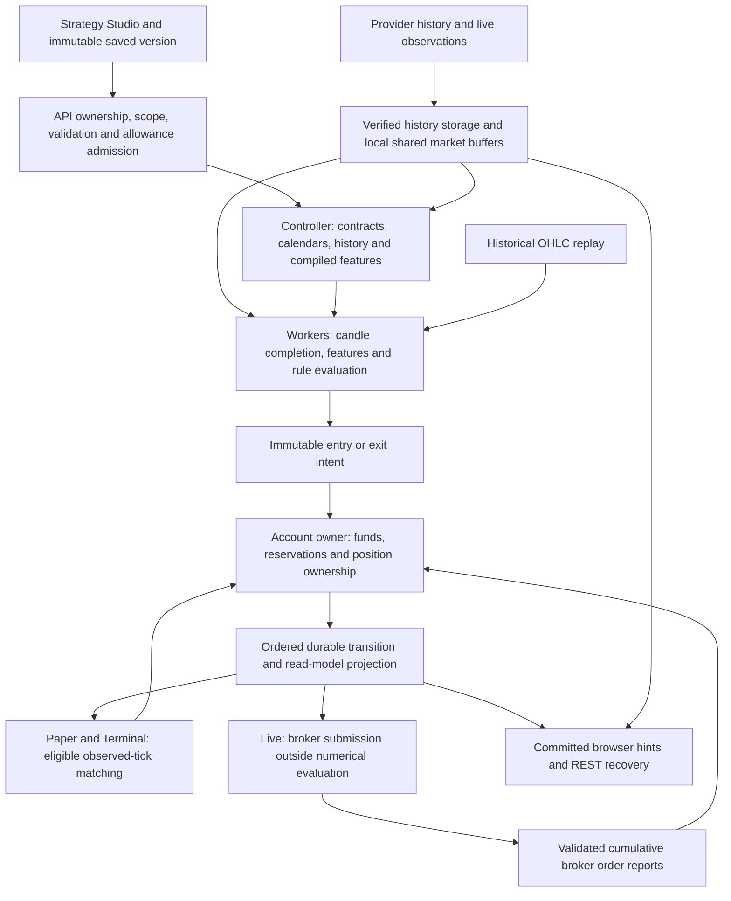

# Release readiness and architecture verification

Audit completed against the working tree on **18 November 2026**. This is the
current implementation and verification record, not a promise that every possible
strategy, broker response or production workload has been tested.

**Result:** the existing single-server architecture can support the first release
without a new distributed framework. Several avoidable latency, memory and
correctness problems were fixed. Isolated execution and deployment checks pass.
Public launch still depends on provider acceptance, a restore drill, a target-host
load test and the migration cutover. The accepted public scope includes stock,
futures and options simulation; customer Live trading remains unavailable.

## 1. Architecture and responsibility boundaries



The diagram shows responsibilities; it does not mean the historical replay task
uses the running worker processes. Backtesting runs through the compute queue and
uses the shared numerical/financial components in its own process.

| Boundary | Main code | Required work and cost |
| --- | --- | --- |
| Authoring and admission | `strategies/specification/`, `definitions.py`, `validation.py`; feature views/serializers | Validate one authoritative document, ownership, execution scope and applicable allowances before accepting work. SQL and metadata access belong here. |
| History and preparation | `marketdata/history.py`, `candles.py`, `calendar.py`; `execution/preparation.py`, `compiler.py` | Resolve exact requirements, fetch missing provider history, validate/store it and build reusable features. Cold, asynchronous work; provider round trips can take seconds. |
| Market ingestion | `marketdata/live_feed.py`, `fyers.py`, `shared_memory.py` | Receive observations, maintain shared buffers and signal data readiness. Provider cadence, reconnects and OS scheduling remain external latency sources. |
| Numerical evaluation | `execution/market.py`, `features.py`, `expressions.py`, `engine.py` | Complete eligible candles and evaluate causal inputs, formulas, groups, capture state and schedules. No ORM, broker HTTP or provider history fetch belongs in this tick path. |
| Financial ownership | `execution/owner.py`, `ledger.py`, `matching.py`, `worker.py` | Serialize shared funds and position changes, preserve reservations and validate order eligibility. Different strategy units have separate evaluation state; the same account cannot spend the same funds concurrently. |
| Persistence and control | `execution/controller.py`, `repository.py`, `snapshots.py`, `models.py` | Commit ordered revisions, commands and projections. This includes SQL and remains materially slower than numerical evaluation. |
| Broker transport | `brokers/`, `live_trading/order_processor.py` and broker-event/reconciliation paths | Send accepted orders and normalize order reports. A submission response is not a fill; unresolved submissions must not be blindly retried as new orders. |
| Customer display | `common/channels.py`, market-data streaming, frontend quote/valuation stores | Best-effort display hints and batched marks. REST/database state remains authoritative for committed orders and balances. |
| Batch analysis | `backtesting/`, `research/`, separate `research_service/` | Bounded compute, evidence, model/tool calls and results. These jobs share the compute queue and can wait behind each other. |

### Correctness invariants retained

- Completed-candle inputs read completed bars; LTP reads observed prices. A
  corrected or discontinuous history must be prepared again rather than silently
  continuing an invalid graph.
- Signal and traded markets are distinct when configured. Position operands read
  the unit's owned traded position. An open automatic-contract position retains
  its bound contract instead of following the moving ATM strike.
- Units and Lots remain distinct. Derivative order quantities must satisfy the
  actual contract lot size; simulated margin and contract multipliers remain part
  of financial accounting.
- Entry schedules stop new entries. Entry end does not itself square off a
  position. Existing exits and protective logic follow their configured rules.
- Capture/confirmation setups arm and confirm on eligible separate observations;
  an already-true arm does not automatically rearm after a close. Simple conditions
  follow their ordinary evaluation semantics, without inventing a capture edge.
- A simulated live order cannot fill on the same observation that accepted it.
  Market, limit, stop-market and stop-limit have distinct eligibility rules.
  Historical backtests deliberately use their documented signal-time fill model.
- Account revisions fence financial writes. Duplicate transitions and cumulative
  broker fills must not spend funds or create trades twice.
- Broker aggregate positions do not replace strategy/session ownership. A late
  fill after cancellation can still change the owned position and must survive
  restart recovery.
- Removing browser connectivity does not stop a running session. A browser message
  is neither the financial ledger nor proof of a broker fill.

Detailed configuration and fill meanings remain in the
[Strategy Studio](strategy-configuration.md), [Backtesting](backtesting.md),
[Paper](paper-trading.md), [Live](live-trading.md) and
[Terminal](trading-terminal.md) guides.

## 2. Changes made during this audit

### 2.1 Active checkpoints no longer rewrite completed-order history

Previously the account JSON included every completed order. Every transition and
some control messages encoded or copied this growing history. A synthetic account
with 10,000 completed orders produced about **13.1 MB** of JSON and took about
**1.64 seconds** for encode/decode in the final loaded-laptop run.

`AccountCheckpoint` now stores active financial state and working orders.
`OrderCheckpoint` stores completed orders separately, uniquely by account and
order identity. The changed completed order is upserted in the same transaction as
the balance, position and read-model effects. Normal configuration refreshes omit
completed history; cold recovery loads it.

The numerical account owner still retains completed orders in RAM for intent
idempotency and late broker reports. This change bounds routine snapshot work
against completed-history growth; **it does not make lifetime RAM use or restart
reconstruction constant**. UNKNOWN and partially filled orders remain active.

Migration `execution/0008_order_checkpoint.py` splits the existing encoded data
without reconstructing contract terms from today's instrument catalogue. Its
reverse operation merges that data back. Forward/reverse recovery was verified in
an isolated database.

### 2.2 Browser transport no longer delays financial acknowledgement

Committed trading, notification and research updates now use one bounded display
queue per process. The payload is frozen before callers mutate their state. Only
successful transaction commits enqueue it; rollback enqueues nothing.

One daemon thread sends messages in queue order, with a two-second send timeout
and a 256-message pending bound. This is a local display mechanism, not another
Celery service or financial event store. Redis/network failure or queue saturation
is logged. A display hint can be missed during saturation or shutdown; the stored
notification and REST snapshot remain available, and reconnect/refresh restores
current state. It is not an exactly-once browser delivery guarantee.

### 2.3 Execution time is saved before publication

Paper positions and Terminal positions/fills/closed-position records now accept
their actual execution timestamps at insertion. Previously `auto_now_add` could
replace the supplied time; an extra UPDATE then corrected the database after a
signal had already serialized the initial value.

Using `default=timezone.now` preserves ordinary insertion defaults while allowing
an explicitly supplied execution time. Redundant corrective UPDATEs were removed,
including the existing Live projection correction where the model already allowed
an explicit timestamp. Existing historical records are not recalculated.

### 2.4 Bursts yield to controller responsibilities

The controller still preserves financial order, but checks a 20 ms elapsed-time
budget between output messages as well as its existing 256-message batch bound.
Large bursts no longer monopolize an entire batch before heartbeats, control
polling and preparation completions can run. A single slow transaction is not
interrupted and can exceed 20 ms; this is fairness, not a hard real-time deadline.

### 2.5 Bounded preparation, transport and batch work

- Indicator bar-count parameters and Shift have a technical maximum of 10,000,
  published by the same backend specification used by Studio. Oversized numeric
  conversions produce validation errors rather than an overflow/500. This is a
  technical memory safeguard, independent of commercial deployment allowances.
- FYERS authorization exchange uses the installed SDK's V3 request contract with
  explicit connect/read timeouts of 5/10 seconds. Invalid responses become safe
  authorization errors. The SDK's unbounded exchange is no longer used. Its
  authorization URL generation and the existing daily token-expiry policy remain.
- SMTP has a 15-second socket timeout. Market-data Redis cache connections/reads
  have explicit 3/5-second timeouts. These bounds limit blocked transport; they do
  not guarantee successful delivery or authorization.
- Backtest result bulk inserts use batches of 1,000. This bounds SQL statement
  size; the engine still retains its result lists until saving.
- Monte Carlo chunk size accounts for trade count as well as simulation count,
  targeting at most 1,000,000 sampled matrix values per chunk, with at least one
  whole simulation path. Several matrices coexist. Seeded numerical outcomes were
  verified unchanged when forcing smaller chunks.

### 2.6 Shared tags cannot be edited by an unrelated customer

Strategy tags are shared catalogue labels. Authenticated users can list and add
them, as required by the current UI. Rename/delete methods are no longer exposed
to every customer. This prevents one user's edits from modifying labels attached
to other users' strategies.

## 3. Deployment modes

The modes share the numerical engine and application workflows. They differ in
admission policy and service topology, not in the arithmetic used to evaluate a
strategy.

| Concern | Development | Public | Private |
| --- | --- | --- | --- |
| Commercial policy | Record accepted usage without enforcing plan limits | Enforce period, saved-resource and per-request allowances | No commercial quota/reservation enforcement |
| Execution scopes | Configured development scopes | Public scopes; Live rejected server-side | Configured scopes, including operator Live |
| Ownership/authentication | Required | Required, with trusted production ingress | Required, with production ingress |
| Technical validity | Calendar, data, contract, lot size, funds and bounded expressions still apply | Same | Same; unlimited commercial quota is not permission for an invalid order |
| Live broker events | Optional `live` profile | Omitted | Included for operator trading |
| Frontend | Vite development profile or native development | Built frontend at configured public origin | Built frontend served by Private ingress |
| Execution topology | One local execution group | One execution server/group | One execution server/group |

The allowance fixtures exercised inventory/per-request enforcement, successful
actual-token settlement, accepted-period ownership, failure refunds, cancellation
and duplicates. A successful accepted AI request can exhaust the balance and
finish; the next Public request is rejected. Development records without this
enforcement. Private creates no commercial reservation for the tested work.

### Public market scope: derivatives simulation included

The accepted release decision includes NSE stocks, futures and options for
backtesting, Terminal simulation and automated Paper on all public plans.
Existing contract validation remains shared; there is no new per-market gate.
Numeric plan allowances still apply at admission. Direct AI stock analysis and
screening remain active-NSE-stock workflows.

Catalogue migration `commercial/0017_derivatives_simulation.py` publishes the
availability update without modifying purchased prices, allowances or snapshots.
Pricing, Billing, the landing page, feature copy and customer guides describe the
same scope. Customer Live/Private is still not offered; the Public configuration
continues to deny Live admission through execution scopes. History availability,
contract terms and the documented simulation assumptions remain material limits.

## 4. Verification evidence

Verification used synthetic users, prices and broker reports, temporary scripts
outside the repository and isolated Docker resources. No customer database was
migrated, no user services were restarted and no real broker order/payment/email
was sent. The runtime fixture used a deliberately permissive calendar in its
isolated database so it could execute outside market hours; that fixture does not
prove live exchange opening/holiday configuration.

| Area | Evidence | Boundary |
| --- | --- | --- |
| Shared kernel | 153 assertions: both sides/all four simulated order types, same-observation fence, indexed/direct matcher agreement, financial recovery, cumulative fills, indicators, capture and schedules | Synthetic observations; does not enumerate every valid strategy tree or real market path |
| Indicator numerics | 18 families compared with independent TA-Lib calculations over the last 200 of 1,500 seeded observations; tolerance `1e-7`, largest observed absolute difference about `1.04e-11` | Selected outputs/default configurations, not every parameter, candle pattern or market regime |
| Development integration | 67 assertions | Synthetic credentials and reports |
| Public integration | 66 assertions, including ingress and Live-scope denial | No real Cloudflare/browser-origin acceptance |
| Private integration | 65 assertions, including cancelled-order late partial/full reports and restart recovery | Broker reports supplied by fixture, no actual brokerage account order |
| Research contract/workflow | Three real Django payloads accepted by separate service schemas; 10 workflow checks using a replaceable fake provider | No paid/configured AI-provider acceptance or quality evaluation |
| Spawned execution pipeline | Nine lifecycle assertions through actual Public deployment API, local mmap observations and spawned worker; four Paper closes and two Terminal fills | Synthetic price source; no provider socket or broker network |
| Runtime controls | Pause, no re-entry while paused, capital edit, Resume and close-on-Stop; final commands drained without errors | This pipeline did not exercise every combination of simultaneous version, settlement and broker commands |
| Database and migration | Duplicate transition handling, full recovered-account equality, completed-history split/reverse, execution timestamps, commit/rollback display behavior | Disposable database, not the user's existing database |
| Data acquisition | Invalid provider candle excluded; confirmed coverage avoids repeat acquisition | Mock provider, not FYERS access or historical entitlement |
| Deployment configuration | All three Compose/preflight configurations, optional Development profiles and mode-specific settings | Configuration checks, not three full Internet-facing deployments |
| Public derivatives catalogue | 26 assertions covering the new revision, all-plan market flags, paid-price/allowance/usage preservation, provider mapping copies, Pricing/Billing responses, derivative lot validation and denied Public Live scope | Disposable database with synthetic contracts; no provider or real broker request |
| Deployment startup | Fresh migrations, deployment checks, migration drift checks, idempotent Timescale setup, site/static setup, API/execution/research readiness on the isolated Public-derived stack | Isolated Linux stack, not Internet DNS/TLS or target-server capacity |
| Shutdown | Three execution stop/restart cycles exited cleanly in approximately 1.48/1.08/1.09 seconds in the final smoke run | Normal SIGTERM, not power loss or mid-write host failure |
| Frontend | Lint and production build pass | Automated build validation, not exhaustive visual/browser interaction coverage |

Independent numerical comparisons covered SMA, EMA, WMA, KAMA, RSI, ROC, DEMA,
TEMA, ATR, ADX, DMI, CCI, Williams %R, MFI, MACD, Bollinger Bands, Stochastic and
Parabolic SAR. Other exposed indicators received warmed/causal-output checks in
the kernel fixture; that is weaker evidence than an independent reference.

External verification artifacts for this audit are under
`%LOCALAPPDATA%/Temp/quantnest-release-audit-20261117/` and the sibling
`quantnest_release_*_20261117` / `quantnest_indicator_reference_20261117` files.
The Public derivatives follow-up uses `catalog_simulation.py` in that directory
and the sibling `verify_quantnest_catalog_20261118.py` runner.
They are local audit evidence, not committed ongoing regression coverage.

The current backend source was tested in a Linux image built over the previously
successful locked-dependency backend runtime. Subsequent normal Dockerfile builds
were blocked resolving the Python base image through the configured Docker Hub
mirror because of TLS handshake timeouts. Dependencies were not changed. A full
normal build of the final tree remains a release gate once registry connectivity
works; the incremental audit image is not a substitute for that release build.

## 5. Performance: measured costs and honest limits

Measurements came from an **Intel i5-13420H, 8 cores / 12 logical processors**,
Python 3.12 on Windows, with Docker and other activity present. Variation between
runs is material. These are diagnostic measurements, not an Oracle VM benchmark,
end-to-end latency guarantee or a supported-customer count.

### Warmed rule evaluation

The fixture used 20 comparisons, arithmetic/LTP and four timeframes
(`1m`, `5m`, `15m`, `1D`), including EMA200/RSI14. Identical requirements deduplicated
to eight shared feature nodes. It measured warmed rule evaluation and intent
generation. It excluded candle aggregation/feature update, market ingestion, IPC,
SQL, broker transport and waiting for an eligible fill observation.

| Batch on one process | Final loaded-run p50 | p95 | p99 |
| --- | ---: | ---: | ---: |
| One evaluation unit | 0.669 ms | 1.227 ms | 5.896 ms |
| Ten units sequentially | 6.077 ms | 7.711 ms | 10.681 ms |
| 100 units sequentially | 57.271 ms | 73.976 ms | 74.785 ms |

Lighter runs produced roughly 0.17 ms p50 for one unit. Reporting that best case
alone would hide CPU contention. One hundred units in a batch is not 100 parallel
cores, and this benchmark is not 100 simultaneous account commits.

An idle scheduler sweep with real mmap readers, but without loaded strategy work,
measured p50 around 0.87 ms for 100 actors/10 markets, 7.61 ms for 1,000 actors/100
markets and 11.07 ms for 2,000 actors/100 markets. This measures scanning overhead,
not supported active-session capacity. Worker idle sleep is not a total latency
bound.

### Financial persistence

The synthetic 10,000-completed-order account shrank from 13,098,623 bytes to an
845-byte **active** JSON snapshot when no open positions/orders remained. Its
encode/decode p50 dropped from about 1.64 seconds to 0.075 ms in the final run.
Separate order-row serialization and SQL are excluded from that comparison.

The database integration's flat Terminal checkpoint stayed at 954 bytes after
16 completed orders. Terminal close transitions used 29 SQL statements. In the
latest Public follow-up fixture they took about 21–28 ms; the Private fixture took
about 25–51 ms. Earlier runs measured 25–63 ms and, under Docker load, values above
200 ms. The SQL writer remains
serial, and notifications/projections still have real cost. This is the next
boundary to profile if committed fills backlog under the target workload.

### Capacity planning

Budget each worker for approximately:

```text
sum(market ticks/second × affected evaluation units × measured evaluation cost)
+ completed-bar feature work
+ market-reader/scheduling/IPC work
+ account-owner matching and financial work
```

Also budget the controller's serial durable writer and asynchronous preparation
pool separately. More workers do not multiply a single writer's SQL throughput.
Price updates and many simultaneous one-minute candle closes are different load
patterns; test both, especially shared symbols across users.

With the default 10,000 minute-candle slots and 32,768 tick slots, one minute mmap
file uses approximately 1,790,848 bytes (1.71 MiB) before additional files/features.
Mapped file size is not identical to resident RAM. Retained Python feature state,
prepared symbols, open positions and completed-order recovery also consume memory.

Increase `EXECUTION_WORKERS` only after measuring on the actual server. Public and
Private Compose currently cap the execution container at 1,536 MiB. Raising worker
count without revisiting that cap and the host budget can cause an OOM. Leave CPU
and RAM for PostgreSQL, feed ingestion, API, browser delivery and background work.
The compute container's CPU cap is a contention control, not reserved execution
capacity. See the [resource/service explanation](../infra/shared/README.md).

This remains a **single execution host** architecture. More processes on that host
are supported. Placing workers on another server requires a new data/ownership
distribution design and is not achieved by increasing the container count.

## 6. Other application workflows

| Functionality | Current boundary and remaining acceptance |
| --- | --- |
| Authentication | Owned-resource isolation, anonymous denial and revoked-session denial passed the API fixture. Real Google redirect/callback, browser cookies/CSRF and production proxy headers still need configured-origin acceptance. |
| Commercial | Public policy and token settlement/refund/idempotency fixtures passed. Razorpay sandbox checkout, webhook signatures, renewals, refunds and reconciliation need real integration acceptance. Do not treat mocked quota checks as payment certification. |
| Research/Screener | Registry-owned tools, separate provider adapter, evidence and confirmed actions remain. Schema/fake-provider checks pass; actual model latency/quality, credentials and period-credit UI acceptance remain provider/browser work. |
| Support/notifications | Durable support replies and stored notifications remain. SMTP transport is bounded; actual delivery, reply access and operator inbox acceptance require configured email accounts. No retired webhook/newsletter/project system was reintroduced. |
| Charts/valuation | Stored/verified history, provider-missing-history acquisition and streamed quotes/candles remain distinct from financial execution. Frontend quote batching can delay a visible mark without delaying the numerical decision by the same amount. A screenshot is not a latency trace. |
| Journal/analytics/paging | Queries/projected records remain the reporting boundary; paging reduces response work, not necessarily aggregate SQL cost. Realistic history-size query plans and browser pages should be checked on the target database. No exhaustive visual verification is claimed. |
| Instruments/calendars | Catalogue identity, contract terms, lot size and exchange/segment calendar remain required data. Fresh catalogue/holidays and provider entitlements must be accepted before trading. |
| Derivative settlement | Reviewed official settlement/MTM paths remain; no atomic multi-leg execution, automatic rollover, clearing service or physical delivery was added. Live charge completeness is not established by simulated profiles. |

## 7. Release gates and operator procedure

1. **Confirm the published scope after deployment.** Check that the active
   catalogue and customer pages show stocks, futures and options simulation on
   all plans, while Public Live admission is denied. Keep customer Private sales
   policy consistent with the existing operator-only Private deployment.
2. **Build from the normal Dockerfiles.** Restore registry connectivity and build
   the final backend/research/frontend images with repository locks. The frontend
   build also reports an old Browserslist database; update it through the normal
   reviewed dependency process rather than during a running deployment.
3. **Back up and perform the migration cutover.** The four migrations below are
   prepared and tested but **not applied to the user's existing database**.
   Finish active compute jobs, settle/review live exposure and stop processes
   using the old execution code. Follow the mode's existing upgrade/backup flow,
   run migrations, then start the matching images together. Do not mix old writers
   with the new active-checkpoint layout.
4. **Run configured-provider acceptance.** Verify FYERS source authorization,
   missing-history acquisition, reconnect and market subscriptions. On the personal
   Private instance, explicitly authorize a small broker order/cancel/fill check;
   replayed broker reports are not enough. Check Google, Turnstile hostname, SMTP,
   payment sandbox, Caddy/Cloudflare TLS and trusted-origin behavior as applicable.
5. **Run a target-host soak and burst test.** Measure source receipt, candle
   completion, signal, durable acceptance, submit and fill as separate times.
   Observe p95/p99 scheduling/commit delay, memory, disk growth, database load and
   command backlog. Start with conservative users/instruments and increase only
   after measured headroom; no fixed user count follows from the laptop results.
6. **Complete a disposable restore drill.** Restore database/media with the same
   credential-encryption keys and prove owned account recovery. Back up keys
   separately and check retention/free disk. Never test restoration over the only
   running customer database.
7. **Check browser recovery and user actions.** Open/refresh/reconnect portfolios,
   compare marks and committed records, change capital/version, pause/resume/stop,
   cancel/modify pending orders and verify clear pending/rejected states. Keep
   browser message recovery distinct from authoritative financial recovery.

Prepared migrations:

| App | Migration | Effect |
| --- | --- | --- |
| Execution | `0008_order_checkpoint` | Preserve completed orders in separate recovery rows; retain active state in account checkpoint |
| Paper | `0026_position_execution_time` | Allow actual opening time on first save |
| Terminal | `0023_execution_times` | Allow actual position/fill/exit times on first save |
| Commercial | `0017_derivatives_simulation` | Publish simulation availability on all plans; retain purchased financial terms and copy unchanged provider price mappings |

### Maintenance cases that still require care

- A new strategy can require more history than an existing mmap capacity. The
  current online path reports that requirement; it does not resize files while
  readers are using them. Stop the relevant processes and use the existing
  `resize_market_buffer SYMBOL --capacity N --timeframe 1m` (or `1D`) management
  command under its lock/lease checks, then reload history. A 10,000-bar indicator
  parameter can require more than 10,000 source candles after convergence,
  timeframe expansion, shift or nested-source warmup.
- Normal task failures and cancellations have accounting handlers. A whole
  compute-worker/host loss is a different case: a backtest can remain RUNNING
  until reviewed/cancelled. Do not deploy by killing active work and assume it
  resumes. Celery acknowledgement behavior depends on the loss scenario; see the
  [official task acknowledgement documentation](https://docs.celeryq.dev/en/stable/userguide/tasks.html#task-acks-late).
- Browser delivery is best effort and can drop hints under sustained outage.
  Monitor warnings and verify REST recovery. It is deliberately not coupled to
  committing money.
- The new SMTP timeout follows Django's
  [EMAIL_TIMEOUT setting](https://docs.djangoproject.com/en/5.2/ref/settings/#email-timeout).
  It is a socket bound, not an end-to-end email-delivery deadline.
- There is no newly committed regression suite in this change. The temporary
  fixtures provide audit evidence; they do not provide automatic future coverage
  for every repository change.

The release should be described by the features and limits actually accepted on
the deployed host. Passing these isolated checks supports the architecture and
the fixes above; it does not establish universal correctness, profitability,
broker/exchange equivalence or an unlimited capacity claim.
