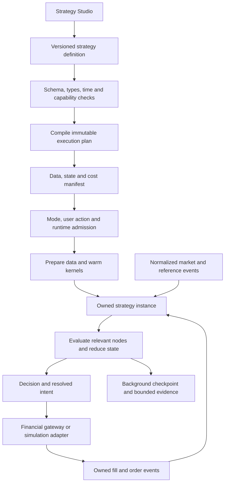
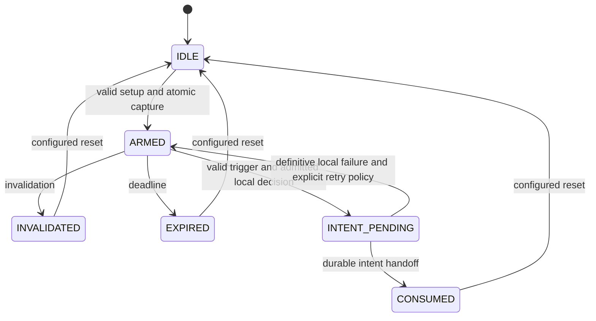

# QuantNest strategy builder plan

**Status: future design; not implemented or scheduled for immediate release.**

**Research and source review: 16 October 2026.** Start this work only after the
current product is stable in production and its execution/recovery limitations
have been addressed. This document authorizes no migration, provider purchase,
deployment change or new trading capability by itself.

This is the proposed design for a composable, extensible strategy builder across
markets and instrument types. It covers the language, UI, data, clocks, state,
position sizing, routing, execution integration, recovery and delivery sequence.
All API names, new modules, schema examples and limits below are **proposals**.

The [original 3,905-line proposal](archive/strategy-builder-original-proposal.md)
has been recovered from Git commit `4d41403` and preserved as historical design
input. It was a future implementation specification, not useless application
code. Its stock-first expressions, event anchors and hybrid triggers remain
central to this plan. Current behavior is documented separately in
[Strategy configuration](strategy-configuration.md) and the
[current Live execution guide](live-trading.md).

## Contents

1. [Outcome and boundaries](#1-outcome-and-boundaries)
2. [Current implementation](#2-current-implementation)
3. [Review of the original proposal](#3-review-of-the-original-proposal)
4. [Research and architecture decisions](#4-research-and-architecture-decisions)
5. [Complete strategy pipeline](#5-complete-strategy-pipeline)
6. [Canonical strategy definition](#6-canonical-strategy-definition)
7. [Type system and validity](#7-type-system-and-validity)
8. [Operator catalog](#8-operator-catalog)
9. [Time and data semantics](#9-time-and-data-semantics)
10. [Calendars and sessions](#10-calendars-and-sessions)
11. [Setups, anchors and sequences](#11-setups-anchors-and-sequences)
12. [State, recovery and replay](#12-state-recovery-and-replay)
13. [Sizing, levels and risk](#13-sizing-levels-and-risk)
14. [Instruments, markets and routing](#14-instruments-markets-and-routing)
15. [Cross-instrument and portfolio strategies](#15-cross-instrument-and-portfolio-strategies)
16. [Compilation and low-latency runtime](#16-compilation-and-low-latency-runtime)
17. [Order and fill integration](#17-order-and-fill-integration)
18. [Backtest and simulation contract](#18-backtest-and-simulation-contract)
19. [Builder user experience](#19-builder-user-experience)
20. [API, persistence and security](#20-api-persistence-and-security)
21. [Migration and version compatibility](#21-migration-and-version-compatibility)
22. [Repository implementation map](#22-repository-implementation-map)
23. [Performance and capacity qualification](#23-performance-and-capacity-qualification)
24. [Required strategy scenarios](#24-required-strategy-scenarios)
25. [Delivery phases](#25-delivery-phases)
26. [Operations and commercial integration](#26-operations-and-commercial-integration)
27. [Complexity to avoid](#27-complexity-to-avoid)
28. [Readiness and next action](#28-readiness-and-next-action)
29. [Research references](#29-research-references)

## 1. Outcome and boundaries

### Product goal

A customer should express a detailed strategy through composition, including:

- Numeric, statistical, indicator, price-action and logical conditions.
- Several timeframes, instruments and sessions with explicit timing.
- Events that capture values, remain armed, expire, invalidate and trigger later.
- Position-aware exits, partial actions and dynamic protection levels.
- Defined sizing, instrument selection, execution routes and portfolio constraints.
- Explainable simulation, deployability checks and versioned execution evidence.

The architecture should accommodate another market through qualified contracts,
calendars, data and execution adapters without rewriting the strategy language.

“All markets and instruments” is an extension objective. It cannot mean that any
unknown venue, data field, order type or arbitrary human instruction works
immediately. The supported combinations must be discoverable and validated.
Arbitrary user code is not necessary for the first language release.

### Design invariants

1. One canonical strategy definition and operator semantics across drivers.
2. No database, Redis, broker, HTTP, DNS, licence lookup or AI call in evaluation.
3. Parse, validate, type-check and compile before an actor becomes ready.
4. Bounded work and memory for every admitted strategy and data dependency.
5. Explicit market-data availability and chronological ordering; no future values.
6. One writer for each stateful instance; independent actors share no mutable state.
7. Financial admission still serializes shared funds and owned exit quantity.
8. Failures block new exposure without disabling known-position protection.
9. Saved definitions, operators, data revisions and execution assumptions are pinned.
10. Market expansion requires a complete supported workflow, not an enum addition.

Keep current hosting and product boundaries: Public through Paper; qualified Live
in Private; Development explicitly configured. There is no change to pricing or
the deferred NSE futures/options status in this documentation task.

## 2. Current implementation

This baseline was read from the working tree; the archived proposal's old file
paths must not be used as the current integration map.

| Area | Current code and behavior | Implication |
| --- | --- | --- |
| Rule storage | Rule stores operand A, comparison, operand B and optional per-operand frames | No general recursive expression definition today |
| Arithmetic | Restricted named arithmetic in math_expressions.py | Useful syntax adapter; not a temporal language |
| Metadata | common/enums.py owns builder parameter descriptors | Reuse/extend backend ownership; do not recreate frontend PARAM_CONFIG |
| Shared program | execution/compiler.py: Program | Entry/exit orchestration already shared |
| Calculations | execution/features.py updates shared incremental numerical features in persistent workers | Extend this path for heavy compiled plans |
| Fast application | execution/engine.py applies results and checks protection | Preserve an owner-controlled tick path |
| Ownership | Execution units are mode/session/instrument, with observed generations and position revisions | State cannot be keyed only by strategy and symbol |
| Requests | execution/messages.py: typed Intent/Transition messages and durable database commands | Extend the existing envelope rather than adding a competing queue |
| Actions | execution/compiler.py | Retain current full-position exits; qualify any future action extensions separately |
| Sizing | Fixed quantity or capital based; optional route override | Preserve these; Risk Based was deliberately removed |
| Execution | Automated strategy MARKET orders and DIRECT NSE-stock routes | Model fields for other routes are not implemented support |
| Contracts | Contract enforces integer lots and price ticks; instrument records hold currency/multiplier metadata | Future execution needs fractional quantities, contract economics, settlement and explicit provider capabilities; unused event/capability declarations were removed |
| Data | Historical candles and observed-price rings; source does not promise every trade/depth event | Observation replay is not an exchange-complete tick tape |
| Backtest | Shared rules, historical driver and fill assumptions; entry vectorization | Stateful logic needs a chronological reducer, not only a Boolean array |
| Versions | Full StrategyVersion snapshots and selected allocation versions | Extend existing provenance and readable differences |
| UI | frontend/src/features/strategies | No dashboard folder or separate builder application |

Prerequisites from current execution limitations include unresolved/partial-fill
protection, complex stop/target parity, full Live net-cost reporting, chart frame
consistency and an explicit backtest end-exposure policy. Address those according
to their release impact before advertising a broader production strategy language.

## 3. Review of the original proposal

The entire original file was reviewed, including its appended stock-first boundary,
70 numbered sections, anchor/tick additions, acceptance scenarios and delivery order.

| Original area | Decision | Reason / change |
| --- | --- | --- |
| Small composable primitives and recursive expressions | Keep | Expands expressiveness without hundreds of one-off rules |
| Central registry and frontend metadata | Keep, build on current metadata | Frontend duplication has already been reduced |
| Rolling/trend/statistical/session operators | Keep | Define exact denominator, history and missing-value behavior |
| Event → capture → wait → trigger → action | Keep as a required capability | Essential for signal-candle and retest strategies |
| Candle setup plus tick trigger | Keep | Separate calculation cadence from trigger cadence |
| Native-frame computation before alignment | Keep and strengthen | Add availability timestamps, freshness and cross-market joins |
| Recursive evaluator as the production hot path | Replace with compiled execution plan | Recursion remains an authoring/validation representation |
| State namespace strategy/instrument/node | Replace | Include tenant, deployment, version, scope and actor generation |
| Every node returns a Series | Replace | A graph needs typed streams, scalars, events and state effects too |
| Invalid/false/insufficient-data distinction | Keep and formalize | Unknown must not become true through NOT or missing-data defaults |
| Expression hash as cache identity | Extend | Hash alone omits data revision, clock, contract, state and semantics |
| Preserve all legacy columns indefinitely | Limit to migration window | One execution representation after parity is accepted |
| No backtest loop changes | Narrow | Stateless additions fit; sequences, fill events and hybrid chronology require driver work |
| No execution-layer changes for new rules | Narrow | True for pure predicates; dynamic protection, partial fills and new order types cross the boundary |
| Stock-first then derivatives | Keep | Global extensibility in the core; staged asset qualification |
| Dynamic risk sizing examples | Separate decision | Do not silently restore the removed Risk Based feature |
| Exact ticks imply exact real execution | Correct | Tick replay improves signal chronology, not queue position, broker delay or actual fills |
| Sessions based solely on strategy timezone | Correct | Exchange calendar controls session boundaries; strategy timezone controls selected schedule/report rules |
| Predicates preview/debug | Keep | Bounded evidence collection outside the live tick path |
| Queue multiple setups | Defer behind state limits | One active setup per node/actor initially is easier to reason about |
| New modules for each tiny responsibility | Consolidate | A compact expression package with clear ownership is sufficient |

The original should remain accessible as input, with its future status explicit.
This plan supersedes conflicting implementation instructions in that archive.

## 4. Research and architecture decisions

### Lessons from established systems

QuantConnect separates universe, signal, portfolio, risk and execution models. Its
documentation also notes that tightly coupled entry/exit strategies may need a
hybrid design. QuantNest should preserve that coupling within a setup lifecycle
while separating financial execution. [QuantConnect framework overview](https://www.quantconnect.com/docs/v2/writing-algorithms/algorithm-framework/overview).

TradingView documents both higher-timeframe future leakage and assumptions in its
broker emulator. QuantNest needs explicit known-at times and fill-model labels,
not claims that matching chart rules establishes execution equivalence.
[Timeframe data](https://www.tradingview.com/pine-script-docs/concepts/other-timeframes-and-data/),
[Strategy simulation](https://www.tradingview.com/pine-script-docs/concepts/strategies/).

NautilusTrader documents the ordering of market processing, strategy callbacks
and command settlement. The useful lesson is an explicit event contract; its
same-timestamp settlement policy is not automatically QuantNest's next-open policy.
[Nautilus execution flow](https://nautilustrader.io/docs/latest/concepts/backtesting/execution-flow/).

CEL separates parse/check from repeated evaluation. Use that principle and a
bounded typed graph; adopting a generic expression engine does not supply trading
clocks, state, routing or fill semantics. [CEL overview](https://cel.dev/overview/cel-overview).

### Recommended approach

| Option | Decision |
| --- | --- |
| Larger fixed A/comparison/B catalog | Insufficient for temporal/stateful composition |
| Arbitrary Python supplied by users | Exclude from the hosted builder; isolation and predictability are a different product |
| Generic rules engine used without a trading contract | Insufficient for causal streams and financial effects |
| Replace the complete runtime with another platform | Not justified by the current need; would create a large execution migration |
| Typed strategy graph compiled into the existing runtime | Recommended; preserves the proven service boundaries and adds expressiveness |

Retain Python for orchestration. Use NumPy/pandas for preparation and qualified
incremental/numerical kernels where needed. Do not add Kafka, Flink, a graph
database, a separate compiler service or a new frontend framework at this stage.
Research references inform the design; they are not dependencies or vendor promises.

## 5. Complete strategy pipeline



Separate five contracts:

1. **Definition:** what the customer authored.
2. **Compiled plan:** how the server will evaluate it.
3. **Input manifest:** what data/contract/calendar versions it requires.
4. **Runtime instance:** mutable setup, sequence and position-linked state.
5. **Intent/outcome:** requested action and what the execution environment recorded.

The compiler reports support for the requested definition and target environment.
It never places orders. The runtime emits effects/intents. The gateway retains
final financial checks and broker interaction.

## 6. Canonical strategy definition

### One versioned document

The complete saved definition includes:

| Section | Contents |
| --- | --- |
| Identity | Language schema version, strategy version and explanatory labels |
| Parameters | Typed customer inputs with bounds and units |
| Universe | Fixed instruments or a qualified point-in-time selection policy |
| Data bindings | Instrument roles, feeds, frames, sessions, price basis and freshness |
| Expressions | Typed node DAG with stable node IDs and explicit references |
| Setups | Events, captures, invalidation, expiry and replacement policies |
| Entry/exit behavior | Trigger roots and deterministic action priority |
| Sizing | Fixed/capital method, overrides and approved later extensions |
| Routing | Signal role to resolved contract(s), account and order policy |
| Schedule/entry controls | Entry windows and declared future policy extensions |
| Simulation | Required data tier and chosen assumptions |
| UI metadata | Layout and readable names excluded from semantic execution hashes |

Use one canonical definition for both simple and advanced editors. A simple rule
is a small graph; it must not become a second executable language.

### Schema shape

Illustrative fragment; IDs resolve only within the owning document:

```json
{
  "schema_version": "quantnest.strategy/2",
  "data": {
    "signal_bars": {"instrument_role": "signal", "kind": "bars", "period": "5m", "session": "regular", "basis": "raw"},
    "signal_price": {"instrument_role": "signal", "kind": "last_price_observation", "max_age_ms": 1000}
  },
  "nodes": [
    {"id": "close", "op": "field", "stream": "signal_bars", "field": "close"},
    {"id": "high", "op": "field", "stream": "signal_bars", "field": "high"},
    {"id": "low", "op": "field", "stream": "signal_bars", "field": "low"},
    {"id": "ema20", "op": "ema", "inputs": ["close"], "params": {"period": 20, "seed": "sma"}},
    {"id": "ema50", "op": "ema", "inputs": ["close"], "params": {"period": 50, "seed": "sma"}},
    {"id": "cross", "op": "crosses_above", "inputs": ["close", "ema20"]},
    {"id": "trend", "op": "greater", "inputs": ["ema20", "ema50"]},
    {"id": "setup", "op": "all", "inputs": ["cross", "trend"]},
    {"id": "price", "op": "field", "stream": "signal_price", "field": "price"},
    {"id": "saved_high", "op": "anchor_value", "setup": "breakout", "field": "high"},
    {"id": "trigger", "op": "crosses_above", "inputs": ["price", "saved_high"]}
  ],
  "setups": [{
    "id": "breakout",
    "when": "setup",
    "capture": {"high": "high", "low": "low"},
    "clock": "signal_bars",
    "expiry_bars": 10,
    "replacement": "ignore_while_armed",
    "trigger": "trigger",
    "trigger_on_arm": "wait_for_new_cross",
    "consume": "on_durable_intent"
  }]
}
```

The full schema must also require an explicit invalidation policy, sizing/routing,
actions, risk and replay policy before this fragment becomes deployable. The
observed-price age above is an example strategy requirement, not a new default.
Use decimal strings for financially exact literals and tagged constant nodes where
units are needed. No provider credentials are embedded in the definition.

### Compilation identity

Hash semantic canonical JSON together with language/operator semantic versions.
Canonicalization can normalize aliases and typed numeric literals. Do not reorder
stateful operations or floating-point expressions whose evaluation order matters.
UI layout/name edits can share an executable hash while retaining their own
saved version/audit identity.

The compiled artifact includes a source-node mapping so errors, diffs and evidence
remain understandable after common pure subexpressions have been deduplicated.

## 7. Type system and validity

### Values need more than FLOAT_SERIES

Track value kind, dimension, currency/contract identity, clock, validity and
availability. A value can be a scalar, stream sample, Boolean, event pulse,
instrument reference or bounded record. Stateful transitions are effects, not
ordinary Boolean functions.

| Dimension | Example | Prevented mistake |
| --- | --- | --- |
| Price<instrument, quote currency> | Stock price or option premium | Comparing incompatible price scales without a conversion |
| Price distance / ticks | ATR, spread, stop offset | Treating a percentage as an absolute price |
| Quantity<contract unit> | Shares, contracts or base-asset quantity | Sending lots as shares or treating BTC as integer units |
| Money<currency> | Available capital, fee, margin | Adding USD and INR without an FX rule |
| Ratio / percent / basis points | Return, weight, threshold | Interpreting 2 as both 2% and a 2× ratio |
| Duration / bar count | Ten minutes / ten 5m bars | Expiring a setup on the wrong clock |
| Boolean / event | Condition / false-to-true transition | Repeatedly entering while a level condition remains true |
| Instrument reference | Resolved December future | Trading a synthetic continuous ticker |

Cross-instrument price comparisons need an explicit normalization/spread formula.
Conversion operators declare their inputs and precision. An explicit valid zero
is different from missing data.

### Invalid values and three-valued logic

Separate an unavailable numeric value from a valid finite number. Boolean results
can be TRUE, FALSE or UNKNOWN with a reason such as insufficient history, stale
input, market closed, missing event, unsupported input or failed calculation.

- NOT UNKNOWN remains UNKNOWN.
- FALSE AND UNKNOWN is FALSE; TRUE AND UNKNOWN is UNKNOWN.
- TRUE OR UNKNOWN is TRUE; FALSE OR UNKNOWN is UNKNOWN.
- A decision root is actionable only when its result is valid TRUE.
- Unknown node/invalid type is a compile error, not an ordinary false condition.
- A failed new calculation does not erase previously installed valid protection.

An explicit IS_AVAILABLE operator may inspect validity. It does not invent a
price or permit stale trade data. Developer diagnostics distinguish configuration
errors from temporary input readiness.

## 8. Operator catalog

### Descriptor contract

Each backend operator definition owns:

- Stable identifier, semantic version, category, labels and description.
- Input/output types, supported clock relationships and parameter bounds.
- Data requirements, publication timestamps and price-basis requirements.
- History/seed requirements, state shape and reset behavior.
- Batch/stream implementations and their equivalence qualification.
- Scheduling domain, cost estimate, memory estimate and allowed deployment modes.
- Unknown/error behavior and explanation fields.

Expose an immutable registry revision through the existing metadata API family.
Frontend controls, AI draft validation, compiler checks and user documentation
reuse it. Do not put mutable commercial permissions into operator code.

### Core catalog and precise semantics

| Family | Initial primitives | Required semantics |
| --- | --- | --- |
| Data | OHLCV, current observed price, qualified indicators | Data kind, unit, native frame and price basis |
| Arithmetic | Add, subtract, multiply, divide, abs, min/max, clamp | Unit checks, overflow/division handling; no implicit invalid-to-zero |
| Comparison | >, <, >=, <=, equality, crosses | Exact price/tick comparison policy; explicit tolerance for analytical floats |
| Logic | ALL, ANY, NOT, availability | Three-valued truth tables |
| Rolling | Max/min/mean/sum/std/count | Full-window default; inclusion, minimum count and gap policy |
| Statistics | Percent change, z-score, percentile rank, relative volume | Exact denominator and tie handling |
| Persistence | Rising/falling, consecutive, true count | Native-clock transitions and known-history requirements |
| Events | Edge, bars since, within bars, time since | Pulse identity, first-event unknown and selected clock |
| Extremum | Previous-window breakout, highest/lowest | Current bar excluded where appropriate; strict vs equal explicit |
| Candle shape | Body/range/wicks/gap | Stated denominator; zero-range treatment |
| Sessions | Previous session levels, developing range, finalized opening range | Exchange calendar and finalization timestamp |
| Position | Filled quantity, average fill, time held, MFE/MAE, protection state | Owned-position lifecycle; not unfilled requested quantity |
| State | Capture/reference, setup, sequence, bounded counter | Owner-controlled mutation and deterministic reset |

Important definitions:

1. RISING(x, 3) means three positive transitions and needs four valid x samples.
2. TRUE_COUNT(c, 5) examines five native c samples. An unknown sample does not
   silently count as a false observation; the declared minimum-valid policy applies.
3. BREAKS_HIGH(high, 20) compares against the previous twenty completed samples,
   requiring twenty-one samples in total.
4. BARS_SINCE(event) is zero on that event, then one/two/etc. Before the first
   event it is unknown. WITHIN_BARS(event, N) means inclusive ages 0 through N.
5. Rolling standard deviation defaults to ddof=0 in new-language definitions.
   Legacy operators retain their versioned historical conventions.
6. Z-score with zero standard deviation and percent change from zero are unknown.
7. Percentile rank initially means 100 × count(samples <= current)/valid_count,
   including the current sample, with a full valid window by default.
8. Relative volume declares whether the baseline excludes the current bar.
   Time-of-session relative volume is a separate operator requiring comparable sessions.
9. A confirmed swing/pivot becomes available only after its right-hand confirmation
   bars. Plotting it on an earlier candle does not make it earlier evidence.

### History and warmup analysis

Propagate requirements through the graph before allocating data. A rolling
window of W needs its child's required samples plus W-1 native samples; a lag of
K adds K. Parallel pure branches take the maximum requirement for each dependency,
not the sum of duplicated shared nodes. A previous-window exclusion adds its lag.

Recursive indicators require a pinned seed and convergence policy: EMA does not
have a universally exact finite memory of twenty bars merely because period=20.
Keep the accepted initialization/preload semantics with the operator version.
Stateful setup memory/replay requirements are separate from indicator warmup.

Convert required samples into sessions/history requests through the actual
calendar and data coverage. Multiplying a week by five trading days or every day
by 375 minutes cannot describe all venues, holidays, breaks or crypto. Validate
the history actually returned; a successful provider request is not proof of a
complete warmup interval.

Add correlation, regression, rank, spreads, fundamentals, news, options and depth
families only with an accepted data/clock/cost contract. New operators generally
need a descriptor, pure implementation and qualification cases, not a new service.

Temporal composition must also support bounded repetition, cancellation/reset,
“A until B” and “B did not occur within N bars”. Implement these through explicit
sequence/timer transitions and typed references. Absence is confirmed at the
deadline; NOT B on one bar does not establish that B never occurred in a window.
Similarly, basket ANY/ALL/rank aggregates use an explicitly selected universe/cut,
not a hidden query over every instrument in the installation.

## 9. Time and data semantics

### Event envelope

Extend normalized events with instrument ID, provider identity, kind, event time,
ingest time, source sequence if available, local observation ID, generation,
revision and quality flags. Keep timestamps in UTC internally with sufficient
resolution for the source; never manufacture precision the source does not supply.

For bars, carry opening time, closing time and available-at time separately.
For reports/news/fundamentals, effective period and public release/known-at time
are different. For corrections, retain the revision's arrival time.

### Scheduling domains

| Domain | Purpose | Default handling |
| --- | --- | --- |
| Completed bar | Indicators, candle patterns, bar predicates | Evaluate once for each newly available closed native bar |
| Price/quote/trade observation | Simple triggers and protection | Incremental, bounded evaluation of declared inputs |
| Scheduled timer | Session exits, expiry, rebalancing | Fires from the relevant simulation/live clock, even without a new tick |
| Fill/order event | Position-linked protection and sequence transitions | Runs after owned observation/accounting semantics |
| Universe/reference update | Resolved contracts or portfolio membership | Background-prepared, versioned input publication |

HYBRID describes a plan combining domains; it is not a magical fourth data source.
INTRABAR_OHLC is a simulation policy, not a live capability or evidence of tick order.

### Causal multi-timeframe alignment

Compute an operator on its native stream before alignment. RISING(EMA20@15m, 3)
counts fifteen-minute samples. Forward-filling that EMA into 1m then counting three
rows changes the question and is prohibited.

Join values only when available_at <= decision_cut and within their allowed age.
Specify whether the root runs on any source update or a particular clock. A stale
daily value may be acceptable until the next session; a stale option quote may not.

The compiler rejects undeclared mixed-clock operations. “Previous” always names
its stream, not the caller's row index. Scheduled closing times alone do not prove
a delayed source bar has already arrived.

### Gaps, corrections and late data

Select a bounded lateness policy. A committed live decision is not silently
rewritten when a corrected bar later arrives. Corrections can update future
analytical state after a versioned reset/replay and record the affected interval.
Existing broker orders remain real obligations.

For a single instrument, use its observed sequence/generation and readiness state.
For joins, use explicit as-of snapshots or bounded event-time progress. Waiting for
all inputs forever is unacceptable. A stalled dependency becomes unavailable;
unrelated actors keep running. These ideas follow stream-processing timing
principles without introducing Flink. [Event time and watermarks](https://nightlies.apache.org/flink/flink-docs-stable/docs/concepts/time/).

Historical replay must choose a declared availability model: original arrival
history where recorded, or modeled bar-close/publication delays. A finalized data
file alone cannot reproduce what a live user actually knew earlier.

## 10. Calendars and sessions

Use the instrument venue's versioned calendar for sessions, breaks, holidays,
early closes, auctions and overnight session trading dates. Use IANA zones for DST.
The strategy's chosen timezone controls its own schedule/display where appropriate;
it must not redefine the exchange's official trading day.

Required policies:

- Regular vs extended sessions; do not combine them implicitly.
- Daily bars aligned to the trading session, not UTC midnight for every instrument.
- Intraday buckets aligned to the selected session opening/break rules.
- Opening range unavailable until its selected duration is complete.
- Developing day high vs completed-day high are distinct fields.
- Overnight futures belong to an explicit trading date; crypto selects a declared
  UTC or venue boundary for “day”.
- Multiple exchanges specify overlap/union and missing-market behavior.
- Time exits and setup expiry must work without an incoming price event; execution
  still requires valid prices/order access and can remain pending when a market closes.

Bar-count expiry counts accepted completed bars of its declared stream. Wall-clock
expiry uses a duration. Session-end expiry uses a calendar event. These are not
interchangeable during a halt, break, weekend or missing-data interval.

## 11. Setups, anchors and sequences

### Core state machine



Track broker pending/filled/rejected outcomes separately from setup consumption.
A consumed signal is not proof of a fill. Ambiguous submission must not rearm it.
An optional on-fill consumption policy needs an intermediate triggered state
that suppresses duplicate intents throughout submission/reconciliation.

### Captures

Capture scalar values atomically from one valid input cut: high, low, range, ATR,
indicator value, reference contract and event ID. A capture freezes values;
“current EMA” is a different reference. Store units, known-at time, triggering bar,
expiry clock and selected version. Do not retain a whole dataframe in an anchor.

Default to one active anchor per named setup and actor. Offer explicit keep-first,
replace-latest and ignore-while-armed policies. Multiple queued anchors require
separate bounded admission and ordering; defer them initially.

### Same-event and boundary rules

Define a deterministic processing order:

1. Apply applicable contract/session resets and authoritative fill updates.
2. Preserve/evaluate eligible existing exposure protection.
3. Check expiry/invalidation of existing setups; these win over an entry trigger.
4. Evaluate existing armed triggers against valid new input.
5. Create new setups/captures for later observations.
6. Apply winning actions once and publish state/intents.

Default: a setup cannot trigger from the same observation that created it. For a
deadline N bars later, permit valid triggers on ages 1..N and expire before N+1.
At an exact wall-clock deadline, expiry wins. Document other policies explicitly.

A cross against a newly installed anchor starts from a post-arming observation
cursor. It does not treat an old below-level price as a new crossing after a delayed
calculation. Default trigger-on-arm is wait-for-new-cross; enter-if-already-beyond
is a separate visible strategy policy.

### Sequences

Each sequence has step index, start event, preceding completion event, clock,
inclusive deadline, replacement policy and completion pulse ID. Default to one
step advance per source event and reset after completion/timeout. Unknown data
does not advance the sequence. A missing-data policy determines expiry/reset.

Stateful nodes update once per input event regardless of Boolean short-circuiting.
Pure branches can short-circuit; hidden sequence mutation inside an ordinary AND
would make behavior depend on optimizer ordering and must be rejected.

### Required walkthrough

Completed 5m close crosses EMA20, with EMA20 > EMA50 → capture high=105, low=100,
range=5 → arm for ten later 5m bars → a new observed price crosses 105 → request
BUY → install captured stop 100 and target 115 under the qualified fill policy.

If the setup invalidates or expires first, no entry is requested. If the new price
was already above 105 before the owner installed the setup, the default does not
invent a crossing. A close-confirmed trigger is a distinct strategy, filled under
its next-eligible-event simulation policy.

## 12. State, recovery and replay

### Identity and ownership

State identity includes tenant/user ownership, deployment instance, scope, session,
strategy version, actor/basket identity, state node ID, setup/position ID and
generation. Existing database/Redis isolation can supply deployment identity;
do not assume a strategy ID is globally unique across customer installations.

An owner alone applies state changes. Calculation children receive immutable input
cuts and return proposed values/effects; they cannot mutate live actor state.
Results include generation, input cut, plan hash and state revision. The owner
rejects stale or conflicting results and never applies a sequence transition twice.

### Persistence policy

Reuse runtime projections, fencing and outbox infrastructure. Add a compact
strategy-state payload/schema to the existing recovery boundary rather than an
unrelated anchor database/service. It contains:

- Plan/state schema versions and configuration hash.
- Anchor/sequence slots and consumed event/decision IDs.
- Input cursor, session/calendar identity and data generation.
- Position-linked action markers and durable request references.
- State revision and last checkpoint identity.

Do not checkpoint every tick. Coalesce replaceable analytical/protection state in
the background. A transition tied to a durable intent must join its fenced
publication/deduplication boundary or retain a recoverable transition reference.

### Honest crash semantics

The current local publication queue has a crash window before Redis handoff.
A DB-free tick loop plus asynchronous persistence cannot promise that every local
setup/transition survives a crash. Define two supported recovery classes:

| Class | Policy |
| --- | --- |
| Reset-on-gap | Preserve recorded financial exposure/protection; invalidate unconfirmed setups and require fresh events after recovery |
| Replayable state | Restore a checkpoint and replay a retained, ordered, versioned event journal from its cursor; fail closed if incomplete |

Start with reset-on-gap for transient setups. Replayable strategies require a
real retained input/transition journal, bounded disk/stream retention and verified
replay coverage. The existing short mmap ring is not sufficient evidence of a
durable complete event history. Add journal capability only for use cases that
need its cost; persistence remains outside evaluation.

Use deterministic decision identity derived from deployment/session/version,
node/setup occurrence, source event and intended action. Retried delivery must
resolve the same admitted decision, not mint a new UUID and duplicate exposure.
There is still no universal exactly-once broker execution guarantee.

### Restart, pause and version change

Pause blocks new entries while specified protection and state clocks continue.
Define whether eligible setups expire while paused; default yes. Stop clears
uncommitted entry setups but retains recorded order/exposure obligations.

Version changes default to resetting strategy setup/sequence state. Keep open
positions linked to their entry version/protection policy until an explicit
position-management transition is accepted. Unchanged UI labels do not justify
rewriting position provenance. A future compatible state migration requires an
explicit state-schema migration; do not infer compatibility by matching names.

## 13. Sizing, levels and risk

### Three separate decisions

1. Signal/setup says whether a strategy wants an action.
2. Sizing/routing resolves desired exposure and protection inputs.
3. Financial admission approves what the account can actually do now.

Keep existing fixed quantity and capital-percentage methods first, including route
override precedence. The removed Risk Based method stays removed. Future target
notional/target-weight or user-defined bounded quantity expressions require their
own approved product scope and clear units. Stop-distance risk budgets are not
silently reintroduced through an unexplained new default.

### Quantity pipeline

Resolve sizing basis → reference contract/price/FX/multiplier → proposed quantity
→ round to permitted increments → apply minimum quantity/notional → compare
exposure/margin caps → produce an intent. Reject invalid/zero quantities with an
explanation. An automatically reduced quantity must be a chosen visible policy,
not a hidden side effect.

Use versioned account/allocation snapshots for early decisions. Final gateway
transactions reserve actual shared capital and check owned exit quantity. Several
actors reading the same available-capital snapshot cannot spend it independently.

### Dynamic protection

Each level declares:

- Formula, source instrument/unit and reference/capture.
- Resolve-at: setup, trigger, first fill, each fill, completed bar or price update.
- Fixed vs dynamic behavior; long/short direction and tick rounding.
- Tighten-only or explicitly authorized loosening.
- Effective input cursor and stale-data handling.
- Whether protection is broker native or application monitored.

Entry-price formulas use actual fills when the policy names average fill, not the
signal quote. A captured absolute stop can be prepared before submission; an
average-fill-relative stop becomes valid as fills arrive. Partial fills must receive
protection for filled exposure while remaining order quantity is unresolved.

Unknown/stale recalculation cannot erase the last valid stop. A risk cap breach
can block entries without cancelling protective exits. Native bracket/OCO support
requires adapter qualification; an app-side simulated bracket is not equivalent.

### Broader risk integration

The current implementation uses full-position exits, sizing and schedules.
Any future performance-triggered pause or portfolio policy is a new feature; define
its snapshot schema and prepared metric basis before implementing it.
Add portfolio exposure limits, maximum open legs, concentration, maximum order
notional, drawdown and margin buffers at their owning state/admission layer.
Distinguish per-position, strategy, account and installation policy. Every rule
needs a declared metric basis: realized/net/gross/mark-to-market and currency.

Entry schedule and commercial availability apply at their owning entry boundaries.
Exit/hedge obligations use explicit execution safety policy rather than a generic
subscription permission check on every order.

## 14. Instruments, markets and routing

### Contract specification

Extend the existing Contract boundary rather than using a symbol string as the
whole contract. A versioned specification needs venue, stable instrument ID,
provider/broker mappings, asset class, base/quote/settlement currency, multiplier,
quantity unit/increment, price increment/scale, minima, expiry, exercise/settlement,
session calendar and available execution capabilities.

Current positive-price/integer-quantity assumptions need deliberate revision.
Fractional spot quantities and some price domains cannot be represented by simply
adding a new integer lot size. Use fixed-point/scaled integers or Decimal at money
boundaries with defined overflow/rounding; analytical floats stay separate.

Precision is not a minimum order size. Linear and inverse contracts have different
payoff/settlement behavior; a universal price × quantity formula is insufficient.
Use explicit product economic functions. [CCXT market/precision model](https://github.com/ccxt/ccxt/wiki/manual).

### Market qualification matrix

| Family | Required beyond general expressions |
| --- | --- |
| Equities / ETFs | Corporate actions, symbol identity, delistings, lot rules, cash/short/borrow and settlement |
| Futures | Dated contracts, multipliers, tick values, margin, expiry/roll, mark-to-market and settlement |
| Options | Point-in-time chains, underlying, strike/expiry/right, qualified IV/Greeks, exercise/assignment, margin and legs |
| Crypto spot | Fractional amounts, minimum notional, 24/7 calendar, fee assets and venue/account behavior |
| Crypto perpetual/inverse | Funding, mark/index/trade distinctions, leverage/liquidation and settlement/payoff conventions |
| FX / CFDs | Pair/contract units, sessions, spread, conversion, financing and provider-specific margin |
| Other products | Explicit instrument/data/execution/economic adapters; remain unavailable until qualified |

Each qualified family needs data, strategy decisions, sizing, simulator, Paper,
broker submission, observations, costs, reporting and recovery. A family can be
research-only if clearly labeled; it cannot appear deployable by implication.

### Signal versus traded instrument

Keep separate roles for signal, reference/underlying and execution contract.
A route can be direct, a fixed target, a qualified selector or a basket.

Resolve dynamic contracts outside the tick loop and publish an eligible candidate
set. At trigger, select from the valid prepared set under the declared policy;
pin the actual contract to the intent/position. Do not later exit whichever
contract happens to be “nearest” at that time.

Selectors specify as-of expiry, strike/ATM/ITM/delta criteria, liquidity/spread,
quote age, tie-break, session and refresh policy. Delta selection requires actual
qualified point-in-time Greeks; do not approximate them invisibly. If the chosen
contract becomes stale/untradable, reject or follow a declared fallback policy.

An index-point stop cannot be applied numerically to an option premium. Allow
separately typed underlying-condition exits and execution-contract price exits.

### Corporate actions and continuous series

Raw tradable prices, split-adjusted/total-return analytical series and continuous
futures series have different uses. Keep the basis in the stream/node identity.
Execute actual dated contracts at tradable prices, not an adjusted synthetic level.
Map/roll events must explicitly update exposure and recorded provenance.

Corporate actions may change positions, pending order quantities/prices and
indicator history. Keep vendor corrections/action revision and apply transformations
according to an asset policy, never by a generic rescale of every anchor.
[Corporate-action lifecycle](https://www.quantconnect.com/docs/v2/writing-algorithms/securities/asset-classes/us-equity/corporate-actions),
[Continuous futures and mapped contracts](https://www.quantconnect.com/docs/v2/writing-algorithms/securities/asset-classes/futures/handling-data).

## 15. Cross-instrument and portfolio strategies

### Independent and coordinated work

Single-instrument strategies remain independently owned actors. Pair/spread,
ranking, basket and target-weight strategies explicitly declare dependencies and
use a coordinator scoped to that strategy/basket. Do not force every strategy
through a deployment-wide barrier.

Build immutable dependency snapshots at a declared cut with per-input validity,
maximum age and maximum skew. As-of joins never select a later-known sample.
Specify how a closed exchange or missing quote affects the joined decision.

The coordinator owns basket state and issues leg decisions. Instrument owners and
financial gateways still own instrument/account effects. A protocol must prevent
two owners from mutating the same setup or reserving the same portfolio budget.

### Portfolio scheduling

Rebalance/rank work normally runs at a bounded scheduled cadence outside the
protective tick path. Cross-sectional ranks use the point-in-time universe and
accepted snapshot, not today's survivors projected into history.

Target weights need a shared account-currency equity/FX basis, maximum gross/net
exposure and turnover/cost policy. Desired exposure produces delta intents only
after accounting for filled positions and pending reservations.

### Multi-leg execution

One basket decision has a parent identity, immutable legs, ratios, maximum
unhedged exposure, leg deadline and failure/reduction policy. Use native atomic
combos only when the broker/venue supports and qualifies them.

Sequential broker requests are not atomic. A rejected/partial/unknown leg requires
an explicit state machine: stop new legs, reconcile, then bounded hedge/reduce or
operator intervention as agreed. Never pretend cancelling an order reverses its
already-filled quantity. A hedge following a fill is an execution consequence;
it must not wait for another customer click or fail solely on a consumed monthly quota.

These capabilities follow the stock language release. They are not required to
make basic single-instrument expressions useful.

## 16. Compilation and low-latency runtime

### Compile once

At save/qualification/deploy:

1. Validate bounded JSON and the language schema.
2. Resolve nodes, types, units, clocks and references; reject cycles.
3. Infer data dependencies, lookback, seed, state and simulation requirements.
4. Check requested broker/market/mode and actual data capabilities.
5. Canonicalize and deduplicate pure identical nodes.
6. Topologically schedule pure calculations and explicit state/effect transitions.
7. Split completed-bar numerical work, hot observation guards, timers and fills.
8. Estimate memory/work; apply runtime admission and produce a support report.
9. Build a server-trusted immutable plan and warm any selected numerical kernels.

Schema validation alone cannot prove unit, clock, graph or execution correctness.
Use JSON Schema for document shape and a semantic compiler for the rest.
[JSON Schema core](https://json-schema.org/draft/2020-12/json-schema-core).

### Hot versus numerical work

| Path | Allowed work | Excluded work |
| --- | --- | --- |
| Observation owner | Read local coherent input slots, compare levels, update bounded state, propose intent | JSON traversal, SQL, broker/Redis calls, history fetch, model inference or compilation |
| Calculation child | Qualified array kernels/rolling windows, completed-frame evaluation | Financial mutations or direct live state mutation |
| Background control | Metadata/config loading, data prep, capabilities, checkpoint/publication | Acting as a second owner for setup state |
| Gateway | Durable identity, final financial checks, submit/reconcile | Rebuilding indicator graphs or fetching builder rules per tick |

Do not allocate a worker for each expression node or instrument. Preserve the
existing bounded process pool. A stateful plan uses actor-affine kernels or
explicit state-in/state-out calculations; a random process cannot be assumed to
retain that actor's prior state.

Computation strategy and trigger domain are separate metadata. A streaming rolling
indicator can update on bar closes; “streaming” does not automatically mean ticks.

### Efficient kernels

- Reuse existing qualified indicator calculations first; seed/rounding semantics
  must match before substituting an incremental implementation.
- Maintain EMA/rolling aggregates incrementally when qualified.
- Monotonic queues give amortized constant-time rolling extrema; worst-case work
  still needs a bound and must not monopolize protection.
- Rolling variance needs numerically stable update/remove/rebase behavior.
- Exact rolling percentile may require bounded sorted-window maintenance; do not
  claim every statistic is O(1). Approximate quantiles are a distinct operator.
- Vectorize pure historical calculations; run stateful transitions in one ordered
  pass using a shared reducer or proven equivalent batch kernel.
- Keep graph arrays and slot references compact. Hash/parse outside evaluation.

Use Numba for measured hot numeric loops where it helps on both ARM64 and x86_64.
Warm kernels before entries are allowed. Avoid fastmath where it can change
NaN/comparison/financial semantics; caches do not remove all compilation or CPU
compatibility concerns. [Numba compilation behavior](https://numba.readthedocs.io/en/stable/reference/jit-compilation.html).

### Cache identity

Cache pure market features by operator version/hash, instrument/contract, provider
data revision, price basis, calendar/session, native frame and available input cut.
Stateful or account-dependent results additionally require their owning state
revision and must not be shared across customers/deployments as pure indicators.

Identical market-only features may be shared within a process where entitlements
and data isolation permit. Deduplicate their subscriptions/history too. Copy-free
reads still require coherent immutable cuts/revision checks; a view of a mutable
array is not automatically a safe snapshot.

### Concurrency and backpressure

Retain fair bounded scheduling across users/actors. Only changed dependencies make
nodes dirty. Completed-bar work is coalescible only if the reducer processes every
required intervening bar; sequences cannot silently skip bars. Tick crosses cannot
be coalesced to the last price without changing semantics.

Apply result generation/cut checks. Late calculation output cannot arm a setup
retroactively against already-processed prices. Protection gets bounded priority
independent of numerical backlog. Overrun/gap blocks new exposure and records the
reason; it must not switch to a cheaper strategy without consent.

Separate state does not provide equal latency under unlimited demand. Shared CPUs,
database/account locks and broker limits remain. Admit only work that the selected
host/resource profile can sustain.

## 17. Order and fill integration

Extend current OrderRequest and financial services; do not create a parallel
strategy queue. Add only fields needed for plan/node/setup/decision provenance,
resolved contract, execution policy and the versioned protection payload.

The live broker adapter remains responsible for supported MARKET/LIMIT/STOP/TIF,
reduce-only/post-only/OCO features where available. A software trigger followed by
MARKET is visibly different from a resting native STOP. Unsupported combinations
fail before deployment; approved emulation needs a named simulation/live policy.

### Fill-aware lifecycle

Maintain requested, working, filled, cancelled and remaining quantity separately.
Order-state labels alone are insufficient to determine exposure. Respect cumulative
observations, identity and monotonic accounting; cancellations/replacements can
race fills. [FIX order-state specification](https://www.fixtrading.org/online-specification/order-state-changes/).

Protect filled exposure even during ENTRY_PENDING or PARTIAL_FILL. Exit quantity
must account for already-working exit reservations. A new fill can update average
entry and protection under the declared fill policy. Duplicate or out-of-order
observations cannot consume a setup/action twice.

Keep existing account + broker-order-ID/verified-QN ownership matching and saved
session/version provenance. Unmatched broker activity remains outside strategy
P&L. Unknown submissions reconcile; do not blindly resubmit or rearm a setup.

Gateway locks/funds checks remain necessary even when commercial admission passed.
Commercial limits stay at user-driven actions and background entitlement refresh,
not per-order database permission lookups in evaluation.

### Proposed action arbitration

This is a future extension. The current builder supports full-position exits only;
there are no partial-exit or breakeven action markers to reuse.

For one owned exposure/event, resolve conflicts deterministically: mandatory
protective reduction before discretionary new exposure; full exit before partial
exit before protection adjustment. A selected reversal is close/confirm then open,
unless a qualified netting model explicitly defines otherwise.

Bound automatic cascades from fill/timer events to prevent recursive order storms.
Breakeven/partial markers use stable action IDs and position identity rather than
only a human-readable reason string. Record requested versus filled action state.

## 18. Backtest and simulation contract

### Same language, declared drivers

Use the same operator semantics, state reducer, sizing/routing rules and action
arbitration. Drivers supply clocks, availability events, account state and fills.
Identical normalized ordered inputs and state produce identical decisions; real
Live inputs, delivery/calculation timing and fills are not identical to an OHLC file.

Preserve a fast vector path for pure stateless indicators/conditions. Stateful
setups, orders, timeouts and fills run chronologically. Do not precompute a future
position-dependent state sequence as if it were a market-only Boolean array.

### Fidelity tiers

| Tier | Permitted claims / requirements |
| --- | --- |
| Completed-bar OHLCV | Candle logic and declared next-eligible-bar fills |
| Explicit OHLC intrabar approximation | Named high/low path/conflict/gap assumptions; uncertainty visible |
| Historical price observations | Trigger chronology for those recorded observations; gaps/coverage retained |
| Trade/quote replay | Qualified original event kinds, sequences, availability and spread handling |
| Order-book replay | Requires depth/event coverage and a validated matching model; still cannot guarantee exchange queue position |

A tick-trigger plan with only OHLC history must reject strict replay or require an
explicit approximation. A quote-last series is not automatically every trade.
Filling at a trigger value is not justified merely because the candle high crossed it.

### Required driver rules

- State which resting orders can see an event before strategy callbacks and how
  new intents become eligible. Keep current next-open behavior for migrated rules.
- Never fill an order before its decision/activation cut.
- Define tie handling for same-time bar close, observation, expiry and fill events.
- Model calculation/data delay or label the zero-delay assumption. A live setup
  installed late can miss a crossing; do not hide that through replay shortcuts.
- Define gaps, partial fills, slippage, costs, spread, funding, borrow, FX and
  settlement for the qualified product.
- Record final open exposure under an explicit liquidation/mark policy.
- Retain incomplete coverage warnings and prevent an approximation label from
  being lost in reports/exports/share links.

Research runs pin definition, operator/compiler/driver versions, dataset revision,
calendar, contract mapping, price basis, seed and assumptions. Prefix/causality
checks must show that future data cannot change past decisions under the selected
point-in-time policy.

## 19. Builder user experience

### Workspace structure

One Strategy Studio inside the current strategies feature:

1. Overview and instrument/universe selection.
2. Data bindings and clocks.
3. Entry conditions or Setup → Wait → Trigger.
4. Exit/protection actions.
5. Sizing, routing and portfolio policy.
6. Time/risk restrictions.
7. Validate, explain, backtest and deploy a saved version.

Simple and advanced views edit the same document. Advanced mode exposes nested
logic and state; switching views must never flatten or lose an unsupported shape.
If a graph cannot be represented by the simple editor, show a read-only summary
and an explicit advanced-edit action.

### Condition editing

Use readable nested cards with ALL/ANY/NOT, typed operands, native frame badges,
units, parameter controls and clear unavailable-data reasons. Reuse named pure
expressions such as EMA20 without forcing a visual node canvas on every customer.

For stateful logic, provide a timeline: when → remember → invalidate/expire →
trigger → action. Show anchor values as frozen, live references as current, and
tick versus candle conditions clearly. Drag/drop is optional; all editing needs
keyboard and touch alternatives, undo/redo and duplicate/move actions.

### Feedback before deployment

Show a server-generated summary:

- What the strategy observes, when it evaluates and what it remembers.
- What creates/invalidates an entry and which action wins on conflicts.
- Requested data vs actual available data and simulation fidelity.
- Required history, expected state size and resource admission status.
- Current supported broker/order/market combinations and blocked reasons.
- Warnings requiring an explicit changed definition or acknowledged simulation policy.

Validation reports link to the exact field/node. Unknown runtime values explain
their cause. No “saved successfully” message should imply that Live deployment
is qualified or that a backtest was executed.

### Explainability and preview

Provide bounded read-only preview over selected history, with source timestamps,
input values, conditions, anchors, transitions and intended actions. Keep this
distinct from the removed public Demo feature: it is an authenticated strategy
authoring/diagnostic tool, not a public marketing demo.

Record small decision evidence at selected transitions, and generate deeper traces
on demand outside evaluation. Do not serialize every node value on every tick.
An explanation identifies gaps/unknowns rather than claiming a trade was guaranteed.

### Themes, mobile and saved versions

Reuse semantic theme tokens, tooltip/select/dialog components and current layout.
On phones, stack editor/inspector panels and keep actions reachable; avoid deeply
nested horizontal overflow or tiny connection handles. Preserve dialog scrolling,
focus management, labels and reduced-motion support.

Diff expressions structurally by stable IDs, types, clocks and parameters; show
meaningful before/after text. Include sizing, routing, schedules, risk and data
assumptions. Long version notes use the same existing version selector/tooltip.

### Smart assistance

Optional AI can translate a customer's requested logic into a draft using the
registry, ask about ambiguous timing/units and explain compiler diagnostics.
The server validates the result; the user reviews changes and explicitly saves,
backtests and deploys. AI cannot introduce hidden defaults, install operator code,
choose unsupported data, recommend guaranteed-profit strategies or bypass quotas.
The compiler and builder must work without AI availability.

## 20. API, persistence and security

### Proposed API additions

Extend current strategy/rule routes and metadata where possible. Exact names below
are future additions, not existing endpoints:

| Proposal | Responsibility |
| --- | --- |
| GET /api/v1/rules/metadata/ | Versioned operator/type/clock descriptors with pagination or revision caching as needed |
| POST /api/v1/strategies/strategies/<id>/validate-runtime/ | Compile candidate/saved version for a target; return errors, manifest, costs and support |
| POST /api/v1/strategies/strategies/<id>/preview/ | Bounded read-only diagnostic preview under owned data permissions |
| Existing version/deploy routes | Save the full definition; admit and start a pinned qualified plan |

Use ETag/revision identity for stable public metadata where appropriate. Backend
ownership remains authoritative. Compilation responses are not authority to deploy
later if data/broker/capacity state changes in the meantime.

### Persistence

The preferred storage target is one JSON definition on Strategy for the editable
draft, containing its schema_version, and the complete immutable copy in the
existing StrategyVersion.config_snapshot. Keep owner, name/status/visibility/tags
in their current relational metadata. Define which metadata belongs in the saved
snapshot so configuration differences and sharing stay complete.

For converted strategies, that definition owns rules, data bindings, setup state
definitions, sizing, routes, time and risk configuration. Existing configuration
tables may remain during conversion, or as necessary indexed query projections,
but must not become a second independently editable source. A projection is
regenerated from the accepted definition in its save transaction and has one
documented reader/purpose. Capacity/subscriptions use the pinned compiled manifest,
not unrelated stale editable watchlist rows.

Represent an unconverted strategy explicitly and convert at the loading/save
boundary; do not infer authority by guessing which of two populated formats is
newer. Use explicit schema migration/conversion status. Store a compact compiler
manifest/artifact reference on the saved version when needed; derive reproducible
plans from definitions rather than treating cached machine artifacts as truth.

Do not create a database row for every pure expression node/tick. Existing model
ownership and version transactions remain. Persist meaningful transition/decision
evidence with bounded retention, and state checkpoints at the existing runtime
recovery boundary. Retain old operator/runtime versions needed by supported
deployed positions until an accepted upgrade closes or migrates them.

### Security and resource controls

- Registry-only operators and explicit names; no imports, arbitrary eval, URLs,
  database expressions or user-installed plugins in hosted definitions.
- Bounded payload bytes, node count/depth/fanout, windows, dependencies, state and
  simulation work. Validate before expensive traversal/allocation.
- Reject cycles, duplicate/unknown IDs, invalid Unicode/name tricks, non-finite
  numeric literals and oversized literals. JSON documents cannot carry live pointers.
- Never load executable pickle/native artifacts supplied by a customer or AI.
  Artifacts come from trusted server compilation and accepted signatures/releases.
- Bind saved versions/previews/state to the owned user/install/session; public
  sharing excludes private runtime/account state and does not grant execution.
- Preview/history/source access follows actual data rights and billing admission.
- Enforce cancellation/timeouts outside a runaway computation; such controls are
  not a substitute for static work limits.

Add resource policies to a small backend-owned configuration/registry structure,
with reviewed publication where live changes matter. Do not introduce one new
environment variable for every operator or customer limit.

## 21. Migration and version compatibility

Implementation will happen after production use, so preserve existing customers'
saved/deployed behavior. Development-only assumptions no longer justify a
destructive unreviewed production conversion.

1. Introduce the versioned definition/schema and a deterministic legacy-to-graph
   conversion at the loading/compilation boundary.
2. Preserve old signal, timeframe, rounding, missing-data and action semantics
   explicitly; do not “improve” them invisibly during conversion.
3. Shadow-compile/evaluate representative saved definitions without sending orders.
4. Keep new stateful/hybrid semantics opt-in on a newly saved version.
5. Convert editable definitions and snapshots through reviewed transactions with
   an inventory report; retain original provenance and purchased historical results.
6. Retire the old execution implementation after parity/upgrade acceptance and
   completion of supported legacy deployments. The simple UI still compiles to
   the canonical graph; no permanent dual-authority interpreter is required.

Do not silently reinterpret historical StrategyVersion snapshots. A schema adapter
can make old data readable while preserving its language/operator semantics.
Deprecating an operator needs impact reporting and an explicit migration path.

## 22. Repository implementation map

Names are proposals to refine at implementation. Keep a compact package rather
than one file per indicator, predicate, action or service.

### Small pure expression package

| Proposed file under backend/rules_engine/expression/ | Ownership |
| --- | --- |
| schema.py | Definition/IR types, validity and error contracts |
| registry.py | Operator descriptors, semantic revisions and kernel lookup |
| compiler.py | Schema/semantic validation, dependencies, scheduling and cost manifest |
| operators.py | Composable numerical/logical/temporal primitives; split by real size later |
| runtime.py | Prepared plan evaluation and batch/stream adapters |
| state.py | Pure setup/sequence transition reducer and checkpoint schema |

Keep these core modules free from ORM, Redis and broker calls. Django serializers,
services and runtime owners adapt to them. Reuse math_expressions.py only as a
restricted arithmetic syntax-to-node adapter when useful.

### Existing integration points

| Current source | Proposed change |
| --- | --- |
| common/enums.py and common/enums_view.py | Keep current choices; expose/bridge the backend expression registry without duplicate frontend metadata |
| rules_engine/models.py, serializers.py, views.py, metadata.py | Definition storage, authoritative validation, preview and requirement reporting |
| execution/engine.py, execution/features.py | Shared rule evaluation and incremental indicator kernels |
| execution/compiler.py | Orchestrate prepared signal/state/action plans |
| execution/compiler.py | Calendar-aware requirements and selected stream/clock policies |
| execution/types.py and execution/preparation.py | Contract economics, quantities and normalized event/capability contracts |
| execution/ledger.py and execution/order_reports.py | Stable fill-aware action identities and shared execution reduction semantics |
| execution/engine.py and owner.py | Apply prepared plans; protect filled exposure through pending phases |
| execution/messages.py | Existing durable envelope with provenance and state/intent coupling |
| execution/worker.py and market.py | Prepared plan loading, immutable cuts, actor state revisions and bounded scheduling |
| execution/lifecycle.py, repository.py, recovery.py | Dependency-aware capacity, checkpoint publication and recovery fencing |
| marketdata providers/access/data preparation | Rich capability reports and canonical stream/calendar/publication semantics |
| instruments/models.py and services.py | Effective contract specs, mappings and background selector publication |
| rules_engine/models.py and utils.py | Current sizing records and shared calculate_quantity; future policies require a separate design |
| backtesting/engine.py and execution/replay.py | Chronological state/timer/fill events plus retained pure vector path |
| paper_trading and live_trading services | Resolved order/protection contract and qualified execution semantics |
| live_trading/order_processor.py | Preserve owned identity and shared cumulative fills |
| research draft/action validation | Accept only registry-described definitions and require user confirmation |
| strategies/services.py and version serializers | Complete definition snapshots, migration/provenance and readable diff data |
| frontend strategies components/pages | Metadata-driven simple/advanced editor and state timeline |
| frontend shared StrategyConfiguration | Readable graph/sizing/routing/schedule snapshot and structural diffs |
| commercial catalog/usage | User-action bounds and future resource admission; no per-tick checks |

Current live order accounting, Terminal and backtest helpers are retained. Generic
order types may later reuse execution policies across Terminal/Paper/Live, but do
not route manual Terminal orders through strategy state by default.

## 23. Performance and capacity qualification

### Measure actual stages

Record source receipt → local availability → actor read → condition/state decision
→ publication queue → durable handoff → gateway admission → broker send/ack →
fill observation → financial/runtime convergence. Distinguish tick guards from
completed-bar calculation and session/portfolio work.

Use monotonic clocks for local durations and synchronized wall clocks for external
event chronology; report source timestamp uncertainty separately. Show p50/p95/p99,
maximum, backlog, rejections, gaps, actor fairness, cold start and resource use.

### Initial proposed policy bounds

These are design starting points to validate later, not current entitlements or
proof that the Oracle VM can execute the maximum combination:

| Resource | Proposed first-release bound |
| --- | ---: |
| Definition JSON | 256 KiB |
| Unique expression nodes | 256 |
| Nesting depth | 12 |
| Logical fanout | 32 |
| Simultaneously armed setups | 1 per setup node/actor; aggregate state budget also applies |
| Hot observation guards | 32 per actor, subject to measured work budget |
| History/window | Per-operator bound and aggregate memory estimate; no unrestricted window |
| Cross-instrument dependencies | Explicit per-strategy cap, introduced only with its qualification phase |
| State transitions/order cascades | Fixed per-event limit with an explicit failure state |

Set latency objectives only for a named host, admitted load, strategy complexity
and data rate. A useful initial target to investigate is owner protection/guard
p99 below 5 ms and candle-plan availability within 100 ms of an already available
closed bar under the qualified load. These are **proposed acceptance objectives**,
not measured results, broker SLAs or guaranteed HFT performance. If the baseline
cannot sustain them, reduce admission or improve resources before publishing them.

The A1 2 OCPU/12 GB machine runs other services too. Preserve conservative current
workers and caps until measurements justify changes. Do not add process count
per user, and do not promise millions of orders from a small free VM.

### Qualification matrix

Before release, plan future validation for:

- Operator normal/empty/NaN/constant/overflow/missing/gap cases.
- Batch versus incremental equivalence with pinned seed/tolerances.
- Prefix causality, late/corrected events, simultaneous boundaries and DST.
- Cross-timeframe/native-sample behavior and as-of cross-instrument joins.
- Deterministic state transitions, expiry, duplicate events and restart policies.
- Partial/rejected/cancel-raced/unknown fills, action deduplication and protection.
- Scalar/unit/FX/contract rounding, corporate actions, funding and settlement.
- Concurrent account capital reservations and fairness at admitted load.
- Crashes before/after durable intent, stale owners and incompatible state.
- UI round-trip, structural diff, both themes, mobile and keyboard workflows.
- Fuzzed malformed/expensive definitions and tenant/data-access isolation.

No tests, benchmark scripts or new execution code are created by this planning
task. Build the required validation evidence during the implementation phases.

## 24. Required strategy scenarios

These are specification scenarios, not investment recommendations or shipped
templates. Every enabled family must work without customer-specific Python.

| Scenario | Required language / acceptance |
| --- | --- |
| Previous-window breakout | Current completed close vs prior 20-bar high, no current-window self-reference |
| Persistent trend | Rising EMA over three native transitions plus true-count confirmation |
| Statistical mean reversion | Z-score with explicit zero-variance behavior and parameterized confirmation |
| Signal-candle breakout | Completed setup/capture, later observed crossing, frozen stop/target and expiry |
| Signal-candle breakdown | Short-side mirror with correctly directed levels/rounding |
| Breakout then retest | Capture the broken level, bounded tolerance/retest condition and later confirmation |
| Failed breakout | Prior armed breakout followed by invalidation/contrary event; no same-event accidental reversal |
| Opening range | Session-aware 15-minute finalized range, then trigger; early values unavailable |
| Crossover then pullback | Frozen crossover anchor vs explicitly current EMA reference selectable |
| Candle pattern then trigger | Pattern becomes available at close; next eligible tick/bar triggers |
| Multi-stage RSI | A within five bars B within three bars C, one completion pulse |
| ATR-derived protection | Captured ATR vs recalculated ATR and fill-relative levels visibly distinct |
| Time exit | Timer event without a tick; execution remains pending/reconciled if unavailable |
| Multi-timeframe confirmation | 15m condition affects a 1m trigger only after known-at availability |
| Pair/spread | Two instruments, normalized currency/units, max skew and one coordinated basket state |
| Index signal to option | Point-in-time selector, pinned contract, underlying exit vs premium exit distinction |
| Futures rollover | Continuous analytics, actual dated orders and explicit roll exposure/cost |
| Multi-leg option structure | Parent/leg state, non-atomic failure handling and partial-fill protection |
| Crypto spot | Fractional sizing, minimum notional, 24/7 day choice and fee currency |
| Funding-sensitive perpetual | Point-in-time funding/mark input and qualified economic/margin model |
| Portfolio ranking/rebalance | Point-in-time universe, common cut/equity/FX basis and pending-budget awareness |

First release qualifies the stock scenarios. Later rows require their market/data/
execution phases; their presence in this table does not make them selectable now.

## 25. Delivery phases

Each phase has a useful release boundary. Do not ship an all-at-once rewrite while
current production behavior is still stabilizing. Estimates should follow a
prototype and evidence; no artificial completion dates are promised here.

| Phase | Deliverable | Gate before proceeding |
| --- | --- | --- |
| 0. Production foundation | Current release stable; settle protection/parity/recovery priorities and record actual load | Known financial/execution risks accepted or fixed, rollback and backup recovery verified |
| 1. Semantic contract | Versioned definition, types/clocks/validity, descriptor registry and legacy conversion design | Reviewed causal/event/unit rules and precise compatibility cases |
| 2. Pure expression core | Compiler and bounded stateless stock operators; existing indicators reused | Deterministic old/new equivalence, work estimates and no-lookahead behavior |
| 3. Authoring experience | Metadata-driven simple/advanced editor, validation report, snapshot/diff and owned preview | Save/reload correctness, readable errors, mobile/theme/accessibility |
| 4. Stateful/hybrid stocks | Anchors, sequences, timers, observation guards and dynamic protection | Canonical breakout/retest cases, partial-fill protection and honest recovery class |
| 5. Controlled rollout | Shadow → Paper → personal Live, per saved version | Stage latency/capacity evidence, recovery and incident procedures |
| 6. Coordinated strategies | Fixed cross-instrument dependencies, pair/basket coordinator and portfolio budgets | No global barriers, deterministic cuts, leg/funds failure semantics |
| 7. Derivatives/crypto | One selected market family end-to-end at a time | Real historical/live capabilities, economic model, order/reconciliation/report qualification |
| 8. Advanced extensions | Qualified fundamentals/news/depth, additional venues and optional execution algorithms | Customer need, data rights, costs and evidence justify the maintenance |

A bounded stock release is compatible with a global architecture. There is no
need to implement every exchange or Greek before releasing a useful language.

### Implementation work packet format

For each phase, record:

1. User-visible capability and unsupported combinations.
2. Definition/schema and operator semantic revisions.
3. Exact existing modules changed and compact new modules needed.
4. Database/snapshot/state migration and compatibility/rollback procedure.
5. Data/clock/contract/fill assumptions.
6. Measured work/memory/latency profile and admission policy.
7. Qualification cases and evidence.
8. Customer/operator documentation and rollout decision.

## 26. Operations and commercial integration

Keep only the two existing deployment controls:

- QUANTNEST_DEPLOYMENT_MODE for Development/Public/Private deployment behavior.
- EXECUTION_ENABLED_SCOPES for Paper/Live execution availability.

Admission additionally checks qualified data, contract/broker support, signed
Public numeric allowances and runtime capacity at user actions. These
are not new competing deployment-mode flags.

Compile/deploy/version-change/resume/preview/backtest are admission points. Meter
actual expensive work through the existing reserve/settle lifecycle. Extend the
workload estimate for unique streams, graph kernels, history and stateful replay;
do not double-charge a cached shared series or ignore a costly dependency graph.

The current runtime has no background commercial-expiry checks. Subscription and
Public plan checks belong to user-action admission, so admitted sessions continue
until explicitly paused/stopped or blocked by ordinary risk/execution controls.
The builder must preserve that boundary. Protection, cancellation, bounded
reductions and reconciliation of admitted obligations remain available.

Private executes on a separate personal host. Public billing/support is
outside tick evaluation; the builder must not add a central compile/market-data
dependency to every private decision. Deliver compatible operator/runtime versions
and registry metadata with the signed software release.

Use existing providers until a real feature requires more data. This plan adds no
TrueData subscription, extra cloud framework, analytics SaaS or mandatory AI vendor.
Each new market/data integration has separate access/rights and operating cost.

Explain state reset/gaps, pending exposure, unsupported routes and data freshness in
the UI. Operator diagnostics use plan/session/node/decision IDs without customer
secrets. Retention of transition evidence/journals is bounded and follows the
approved privacy/data policy.

## 27. Complexity to avoid

Do not build:

- A second strategy service with duplicate execution, fills and account state.
- A microservice/file/class for each rule primitive.
- A permanent legacy + new interpreter split after migration is accepted.
- Recursive dictionary interpretation, arbitrary Python or compilation on ticks.
- A Redis/SQL lookup for every node, anchor read or limit check.
- A global barrier that lets one slow symbol stall unrelated strategies.
- A huge visual graph editor as the only way to express a simple comparison.
- All options/depth/alternative-data operators before their data actually exists.
- Universal P&L/margin/tick/lot assumptions hidden behind a generic asset enum.
- A “smart” assistant that silently deploys or fixes ambiguous strategy intent.
- Claims of exact fills from candles, every trade from quote updates, equal latency
  under unlimited load or zero-loss state recovery without a retained journal.

Prefer reusable primitives, explicit contracts and small validated phases. Add
native code, new processes or distributed infrastructure only for a measured need.

## 28. Readiness and next action

The design is ready for a later implementation kickoff when:

1. Current production workflows and financial recovery are stable.
2. The first stock release's operators, clocks and setup semantics are accepted.
3. The compatibility inventory and supported runtime versions are known.
4. The source-data fidelity and required rights are confirmed.
5. The host/admission objective and state recovery class are selected.
6. The canonical breakout example has a complete definition and expected event
   trace, including failed/late/partial scenarios.

The next action is **Phase 0 followed by a small Phase 1 prototype**, when the user
chooses to start implementation. Do not change current live/paper/backtest logic
merely because this future plan exists.

## 29. Research references

Primary technical sources inspected for this plan. They inform individual design
decisions; the complete architecture and release sequence are QuantNest-specific
engineering recommendations. Recheck library/provider details when implementation
starts, because this work is intentionally deferred.

| Source | What it contributes |
| --- | --- |
| [QuantConnect Algorithm Framework](https://www.quantconnect.com/docs/v2/writing-algorithms/algorithm-framework/overview) | Separation of universe, signals, portfolio, risk and execution; coupled-strategy caveats |
| [TradingView timeframe/data semantics](https://www.tradingview.com/pine-script-docs/concepts/other-timeframes-and-data/) | Higher-frame known-at behavior and lookahead/repainting pitfalls |
| [TradingView strategies](https://www.tradingview.com/pine-script-docs/concepts/strategies/) | Historical fill assumptions, next-event behavior and limitations of intrabar simulation |
| [NautilusTrader execution flow](https://nautilustrader.io/docs/latest/concepts/backtesting/execution-flow/) | Explicit market/callback/command ordering |
| [CEL parse/check/evaluate model](https://cel.dev/overview/cel-overview) | Validating/compiling outside latency-critical evaluation |
| [Apache Flink event time](https://nightlies.apache.org/flink/flink-docs-stable/docs/concepts/time/) | Event-time progress, bounded lateness and multi-input timing principles |
| [FIX order-state specification](https://www.fixtrading.org/online-specification/order-state-changes/) | Working/filled/leaves quantities and state changes |
| [CCXT manual](https://github.com/ccxt/ccxt/wiki/manual) | Contract units, settlement, precision and independent limits |
| [QuantConnect corporate actions](https://www.quantconnect.com/docs/v2/writing-algorithms/securities/asset-classes/us-equity/corporate-actions) | Effects on positions/orders and analytical history |
| [QuantConnect futures data](https://www.quantconnect.com/docs/v2/writing-algorithms/securities/asset-classes/futures/handling-data) | Continuous analytical series versus actual mapped contracts |
| [JSON Schema 2020-12](https://json-schema.org/draft/2020-12/json-schema-core) | Versioned structural document validation; semantic checks remain application-owned |
| [Numba compilation reference](https://numba.readthedocs.io/en/stable/reference/jit-compilation.html) | Compilation/caching, native execution and numerical-optimization tradeoffs |
| [Original QuantNest proposal](archive/strategy-builder-original-proposal.md) | Complete original stock-first expressions/anchors/sequences requirements |

Current repository sources: [Rule model](../backend/rules_engine/models.py),
[evaluator](../backend/execution/engine.py), [metadata](../backend/common/enums.py),
[shared program](../backend/execution/compiler.py),
[runtime calculation](../backend/execution/features.py),
[owner application](../backend/execution/engine.py),
[contracts](../backend/execution/types.py),
[routes](../backend/instruments/models.py),
[order request](../backend/execution/messages.py),
[shared full-exit program](../backend/execution/compiler.py),
[backtest driver](../backend/backtesting/engine.py) and
[strategy UI](../frontend/src/features/strategies).
