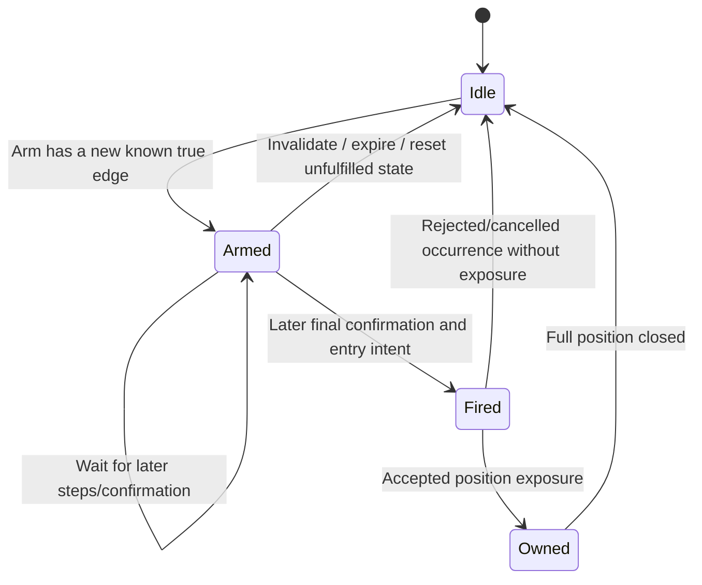
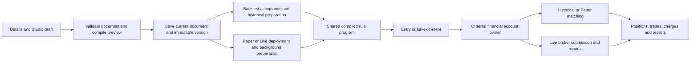

# Strategy Studio: complete current guide

**Code reviewed: 7 November 2026.** This guide describes the current builder,
saved strategy documents and their use in Backtesting, Paper and Live. Examples
explain configuration mechanics; they are not claims of profitable performance.
The backend specification remains authoritative when defaults or limits change.

## Contents

1. [What the builder supports](#1-what-the-builder-supports)
2. [Create and manage a strategy](#2-create-and-manage-a-strategy)
3. [Navigate Studio and save safely](#3-navigate-studio-and-save-safely)
4. [Markets: fixed instruments and automatic contracts](#4-markets-fixed-instruments-and-automatic-contracts)
5. [Direction, sizing and initial risk](#5-direction-sizing-and-initial-risk)
6. [Conditions, groups and decision order](#6-conditions-groups-and-decision-order)
7. [All rule inputs and indicator parameters](#7-all-rule-inputs-and-indicator-parameters)
8. [Comparisons, arithmetic and rolling calculations](#8-comparisons-arithmetic-and-rolling-calculations)
9. [Reusable formulas and text arithmetic](#9-reusable-formulas-and-text-arithmetic)
10. [Capture and confirmation](#10-capture-and-confirmation)
11. [Schedule and timeframes](#11-schedule-and-timeframes)
12. [Validate and review](#12-validate-and-review)
13. [Versions, restore, sharing and cloning](#13-versions-restore-sharing-and-cloning)
14. [Worked strategies](#14-worked-strategies)
15. [From saved strategy to execution](#15-from-saved-strategy-to-execution)
16. [Data preparation and low-latency boundaries](#16-data-preparation-and-low-latency-boundaries)
17. [Troubleshooting](#17-troubleshooting)
18. [API and document reference](#18-api-and-document-reference)
19. [Implementation ownership and maintenance](#19-implementation-ownership-and-maintenance)
20. [Current limits and a verification checklist](#20-current-limits-and-a-verification-checklist)

## 1. What the builder supports

| Capability | Current behavior |
| --- | --- |
| Instruments | Fixed tradable instruments/contracts and automatic NSE/BSE stock/index-underlying futures/options selection |
| Data versus execution | A row can calculate signals on one instrument and trade another; an index supplies data and never receives an order |
| Rule composition | Nested boolean groups, comparisons, arithmetic, rolling windows, named formulas and restricted text arithmetic |
| Entry state | Simple conditions, or one active capture-and-confirmation Entry group |
| Exits | Stop-loss, target and general exit conditions close the full owned position |
| Sizing | Strategy default plus optional per-row override; fixed Units/Lots or a percentage of available capital |
| Timing | Completed-candle inputs, live LTP, multiple candle timeframes, weekdays, entry hours and exclusion windows |
| Saved versions | Immutable snapshots, readable comparisons, restore and explicit deployment version selection |
| Execution | The same compiled rule semantics feed historical replay, Paper simulation and Live broker execution |

The same condition trees and entry direction apply independently to every
selected row. Signal/Trade references resolve relative to that row. Per-row
customization currently changes the signal binding, contract policy and size;
it does not provide a separate rule tree or direction for each row. Use separate
strategies when those need to differ.

Multiple rows are independent trading units, not an atomic basket. There is no
coordinated multi-leg entry/exit, portfolio-level condition language, automatic
rollover of open positions, arbitrary Python/Pine execution, or general custom
indicator plugin exposed in Studio. A strategy does not add to its position while
that unit is already open. Manual Terminal order types are documented separately
in [Trading Terminal](trading-terminal.md); Studio generates market orders.

Derivative settlement has narrower qualifications than contract selection. Read
[Derivative settlement](paper-trading.md#derivative-settlement) before holding through expiry.
Available code paths do not imply every derivative family or broker operation
has been verified with a real account.

## 2. Create and manage a strategy

### 2.1 Create it

1. Open **Strategy Lab → My Strategies → New Strategy**.
2. Enter a descriptive name, description and optional tags.
3. Choose the strategy type, market, exchange and instrument classification.
4. Choose visibility and the available Paper/Live enablement flags.
5. Save. The strategy is created as **Draft**, with an initial configuration;
   the UI opens Studio so you can define its actual instruments and rules.

Strategy names require at least three characters in the form. The current field
limit is 255. Classification describes the strategy; the instruments actually
selected in Studio determine the data, contract terms, exchange calendar and
tradable destination. Classification alone does not select instruments.

Current fresh defaults:

| Field | Default |
| --- | --- |
| Strategy name | Blank |
| Description | Blank |
| Strategy type | Intraday |
| Market | Equity |
| Exchange | National Stock Exchange |
| Instrument type | Stock |
| Visibility | Private |
| Status | Draft |
| Paper trading | Yes |
| Live trading | No |

Paper/Live switches allow that strategy to be used in the corresponding mode.
They do not start a session. The deployment's enabled execution scopes also apply;
Live controls may be unavailable on a deployment that only enables Paper.
Disabling a trading mode is rejected while its running/paused sessions exist.

### 2.2 The four main strategy tabs

| Tab | Use |
| --- | --- |
| Details | Edit identity, classification, description, tags and execution enablement |
| Studio | Edit the complete strategy document and save a new version |
| Sharing | Choose Private/Public and manage the current configuration link |
| Versions | List snapshots, inspect changes, create a snapshot or restore an older configuration |

### 2.3 Strategy status is different from session status

Draft, Active, Paused and Archived describe the strategy's lifecycle. RUNNING,
PAUSED, STOPPING, ERROR and STOPPED describe execution sessions. Activating a
strategy does not deploy it; pausing a strategy is not a substitute for pausing a
running session.

Status changes are blocked while relevant Paper/Live sessions are running,
paused, stopping or in error. Manage/settle those sessions first. Archive a
strategy with retained execution history instead of trying to delete its records.
Deletion is blocked when related trading/backtest data requires retention.
Unarchive returns the strategy to Draft.

The special **halt and archive** flow can request Live square-off and wait for
settlement. It does not bypass Paper lifecycle restrictions or prove the broker
has closed positions immediately. Prefer managing the affected sessions explicitly.

## 3. Navigate Studio and save safely

Studio has four steps: **Markets & size**, **Conditions**, **Schedule**, **Review**.
The step bar and Previous/Next controls stay available while the editor scrolls.
Validate and Save version are in the main workspace header.

All steps edit one browser-held document. Moving between steps does not save or
deploy it. **Validate** checks the document; **Save version** validates and saves
the entire document and creates an immutable snapshot. Save version becomes
available when the draft differs from the saved document.

The toolbar reports Saved, Unsaved changes, Validating or Saving. Editing after
validation invalidates the previous validation indicator. The Review step offers
Edit links back to the relevant section.

Leaving the Studio with unsaved changes asks whether to keep editing or discard
them. In-app navigation uses the themed confirmation dialog. Browser reload,
closing a tab or leaving the site uses the browser's own before-unload prompt;
the browser does not allow the application to replace it with an asynchronous
custom dialog. Neither prompt saves the draft automatically.

**Reload saved version** discards the local draft after confirmation. There is no
toolbar Undo or document-wide undo history; normal text-field undo still works.
Removing configured groups, instruments, formulas and setup state uses confirmation
where appropriate.

Each load includes a revision of the saved document. Saving from a stale second
tab returns a conflict rather than overwriting the newer document. Preserve any
local changes you need, reload the current saved configuration, then reapply them.

## 4. Markets: fixed instruments and automatic contracts

### 4.1 Fixed instrument or contract

1. In Markets & size, select **Add instrument**.
2. Choose **Fixed instrument / contract**.
3. Search by company/name, ticker, underlying or contract text; narrow by exchange,
   instrument type and expiry when useful.
4. Add the exact instrument. Read its displayed name and contract details, not
   only a shared underlying symbol. `sym_ticker` is the unique provider identity.
5. Expand the selected row to change its signal instrument or custom size.

A fixed stock keeps trading that stock. A fixed option/future keeps the chosen
expiry and strike; it does not become next month's contract automatically.
The search can include archived/expired contracts for historical work. That does
not make them eligible for current Paper/Live deployment. An analysis-only index
cannot be added as a fixed order destination.

The selected-row summary shows the fixed/automatic choice, signal → trade binding,
size inheritance and useful lot/expiry information. With more than five rows a
filter helps find selected instruments. Removing a row changes the draft, not an
already deployed session.

### 4.2 Signal instrument versus traded contract

| Role | Meaning | Example |
| --- | --- | --- |
| Signal instrument | Market used by inputs whose source is Signal instrument | BANKNIFTY index |
| Traded contract | Instrument whose price, quantity, fills and position are owned | A specific BANKNIFTY call |
| Position state | Always the row's owned traded position; no independent market selector | Entry price of that call |

For a fixed binding, **Change signal instrument** selects an alternate source.
**Use traded contract for signals** restores the same-instrument binding.
The input's source selector applies only to that input. The two sides of a
comparison and separate arithmetic children can each use their own source.

The **Source** parameter inside an indicator is different: it chooses which
series the indicator consumes, such as Close or RSI. The outside **Signal
instrument / Traded contract** control chooses the market providing that series.

Example: `Signal CLOSE > Signal EMA(20)` can buy a call, while
`Traded LTP < Entry price - 20` stops that call by premium. Index points are never
used as the call's fill price or option P&L. The engine still needs a received
quote for the selected traded contract before it can act.

### 4.3 Automatic futures/options selection

1. Add instrument → **Automatic F&O selection**.
2. Select an NSE/BSE stock or index underlying from the catalog. This underlying
   supplies the signal and contract-selection reference price.
3. Expand the row and choose Option or Future.
4. For options choose Call/Put, expiry policy and strike policy.
5. Set size, then optionally use **Preview selected contract**.

The preview shows a currently resolved contract, expiry, lot size and underlying
quote provenance. It submits no order and does not pin that preview into the
saved strategy. Saving retains the policy. Current default policy:

| Field | Default |
| --- | --- |
| Contract family | Option Contract |
| Option right | Call Option |
| Expiry selection | Nearest eligible expiry |
| Specific expiry | Not set |
| Include contracts expiring today | No |
| Strike selection | ATM (nearest listed strike) |
| Listed strikes from ATM | 0 |
| Specific strike | Not set |

Switching to Future clears option-only fields. Switching back to Option restores
its option defaults; it does not preserve an incompatible old strike/right.
Changing expiry selection clears a previous specific expiry date. Changing strike
selection clears an incompatible specific strike and resets its distance.

### 4.4 Expiry selection

| Choice | Behavior |
| --- | --- |
| Nearest | First eligible listed expiry on/after today when expiry day is allowed, otherwise strictly after today |
| Next | The listed eligible expiry immediately after Nearest |
| Specific expiry | That exact listed date, subject to eligibility and the expiry-day setting |

These are listed dates, not hardcoded weekday, weekly/monthly or N-day rules.
**Include contracts expiring today** changes eligibility for the current exchange
session date. It does not guarantee safe holding into final settlement or bypass
market hours. A specific date absent from the qualified catalog does not select
a nearby replacement.

### 4.5 ATM, ITM and OTM

ATM is the listed strike closest to the underlying price. An exact distance tie
chooses the lower strike. Distance counts positions in the eligible listed grid,
not rupee/point intervals. ITM/OTM distance is a positive integer, currently up to
20. ATM and Specific strike use zero relative distance.

| Selection | Call | Put |
| --- | --- | --- |
| ATM | Nearest listed strike | Nearest listed strike |
| ITM N | Move N listed strikes down from ATM | Move N listed strikes up from ATM |
| OTM N | Move N listed strikes up from ATM | Move N listed strikes down from ATM |
| Specific strike | Require that exact listed strike | Require that exact listed strike |

Hypothetical grid: 57,000; 57,100; 57,200; 57,300; 57,400; 57,500; 57,600.
At underlying 57,320, ATM is 57,300. Call ITM 3 selects 57,000; Call OTM 3 selects
57,600. Put ITM 3 selects 57,600; Put OTM 3 selects 57,000. These numbers illustrate
the algorithm; inspect your catalog's actual listed grid and dates.

If the underlying later moves to 57,410, the next flat selection can use 57,400
as ATM. A pending order or open position keeps its existing contract. Exits never
move to a new strike because the index moved. Once fully flat and with no pending
order, selection may change again, subject to entry/setup conditions.

Changing a flat binding discards premium-series crossing/capture state that belongs
to the previous contract. An underlying-only setup can remain valid for the
unchanged underlying; it is not automatically frozen to the earlier preview.
Missing exact quotes/history or an unavailable requested grid point makes that
selection wait; another strike is not substituted silently.

### 4.6 Historical automatic selection

Backtests use the configured policy against historical underlying observations
and dated contract prices. Missing expired catalog entries can be discovered
through FYERS' expired-contract facilities. Only relevant selected contracts need
price history, while selection uses the available expiry/strike grid.

Two important current limitations must be read in the workload/data-quality notes:

- Provider historical listing timestamps are unavailable. The per-expiry grids
  are retrospective; this is not a fully point-in-time reconstruction of when
  every strike first became available to trade.
- Dated economic terms are preferred. When unavailable, the authorized fallback
  can assume lot size/tick/multiplier and related terms from a current template.
  The assumption is recorded. The expired contract's own price series, strike
  and expiry remain its own; it is never priced using a current contract proxy.

Review these assumptions before drawing economic conclusions. Missing real prices
are not invented. See [Backtesting](backtesting.md) for acquisition, workload,
expiry and replay details.

## 5. Direction, sizing and initial risk

### 5.1 Direction

The strategy has one **Entry direction**: Buy or Sell. Buy opens long exposure;
Sell opens short exposure where supported. Exits choose the opposite side of the
owned position automatically. Selecting Sell in Details/classification is not
enough; use Entry direction in Markets & size.

Stock short entries require an Intraday strategy under current deployment
validation. A non-intraday stock strategy does not add stock-borrowing capability.
The execution product is derived from the contract: stocks/ETFs/bonds use CNC;
derivatives use Margin. The strategy type does not switch the product to Intraday.
Actual Live eligibility, broker restrictions and funds remain authoritative.

### 5.2 Fixed Units and Lots

| Setting | Result |
| --- | --- |
| 10 Units on a one-unit stock | Quantity 10 |
| 1 Lot on a derivative with lot size 30 | Quantity 30 |
| 2 Lots on that derivative | Quantity 60 |
| 30 Units on that derivative | Quantity 30 |
| 1 Unit on that derivative | Invalid; it is not silently rounded up to a lot |

Lots multiply by the selected contract's lot size once. Units already mean exact
order units and must be a positive whole-lot multiple. Contract multipliers are
then applied separately for financial valuation; they are not another lot conversion.
Freeze quantities, valid tick sizes, expiry, available funds and market eligibility
can still reject an otherwise valid size.

For a mixed stock/derivative strategy, use Lots where appropriate or give the
derivative a custom size. A shared default of 1 Unit does not become 1 Lot for
derivatives.

### 5.3 Percentage of available capital

This sizing percentage is an order-sizing method, not the removed percentage
allocation feature. A session still has its own capital/allocation configuration.

The owner calculates a budget from currently available capital, then takes the
largest whole-lot quantity that fits the budget's collateral basis:

```text
budget = available capital × capital percentage / 100
quantity = floor(budget / collateral per lot) × lot size
```

Available capital accounts for existing positions, working-order reservations,
session allocation and, for Live, broker funds. It is not the original account
deposit or unrealized profit assumed to be immediately spendable.

Stocks use their financial value. Long options use premium. Futures use the
account's configured futures collateral percentage; short options use the configured
short-option percentage against strike-based value. These are simulation/admission
estimates, not an exchange SPAN calculation or a real-time broker margin quote.
The broker can reject a Live submission even when simulated capacity is positive.

Example: ₹10,000.00 available, 10% sizing, stock price ₹200.00 and one-unit lots
gives a ₹1,000.00 budget and 5 units before any other admission restriction.
If a single allowed lot does not fit, size is zero and no entry is admitted.

### 5.4 Per-instrument custom size

Expand the selected row and enable **Use custom size**. Choose its sizing method,
Units/Lots and quantity/percentage. Turning the override off restores inheritance
from Direction & default size. There is one override per row, not another route
execution mode.

Automatic contract rows default to a custom fixed size of 1 Lot. Automatic fixed
sizing requires Lots because the chosen contract's lot size can differ. A capital-
based automatic row can use capital sizing. The UI prevents disabling a required
override when the inherited fixed default would use Units.

### 5.5 Reward/risk basis: what 1R means

Open **Reward/risk basis → Define initial risk distance** when using an explicit
R-multiple denominator. The starting template is traded-contract ATR with its
published default period. It is an editable numeric expression.

The expression must produce a positive distance in traded-contract price points
at entry admission. It may use traded-market inputs and constants, including
valid named formulas; signal-market prices, position state and setup captures
cannot define this explicit initial basis. Its accepted value freezes for the
owned trade, including partial fills and recovery.

For entry ₹100.00 and initial distance ₹2.00, +₹4.00 per-unit favorable movement
is +2R. A short position gaining ₹4.00 per unit also has +2R. ATR changing later
does not rewrite this denominator. **Defining 1R does not place a stop order.**
Configure an actual stop-loss condition as well.

Example configuration:

```text
Initial risk: ATR(14), Traded contract
Stop loss: Position Risk:Reward Ratio <= -1
Target: Position Risk:Reward Ratio >= 2
```

Without an explicit basis, the engine can infer distance from supported simple
same-market stop boundaries combined with ALL/ANY. This does not cover arbitrary
NOT/K-of-N stop geometry. Separate signal/trade markets using R require an explicit
traded-market basis. Prefer that explicit basis when the intended meaning matters.
Unavailable/non-positive initial risk blocks an entry. A version change cannot
retroactively give an older position a different initial risk denominator.

## 6. Conditions, groups and decision order

### 6.1 Choose the action stage

| Stage | Evaluated when | Result |
| --- | --- | --- |
| Entry | Flat, running, ready and inside entry availability | Request an entry in the configured direction |
| Stop loss | Position owned | Request a full exit; checked before other exit stages |
| Target | Position owned | Request a full exit if Stop loss has not won |
| Exit | Position owned | Request a full exit if neither Stop loss nor Target has won |

No position means no valid position-state operands. Entry and pure reusable
formulas therefore cannot use Entry price, Position P&L or other position state.
All stages use the same supported operand/calculation language subject to context.

Stop/Target groups are engine-monitored conditions. A match requests the full
exit; saving such a group does not automatically install an exchange-hosted
resting protective stop order at the broker.

### 6.2 Two separate levels of combination

Inside a group, combine comparisons using **All conditions**, **Any condition**,
**Not** or **At least K**. Use Condition to add a comparison and Nested group to
compose different boolean combinations. **Wrap in group** puts a comparison into
a new combination without losing it. A single-child group can be unwrapped.

Separately, choose AND/OR for the enabled groups of a stage. For example:

```text
Entry group A: ALL(CLOSE > EMA20, RSI14 > 50)
Entry group B: VOLUME > SMA20(VOLUME)
Stage combination OR: A or B is enough
Stage combination AND: A and B must both be true
```

An enabled toggle controls whether a top-level group participates. Disabled groups
remain editable but do not provide active conditions or active captures. Group
names are labels; group IDs identify saved state and capture references. A compact
group header does not repeat the entire condition tree.

Every comparison advances its observation/crossing state before the boolean
result is combined. One false AND input does not prevent another comparison from
remembering its latest observation. No stage with zero active groups triggers by
default. Live deployment additionally requires an active Stop loss group.

### 6.3 Simple conditions and re-entry

A simple numeric comparison such as `LTP > EMA20` is a level condition. Once flat
again, it may enter on another advancing eligible observation while still true.
It does not require a new false → true edge of the entire group.

`CROSSES_ABOVE` is different: it requires the prior known relation to be <= and
the new relation to be >. It will not trigger repeatedly while remaining above.
Entry on a still-true level, a new comparison cross and re-arming a capture setup
are three different behaviors. See [Capture and confirmation](#10-capture-and-confirmation).

Working/pending intents prevent duplicate entry admission for that owned unit.
An open unit evaluates exits rather than taking another entry. Partial Live fills
create actual exposure that remains protected; exit processing handles cancellation
of any outstanding entry remainder instead of pretending the entire order filled.

## 7. All rule inputs and indicator parameters

### 7.1 How to configure an input

1. Select the input/indicator by its displayed name.
2. Open its parameter control to edit periods, source, selected output or other
   published parameters.
3. For a market input choose Signal instrument or Traded contract.
4. For candle inputs choose Default or a timeframe override.
5. If a completed-candle shift is supported, use Shift 0 for the newest completed
   value and Shift 1 for one completed bar earlier.

The current catalog has **48 inputs**, shown below. Parameter defaults in the
tables are a snapshot of the published backend specification, not another source
of application defaults. Indicators with no extra parameters still need history.

LTP is the last received live trade price for its selected market role. CLOSE is
the latest completed candle close. They are not interchangeable. Changing a candle
timeframe does not turn LTP into a candle-close input; LTP has no historical Shift.

### 7.2 Price action and volume

| Input / API value | Meaning | Parameters and current defaults | Example use |
| --- | --- | --- | --- |
| **Last Traded Price** (`LTP`) | Last received live trade price; no completed-candle shift. | No additional parameters | Signal LTP > captured high |
| **Open Price** (`OPEN`) | Open of the selected completed candle. | No additional parameters | OPEN < CLOSE |
| **High Price** (`HIGH`) | High of the selected completed candle. | No additional parameters | Capture signal_high = HIGH |
| **Low Price** (`LOW`) | Low of the selected completed candle. | No additional parameters | Capture signal_low = LOW |
| **Close Price** (`CLOSE`) | Close of the selected completed candle. | No additional parameters | CLOSE > EMA20 |
| **Volume** (`VOLUME`) | Volume of the selected completed candle. | No additional parameters | VOLUME > Rolling average(20, VOLUME) |
| **Volume Weighted Average Price** (`VWAP`) | Typical-price × volume sum / volume sum over its selected session anchor. | Anchor=Daily; choices: Daily, Weekly, Monthly | CLOSE > VWAP, Daily |
| **HL2** (`HL2`) | (HIGH + LOW) / 2. | No additional parameters | HL2 > EMA20 |
| **HLC3** (`HLC3`) | (HIGH + LOW + CLOSE) / 3. | No additional parameters | EMA14 with Source HLC3 |
| **OHLC4** (`OHLC4`) | (OPEN + HIGH + LOW + CLOSE) / 4. | No additional parameters | SMA14 with Source OHLC4 |
| **Current Day Open** (`CURRENT_DAY_OPEN`) | Open of the current exchange session from completed source bars. | No additional parameters | CLOSE > Current Day Open |
| **Previous Week High** (`PREV_WEEK_HIGH`) | Highest value from the preceding exchange-session week. | No additional parameters | LTP > Previous Week High |
| **Previous Week Low** (`PREV_WEEK_LOW`) | Lowest value from the preceding exchange-session week. | No additional parameters | LTP < Previous Week Low |

Current day/week/VWAP anchors use the instrument's exchange session calendar.
Current Day Open becomes available from the first relevant completed source bar;
it is not a promise of an auction/open quote before any candle is complete.
Previous Week High/Low require valid preceding-week data; stale data from a more
distant week is not labelled as the previous week. Volume is the provider's
instrument volume measure, not an inference about executable depth.

### 7.3 Candle analysis

| Input / API value | Meaning | Parameters and current defaults | Example use |
| --- | --- | --- | --- |
| **Candle Pattern** (`CANDLE_PATTERN`) | Numeric pattern detection: 1 detected, 0 not detected. | Pattern=Doji; choices: Doji, Hammer, Shooting Star, Bullish Engulfing, Bearish Engulfing, Morning Star, Evening Star, Marubozu, Bullish Harami, Bearish Harami, Piercing Line | Bullish Engulfing = 1 |
| **Candle Body Size** (`CANDLE_BODY_SIZE`) | Absolute body in points or percentage of high-low range. | Mode=Points; choices: Points, Percentage | Body Size, Percentage > 60 |

Candle Body Size in Points is `abs(CLOSE - OPEN)`. Percentage means
`abs(CLOSE - OPEN) / (HIGH - LOW) × 100`, with a zero-range candle producing 0.
It is the share of the candle's range, not percentage price return.

Candle Pattern outputs 1 for detected and 0 otherwise. Use `Candle Pattern = 1`
or `> 0`; do not compare it to a price. Supported patterns:

Doji, Hammer, Shooting Star, Bullish Engulfing, Bearish Engulfing, Morning Star, Evening Star, Marubozu, Bullish Harami, Bearish Harami, Piercing Line.

Directional labels such as Bullish/Bearish Engulfing distinguish the direction.
Other patterns expose detection, not a common signed strength scale. The Doji
implementation compares body size with 10% of the ten preceding candle ranges'
average. Pattern detection needs its historical context; a label is not a
guarantee of a future directional move.

### 7.4 Technical indicators

| Input / API value | Meaning | Parameters and current defaults | Example use |
| --- | --- | --- | --- |
| **Simple Moving Average** (`SMA`) | Arithmetic average of its source over N bars. | Period=14; min 1<br>Source=CLOSE; permitted price/indicator source | CLOSE > SMA20(CLOSE) |
| **Exponential Moving Average** (`EMA`) | SMA-seeded exponentially weighted source average. | Period=14; min 1<br>Source=CLOSE; permitted price/indicator source | EMA9 Crosses Above EMA21 |
| **Weighted Moving Average** (`WMA`) | Weighted source average; newest weight N, oldest weight 1. | Period=14; min 1<br>Source=CLOSE; permitted price/indicator source | CLOSE > WMA14 |
| **Hull Moving Average** (`HMA`) | Weighted half/full-period difference smoothed over square-root period. | Period=14; min 1<br>Source=CLOSE; permitted price/indicator source | HMA14 > Shift 1 HMA14 |
| **Arnaud Legoux Moving Average** (`ALMA`) | Gaussian-weighted source average using the implemented fixed weighting shape. | Period=14; min 1<br>Source=CLOSE; permitted price/indicator source | CLOSE > ALMA14 |
| **Kaufman Adaptive Moving Average** (`KAMA`) | Efficiency-ratio adaptive source average. | Period=14; min 1<br>Source=CLOSE; permitted price/indicator source | CLOSE > KAMA14 |
| **Double Exponential Moving Average** (`DEMA`) | 2 × EMA(source) - EMA(EMA(source)). | Period=14; min 1<br>Source=CLOSE; permitted price/indicator source | CLOSE > DEMA14 |
| **Triple Exponential Moving Average** (`TEMA`) | 3 × first EMA - 3 × second EMA + third EMA. | Period=14; min 1<br>Source=CLOSE; permitted price/indicator source | CLOSE > TEMA14 |
| **Relative Strength Index** (`RSI`) | Wilder-smoothed relative gain/loss oscillator. | Period=14; min 1<br>Source=CLOSE; permitted price/indicator source | RSI14 > 50 |
| **Rate of Change** (`ROC`) | Percentage source change over its period. | Period=9; min 1<br>Source=CLOSE; permitted price/indicator source | ROC9 > 1 |
| **MACD** (`MACD`) | Fast/slow EMA difference, selected signal line or histogram. | Fast=12; min 1<br>Slow=26; min 1<br>Signal=9; min 1<br>Output=MACD Line; choices: MACD Line, Signal, Histogram | MACD Histogram > 0 |
| **Bollinger Bands** (`BOLLINGER_BANDS`) | SMA and population-standard-deviation price bands. | Period=20; min 1<br>StdDev=2; min 1<br>Output Line=Upper; choices: Upper, Middle, Lower | CLOSE > Bollinger Upper |
| **SuperTrend** (`SUPERTREND`) | ATR-based retained trend boundary level, not a boolean direction input. | Period=7; min 1<br>Multiplier=3; min 1 | CLOSE > SuperTrend |
| **Average Directional Index** (`ADX`) | Wilder trend-strength ADX or selected directional line. | Period=14; min 1<br>Output=ADX; choices: ADX, +DI, -DI | ADX output ADX > 25 |
| **Directional Movement Index** (`DMI`) | Same directional-movement family; select ADX, +DI or -DI. | Period=14; min 1<br>Output=ADX; choices: ADX, +DI, -DI | DMI +DI > DMI -DI |
| **Stochastic** (`STOCHASTIC`) | Smoothed close position within its high-low range. | %K=14; min 1<br>%D=3; min 1<br>Smooth=3; min 1<br>Output Line=%K; choices: %K, %D | Stochastic %K Crosses Above %D |
| **Average True Range** (`ATR`) | Wilder average true range in price points. | Period=14; min 1 | Initial risk = Traded ATR14 |
| **Commodity Channel Index** (`CCI`) | Typical-price deviation relative to its mean deviation. | Period=20; min 1 | CCI20 > 100 |
| **Williams %R** (`WILLIAMS_R`) | Close location in its high-low range, on a negative oscillator scale. | Period=14; min 1 | Williams %R > -20 |
| **On Balance Volume** (`OBV`) | Accumulated signed volume by close direction. | No additional parameters | OBV > Shift 1 OBV |
| **Money Flow Index** (`MFI`) | Positive/negative typical-price volume flow oscillator. | Period=14; min 1 | MFI14 > 50 |
| **Pivot Point** (`PIVOT_POINT`) | Preceding selected-timeframe candle typical price. | No additional parameters | CLOSE > Pivot Point @ 1D |
| **Keltner Channel** (`KELTNER_CHANNEL`) | EMA-centered ATR distance channel. | Period=20; min 1<br>Multiplier=2; min 1<br>Output Line=Upper; choices: Upper, Middle, Lower | CLOSE > Keltner Upper |
| **Donchian Channel** (`DONCHIAN_CHANNEL`) | Selected high/low extreme or midpoint over N bars. | Period=20; min 1<br>Output Line=Upper; choices: Upper, Middle, Lower | CLOSE > Lag(1, Donchian Upper) |
| **Parabolic SAR** (`PARABOLIC_SAR`) | Incremental stop-and-reverse price level. | Acceleration Factor=0.02; min 0<br>Max AF=0.2; min 0 | CLOSE > Parabolic SAR |
| **Ichimoku Cloud** (`ICHIMOKU_CLOUD`) | Selected causal conversion/base/cloud or historical-close line. | Tenkan (Conversion)=9; min 1<br>Kijun (Base)=26; min 1<br>Senkou B=52; min 1<br>Output Line=Tenkan; choices: Tenkan, Kijun, Senkou A, Senkou B, Historical close (Kijun candles ago) | Tenkan > Kijun |

The selected output matters: MACD histogram is not MACD line; +DI is not ADX;
upper/lower channel levels are prices, while oscillator outputs are not prices.
Pivot Point currently uses the **preceding selected-timeframe candle's**
`(HIGH + LOW + CLOSE) / 3`; it is not an entire floor-pivot support/resistance
system with automatically forced daily bars.

Ichimoku outputs use causal retained values. The historical-close output reads
the close Kijun bars ago. Cloud/lagging display conventions must not be interpreted
as access to future candles. ALMA uses its implementation's fixed weighting
settings in addition to the exposed period; KAMA uses its implemented adaptive
smoothing. Only parameters actually published in Studio are configurable.

### 7.5 Indicator source versus nested calculations

Period/source indicators can consume a permitted price series or a listed source
indicator. For example, select RSI as EMA's Source, configure RSI's source-parameter
period, then smooth that RSI with the outside EMA period.

This source-parameter editor has a deliberate boundary: it does not recursively
nest another source selector or Shift inside the inner source indicator. The
outside input still owns its market role, timeframe and supported Shift. Use the
expression tree and named formulas for the combinations that those features
actually support; they do not turn any arbitrary formula into every indicator's
source parameter.

### 7.6 Position state

| Input / API value | Meaning | Parameters and current defaults | Example use |
| --- | --- | --- | --- |
| **Position PnL %** (`POSITION_PNL_PERCENTAGE`) | 100 × direction-adjusted per-unit price change / entry price. | No additional parameters | Stop loss: PnL % <= -2 |
| **Position PnL Points** (`POSITION_PNL_POINTS`) | (current - entry) for long; (entry - current) for short. | No additional parameters | Target: PnL Points >= 4 |
| **Trailing Peak Offset** (`TRAILING_PEAK_OFFSET`) | Adverse retracement from the favorable observed extreme, in points. | No additional parameters | Trailing Peak Offset >= 1 |
| **Entry Price** (`ENTRY_PRICE`) | Owned position average entry price. | No additional parameters | Traded LTP < Entry Price × 0.98 |
| **Position Risk:Reward Ratio** (`POSITION_RR_RATIO`) | Favorable per-unit movement / frozen initial risk distance. | No additional parameters | Target: Risk:Reward Ratio >= 2 |

These inputs always read this row/session's **traded** position. The source
selector is absent because an underlying index does not own the option position.
Different sessions trading the same symbol do not share these values.

For a long entry at ₹100.00, current price ₹103.00 and peak ₹105.00:
Entry price = 100; Position PnL Points = +3; Position PnL % = +3%; Trailing Peak
Offset = 2. For a short entry at ₹100.00, current price ₹97.00 and favorable trough
₹95.00, the corresponding profit is also +3 points and trailing offset is 2.

Points and percentages are per-unit price movement, before quantity, fees and
settlement cash effects. They are not the total account unrealized currency P&L.
Trailing Peak Offset measures retracement from the best observed traded price
since ownership; it is not itself an order. Configure a comparison to act on it.

### 7.7 Constants and arithmetic

| Input / API value | Meaning | Parameters and current defaults | Example use |
| --- | --- | --- | --- |
| **Constant Value** (`CONSTANT`) | A finite number, with no instrument or candle history. | Value=0 | Threshold 50 or -1 |
| **Math Expression** (`MATH_EXPRESSION`) | Restricted configured-variable arithmetic, compiled before ticks. | Math Formula=empty formula/variables | (VAR_1 - VAR_2) / VAR_2 * 100 |

Use Constant Value for a numeric threshold such as 50, -1 or 1.5. It has no market
source or candle timeframe. Math Expression is a scalar arithmetic input with
configured variables; it is different from a reusable named formula tree.

## 8. Comparisons, arithmetic and rolling calculations

### 8.1 Comparisons

| Choice / API value | Meaning |
| --- | --- |
| Greater Than (`GT`) | left > right |
| Less Than (`LT`) | left < right |
| Equal To (`EQ`) | left == right |
| Greater Than or Equal (`GTE`) | left >= right |
| Less Than or Equal (`LTE`) | left <= right |
| Crosses Above (`CROSSES_ABOVE`) | Previously left <= right; now left > right, on advancing known inputs |
| Crosses Below (`CROSSES_BELOW`) | Previously left >= right; now left < right, on advancing known inputs |
| Not Equal To (`NEQ`) | left != right |

Crosses require two known observations of their actual inputs. Example:

| Observation | LTP | Captured high | Above? | Crosses Above? |
| --- | --- | --- | --- | --- |
| First known | 100 | 101 | No | No crossing yet |
| Next | 101 | 101 | No | No; equality is not above |
| Next | 101.05 | 101 | Yes | Yes |
| Next | 101.10 | 101 | Yes | No new cross |

Different timeframes advance on their own completed-candle clocks. A faster input
can advance while the slower input still reads its latest available completed
value. Re-reading the same unchanged candle on many ticks does not manufacture
a new completed-candle cross. A feed-generation change, history rebuild or changed
position revision can reset comparisons so a missing sequence is not treated as
an observed crossing.

Exact Equal/Not Equal compare numerical values; there is no automatic price
tolerance. For a tolerance, compare an absolute difference to a deliberate
threshold: `abs(left - right) <= 0.05`.

### 8.2 Numeric tree operations

| Choice / API value | Inputs | Meaning |
| --- | --- | --- |
| Add (`add`) | 2 | a + b |
| Subtract (`subtract`) | 2 | a - b |
| Multiply (`multiply`) | 2 | a × b |
| Divide (`divide`) | 2 | a / b |
| Minimum (`min`) | 2 | smaller of two inputs |
| Maximum (`max`) | 2 | larger of two inputs |
| Absolute value (`abs`) | 1 | absolute value of one input |
| Negate (`negate`) | 1 | -a |

Use the input's **ƒx** operation selector to wrap an existing value in a
calculation. The original value is retained as its first input; additional
arithmetic input defaults come from the backend. Each market-valued child has
its own role/timeframe outside the rolling restriction below. The editor labels
subtraction's second input and division's denominator to make order explicit.

Example: `Traded LTP <= Entry price × 0.98` is a 2% long-premium stop. Reversing
the subtraction or inequality changes the meaning. A short-premium price stop
instead tests an adverse increase, such as `Traded LTP >= Entry price × 1.02`.

Division by zero, overflow and unavailable/non-finite inputs produce unavailable
values, not an arbitrary zero. Min/Max are strict numeric operations; they do not
silently discard an unavailable child.

### 8.3 Rolling and lag operations

| Choice / API value | Meaning | New-node default |
| --- | --- | --- |
| Lag by bars (`lag`) | Reads the input value from N completed candles ago. | N=1 |
| Rolling highest (`highest`) | Returns the highest input value across the last N completed candles. | N=20 |
| Rolling lowest (`lowest`) | Returns the lowest input value across the last N completed candles. | N=20 |
| Rolling average (`rolling_mean`) | Averages the input values across the last N completed candles. | N=20 |
| Rolling sum (`rolling_sum`) | Adds the input value from each of the last N completed candles. | N=20 |
| Rolling standard deviation (`rolling_std`) | Measures the input values' dispersion across the last N completed candles, using the selected variance divisor. | N=20; Population variance |
| Rolling z-score (`zscore`) | Measures how many selected-window standard deviations the latest input is above or below its N-candle mean. Zero variance is unavailable. | N=20; Population variance |
| Return over bars (%) (`return_pct`) | Calculates (latest input / input N completed candles ago - 1) × 100. The starting value must be positive. | N=20 |

Windows use completed native candles, not wall-clock minutes. N=20 on 15m means
20 completed 15-minute bars, crossing session boundaries as the source requires.
Holidays do not count as fabricated candles.

Highest, Lowest, Average, Sum, Standard deviation and Z-score include the newest
completed candle. Wrap the result in **Lag by bars (1)** for the previous window:

```text
Prior 20-bar breakout:
CLOSE > Lag(1, Rolling highest(20, HIGH))

Total 20-bar volume:
Rolling sum(20, VOLUME)

Price z-score:
Rolling z-score(20, CLOSE, Population)
```

`CLOSE > Rolling highest(20, HIGH)` includes the current high and will normally
not express the intended prior-window breakout. Also, summing 20 EMA14 outputs
does not calculate EMA20 or EMA280; it adds 20 values from that indicator series.

A rolling input must be a pure completed-candle calculation using **one market
source and one timeframe**. Arithmetic, indicators, named formulas and nested
windows are allowed when they meet that requirement. LTP, position state and
frozen captured values have no native completed-candle history and cannot be
placed inside a rolling window.

Valid: `Entry price + Rolling average(20, Traded CLOSE)`. Invalid:
`Rolling average(20, Entry price + Traded CLOSE)`. To combine two markets, compute
their rolling values separately, then combine them outside their windows.

Lag needs its earlier value and Return over bars needs N+1 endpoints. Other
windows require their complete finite values; missing data occupies its native
slot instead of silently shortening the window. Return over bars specifically
uses its two known positive-start endpoints; a missing intermediate slot does
not replace those endpoints.

Population standard deviation uses divisor N (`ddof=0`); Sample uses N-1
(`ddof=1`, requiring more than one bar). Z-score is `(latest - mean) / deviation`.
A zero deviation makes z-score unavailable. These definitions are independent
of a trading signal until you add a comparison.

### 8.4 Boolean combinations and unavailable data

| Operation | Meaning |
| --- | --- |
| All conditions / ALL | Every child must be true |
| Any condition / ANY | At least one child must be true |
| Not / NOT | Invert exactly one child |
| At least K | At least K children must be true; K is 1 through the number of children |

The evaluator preserves TRUE, FALSE and UNKNOWN. `NOT UNKNOWN` is UNKNOWN, not
true. ALL can be false when one known child is false; ANY can be true when one
known child is true. Otherwise missing children can keep the result UNKNOWN.
For K-of-N, K known truths suffice; if even all unknown children could not reach
K, the result is false; otherwise it remains unknown. An entry/exit stage acts
only on an actual true result.

## 9. Reusable formulas and text arithmetic

### 9.1 Reusable formulas

Open **Reusable formulas** in Conditions. Enter a name starting with a letter,
then letters, numbers or underscores, currently up to 40 characters. Add the
formula, edit its numeric expression tree and select it elsewhere through
**Named formula**. There are currently at most 32 formula definitions.

Example:

```text
TrendGap = Signal EMA(9, CLOSE, 5m) - Signal EMA(21, CLOSE, 5m)
Entry: TrendGap > 0
Exit: TrendGap < 0
```

Reusable formulas may reference other named formulas but cannot be circular.
They must remain pure market/constant calculations: no owned-position inputs
and no setup captures. They can use live market inputs in ordinary contexts;
placing a live-dependent formula inside a rolling window remains invalid.
Input sources/timeframes are part of the formula tree. Selecting a formula does
not reinterpret its leaves as another instrument role chosen at its use site.

Referenced formulas cannot be deleted until their references are removed.
Unused formula definitions do not create runtime history demand. Shared formula
work is reused within the current observation; values are not cached across
later events as though market inputs could never change. A saved version pins
the formula definition, so editing it does not change deployed versions.

### 9.2 Text Math Expression

1. Select **Math Expression** as an input and open its parameter editor.
2. Add variables, choose each variable's operand/parameters/timeframe and use
   those variables in the expression.
3. Compose the formula with numeric literals, `+`, `-`, `*`, `/`, `%`, parentheses
   and unary plus/minus. `%` means modulo/remainder, not percentage conversion.
4. Save the parameters; the outer input still supplies its market source.

Example variable configuration:

```text
VAR_1 = EMA(9, CLOSE)
VAR_2 = EMA(21, CLOSE)
Expression: (VAR_1 - VAR_2) / VAR_2 * 100
Meaning: percentage gap of the fast EMA relative to the slow EMA
```

Variable IDs use `VAR_` followed by digits; UI labels are descriptive, not Python
variable declarations. Different variable timeframes are supported outside a
single-clock rolling window. Variables inherit their parent market role; use
ordinary expression-tree children for independently chosen Signal/Trade roles.
Exit-context math may use position-state variables; Entry math cannot. Candle
Pattern and another Math Expression are not offered as numeric math variables.

Functions, attributes, imports, indexing, exponentiation and arbitrary executable
code are not accepted. The expression is parsed/validated and compiled to numeric
instructions before execution; no user `eval` runs on ticks.

## 10. Capture and confirmation

### 10.1 When to use it

A simple comparison asks whether something is true now. Capture & confirmation
asks whether an occurrence armed earlier, what values it froze, and whether
later observations satisfy a sequence before invalidation or expiry.

Current release constraint: when an Entry group uses a setup, it must be the
only **active** Entry group. Combine filters inside its Arm tree instead of
adding several competing active setups. Stop-loss, Target and Exit groups can
still be configured separately.

### 10.2 Configure each part

Select **Configure** in the Entry group. The current condition becomes Arm;
the template captures signal high/low, confirms a later LTP cross above the
captured high, invalidates below the captured low and expires after three bars.
Every part is editable.

| Part | What to configure | Example |
| --- | --- | --- |
| Arm when | Pure condition without captures/position state | Completed Signal CLOSE > EMA20 |
| Remember values | Named finite numeric expressions evaluated once on arming | `signal_high = HIGH`, `signal_low = LOW` |
| Intermediate confirmations | Optional ordered condition trees | First pull back, then recover |
| Enter on a later observation | Final confirmation condition | Signal LTP Crosses Above captured signal_high |
| Invalidate | Optional condition that abandons the occurrence | Signal LTP < captured signal_low |
| Expire | Count new completed bars on the chosen signal timeframe | Five new 1m bars |

Captures are frozen numbers, not aliases that keep tracking the newest candle.
Capture names follow the same letter/number/underscore rule as formula names.
Captures cannot reference other captures while being defined, and the Arm tree
cannot reference values it has not captured yet. Intermediate/final/invalidation
conditions can use that setup's captures. Exits can reference captures from active
Entry setups, keeping their original meaning for the owned occurrence.

### 10.3 Exact lifecycle



1. A known, advancing true Arm with no previously seen true Arm creates an edge.
   The first eligible known true Arm can arm an initially idle unit.
2. Captures are evaluated once. Any unavailable capture prevents arming.
3. The arming observation seeds final/step comparison state but cannot confirm,
   advance a later phase or place that setup's entry on the same observation.
4. On later observations, expiry/invalidation are considered before confirmation.
   At most one intermediate step advances per observation. Finishing the last
   step does not also confirm entry on that same observation.
5. Final confirmation can generate an entry only after earlier steps. Missing
   required input remains UNKNOWN; unknown invalidation also defers confirmation.
6. Expiry wins at its boundary. A matching confirmation on the Nth new completed
   expiry bar does not rescue a setup that expires at N.
7. A filled position retains its captures for protection. They are not recalculated
   with each candle. Full closure clears the occurrence's captures.

Step/final comparison state is sampled while earlier steps are waiting. A cross
that happened too early is not automatically latched for a later step; use the
ordered setup design to express the actual observations you want to require.

Arm state is tracked even while fired/owned. After closure, a setup needs a new
observed false → true Arm edge; remaining true throughout the trade does not
automatically create another occurrence. An unknown Arm is not an observed false
that can reset that edge. A Crosses Above Arm has its own comparison-edge behavior.

Pausing or losing a proven observation sequence resets unfulfilled setup state.
Already-owned captures remain available to protect exposure. A market gap is not
replayed as if every missing crossing had been observed. Changing a contract or
version also respects the ownership restrictions described elsewhere.

### 10.4 A concrete timeline

| Event | Input/state | Result |
| --- | --- | --- |
| 09:16 completed bar | Arm becomes true; HIGH=101, LOW=99 | Freeze 101/99; no entry yet |
| Later tick | LTP=100.80 | Wait |
| Later tick | LTP=101.05 after <=101 | Final Crosses Above is true; request entry |
| Position open | Market continues | Keep captured 101/99; evaluate exits |
| Position closes | Arm stayed true | Clear occurrence; no immediate re-arm |
| Later bar | Arm observed false | Reset its seen-true state |
| Later bar | Arm true again | New occurrence can arm |

If the condition should simply allow re-entry while it remains true, use a simple
Entry condition rather than a captured occurrence. Removing a setup through
**Use simple condition** restores its Arm condition after confirmation; referenced
captures must be removed first.

## 11. Schedule and timeframes

### 11.1 Timeframe choices and completion

**1 Minute** (`1m`), **3 Minutes** (`3m`), **5 Minutes** (`5m`), **15 Minutes** (`15m`), **30 Minutes** (`30m`), **1 Hour** (`1H`), **4 Hours** (`4H`), **1 Day** (`1D`), **1 Week** (`1W`).

These are Studio's calculation timeframes. Chart display intervals are a separate
catalog; a chart-only interval is not automatically available for rule evaluation.
The default timeframe starts at 5m. Each candle input can inherit Default or use
an explicit override, such as 1m entry with a 15m EMA filter.

At 10:07, a 15m input reads its most recent completed exchange-aligned 15m bar,
not the still-forming 10:00–10:15 bar. The 1m input can keep advancing independently.
Bars align with the relevant exchange/segment session and its holidays/breaks;
they are not arbitrary UTC-midnight buckets. Daily/weekly features also require
the correct exchange calendar and enough confirmed history.

### 11.2 Entry availability

| Control | Meaning |
| --- | --- |
| Schedule timezone | Interprets weekday names and entered entry/window times |
| All exchange trading days | No extra weekday filter; an empty saved weekday list represents this |
| Selected weekdays | A non-empty subset; it cannot open an exchange holiday/weekend session by itself |
| Entry start / Entry end | Additional entry-time bounds; either can be unset |
| Excluded entry windows | Times during which new entries must not occur |

Start/end and exclusions retain seconds precision and cannot wrap midnight.
When both bounds exist, end must be after start. Start and end comparisons are
inclusive; exclusion start/end are also excluded inclusively. The contract's
actual calendar-open requirement still wins at the exchange closing boundary.

Changing timezone preserves the entered clock text and changes its interpretation.
It does not convert 09:15 IST automatically to a different timezone's equivalent.
Current defaults are Asia/Kolkata, Monday–Friday, 09:15:00–15:30:00; review them for
the selected exchange/segment.

**Entry end stops new entry admission; it does not square off positions or
create a time-based exit.** Paper additionally checks its pending strategy
entry when matching and cancels a simulated fill outside the allowed window;
this is not an immediate timer-based cancellation of every accepted order.
An order already accepted at a Live broker still needs broker confirmation.
Stop/Target/Exit rules continue to govern exposure. Intraday classification
does not change that meaning. Studio
currently has no general Time-of-day operand for expressing a custom timed exit;
use the session's explicit position-management controls when needed.

The stored Market session vocabulary does not bypass the actual exchange
calendar. The current Studio schedule UI focuses on explicit weekdays/hours and
windows. See [Paper trading](paper-trading.md) or [Live trading](live-trading.md)
for session stopping and broker behavior outside an open segment.

Example: enter on exchange trading weekdays between 09:20:00 and 15:10:00, except
12:00:00–12:15:00. At exactly 12:15:00 the exclusion still applies; the next eligible
advancing observation can enter. An existing position at 15:10:01 does not close
solely because Entry end has passed.

## 12. Validate and review

Use Review to inspect selected markets, effective sizes, entry/exit logic, setup
definitions and schedule. Its Edit links return to the corresponding step.
Use Validate after assembling the strategy and Save version when ready to retain it.

Validation checks the document shape, choices, operand parameters, expression
types, references, context, source/timeframe restrictions, policy constraints and
compiler feasibility. It may read the instrument catalog/calendar. It does not
download price history, open a Paper/Live session, reserve trading funds or place
a broker order.

Successful validation therefore means the configuration can be compiled, not
that every required history range/contract quote exists or that a broker will
accept an order. A draft may be saved before it is deployable; deployment requires
actual eligible instruments, enabled mode, active Entry conditions and appropriate
funds/data. Live also requires an active Stop loss group.

Local schedule errors can link/focus the offending field. Server errors remain
authoritative. Fix the reported issue and validate again. Unknown/deleted
instruments require selecting valid catalog records, not silently renaming IDs.

## 13. Versions, restore, sharing and cloning

### 13.1 Saved draft, snapshot and deployment

| Item | What changes it | A running session changes automatically? |
| --- | --- | --- |
| Unsaved Studio draft | Editing a control | No |
| Current saved document | Save version or an explicit restore | No |
| Immutable version snapshot | Save version, Snapshot or an automatic checkpoint | No |
| Deployed version | Explicit session/allocation version-change action | Yes, after validation and runtime application |

The Versions tab lists snapshots newest first using server-side paging. Open a
version to inspect its full saved configuration and changes relative to the true
preceding version. This is a comparison of saved states, not a keystroke history.

**Snapshot** captures the currently saved configuration and optional notes. It
cannot include an unsaved Studio draft. **Auto snapshots** records committed
strategy/detail/tag changes, skipping an identical final state; it is not
continuous browser draft saving. Explicit Studio saves create their version even
when automatic checkpoints are paused. Initial strategy creation has an initial
checkpoint.

Restore validates/compiles the chosen saved configuration, replaces the current
document and restorable details/tags, and records a **new** version noting the
rollback. It does not delete later versions or rewrite previous orders/results.
It is not an automatic deployment rollback. Current session version/ownership
must be managed separately. A version that refers to a deleted instrument or no
longer-valid configuration can fail current validation.

### 13.2 Change the version of a running deployment

Use the deployment's explicit version control. Saving Studio alone never applies
new rules to a running session. A version change need not require a blanket
stop/restart when the change is accepted, but it is a validated asynchronous
runtime refresh, not an immediate mutation inside a tick evaluation.

Important restrictions include:

- The version must belong to this strategy and satisfy the mode's current validation.
- Outstanding orders must settle before a version change.
- Open positions must retain their route/leg and signal/traded binding.
- Close positions before changing a version involving captured setup state.
- A new initial risk definition cannot rewrite an existing trade's risk.
- Paper cannot create a duplicate deployment of the same strategy/version.
- Applicable current Paper capacity checks run for the changed snapshot.

Manage allocation capital through the deployment controls, not the Studio sizing
percentage. The mode guide owns exact command acknowledgment and state behavior:
[Paper](paper-trading.md), [Live](live-trading.md).

### 13.3 Sharing

Choose Private or Public in Sharing, then **Save sharing**. The selected color
indicates the draft choice. Until saved, the previous visibility is still effective.
Public reveals the current saved configuration through `/strategy/view/<id>`.
Copy copies that link; Preview opens the read-only view.

The public projection excludes account balances, private fills/P&L and editing
controls. It does not grant another user deployment, cloning or backtest rights.
Making it Private blocks later anonymous reads; it cannot recall content somebody
already copied. The public response is uncached/no-store and is not pinned to a
particular old version. Unsaved Studio edits are never included.

### 13.4 Clone versus restore

Clone makes a new owner-controlled **Private Draft** with copied configuration and
tags and its own initial snapshot. It does not copy open positions, capital,
execution sessions or the complete old version timeline. Creating/cloning can
consume saved-strategy capacity in Public mode. Restore edits the existing
strategy and creates another version instead of another strategy.

## 14. Worked strategies

These recipes are configuration examples. Choose real eligible instruments, use
the actual lot size, confirm data readiness and inspect Paper behavior before
using broker execution. A threshold matching on a chart is not proof that every
required source/clock/state input was available to the evaluator then.

### 14.1 Simple stock trend with fixed-point exits

Goal: buy a stock while its completed trend filter is true, then close on a
specified favorable/adverse per-unit move.

1. Add a fixed stock, keeping Signal = Trade.
2. Direction Buy; fixed 1 Unit for a one-unit stock.
3. Schedule default 1m; choose the intended entry window.
4. One Entry group, All conditions:
   - Close Price > EMA, period 20, Source Close Price.
   - RSI, period 14, Source Close Price > Constant 50.
5. Stop loss: Position PnL Points <= Constant -2.
6. Target: Position PnL Points >= Constant 4.
7. Validate, save a version, activate as required and deploy that version to Paper.

At entry ₹100.00, the point comparisons are met at observed prices <=₹98.00 or
>=₹104.00 for a long position. Gap/slippage/fill rules mean an actual fill is not
guaranteed at the threshold. These are level Entry filters: after closure a new
eligible observation can re-enter while both filters remain true.

To trade only a fresh trend cross, replace the first comparison with
`EMA9 Crosses Above EMA20`; that changes re-entry behavior. A cross that occurred
while another required filter was false is not saved up for later. Use a capture
sequence when you explicitly want to remember an earlier occurrence.

### 14.2 Index breakout into an automatically selected option

Goal: arm from an index's completed candle, buy its current Call ITM 3 on a later
breakout, and protect the option using its own premium and captured index level.

1. Add an automatic index row: Option, Call, Nearest, expiry day excluded,
   ITM distance 3, custom fixed 1 Lot.
2. Default timeframe 1m. Direction Buy.
3. Create one Entry group with `Signal CLOSE > Signal EMA20`.
4. Configure Capture & confirmation:
   - Arm: the condition above.
   - Captures: signal_high = Signal HIGH, signal_low = Signal LOW.
   - No intermediate step initially.
   - Confirm: Signal LTP Crosses Above captured signal_high.
   - Invalidate: Signal LTP < captured signal_low.
   - Expire after five new 1m signal bars.
5. Set initial risk to Constant 20 traded-price points.
6. Stop loss, Any condition:
   - Position Risk:Reward Ratio <= -1.
   - Signal LTP < captured signal_low.
7. Target: Position Risk:Reward Ratio >= 2.

The constant basis avoids requesting option ATR history solely to define 1R.
The index still needs its candle/EMA warmup and setup clock. The option needs its
actual quote and tradable terms; no option price is inferred from index movement.
Changing the basis to Traded ATR deliberately adds option candle history demand.

If that call fills at ₹700.00, an initial 20-point distance means the R-based stop
matches at -20 points and target at +40 points per unit. The signal-based stop may
win earlier. One 30-unit lot multiplies the financial move by 30 before costs;
the index's point change is not that financial move.

The preview contract can change before acceptance while flat. Once the order or
position is owned, it stays pinned. After closure, another captured occurrence
requires a new Arm edge as explained in section 10.

### 14.3 Fixed futures short with ATR risk

1. Add a real, active fixed future. Use that contract for Signal and Trade.
2. Direction Sell; fixed 1 Lot.
3. Entry: `CLOSE < EMA20 AND RSI14 < 50` on the intended completed timeframe.
4. Initial risk: Traded ATR14.
5. Stop loss: Position Risk:Reward Ratio <= -1.
6. Target: Position Risk:Reward Ratio >= 2.

For a short, falling price gives positive position points/R; rising price gives
negative values. Initial ATR freezes at admission. Futures capital/cash accounting
uses its contract multiplier, configured collateral and applicable settlement
logic; a lot is not a stock unit. Choosing Next expiry automatically would select
while flat, not roll this open future into another contract.

### 14.4 Multi-timeframe trend and previous-window breakout

Use All conditions:

```text
Signal CLOSE @ 1m > Lag(1, Rolling highest(20, Signal HIGH @ 1m))
Signal EMA(9, CLOSE) @ 15m > Signal EMA(21, CLOSE) @ 15m
Signal VOLUME @ 1m > Rolling average(20, Signal VOLUME @ 1m)
```

Set every input in the breakout window to the same source/timeframe. The separate
15m filter is outside it. At each 1m close, the 15m inputs use only the latest
completed 15m values. The first condition excludes the candle being tested from
the high window; the third deliberately includes its latest completed volume in
the mean. Lag that mean by one if you want the preceding 20-bar baseline instead.

### 14.5 Trailing retracement and its limits

For a long or short position, `Trailing Peak Offset >= 1` requests an exit after
a one-point retracement from the favorable observed extreme. Add an independent
initial protective stop if required. The trailing measurement starts with owned
exposure; it does not wait for a profit threshold automatically.

`ALL(Position PnL Points >= 3, Trailing Peak Offset >= 1)` requires **both now**.
It does not permanently activate a trailing state after profit once reaches 3.
If profit falls back below 3, that group becomes false. There is no generic
position-time boolean latch or trailing-activation state editor in this release.
Do not assume that a historical true level is remembered unless a documented
setup/state mechanism explicitly owns it.

### 14.6 Understand unavailable values before using NOT

Suppose a 15m EMA is not warmed yet:

```text
NOT(Signal CLOSE @ 15m > Signal EMA20 @ 15m)
```

The result is UNKNOWN, not an entry permission. Wait for actual data readiness;
do not invert a missing indicator in an attempt to bypass preparation. Likewise,
a frozen capture is unavailable before its setup arms and a position input is
unavailable while flat.

## 15. From saved strategy to execution



### 15.1 Mode-specific boundaries

| Concern | Backtesting | Paper | Live |
| --- | --- | --- | --- |
| Configuration | Accepted immutable snapshot | Explicit deployed version | Explicit deployed version |
| Market observations | Synthetic path from confirmed OHLC | Received market observations and completed bars | Received market observations and completed bars |
| Rule meanings | Shared compiled program | Shared compiled program | Shared compiled program |
| Order acceptance | Shared financial kernel with historical terms | Shared financial owner with simulated funds | Owner plus broker/funds/contract constraints |
| Fill authority | Simulated signal-time traded quote, configured slippage/tick handling | Eligible observed traded ticks through simulated matching | Broker cumulative reports and reconciliation |
| Required running services | API and configured compute/Celery worker; no execution daemon needed for replay | API, market-data and execution runtime plus normal infrastructure | Paper services plus broker order-event/reconciliation service and verified credentials |

An automatic policy, separate signal/trade binding, formula, setup, sizing method
or timeframe does not create another mode-specific rule evaluator. The data and
fill adapters differ; that is why equal rules do not guarantee identical fills.

### 15.2 Historical replay assumptions

Current replay visits synthetic observations along each base candle:
open → adverse extreme → favorable extreme → close, relative to the strategy's
entry direction. For a Buy strategy that means Open → Low → High → Close; Sell
reverses the extremes. With a one-minute base candle, internal observations can
therefore occur at fractional-bar times such as +20 and +40 seconds.

Those seconds are synthetic scenario timestamps, not recovered exchange ticks.
LTP rules use these replay observations. Completed-candle inputs retain their
actual completion boundary. The order uses the traded quote available when its
signal fires, with slippage/rounding; it does not deliberately wait for a later
high/low landmark to price that order. An underlying signal still executes on
the contract's own available quote.

OHLC cannot reveal the real intrabar sequence, depth, queue priority or a crossing
between its sampled landmarks. A breakout may first be observed at an extreme
rather than exactly at the threshold. Choosing signal-time execution removes a
later-landmark pricing delay; it does not invent historical tick interpolation.
Residual positions, expiry and settlement use the policies documented in
[Backtesting](backtesting.md) and [Derivative settlement](paper-trading.md#derivative-settlement).

### 15.3 Paper and Live decisions versus fills

For running sessions, candle completion can generate a decision without waiting
for a new candle's first trade. LTP decisions advance on received quotes. The
intent is not the fill: Paper still needs its eligible traded observation and
financial admission; Live needs network submission and broker/exchange execution.
An illiquid contract may have no new quote even while its underlying moves.

The platform has no fixed N-second tick-age rejection rule. It still requires
received, causally ordered quotes and ready numerical inputs. A reconnect or lost
observation sequence is not treated as complete history, and a newer underlying
observation cannot borrow a future contract quote.

Trading costs are mode/account-profile behavior. Strategy PnL operands describe
price movement before fees. Real fills, partial quantities, settlement cash and
charges belong to the account/position layer, not to a condition's truth value.

### 15.4 Independent sessions and shared funds

The owned evaluation identity is `(mode, session_id, route_id, leg_id)`. A binding
separately identifies signal/traded instruments. `route_type` is not a current
field; the internal route/leg IDs remain necessary to distinguish ownership.

Each unit has independent crossing memory, captures, pending state and position
view. Units can run across CPU workers with bounded fair turns. Sharing one market
symbol does not require one strategy to finish its full trade before another
strategy sees that symbol's observations. Within a worker, runnable work is still
scheduled on finite CPU resources; there is no literal simultaneous start for
unlimited instruments.

Reservations/fills for one financial account are deliberately ordered by its owner
so two independent signals cannot spend the same capital. Shared immutable market
features do not share private position/setup state. Adding workers scales available
CPU scheduling capacity; it does not remove a broker account's throughput limits.

### 15.5 Allowance and deployment checks

Creating/cloning consumes saved-strategy inventory where enforced. Backtest
acceptance checks its request/workload/period allowance. Paper deployment/version
changes check the configured session/instrument capacity. Trading admission also
checks valid contracts, sizes, calendar availability and funds.

Public mode enforces the relevant commercial policy. Development records the
configured usage without public quota enforcement; Private has no commercial
resource allowance enforcement. Enabled execution scopes still apply. No variant
of a plan removes numerical, ownership, contract or broker correctness rules.
See [Commercial operations](commercial-operations.md) for current plan policy;
do not copy plan quantities into a strategy document.

## 16. Data preparation and low-latency boundaries

The metadata endpoint is an authoring contract, not a tick-time calculation
service. The numerical hot path does not fetch enums, run serializer validation,
download candles or query Django models for every event.

1. The saved version is validated and its active dependency trees compiled.
2. Preparation determines required source markets, timeframes, nested-source
   warmups, shifts and extra rolling lookback. A named formula only contributes
   demand when referenced.
3. The shared market-data layer reads confirmed stored history, acquires missing
   provider ranges as needed, and aligns it with exchange/segment calendars.
4. Prepared incremental feature graphs and read-only financial contract terms
   move to CPU workers. Running observations arrive through the local shared-
   memory data path, with per-source ordering.
5. Every decision reads prepared causal feature/quote values and its owned state.
6. Account transitions are serialized and persisted outside the numerical
   evaluation work; broker network calls are outside it too.

A tick-only traded option used for LTP/position-state protection does not require
arbitrary option candle warmup. A referenced Traded EMA/ATR or rolling value does.
A capture setup also needs its configured signal-bar clock for expiry. Live
automatic preparation warms the exact selected candle-dependent contract,
neighboring listed candidates and owned/pending contracts through the background
demand path; it does not fetch full-chain candle history for every subscribed
candidate. A jump beyond prepared data waits for the exact required input.

Long indicator periods increase preparation and retained history requirements;
they do not mean re-reading an entire database on each tick. They can still cost
CPU/memory, especially with many distinct source/parameter combinations. Measure
the actual strategy/session mix on the target machine.

For latency measurement, separate provider event → receipt, receipt → ready input,
input → decision, decision → persistence/submission, and submission → fill. Report
the workload, worker count, hardware, p50/p95/p99 and exclusions. A local kernel
timing or old one-unit benchmark is not a verified multi-user production guarantee.
Use [Paper runtime operations and scaling](paper-trading.md#runtime-operations-and-scaling)
for configuration/operation; [Infrastructure](../infra/README.md) owns commands.

## 17. Troubleshooting

| Symptom | Check |
| --- | --- |
| Chart appears to match but Entry does not occur | Deployed version, exact signal/trade source, completed versus forming bar, active stage, group combination, schedule, warmup, quotes, pending state and funds |
| No new captured trade after closure | Arm needs a new known false → true edge; a simple level condition behaves differently |
| Cross does not fire on first value | A cross needs a previous known relation; compare Above instead if a level is intended |
| Both sides look like different markets | Every market input owns its source; the left selector does not configure the right side |
| Position input has no market selector | Intentional: it reads this unit's traded position; it is unavailable in Entry |
| Rolling input rejected | Remove LTP/position/capture inputs and ensure one source/timeframe inside that window |
| Breakout never matches | A highest window may include the candle under test; lag the completed window when a prior-window breakout is intended |
| Indicator remains unavailable | Verify source data, period/output/shift, native timeframe, nested warmup, calendar and missing bars |
| Option price is ready but underlying rule is not | Signal and traded data have independent requirements; inspect the correct source history |
| Automatic contract changes with price | Expected while flat; preview is not a pinned selection. Pending/open ownership must stay on the old contract |
| No contract qualifies | Check family/right, eligible listed expiry, include-expiry-day setting, strike grid, distance, actual underlying identity and catalog sync |
| Derivative rejects 1 Unit | Enter 1 Lot or exact whole-lot Units; automatic fixed sizing requires Lots |
| Capital sizing returns no quantity | Available budget may not cover one lot under the configured collateral policy |
| Target immediately closes below entry | Review inequality, long/short sign and units; `LTP > Entry - distance` is normally already true for a long, not a profit target |
| A stop was crossed but no fill at its threshold | Rule match and fill are separate; check consumed ticks, admitted order state, Paper eligibility or broker reports and gaps |
| Entry end passed but position remains | Expected; schedule does not create a square-off action |
| Save does not update a running session | Expected; explicitly select/deploy the new immutable version |
| Version change rejected with exposure | Settle working orders; preserve owned bindings; captured setups require flat positions before changing version |
| Save returns a concurrent-edit conflict | Preserve needed draft text, reload current saved revision and reapply; another tab saved first |
| Sharing color changed but public link did not | Save sharing; the highlighted choice may still be only a draft |
| Snapshot did not include my Studio edits | Save version first; Snapshot/Auto snapshots operate on committed configuration |
| Tick updates arrive but rules look unchanged | Candle inputs deliberately hold completed values; use LTP only when live-price semantics are intended |
| Backtest times include seconds with 1m candles | Replay synthesizes within-bar observations; see section 15.2 |

Inspect the accepted order/position state and data provenance before concluding
that a visual chart crossing proves an execution defect. Conversely, a successful
build does not prove broker submission/fills; verify each mode at its real boundary.

## 18. API and document reference

### 18.1 API map

All paths below are relative to `/api/v1/`. Owner operations require authentication
and user ownership. Instruments and resource choices use their own APIs; they are
not embedded as a full instrument catalog in the Studio specification.

| Method | Path | Responsibility |
| --- | --- | --- |
| GET | `common/enums/` | Shared choices plus one categorized `StrategyStudio` specification |
| GET/POST | `strategies/strategies/` | Paged owner list / create strategy |
| GET | `strategies/strategies/summary/` | Status counts for the filtered owner list |
| GET/PATCH/DELETE | `strategies/strategies/{id}/` | Details, editable flags/tags, protected deletion |
| GET | `strategies/strategies/{id}/definition/` | Document, revision and selected instrument details |
| PUT | `strategies/strategies/{id}/definition/` | Validate/compile/save a complete document using its current revision; create version |
| POST | `strategies/strategies/{id}/validate-definition/` | Validate/compile a proposed document without saving |
| GET | `strategies/strategies/{id}/versions/` | Paged version metadata |
| GET | `strategies/strategies/{id}/versions/{version_id}/` | One snapshot and its actual predecessor comparison |
| POST | `strategies/strategies/{id}/create-version/` | Snapshot the current saved configuration with optional `notes` |
| POST | `strategies/strategies/{id}/rollback/` | Restore `version_id` and record a new snapshot |
| POST | `strategies/strategies/{id}/clone/` | New Private Draft with copied configuration |
| POST | `strategies/strategies/{id}/activate/` or `pause/` | Strategy lifecycle, not session control |
| POST | `strategies/strategies/{id}/archive/`, `unarchive/`, `halt-and-archive/` | Protected lifecycle actions |
| POST | `strategies/strategies/{id}/deploy-paper/` | Saved `version_id`, fixed `allocation_amount`, simulation costs/settings |
| POST | `strategies/strategies/{id}/deploy-live/` | Saved `version_id`, owned verified `broker_credential`, fixed `allocation_amount` |
| GET | `strategies/shared/{id}/` | Anonymous current Public configuration projection |

Validate request: `{ "document": <complete document> }`. Save request:
`{ "document": <complete document>, "revision": <revision from GET> }`.
A stale revision returns HTTP 409. Do not build a revision by guessing or use a
snapshot's database ID as a document revision.

### 18.2 One canonical document

`Strategy.definition` is the current editable/saved authoring document. A
`StrategyVersion.config_snapshot` contains strategy metadata/tags and the complete
document sections as its immutable snapshot. The runtime does not choose between
parallel old and new configuration tables.

| Section | Purpose |
| --- | --- |
| `schema_version`, `semantics_version` | Both currently 1; reject unsupported contracts rather than guess meaning |
| `watchlist_instruments` | Fixed/automatic rows, signal binding, ownership IDs and optional size override |
| `position_sizing_rule` | Strategy default size |
| `entry_order_config` | Entry side, Entry group combination and Market order type |
| `exit_order_config` | Independent stage-level group combinations |
| `time_rule` | Candle default, timezone, weekdays and entry/exclusion bounds |
| `expressions` | Named pure numeric trees |
| `initial_risk` | Optional traded-price distance tree frozen on entry admission |
| `rule_groups` | Enabled stage groups, condition trees and optional Entry setup |

`execution_routes` inside a selected row is the retained JSON key for its optional
one sizing override. It is not a route-type selector or a multi-leg executor.
`route_id` and `leg_id` identify owned state; changing them is not a cosmetic rename
for a running position. Instrument `name` is display text; IDs and `sym_ticker`
carry identity.

### 18.3 Complete stock document example

This corresponds to the first worked recipe. Instrument ID **101** and its display
name/ticker are placeholders: replace them with the actual catalog identity.
Validation refreshes descriptive instrument fields from the catalog; supplying a
familiar name does not make a foreign/missing ID valid. The boolean/numeric shapes
below are real current schema, not pseudocode.

```json
{
  "schema_version": 1,
  "semantics_version": 1,
  "expressions": {},
  "initial_risk": null,
  "time_rule": {
    "candle_timeframe": "1m",
    "timezone": "Asia/Kolkata",
    "trading_days": [
      "Monday",
      "Tuesday",
      "Wednesday",
      "Thursday",
      "Friday"
    ],
    "market_session": "MARKET_OPEN",
    "start_time": "09:15:00",
    "end_time": "15:30:00",
    "no_trade_windows": []
  },
  "entry_order_config": {
    "entry_side": "BUY",
    "entry_group_operator": "OR",
    "order_type": "MARKET"
  },
  "exit_order_config": {
    "exit_group_operator": "OR",
    "stop_loss_group_operator": "OR",
    "target_group_operator": "OR"
  },
  "position_sizing_rule": {
    "sizing_method": "FIXED",
    "quantity_unit": "UNITS",
    "fixed_quantity": 1,
    "capital_percentage": "10.00"
  },
  "watchlist_instruments": [
    {
      "instrument_id": 101,
      "signal_instrument_id": 101,
      "instrument_name": "EXAMPLE STOCK",
      "instrument_symbol": "NSE:EXAMPLE-EQ",
      "source_id": "instrument-101",
      "route_id": "stock-example",
      "leg_id": "primary",
      "execution_routes": []
    }
  ],
  "rule_groups": [
    {
      "id": "trend-entry",
      "name": "Trend entry",
      "rule_type": "ENTRY",
      "priority": 1,
      "is_active": true,
      "condition": {
        "op": "all",
        "args": [
          {
            "op": "compare",
            "comparison": "GT",
            "left": {
              "op": "input",
              "type": "CLOSE",
              "params": {},
              "timeframe": null,
              "source": "signal"
            },
            "right": {
              "op": "input",
              "type": "EMA",
              "params": {
                "period": 20,
                "source": "CLOSE"
              },
              "timeframe": null,
              "source": "signal"
            }
          },
          {
            "op": "compare",
            "comparison": "GT",
            "left": {
              "op": "input",
              "type": "RSI",
              "params": {
                "period": 14,
                "source": "CLOSE"
              },
              "timeframe": null,
              "source": "signal"
            },
            "right": {
              "op": "input",
              "type": "CONSTANT",
              "params": {
                "value": 50
              },
              "timeframe": null,
              "source": "signal"
            }
          }
        ]
      }
    },
    {
      "id": "point-stop",
      "name": "Two-point stop",
      "rule_type": "STOP_LOSS",
      "priority": 1,
      "is_active": true,
      "condition": {
        "op": "compare",
        "comparison": "LTE",
        "left": {
          "op": "input",
          "type": "POSITION_PNL_POINTS",
          "params": {},
          "timeframe": null,
          "source": "trade"
        },
        "right": {
          "op": "input",
          "type": "CONSTANT",
          "params": {
            "value": -2
          },
          "timeframe": null,
          "source": "signal"
        }
      }
    },
    {
      "id": "point-target",
      "name": "Four-point target",
      "rule_type": "TARGET",
      "priority": 1,
      "is_active": true,
      "condition": {
        "op": "compare",
        "comparison": "GTE",
        "left": {
          "op": "input",
          "type": "POSITION_PNL_POINTS",
          "params": {},
          "timeframe": null,
          "source": "trade"
        },
        "right": {
          "op": "input",
          "type": "CONSTANT",
          "params": {
            "value": 4
          },
          "timeframe": null,
          "source": "signal"
        }
      }
    }
  ]
}
```

### 18.4 Automatic policy object

An automatic row uses its stock/index underlying as `instrument_id` and
`signal_instrument_id`, and adds this `contract_selection` shape:

```json
{
  "instrument_type": "OPTION",
  "option_type": "CE",
  "expiry": "NEAREST",
  "expiry_date": null,
  "allow_expiry_day": false,
  "strike": "ITM",
  "distance": 3,
  "strike_price": null
}
```

The row must also have effective fixed Lots sizing or capital-based sizing.
Futures use empty `option_type`, ATM with distance 0 and no strike price. Specific
expiry requires `expiry_date`; other expiry policies use null. Specific strike
requires a positive decimal-string `strike_price`; other strike policies use null.
These details are normalized by the owning validator, not inferred by ticker text.

## 19. Implementation ownership and maintenance

### 19.1 One metadata source, one frontend cache

```text
backend/strategies/specification/
  -> common/enums_view.py: GET /api/v1/common/enums/
  -> frontend shared services/enumsApi.js
  -> EnumsProvider
  -> useStrategySpecification()
  -> Details, Studio, screener and configuration/version readers
```

The four specification files organize facts by responsibility:

| File | Owns |
| --- | --- |
| [specification/__init__.py](../backend/strategies/specification/__init__.py) | Assembled current Studio contract and requested AI metadata projections |
| [specification/operands.py](../backend/strategies/specification/operands.py) | Operand parameters/defaults, source options, grouping, context and rolling/math capabilities |
| [specification/expressions.py](../backend/strategies/specification/expressions.py) | Node/operator vocabulary, labels/symbols, windows and expression constraints |
| [specification/configuration.py](../backend/strategies/specification/configuration.py) | Details, markets/policies, sizing, setups, schedule, field descriptors and new-document/node templates |

Shared enum identities remain in [common/enums.py](../backend/common/enums.py).
The enum publisher assembles this information; it is not a second owner of Studio
rules. Definition responses do not contain another operator catalog. There is no
separate `rules_engine` or `core` application in the current authoring path.

The frontend fetches the common contract once per mounted provider, shares
overlapping loads and projects it locally. Explicit refresh reloads it. Bounded
retries are cancelled on unmount/refresh, old responses are ignored, and malformed
metadata ends in a retry state rather than a global render crash. Studio defaults
are not separately persisted in browser storage.

The screener filters the same cached operand capabilities. Its own research API
still owns account-specific limits and research defaults. AI's run-scoped schema
tool projects from the same backend specification; it does not add another manually
maintained list of indicator arguments. Actual instruments, accounts, quotes,
history and billing remain data services with their own ownership.

### 19.2 Source reading order

| Responsibility | Source |
| --- | --- |
| Main Studio page and draft state | [StrategyStudio.jsx](../frontend/src/features/strategies/pages/StrategyStudio.jsx) |
| Details/create | [StrategyWizard.jsx](../frontend/src/features/strategies/pages/StrategyWizard.jsx) |
| Market bindings, policy editor and size inheritance | [StudioMarkets.jsx](../frontend/src/features/strategies/components/StudioMarkets.jsx), [ContractSelectionEditor.jsx](../frontend/src/features/strategies/components/ContractSelectionEditor.jsx) |
| Stage groups, formulas and setup authoring | [StudioConditions.jsx](../frontend/src/features/strategies/components/StudioConditions.jsx), [SetupEditor.jsx](../frontend/src/features/strategies/components/SetupEditor.jsx) |
| Numeric/boolean editor and operand parameters | [ExpressionEditor.jsx](../frontend/src/features/strategies/components/ExpressionEditor.jsx), [OperandSelector.jsx](../frontend/src/features/strategies/components/OperandSelector.jsx), [MathExpressionBuilder.jsx](../frontend/src/features/strategies/components/MathExpressionBuilder.jsx) |
| Schedule authoring | [StudioSchedule.jsx](../frontend/src/features/strategies/components/StudioSchedule.jsx) |
| Shared metadata cache/factories | [EnumsContext.jsx](../frontend/src/shared/context/EnumsContext.jsx), [strategySpecification.js](../frontend/src/shared/utils/strategySpecification.js) |
| API and document validation | [strategies/views.py](../backend/strategies/views.py), [definitions.py](../backend/strategies/definitions.py), [serializers.py](../backend/strategies/serializers.py), [validation.py](../backend/strategies/validation.py) |
| Snapshots, restore and deployment guards | [services.py](../backend/strategies/services.py), [signals.py](../backend/strategies/signals.py), [snapshots.py](../backend/strategies/snapshots.py) |
| Safe expression grammar and boolean semantics | [execution/expressions.py](../backend/execution/expressions.py) |
| Program compilation and warmup requirements | [execution/compiler.py](../backend/execution/compiler.py) |
| Incremental indicators and rolling calculations | [execution/features.py](../backend/execution/features.py) |
| Per-unit conditions, crossings, setup and intents | [execution/engine.py](../backend/execution/engine.py) |
| Live preparation, event delivery and financial owner | [execution/preparation.py](../backend/execution/preparation.py), [worker.py](../backend/execution/worker.py), [owner.py](../backend/execution/owner.py), [ledger.py](../backend/execution/ledger.py) |
| Contract policy, historical discovery and replay preparation | [instruments/selection.py](../backend/instruments/selection.py), [instruments/history.py](../backend/instruments/history.py), [backtesting/preparation.py](../backend/backtesting/preparation.py) |
| Historical clock and orchestration | [execution/replay.py](../backend/execution/replay.py), [backtesting/engine.py](../backend/backtesting/engine.py) |
| Public projection | [strategies/public_views.py](../backend/strategies/public_views.py) |

### 19.3 Make a future change without scattered definitions

- **Parameter/default/choice:** edit its specification owner; keep validators and
  frontend factories reading it. Existing saved explicit parameters are not
  silently replaced by new defaults. EMA's ordinary default is 14; the current
  new-comparison template intentionally requests EMA20.
- **New operand/operator:** add its descriptor and actual validation/compiler/
  numerical implementation. A new label alone cannot create computation support.
  Specify its source, timeframe, warmup, unavailable behavior and allowed contexts.
- **New contract policy:** add the vocabulary/fields and actual selector behavior.
  Verify both current and historical grids plus binding/ownership transitions.
- **Changed meaning/document field:** update save/restore/AI/previews/deployments
  together. Introduce a data migration when stored data must change; do not add a
  runtime guessing branch for two incompatible meanings.
- **Release:** load backend and frontend that understand the same metadata contract,
  reload the browser, and restart affected long-running services only when they
  need changed execution code. Metadata changes do not require per-tick HTTP.

## 20. Current limits and a verification checklist

### 20.1 Authoring limits

| Bound | Current value |
| --- | --- |
| Complete document size | 256,000 UTF-8 bytes |
| Top-level condition groups | 32 |
| Named formulas | 32 |
| Numeric/boolean expression tree nodes | 512 |
| Numeric/boolean tree maximum depth | 24 |
| Rolling/lag bars | 1–1,000 |
| Text arithmetic AST nodes/depth | 512 / 64 |
| Formula/capture name | 40 characters; initial letter, then letters/numbers/underscore |
| Group name / stable ID length | 100 / 80 characters |
| Captures per setup | 16 |
| Intermediate setup steps | 8 |
| Setup expiry bars | 1–1,000 |
| Active Entry groups when using a setup | 1 |
| Sizing overrides per selected row | 1 |
| Automatic ITM/OTM distance | 1–20 listed strikes |
| Source/route/leg identity length | 80 characters; initial letter, then letters/numbers/dash/underscore |

Tree limits are enforced during validation, including expanded named references.
They are technical authoring bounds, separate from subscription allowance and
historical data availability. The current catalog does not publish every period
as a fixed maximum; positive/integer rules, numerical readiness and resource
admission still apply. Never interpret an absent parameter maximum as a promise
of practical unlimited history/CPU.

### 20.2 Check your strategy before deployment

1. Read the exact selected instruments, signal/trade roles and derivative lot terms.
2. Identify every input's unit: price, points, percentage, oscillator, volume,
   boolean detection or R. Check that arithmetic and inequalities make sense.
3. Verify completed/shifted/rolling timeframes and required data on both roles.
4. Decide whether Entry is a level, a comparison cross or a captured occurrence.
5. Check full exit precedence, stop/target signs for the chosen direction and 1R.
6. Confirm schedule timezone, weekdays, inclusive exclusions and the absence of
   implicit end-time square-off.
7. Validate and save; inspect the immutable version you actually select to run.
8. Review historical data/terms assumptions and synthetic replay before trusting
   a backtest comparison with live behavior.
9. In Paper, observe an entry, protective exit, re-entry and, where used, automatic
   reselection without retargeting an open position.
10. Check pause/resume, rejected/working orders and permitted version changes.
    For Live, verify the actual broker acknowledgment/fill/reconciliation boundary.

For a code change, additionally check metadata/factory parity, valid/invalid
context examples, unknown and crossing behavior, formula/capture cycles, Units/
Lots, holidays/timezones, save conflicts and saved-version behavior. Django checks,
migration consistency, frontend lint/build and browser flows support this review;
they are not substitutes for measured runtime or broker verification.

The four mode guides own operations and their financial adapters:
[Backtesting](backtesting.md), [Paper](paper-trading.md), [Live](live-trading.md),
[Trading Terminal](trading-terminal.md). This guide owns current strategy authoring
and its shared meanings; historical plans and dated personal-strategy audits are
not parallel specifications.
