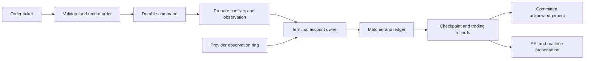

# Trading Terminal: complete workflow and technical reference

Reviewed against the source on 23 October 2026. The Terminal is a **manual simulation** using observed market prices. It is separate from automated Paper deployments and does not place real broker orders.

## Contents

- [Workspace and account](#workspace-and-account)
- [Instrument search and watchlists](#instrument-search-and-watchlists)
- [Chart history and live candles](#chart-history-and-live-candles)
- [Order workflow and matching](#order-workflow-and-matching)
- [Position management](#position-management)
- [Capital and charges](#capital-and-charges)
- [History, journal and reports](#history-journal-and-reports)
- [Backend execution path](#backend-execution-path)
- [API map](#api-map)
- [Calendar and holiday configuration](#calendar-and-holiday-configuration)
- [Operations and troubleshooting](#operations-and-troubleshooting)
- [Source map](#source-map)

Related: [Backtesting](backtesting.md), [automated Paper](paper-trading.md), [Live broker execution](live-trading.md), [infrastructure](../infra/README.md).

## Workspace and account

Open Trading Tools → Trading Terminal. The content-header tabs are:

| Tab | Purpose |
| --- | --- |
| Trade | Watchlists, chart, ticket and positions/working-orders panel |
| History | Execution and completed-position records with filters |
| Account | Equity, available/reserved capital, charges, margin configuration and runtime information |

Drag the watchlist separator to change its width. Drag the bottom-panel handle to change its height or collapse it. Smaller screens use compact watchlist/ticket controls. Layout sizes and chart preferences are retained locally. Shared UI components and [formatters](../frontend/src/shared/utils/formatters.js) provide consistent dates, currency and controls.

The account is created automatically for the authenticated user. Current model defaults are starting balance 1,000,000, futures simulation margin 20% and short-option margin 25%. Opening the page does not reset existing values. This account is independent of the Paper wallet and automated session allocations.

The Account tab permits an owned charge profile and supported simulation margin percentages. Balance, realized P&L and charges are ledger-controlled read-only values. Changing margin settings with working orders is rejected. Settings are queued for owner application; a success notification means submitted, not necessarily already applied.

The Terminal has no price alerts, study/indicator selector, entry/sell price lines, validity selector or risk-amount-to-stop sizing calculator. Journal/Reports are separate common pages.

## Instrument search and watchlists

1. Create/select a named watchlist.
2. Open Add instruments and search the catalogue. Supported filters include exchange, instrument type and expiry.
3. Add a result, then select it to load its chart and ticket.
4. Rename/delete watchlists or remove instruments through their actions.

`TradingInstrumentService.search()` supplies metadata. `TradingWatchlistService` manages owned membership. The unique exchange-qualified `sym_ticker` identifies requests/subscriptions. The instrument **Name** supplies readable labels, including option strike/expiry distinctions. Display labels are not database keys.

Backend enums and common metadata own classifications. UI code should not invent alternative CASH/FUTURE/option codes.

| Concern | Behaviour |
| --- | --- |
| Index | Chart/research allowed; not directly orderable |
| Cash instruments | Quantity in instrument units |
| Futures/options | UI lot entry converts to units using catalogue lot size |
| Tick size | Prices must conform to the contract increment |
| Expiry | Expired contracts reject ordinary new orders |
| Multiplier | Used in turnover, margin and P&L |

Example: with a catalogue lot size of 25, two lots become quantity 50. This does not establish a fixed lot size for any real exchange contract. Backend contract validation remains authoritative.

## Chart history and live candles

### Stored history and missing data

`useRealtimeCandles()` identifies a chart by symbol/interval and requests stored data first. `ChartDataService.chart_window()` reads confirmed candles, aggregates the requested interval and overlays eligible live state. Missing history is acquired separately through the common data service.

`GET /api/v1/market/candles/` accepts parameters including `symbol`, `interval`, `limit`, `before` and `fetch_missing`. Provider acquisition is bounded per request. Scrolling left requests earlier windows instead of downloading the instrument's lifetime before rendering.

The data path is:

1. Check provider-specific source coverage and stored rows.
2. Lock instrument/source acquisition, apply request budget and fetch missing windows.
3. Validate positive finite OHLC values, OHLC ordering, nonnegative volume and timestamps.
4. Commit valid candles and successful acquisition coverage together.
5. Advance source revisions, invalidate derived caches and aggregate the requested timeframe.
6. Return available candles and acquisition/pagination state to the chart.

`HistoryCoverage` describes acquired windows, not a guarantee every minute traded. Empty success is not permanently cached; provider errors do not become successful coverage. Existing stored candles can remain visible while history acquisition fails.

Intraday intervals derive from one-minute data; daily/weekly/monthly intervals derive from daily data. `aggregate_candles()` uses exchange/segment sessions, breaks, holidays and timezone. Intraday buckets are not arbitrarily anchored to UTC midnight.

### Live transport and candle formation

The authenticated browser websocket is `/ws/marketdata/`. `MarketDataConsumer` handles subscription messages and tick/chart/Terminal events. It is separate from the backend's provider websocket.

| Update | Purpose |
| --- | --- |
| Tick/quote | Watchlist price, price header and position marks |
| Chart candle | Backend-computed OHLCV for the selected symbol/timeframe, including the forming bar |
| Terminal event | Account, position and order presentation refresh |

`LiveChartPublisher` builds candles on the backend. React applies those OHLCV values to the chart series; it does not independently create authoritative candles from every tick packet. Forming bars update during the candle, not only on close. Completed history and subsequent snapshots finalize/correct the visible series.

Provider callbacks write local shared-memory observations. Background publishers serve browsers. Execution reads the local observation ring directly and continues without an open browser. Browser animation frequency is not the rule-evaluation frequency.

### Loading and price availability

A stored/cache hit can render before provider history finishes. Missing data necessarily includes provider/network work; a fast stored chart does not prove provider authorization is valid. The UI shows acquisition errors rather than fabricated candles.

Watchlist prices load independently of chart selection and the WebSocket handshake. On initial load, membership changes and reconnect, `Watchlist` calls `useWebSocket.getLatestPrices()` with the active list's `sym_ticker` values. The authenticated `POST /api/v1/market/quotes/` endpoint accepts `{"symbols": ["NSE:INFY-EQ", "NSE:MRF-EQ"]}` and returns a symbol-keyed map of price snapshots. The selected chart shares in-flight requests with this load.

`refresh_quotes()` reuses provider snapshots for 60 seconds across browsers and batches missing prices through `FyersProvider.quotes()`. The SDK's GET endpoint receives up to 50 symbols per provider call. Acquired snapshots also reach subscribed browsers through the existing quote channel. This does not create execution observations or chart candles. During market hours, existing WebSocket subscriptions update every watchlist instrument; there is no quote polling loop.

The watchlist renders Redux quote state directly. Display updates combine received ticks every 200 ms and retain the last tick even if no more arrive; chart/ticket subscription callbacks receive accepted ticks immediately. Actual provider/observed prices take precedence over candle-derived fallback prices, and older real quotes cannot replace newer real quotes. If provider acquisition is unavailable, the shared quote service can still return its last known price or an explicit unavailable snapshot.

REST snapshots record acquisition start time in `updated_at`; WebSocket quotes record receive time there. Cross-transport ordering uses that field because FYERS REST `tt` can have date precision. A tick received during an HTTP acquisition therefore remains newer than that snapshot. Within one transport, event timestamps and `updated_at` break ties as usual; no tick-age expiry is applied.

There is no fixed tick-age cutoff. Quiet symbols retain their observed price. A stored close may be used for display, but execution requires an actual observation from the connected feed. A detected disconnect/generation change invalidates execution observations until new data arrives. A silent frozen feed cannot be identified merely by the removed age check.

A visible historical chart, a connected browser socket and a running execution worker are separate states.

## Order workflow and matching

### Place an order

1. Select an orderable instrument during its exchange/segment session.
2. Choose Buy/Sell and Market, Limit, Stop Market or Stop Limit.
3. Enter units/lots and required limit/trigger prices; configure optional position protection where exposed.
4. Review estimated funds. This is configured simulation collateral, not a broker margin quotation.
5. Submit, then inspect Working orders and Positions/History.

The preview contains notional and estimated funds, **not a guaranteed charge estimate**. Fees depend on actual closing dates and are settled when exposure closes.

`OrderSerializer` validates input/ownership. `TradingOrderService.create_order()` checks session and contract, snapshots costs, creates the order and queues ORDER. The worker performs definitive current capital/position checks. An HTTP success means an order was recorded, not that it filled. Later rejection reasons are stored on the order.

### Matching conditions

`match_order()` and `OrderBook` are shared with Paper and historical replay.

| Type | BUY | SELL |
| --- | --- | --- |
| Market | Next eligible observation | Next eligible observation |
| Limit | Price ≤ limit | Price ≥ limit |
| Stop Market | Activate at price ≥ trigger | Activate at price ≤ trigger |
| Stop Limit | Activate first, then obey buy limit | Activate first, then obey sell limit |

**Limit example:** a BUY limit at 1,240 is price-eligible at 1,238. A SELL limit at 1,240 is not. Session, capital, contract and event sequencing must also be valid.

**Stop Market example:** a protective SELL stop at 98 activates at 98 or lower. The trigger is not a guaranteed fill price if the observation gaps through it.

**Stop Limit example:** with price 100, BUY trigger 105 and limit 106, the order does not buy at 100 just because it is below the limit. It first activates at/above 105. If price gaps to 108 it remains unfilled until a limit-eligible observation occurs. The trigger and `activated_at` retain meaning after activation; a limit stage is not evidence that the trigger was ignored.

New orders do not fill retroactively from their admission observation. Later eligible events are required; an unchanged number displayed on screen does not generate another fill. Slippage/tick rounding cannot breach the order's limit. Simulation does not reconstruct order-book liquidity or queue priority.

### Amend/cancel

Open-order modifications queue AMEND. Cancellation queues CANCEL; batch cancellation accepts owned open IDs. Neither action directly edits the financial ledger in the HTTP request. A fill already processed by the owner can win a cancellation race; refresh the final status instead of assuming cancellation reversed it.

There is no OrderValidity/expiry-column workflow. Session-hours validation is still required and is a separate concern.

## Position management

Terminal has one net position per account/instrument, unlike isolated automated strategy-session positions.

| Action | Effect |
| --- | --- |
| Increase | Market order in the current direction |
| Reduce | Opposite reduce-only quantity, bounded by current exposure |
| Close | Opposite reduce-only order for the full position |
| Reverse | Close current exposure and request the chosen opposite quantity |
| Protect | Queue stop-loss/take-profit changes through PROTECT |
| Settle | Explicit simulation close at entered official settlement price after expiry |

For long 10 and requested reverse quantity 5, the opposite order is 15: close 10 and open short 5, subject to funds/contract checks. Close and Reduce cannot accidentally reverse the position.

Protection belongs to owner state. Conflicting working orders are handled when protection triggers so an outstanding add/limit exit cannot silently block the protective close. It still requires observations; it is not an exchange-hosted stop.

Settlement is permitted only after the contract's calendar-defined expiry close. The user supplies the official price for this simulation. The platform does not automatically establish that price or submit a real broker settlement instruction.

## Capital and charges

### Financial state

`margin()` implements simulation collateral. `available()` subtracts commitments, reservations and uncommitted funds. `apply_fill()` updates quantity, average, cash/margin and completed closes. One owner for `(TERMINAL, account_id)` serializes financial effects across concurrent requests.

Equity, available capital, reserved amounts, realized P&L, open P&L and charges are different quantities. Reservation is not realized loss. Open P&L is a current mark before future exit costs. Account balances cannot be edited through the ordinary account settings serializer.

### Charges on closing

`TradingCostCalculator` calculates recorded fees on closing exposure. Entry lots preserve original profile/time information. `_closing_costs()` settles same-day lots before carried lots and allocates original flat entry brokerage proportionately across reductions, then recalculates GST.

Actual entry/exit dates determine intraday/delivery tax classification, including stocks entered under CNC. Segment/instrument enums and configured rates govern currency/commodity handling. This guide does not prescribe current statutory rates.

Example: buy 10 at 100 and close 4 at 105. Gross realized P&L is 20; 6 remain open. Only the appropriate entry-fee share and closing fees are settled for the closed 4. The later close must not charge the entire original flat entry brokerage again. Slippage already affects prices and must not be subtracted twice.

Choose an owned charge profile or no profile in Account. The common charge-profile flow provisions a default QuantNest profile and prevents deletion of whichever profile is default. Editing a profile does not rewrite already captured entry-lot assumptions.

## History, journal and reports

`TradeHistory` stores executions; `ClosedPositionLog` stores realized closes. Use History for their quantity, prices/times and charge detail. Shared Journal/Reports source **TERMINAL** aggregates `ClosedPositionLog.realized_pnl`, **net of recorded charges**.

Filters include exit dates, account/instrument/search and review state. Terminal has no strategy filter because orders are manual. Current unrealized marks are separate from historical date filters and disclose missing quote coverage. Default reporting dates cover the last 30 calendar dates.

Private notes, lessons, ratings and mistake tags attach to owned completed closes. Deleting a review leaves its financial record. Tag groups can overlap and must not be summed as disjoint totals.

CSV export uses the same filters and rejects more than 50,000 closes. Ask AI creates frozen evidence; sending the research message is separate and uses normal research allowances. Saved private notes are included only when explicitly selected.

Terminal net realized results are not directly interchangeable with Live before-fee P&L or a backtest equity curve. Reports aggregate existing closes; they do not import broker positions or create another financial ledger.

## Backend execution path



`Controller.command_payload()` resolves contract and actual SHM observation. `Worker.control()` applies ORDER/AMEND/CANCEL/PROTECT/SETTLE/settings commands. `AccountOwner.observe()` matches working orders and protection. `repository._terminal()` maps typed transitions to Terminal models, and `persist_transition()` commits those records and checkpoint together.

Commit acknowledgement prevents spending an uncommitted gain/released reservation. The numerical path uses local typed state and shared memory; ORM/provider work stays in preparation/persistence. DB-free matching does not make durable financial progression independent of the database.

Terminal has no monthly per-order allowance or Paper deployment quota. Authentication, ownership, active account, valid contracts, session hours and simulated funds remain required. Private/Development mode does not bypass order correctness.

## API map

Paths are relative to `/api/v1/trading/` unless specified.

| Endpoint | Use |
| --- | --- |
| `GET instruments/search/` | Catalogue search |
| `GET/POST/DELETE watchlist/` | Read/add/remove membership |
| `GET/POST watchlists/`; detail update/delete at `watchlists/{id}/` | Named watchlists |
| `GET terminal/`, `status/` | Combined snapshot and runtime status |
| `GET/PATCH account/` | Account/configuration |
| `POST orders/preview/` | Notional/funds estimate |
| `GET/POST orders/` | List/create orders |
| `GET/PATCH/DELETE orders/{id}/` | Read/amend/cancel |
| `POST orders/cancel/` | Batch cancel |
| `GET positions/`; `GET/PATCH positions/{id}/` | Positions/protection |
| `POST positions/{id}/action/` | Increase/reduce/close/reverse/settle |
| `GET trades/`, `pnl-report/` | Executions and completed closes |
| `GET /api/v1/market/candles/` | History/aggregation/acquisition |
| `/ws/marketdata/` | Authenticated browser realtime |
| `/api/v1/analytics/reports/`, `reports/trades/`, `reports/export/` | Reports with `source=TERMINAL` |
| `/api/v1/journal/entries/` | Private close reviews |

Read [serializers](../backend/trading/serializers.py) for payload fields and [routes](../backend/trading/urls.py) for supported actions. Shared API error handling and notifications report failures consistently with other pages.

## Calendar and holiday configuration

Trading hours come from exchange/segment `ExchangeConfig` and `MarketHoliday`, not per-instrument timing fields. `MarketSessionCalendar.for_instrument()` supplies session validation, chart bucket alignment and expiry settlement timing. Configure timezone, weekdays, opening/closing hours and breaks for each segment.

A chart can display after close, but ordinary placement is rejected outside the instrument's segment session. Derivatives must not accidentally inherit another segment's session configuration.

### Holiday synchronization

`sync_market_holidays` verifies the current year from NSE's API and uses the configured library for historical dates. Historical library dates apply across supported segments; BSE/MCX follow the corresponding NSE segment policy. This is the application's chosen policy, not a claim that official exchange calendars are universally identical.

File import is removed. Inspect current command options with:

```bash
python manage.py sync_market_holidays --help
```

Review synchronized dates and segment-specific hours in Admin. Operator corrections must be reflected in the configured calendar. Follow the [infrastructure guide](../infra/README.md) for initialization and scheduling.

## Operations and troubleshooting

Run the API, database/Redis dependencies, market-data and the shared execution group. From `backend/`, in separate managed processes:

```bash
python -m quantnest_runtime market-data
python -m execution
```

There is no separate Terminal runtime command. The `quantnest_runtime execution` alias starts the same service. Only one group may own local state; an OS lock excludes duplicates. Market-data and execution share local mapped files on one host.

`EXECUTION_WORKERS` sets persistent CPU workers. Bounded actor turns and asynchronous persistence share the architecture with Paper/Live. Measure CPU, observation bursts, commit and UI/API latency before increasing it. Multi-host replication and a guaranteed user capacity are not implemented promises.

| Symptom | Inspect |
| --- | --- |
| Watchlist later than chart | Snapshot request timing and independent persisted chart selection/history load |
| Blank chart | Selected symbol, stored rows, provider authorization and acquisition error |
| Chart works but order does not | Actual observation, session calendar and execution service |
| Open limit | Side comparison, stop activation, later eligible observation and rejection reason |
| Quiet price remains | Expected without tick-age expiry; a screen value is not a new event |
| Unexpected fees | Entry/exit dates, lot portions, captured profile, multiplier and gross/net basis |
| Delayed settings | Pending REFRESH and owner acknowledgement |
| Margin update rejected | Outstanding working orders |
| After restart | Inspect checkpoints/commands; do not recreate existing orders to force fills |

Closing a browser does not stop execution. A disconnected provider supplies no new eligible observations until recovery. Simulation is not an exchange-liquidity model or a guarantee of real broker execution prices.

## Source map

| Source | Responsibility |
| --- | --- |
| [TradingTerminal](../frontend/src/features/terminal/pages/TradingTerminal.jsx) | Tabs, layout and resizing |
| [Components](../frontend/src/features/terminal/components) | Search/watchlist, chart, ticket, blotter, history/account |
| [Realtime candle hook](../frontend/src/features/terminal/hooks/useRealtimeCandles.js) | Stored-first load, pagination and subscriptions |
| [Views](../backend/trading/views.py), [services](../backend/trading/services.py) | Owned API, contract/session checks and commands |
| [Chart service](../backend/marketdata/charts.py), [consumer](../backend/marketdata/consumers.py) | Backend candles and browser transport |
| [History](../backend/marketdata/history.py), [candles](../backend/marketdata/candles.py) | Acquisition, coverage and aggregation |
| [Controller](../backend/execution/controller.py), [worker](../backend/execution/worker.py) | Cold command preparation and runtime application |
| [Owner](../backend/execution/owner.py), [matching](../backend/execution/matching.py), [ledger](../backend/execution/ledger.py) | Account ownership, order conditions and financial transitions |
| [Repository](../backend/execution/repository.py) | Durable projections and checkpoints |
| [Costs](../backend/common/costs.py) | Configured fee calculation |

Extend order behaviour in the shared matcher/owner and its validation. Extend providers through adapters/common history contracts. Keep one financial implementation rather than recreating cash/P&L calculations independently in HTTP handlers or screens.
