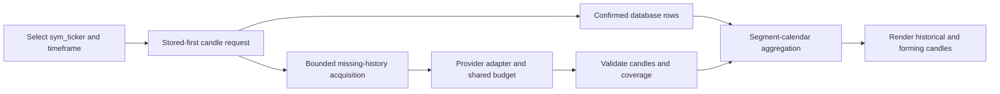

# Trading Terminal: complete user and technical guide

**Source reviewed: 7 November 2026.** The Terminal is a manual trading simulator:
named watchlists, historical/live charts, order tickets, working orders, positions,
protection and closed-result accounting. It does not send a broker order. Automated
simulation is [Paper](paper-trading.md); real automated broker execution is
[Live](live-trading.md).

The current Terminal uses the shared execution runtime and financial kernel. It
does not have a separate Terminal daemon or a second historical-data engine.

## Contents

- [Workspace and first use](#workspace-and-first-use)
- [Account and configuration](#account-and-configuration)
- [Named watchlists and instrument identity](#named-watchlists-and-instrument-identity)
- [Chart history and live candles](#chart-history-and-live-candles)
- [Calendar and holiday configuration](#calendar-and-holiday-configuration)
- [Order workflow and matching](#order-workflow-and-matching)
- [Position actions and protection](#position-actions-and-protection)
- [Funds, charges and P&L](#funds-charges-and-pl)
- [History, settlements and review](#history-settlements-and-review)
- [Realtime state and recovery](#realtime-state-and-recovery)
- [API contracts](#api-contracts)
- [Implementation ownership](#implementation-ownership)
- [Worked examples](#worked-examples)
- [Operations and verification](#operations-and-verification)

## Workspace and first use

The main header has **Trade**, **History** and **Account** tabs. Trade combines:

| Area | Purpose |
| --- | --- |
| Left watchlist | Choose a named list, search/add instruments and read live marks |
| Center chart | Selected instrument, timeframe, chart style, OHLC and price history |
| Right order ticket | Side, order type, units/lots, required price fields and optional protection |
| Bottom blotter | Open positions and working orders with counts/actions |

The watchlist width and bottom-panel height can be resized; layout preferences
are stored locally. Expand/collapse controls let the blotter use the available
space. Panels scroll internally rather than requiring a large page full of blank
cards. Shared themed tabs, controls, tables, loaders, tooltips and formatters are
used in both themes.

To begin:

1. Open **Trading Tools → Trading Terminal**. The owned simulated account is
   obtained automatically.
2. In Account, review capital, simulated margin percentages and charge profile.
3. Create/select a watchlist, add an active tradable instrument and open its chart.
4. Confirm the exchange/segment session is open and execution/feed services run.
5. Enter a small valid size and order type; review funds and confirm the ticket.
6. Follow its actual order state. An accepted API request is not already a fill.

The current simplified workspace intentionally omits price alerts, studies/
indicators, entry/sell price lines, order-validity controls, stop-based risk amount
calculators and the old Journal/Reports shortcut buttons. Those are not hidden
requirements to place a manual simulated order.

## Account and configuration

The account model initializes a new simulated account with **1,000,000** monetary
units (displayed as INR by the current UI). This default is seed simulation capital,
not an entitlement to broker money or a linked Paper wallet deposit.

Account shows balance/equity-related values, available/reserved funds, margin,
realized/open P&L and charges. Configuration supports:

- An owned charge profile, or no profile for no simulated fees.
- Futures margin percentage (1–100; current new-account default 20).
- Short-option margin percentage (1–100; current default 25).

Those percentages are simple simulation collateral assumptions, not broker SPAN,
exposure or portfolio-margin quotations. A long option consumes its premium basis.

Account changes are durable `REFRESH` commands applied by the financial owner.
Changing margin settings while working orders exist is rejected; an old browser
funds figure cannot override the owner's current exposure. Balance, starting
balance and realized results are read-only through this settings endpoint. There
is no current user account-reset/top-up endpoint in this Terminal API.

Charge profiles are maintained in Broker Integration's charge-profile workflow.
A default profile cannot be deleted; a user with none is provisioned a QuantNest
profile and can create/edit another and make it default. Selecting a profile for
Terminal governs simulated costs, not a real broker invoice.

## Named watchlists and instrument identity

Each user can have multiple named Terminal watchlists. Create, rename, select and
delete a list with its picker controls. Names are unique for that user; at least
one list is retained. Add/remove instruments in the selected list.

`Instrument.sym_ticker` is the unique identity used by API lookup, quote storage,
chart requests and subscriptions. `Instrument.name` is the readable label. The
short underlying symbol alone cannot distinguish all option expiries/strikes.
Names/contract details make the UI readable; exchange, expiry, right and strike
identify what will actually be traded.

Search supports symbol/name/underlying/contract text and exchange, instrument-type,
expiry and archived controls where offered. Common enum/specification responses
provide selectable choices; another broker/segment is not represented by copying
unrelated static labels into the ticket.

Indices may be watched/charted for analysis but cannot be ordered. Active/tradable,
expiry and supported instrument-type constraints still apply. Expired/archived
discovery supports historical inspection, not permission to open a live simulation
position in an expired instrument.

Every instrument in the active watchlist subscribes to display prices. Its latest
mark should not require clicking it to open a chart. Subscription sets are shared
and stable across row refreshes; opening the chart adds candle demand separately.

## Chart history and live candles

### Search to historical chart



1. Instrument selection sets one normalized `sym_ticker`, display metadata and
   selected timeframe. Stale responses for the previous selection are ignored.
2. `useRealtimeCandles` requests stored data first with `fetch_missing=false`.
   Existing candles can render without waiting for a provider round trip.
3. `ChartDataService.chart_window()` reads confirmed candles and aggregates them
   using the same calendar semantics as execution/research.
4. If `backfill_requested` is returned, the hook makes the bounded acquisition
   request with `fetch_missing=true`. The backend limits provider work for that
   interactive window instead of queuing a huge Celery history job.
5. Successfully acquired source windows/candles become common stored history.
   Coverage prevents repeatedly fetching known-empty ranges. Provider failure
   leaves stored data usable and exposes a retryable history error.
6. Scrolling left requests older windows using `before` / returned cursor.
   Overlapping timestamps are merged; the whole chart is not downloaded again.

The service bounds candle `limit` to 1–1,000; the current UI initially requests
200 for most intervals, 104 weekly and 60 monthly. Source history uses the required
minute/daily families; higher intervals are calendar-aligned aggregates rather
than independently guessed bucket clocks.

The response includes candles, cursor/has-more information, interval choices,
source/backfill information, data revision, active bucket and session metadata
including timezone, open state and next transition. Expired-contract windows are
clamped to their valid expiry session. An error is not silently converted to
complete empty historical coverage.

### Which WebSocket changes what

The browser shares one authenticated **`/ws/marketdata/`** connection, multiplexed
by instrument and message type:

| Subscription/message | Role |
| --- | --- |
| `subscribe` / tick updates | Latest price, watchlist change, chart price header, position marks/P&L |
| `subscribe_chart` / `chart.candle` | Backend-built forming and completed candle OHLCV for one symbol/timeframe |
| Matching unsubscribe messages | Release that consumer's demand; shared references remain until unused |
| Ping/renewal | Keep active demand alive; abandoned browser demand expires |
| User trading updates | Refresh financial snapshots when orders/positions change |

`MarketDataConsumer` authenticates the user, tracks subscriptions and renews
demand. It does not evaluate strategies or execute orders. A subscription can
return current display state or an unavailable/error state before live data arrives.

**Candle construction is on the backend.** `LiveChartPublisher` combines confirmed
history prefixes with the current observed buffer/calendar bucket. The frontend
updates the supplied candle's OHLCV; it does not independently rebuild that same
candle from every tick. Candle messages update the forming bar as well as completed
bars. They are not only a candle-close notification.

Provider-confirmed corrections take precedence over older observed prefixes;
revisions allow corrected historical rows to replace the chart value. Current
minute volume is not added twice. Tick display coalescing and chart publication
do not sit in front of the execution worker's local tick reader.

Reconnect triggers history recovery after the initial connection. Session-transition
metadata schedules appropriate refreshes around opens/closes. Cached historical
rendering can still work while the live feed is disconnected; it must not be
presented as a new received market observation.

### Display prices versus execution prices

`marketdata/quotes.py` combines observed and REST snapshots using receipt/update
ordering, with confirmed-close fallback for display when appropriate. A provider
timestamp from an old quote must not replace a newer accepted observed mark.

These are labelled **display marks**. Execution reads the sequenced observation
buffer. A fallback candle close or REST quote cannot fill an order merely because
the chart/header can show a price. There is no fixed tick-age rejection, but
sequence/generation/session and actual observation availability remain necessary.

## Calendar and holiday configuration

Exchange/segment timing belongs to `ExchangeConfig`, with the common segment enum,
timezone, weekdays, session boundaries and breaks. Holiday/special-session records
modify that calendar. Instrument fields are not another source of market hours.

This calendar is used by chart bucket boundaries, session labels, historical
acquisition, execution preparation and order admission. Configure every supported
exchange/segment rather than copying cash-market hours to commodities/currency.

`sync_market_holidays` uses the current-year NSE API as configured and the
historical holiday library for earlier years. The shared policy maps BSE/MCX to
the matching NSE segment holidays. This is a platform policy; review exceptional
exchange-specific closures/sessions rather than assume every exchange is always
identical. The retired file-import command path is not part of holiday setup.

Orders are rejected outside the actual segment session; the Terminal does not
implement after-market-order routing. A global cash-market-open label is not
sufficient to allow an order in every segment.

## Order workflow and matching

### Ticket and request lifecycle

1. Choose the exact tradable instrument and Buy/Sell.
2. Choose Market, Limit, Stop or Stop-limit. Only required price fields are shown.
3. Enter units or, for derivatives, lots. The UI converts lots to actual order
   units; the backend validates a whole tradable lot and quantity limits again.
4. Optionally attach stop-loss/take-profit prices for the resulting position.
5. The preview shows required funds/notional/margin basis against current account
   data. It intentionally does not predict final intraday-versus-delivery charges.
6. Submit. Validation checks payload, owner, tradability, expiry, lot/tick and
   session. The order/request ID and `ORDER` command are persisted.
7. The execution owner admits or rejects it against current financial state.
   Its committed projection updates the UI; a newly saved OPEN row is not a fill.
8. An admitted simulated order matches a later eligible traded observation.
   The account commits the fill and exposes the resulting position/order status.

Limit/trigger prices must be positive when required and aligned to the contract's
tick. Quantity is a positive whole unit count and a derivative lot multiple.
Reference/fund estimates are advisory snapshots; only current owner admission
reserves the available funds.

Symbol-master upper/lower bands are retained as reference metadata; they can be
old or change intraday and are not treated as the exchange's current operating
range by the numerical contract validator. Live broker submissions remain subject
to the broker/exchange's actual controls. No provider request is added to each
simulated tick merely to recheck a master-file band.

### Matching rules

Let `P` be the new eligible observation, `L` the limit, and `T` the trigger:

| Type | Buy | Sell |
| --- | --- | --- |
| Market | Fill at eligible observed P | Fill at eligible observed P |
| Limit | Match when P ≤ L | Match when P ≥ L |
| Stop | Activate when P ≥ T, then market behavior | Activate when P ≤ T, then market behavior |
| Stop-limit | Activate when P ≥ T, then match only if P ≤ L | Activate when P ≤ T, then match only if P ≥ L |

Stop activation is permanent for that accepted order and stored as `activated_at`.
Crossing back does not disarm it. Once activated, Stop-limit behaves as a limit;
the trigger has already done its job. Showing a limit phase does not mean its
trigger should never have existed. Order history retains type/trigger/activation.

An observation can satisfy activation and limit eligibility together. A gap beyond
the limit can activate without filling; Stop-limit prioritizes a price bound over
guaranteed execution. A stop market has no such limit protection.

The shared matcher requires an observation at/after eligibility and a newer
sequence within the same generation. A price already visible before acceptance
is not replayed as a future fill. Simulated matching consumes observed last prices,
not an exchange bid/ask queue, depth or a broker execution report. It fills eligible
remaining quantity without modelling real market liquidity/queue priority.

Where slippage applies, buy execution moves adversely upward and sell downward;
tick rounding remains side-aware. A limit fill must still respect its price bound.

### Modify and cancel

Working OPEN orders can request changes to quantity, type, limit/trigger and
protection. Instrument, side and reduce-only identity cannot be changed; cancel
and create a deliberate new order for a different instrument/side.

Amend/cancel are commands checked again by the owner. A fill racing with a UI
request is resolved against actual current state. Bulk cancel accepts bounded
owned order IDs; its response counts requests, not a promise that every order was
still unfilled at the moment the worker processed them.

There is no user-selectable OrderValidity or separate validity/expiry column in
the current Terminal order flow. Contract expiry and market-session admission
remain correctness rules independent of a removed ticket setting.

## Position actions and protection

Terminal keeps net manual exposure per instrument within the owned account.
Ordinary opposite-side orders can reduce/close it; a larger opposite order can
reverse it where funds/quantity checks allow.

| Action | Meaning |
| --- | --- |
| Close | Request a reduce-only market order for the full current quantity |
| Reduce | Request a positive quantity up to the current exposure; no accidental reverse |
| Increase | Request more exposure on the existing side, with new funds admission |
| Reverse | Request closing the old exposure and opening the selected new opposite exposure |
| Protect | Set/change stop-loss and take-profit; null removes the corresponding level |

Action API quantities are actual units. UI lots are a convenience conversion, not
an alternate ambiguous argument type. The owner checks current position size again;
stale close requests cannot invent a reverse position through reduce-only execution.

Protection checks traded observations while the position exists. A long stops at
or below its stop and targets at or above target; short direction reverses those
comparisons. Stop has priority if both become eligible. Pending manual add/exit
orders are cancelled before the protective full exit so they cannot block it or
unexpectedly re-open risk after a stop.

A protective threshold creates an order; final execution still uses the next
eligible observation and applicable matching rules. Sparse ticks/gaps can therefore
produce a different fill price. Protection is simulated and not an order held at
a broker/exchange when the Terminal/runtime is stopped.

## Funds, charges and P&L

The shared account owner distinguishes cash/balance, position margin/value,
working-order reservation and released funds awaiting durable acknowledgement.
Required-funds estimation accounts for exposure reduction instead of charging a
closing order as a fresh unrelated position.

New entries can fail for funds; a browser estimate does not reserve them. Futures
and short-option simulation margin percentages apply consistently at estimate,
admission and valuation. Quantity multipliers must be used for commodity/currency
economics instead of assuming one displayed price point always equals one rupee.

### Charge on close

The Terminal uses the same shared close-accounting approach as Paper/Backtesting:

- No estimated charge panel before placement and no prepaid entry fee on open
  positions.
- Entry lots retain opening time and frozen cost profile. Costs settle when an
  owned quantity closes.
- Actual entry/exit local calendar dates choose equity intraday versus delivery
  classification; a CNC product name does not force delivery rates on a same-day
  trade. The current helper uses the application's timezone.
- Segment/instrument enums choose equity STT, commodity CTT and currency treatment;
  profile rates remain configurable assumptions.
- Partial closes allocate the corresponding entry-lot costs; remaining lots keep
  their provenance. Reverse execution closes the old cycle and opens a new one.
- With no selected profile, simulated fees are zero. That is not evidence of zero
  actual exchange/broker charges.

```text
Gross P&L = signed direction × (exit − entry) × units × multiplier
Net P&L   = gross P&L − recorded charges
```

Recorded slippage/fees must not be deducted twice from a result already based on
adjusted execution prices. All money calculations use the financial kernel's
precision; formatting two decimals in UI does not round stored contract prices.
Lots/counts remain whole numbers and contract-specific precision remains relevant
for order validation even when table display is compact.

### Realtime marks

`useTerminalPositionsPnL()` adapts signed Terminal positions to the common
valuation path. Row and account totals use the same shared quotes. The full-scope
summary includes off-page positions; changing pages must not change total account
P&L. Futures already-paid MTM is subtracted from residual open P&L.

Financial events refresh exposure. Quote changes update display values without
per-tick API reloads or P&L database writes. Missing/older quotes are handled as
pricing availability, not a fabricated zero result.

## History, settlements and review

History provides **Settlements**, **Orders**, **Fills** and **Closed positions**,
with shared server paging, instrument search, relevant status and date filters.
Date boundaries are interpreted consistently for the displayed IST dates; the end
date is included through the following exclusive boundary.

- Orders retain side/type, requested quantity, prices, activation, final state,
  rejection and placement/fill facts.
- Fills represent executions, not every status update. Charges on an opening fill
  may be zero under charge-on-close.
- Closed positions separate **gross P&L**, **charges**, **net P&L**, entry/exit
  prices and closing time. The result is a closed quantity/cycle, not the account's
  current mark.
- Settlements show reviewed source, cutoff and cash postings. Final settlement
  is a financial event, not an extra manually created market-fill order.

Paper and Terminal share reviewed futures daily MTM and qualified index-derivative
final cash settlement. See the complete
[settlement import and accounting guide](paper-trading.md#derivative-settlement).
Missing official inputs are not synthesized; general physical delivery,
devolvement and assignment are outside current scope.

Trade Journal/Performance Reports remain available through their own navigation.
They select Terminal/Paper/Live sources and preserve recorded fee/P&L basis.
Journal notes/ratings do not rewrite order execution. Owned report snapshots can
be attached to AI Research for a review.

## Realtime state and recovery

`GET terminal/` supplies an initial owned workspace snapshot. Chart history loads
independently, so a slow account/history request should not become a dependency
for every other panel. The shared quote store then updates all subscribed rows.

The status indicator distinguishes browser connection from required runtime/feed
availability. Connected only confirms a transport connection; it is not proof that
every order can match. Account/order/position updates and reconnect recovery fetch
current persisted state so a missed message does not leave a phantom open position.

User mutations become durable commands. If execution is unavailable, accepted
requests remain pending until applied or rejected; API success does not create a
fictional immediate fill. After restart, committed checkpoints reconstruct account
orders, entry lots, positions and reservations. Normal refresh/reconnect must not
place the same order again.

## API contracts

Authenticated prefix: **`/api/v1/trading/`**.

| Method/path | Purpose |
| --- | --- |
| `GET terminal/`, `GET status/` | Initial snapshot and runtime/feed status |
| `GET/PATCH account/` | Read financial state; queue supported profile/margin settings |
| `GET instruments/search/` | Filter instrument/contract discovery |
| `GET/POST watchlists/` | Owned named lists |
| `GET/PATCH/DELETE watchlists/{id}/` | Read/rename/delete eligible list |
| `GET/POST/DELETE watchlist/` | Read/add/remove items in the selected list |
| `GET positions/`, `GET/PATCH positions/{id}/` | Read exposure; queue protection changes |
| `POST positions/{id}/action/` | Close/reduce/increase/reverse request |
| `POST orders/preview/` | Funds/margin estimate without placing an order |
| `GET/POST orders/` | Paginated orders or create order/command |
| `GET/PATCH/DELETE orders/{id}/` | Detail, amend or cancellation request |
| `POST orders/cancel/` | Bounded owned bulk cancellation |
| `GET trades/`, `GET pnl-report/`, `GET settlements/` | Paginated fill, closed-result and settlement histories |

Market endpoints are separate:

| Method/path | Purpose |
| --- | --- |
| `GET /api/v1/market/candles/` | `symbol`, `interval`, `limit`, optional `before`, bounded `fetch_missing` chart window |
| `POST /api/v1/market/quotes/` | Shared batch display snapshots, including a one-symbol batch |
| `/ws/marketdata/` | Authenticated shared tick/chart/user-event transport |

The old `market/latest-tick/` endpoint is removed. Consumers use the batch quote
boundary rather than duplicate price-fetch wrappers. Shared table pagination uses
`page`/`page_size` (10/25/50/100, default 25), count/range, direct page input and
first/previous/next/last controls. Filters and summaries are server scoped.

## Implementation ownership

Backend paths below are relative to `backend/`. Start at
[`trading/services.py`](../backend/trading/services.py),
[`execution/owner.py`](../backend/execution/owner.py) and
[`marketdata/charts.py`](../backend/marketdata/charts.py).

| File/symbol | Responsibility |
| --- | --- |
| `trading/views.py`, `serializers.py` | Owned HTTP payloads, server lists and command requests |
| `trading/services.TradingOrderService` | Payload/session validation, order creation and position actions |
| `trading/services.TradingAccountService` | Account snapshot, funds/margin/mark helpers |
| `execution/controller.py`, `worker.py` | Shared durable control and local observation scheduling |
| `execution/owner.py`, `ledger.py`, `matching.py` | One financial writer, protection, fills and entry-lot accounting |
| `execution/repository.py`, `recovery.py` | Transactional projection and restart state |
| `common/costs.TradingCostCalculator` | Configured common tax/fee and holding-date logic |
| `marketdata/charts.ChartDataService`, `LiveChartPublisher` | Stored chart windows and backend forming candles |
| `marketdata/history.py`, `candles.py`, `calendar.py` | Shared confirmed acquisition and completed timeframe data |
| `marketdata/consumers.MarketDataConsumer`, `streaming.py`, `quotes.py` | Display demand, fanout and quote snapshots |
| `TradingTerminal.jsx`, `Watchlist.jsx`, `OrderTicket.jsx`, `TerminalBlotter.jsx` | Workspace, list, order and position UI |
| `ChartView.jsx`, `useRealtimeCandles.js` | Chart render, historical paging and live candle merge |
| `AccountSummary.jsx`, `HistoryDisplay.jsx` | Account/configuration and paged histories |
| Shared `useWebSocket.js`, `useLivePositionsPnL.js`, `formatters.js` | One market connection, valuation and consistent presentation |

## Worked examples

### Buy limit below/above the market

A buy limit at 1,240 is eligible on a new observed price of 1,238.40 because it
allows **1,240 or less**. A buy limit at 1,237 waits while observations remain
above it. If no new eligible tick arrives after admission, seeing a cached chart
price of 1,238.40 alone cannot force a fill.

### Stop-limit breakout and a gap

Buy stop-limit trigger 101, limit 102, current price 100:

1. 100.50: not activated.
2. 101.20: trigger crossed and within limit; eligible execution can occur.
3. Alternatively a gap to 103: activated, but remains unfilled because 103 > 102.
4. A later 101.80 can match the activated limit; the trigger does not need to cross
   again. A stop market would not retain the 102 price cap.

For a sell stop-limit, reverse the trigger/limit comparisons. The trigger decides
when the conditional order becomes active; the limit decides the acceptable fill.

### Derivative lots and multiplier

One option lot of size 30 produces 30 units. Entry 729.00, exit 734.75,
multiplier one gives gross 172.50 before configured charges. For a commodity
contract with a different multiplier, use that multiplier in notional, margin and
P&L; multiplying only by the displayed lot count is wrong.

### Same-day close with CNC mapping

A stock bought and sold on the same application-local date is classified by that
actual holding period for simulated equity taxes. It does not become delivery
merely because execution product mapping is CNC. The exact fees still depend on
the frozen profile and both entry/exit sides. No fee estimate is shown before
placement because the eventual close date is not yet known.

## Operations and verification

Run API/ASGI, stores and the existing `market-data` and `execution` commands.
Broker-events is not required for manual simulation. There is no current
`python -m quantnest_runtime terminal` service. See
[runtime operations](paper-trading.md#runtime-operations-and-scaling) and
[beginner setup](../infra/START-HERE.md).

| Symptom | Check |
| --- | --- |
| Prices update only when chart opened | Active-watchlist tick subscription set and quote-store merge; chart demand is separate |
| Empty chart but known provider history | Correct exact symbol/expiry, stored-first response and bounded backfill error, provider auth/network and calendar window |
| Limit not filled | Correct side comparison, owner admission, new eligible observed tick, session and runtime status |
| Stop-limit activated but waiting | Current price outside limit; this is allowed behavior |
| Invalid price/tick/quantity | Exact contract metadata and applicable constraints; do not change an option into its underlying to bypass validation |
| Protection delayed | New traded observations, pending command, actual threshold/direction and account state |
| API accepted but later rejected | Current financial-owner funds/contract validation, not only ticket preview |
| Header Connected but no matching | Market-data/execution process health and actual symbol observation readiness |
| Summary differs from rows | Same quote and full-scope valuation vector, including off-page positions |

Release checks should cover all four order types on both sides, stop activation
and limit gaps, amendments/cancel-fill races, lots/ticks/multipliers, position
increase/reduce/reverse, protection with pending adds, same-day/overnight close
costs, charts across session/holiday/reconnect, full-scope realtime P&L and account
recovery. This guide records source behavior; it does not certify production load,
actual exchange queue execution or authenticated provider availability.
