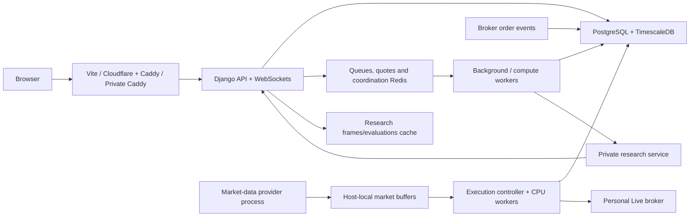

# QuantNest deployment

**New to deployment? Start with [Your deployment checklist](START-HERE.md).**
It links the ordered [Development](development/SETUP.md),
[Public](public/SETUP.md) and [Private](private/SETUP.md) walkthroughs, plus
server/tool installation and provider-dashboard setup. This README is the
architecture and configuration reference.

Use one mode on one Docker host. All modes run the same Django API, market-data
layer and execution engine. The frontend, registration and support flows are shared.

| Mode | Purpose | Execution and allowance policy | Start here |
| --- | --- | --- | --- |
| Development | Local work with Vite and console mail | Paper by default; usage recorded without plan enforcement; optional Live | [Development](development/README.md) |
| Public | Hosted customer application | Paper and simulated Terminal; Public plan allowances enforced; configured subscription checkout | [Public](public/README.md) |
| Private | Operator's personal production deployment | Paper, Live and simulated Terminal; no commercial quotas or checkout | [Private](private/README.md) |

Public uses Cloudflare Pages for React and a Pages Function for API/WebSocket
proxying. Private builds React inside Docker and serves it through Caddy.
Private is currently personal use; no customer licence/installer service is included.

## What runs, and why



The diagram shows service responsibilities, not a database call on every tick.
`python -m execution` starts one controller and `EXECUTION_WORKERS` persistent CPU
workers. The controller prepares inputs, delivers commands, persists outcomes and
performs broker I/O. Workers evaluate local buffered observations and update their
owned in-memory account state. Orders, positions, trades, execution commands and
account checkpoints are committed in PostgreSQL. Backtests use the shared execution
logic in Celery's compute worker.

Feed, execution and API containers mount the same `runtime` volume. This is
required for local market buffers and the execution ownership lock. Scaling means
more workers on this execution host; these files do not implement distributed
execution across servers. No separate Terminal, orders, outbox or calculation
service should be started.

## First-release scope

The supplied flow is: configure files → build → stop application services → migrate
and configure Timescale → start → check health. Docker supervises services and
rotates production console logs. Backups use one encrypted local archive containing
PostgreSQL and media. Copy backups off the server yourself.

Optional Terraform provisioning, OCI metric/timer automation, cloud backup uploads,
signed Private distribution/installers and their host dependency lockfiles have
been removed. This edits repository tooling only; it does not delete existing cloud
resources, operator Terraform state or backups.

Two Redis services remain. `redis` is persistent and does not evict queue/coordination
data. `redis-cache` holds disposable research data and may evict it. The old separate
`redis-runtime` service and synchronous fsync policy are removed: financial execution
recovery is backed by PostgreSQL. See [shared components](shared/README.md) for each
service, network, mount, memory limit and command option.

## Prerequisites

- Linux for production, or Docker Desktop's Linux engine for local development.
- Docker Engine and Compose v2 with `up --wait` support.
- Python 3.12 for the host scripts. They use the standard library; no OCI SDK or
  host application virtual environment is required.
- Node 22.14+ for native Vite or a local Public frontend build. Private's frontend
  build runs in Docker and needs no host Node installation.
- `age` for backup/restore, plus a recovery private key stored away from the host.
- A domain and ports 80/443 for production Caddy. Databases, Redis and research
  are not published to the Internet.

Use your OS/Docker installation procedure. On Ubuntu 24.04, the distribution
packages `docker.io`, `docker-compose-v2`, `python3` and `age` provide the host
tools. Check `docker version`, `docker compose version` and `python3 --version`.
Run Docker as an operator allowed to use its daemon; this access controls the host.

Commands in production guides use a POSIX shell from the repository root. The
Development guide also explains PowerShell. Paths such as `infra/public/backend.env`
are relative to that root. Public and Private run on separate hosts/data volumes.

## Configuration files

Copy only the selected mode's examples. Never commit populated `*.env` files.
Compose sets mode, internal service addresses, database port and runtime path.
The application reads credentials from `backend.env`, and the research provider
reads its own key from `research.env`.

| Input | What it means and why it exists |
| --- | --- |
| `QUANTNEST_RELEASE` | Human-reviewed image tag; identifies backend/research/Private frontend images for an upgrade. Not a licence or Django access setting. |
| `SECRET_KEY` | Django signing key for sessions, tokens and signed links. Preserve across normal upgrades. |
| `CREDENTIAL_ENCRYPTION_KEYS` | Fernet key list protecting stored provider credentials; preserve for recovery. First key encrypts new values. |
| `POSTGRES_ADMIN_PASSWORD` | Bootstrap database administrator password; used by initialization and backup/restore. |
| `DB_NAME`, `DB_USER`, `DB_PASSWORD` | Application database and non-superuser role. Password must differ from the bootstrap administrator's password. |
| `REDIS_PASSWORD` | Shared Redis authentication. Use 64 hexadecimal characters so generated connection URLs need no escaping. |
| `FRONTEND_URL` | Canonical browser origin, including scheme. Controls email links, CORS/CSRF and Private frontend build URL. |
| `BACKEND_URL` | Externally reachable callback origin. Production uses the browser origin because the gateway proxies API routes. |
| `ALLOWED_HOSTS` | Hosts Django accepts; include the browser host, `api`, `localhost`, `127.0.0.1`. Public also includes the origin host. |
| `PUBLIC_HOSTNAME` | Browser domain without scheme/path. The name is also used in Private; it does not select deployment mode. |
| `ORIGIN_HOSTNAME` | Public only: separate DNS-only hostname for the Caddy backend origin. |
| `QUANTNEST_PROXY_TOKEN` | Random server-only gateway token. Public must match Cloudflare's Function secret; Private Caddy injects it. |
| `EMAIL_BACKEND` | Development console output. Production uses Django SMTP by default. |
| `EMAIL_HOST_USER`, `EMAIL_HOST_PASSWORD`, `DEFAULT_FROM_EMAIL` | SMTP login, SMTP key and verified sender for account/support emails. Host/port/TLS default to Brevo on 587 with STARTTLS. |
| `FYERS_CLIENT_ID`, `FYERS_SECRET` | Market-data app credentials. Live trading app credentials are entered per user through Broker Integration. |
| `RESEARCH_SERVICE_TOKEN` | Shared Django/research secret; enter the same value in both server environment files. |
| `GEMINI_API_KEY`, `GEMINI_MODEL` | Research provider credentials/model, read only by the research container. Use a model enabled in your provider project. |
| `TURNSTILE_SECRET_KEY` | Server key for anonymous enquiry verification. Authenticated Support requests still use their signed-in flow. |
| `VITE_TURNSTILE_SITE_KEY` | Public widget key. Private passes it to the frontend image build; Public sets it in its frontend build environment. |
| `VITE_SITE_URL` | Public/Development frontend build canonical URL; must be HTTPS for production builds. Private derives it from `FRONTEND_URL`. |
| `BILLING_ENABLED` | Public checkout switch. Keep false until provider configuration and capacity are ready; Private forces false. |
| `RAZORPAY_KEY_ID`, `RAZORPAY_KEY_SECRET`, `RAZORPAY_WEBHOOK_SECRET` | Public checkout and signed payment webhooks; configure when enabling billing. |
| `BILLING_TAX_BPS`, `BILLING_TAX_ID` | Reviewed tax basis points and invoice identifier; 100 basis points equals one percent. |
| `API_WORKERS` | Production ASGI processes, default one. It does not increase execution parallelism. |
| `EXECUTION_WORKERS` | Persistent execution CPU processes, default one. Increase only with measured headroom. |
| `EXECUTION_ENABLED_SCOPES` | Development's selectable scopes. Public/Private Compose supplies the production policy. |
| `QUANTNEST_API_PROXY_TARGET` | Development Vite server's API destination; Compose sets `http://api:8000`. It stays out of the browser bundle. |

Optional contact overrides are `QUANTNEST_LEGAL_NAME`, `QUANTNEST_SUPPORT_EMAIL` and
`QUANTNEST_SUPPORT_HOURS`. The catalog exposes them consistently to the site and
workspace. Callback URLs derive from `BACKEND_URL`; see each mode guide for exact
paths. Inbound email webhooks and in-platform project payments are not included.

Generate independent values locally:

```sh
python3 -c "import secrets; print(secrets.token_urlsafe(64))"
python3 -c "import secrets; print(secrets.token_hex(32))"
```

The first command prints one strong secret; run separately for Django, database,
gateway and research secrets. The second prints a URL-safe hexadecimal Redis
password. Generate a Fernet key using the backend image after building it; the
mode guides show the command. Save that key with the protected environment files.

## Deploy, maintain and restore

1. Follow the selected mode guide and replace credentials/domain values.
2. Run `deploy.py --root . --mode <mode> --build`. It runs database migrations,
   Timescale setup, Site configuration and static collection with applications stopped.
3. Create the administrator and enrol Admin OTP; then authorize data and review
   calendars/instruments before running strategies.
4. Run `diagnostics.py` and inspect provider connection and execution logs.
5. Stop applications and make a backup before each upgrade. Keep an off-host copy.
6. Recover into an empty deployment only. Restore does not start trading workers.

All command arguments and recovery steps are explained in
[the script runbook](shared/scripts/README.md). The mode READMEs explain their
specific configuration and first-start sequence.

## Upgrading the former infrastructure layout

Before changing a running old stack, stop/settle strategy work through the
workspace, make a backup using that release's tool and retain its code/image tag.
Then run your old mode's `docker compose ... --profile "*" down --remove-orphans`
without `-v`. This removes old containers/networks while preserving database/media
volumes. Deploy the new release against the same mode/project identity.

The former runtime Redis volume may remain on disk; it is not used by the new
configuration. Do not copy its old leases into Redis DB 3. Market buffers are rebuilt,
and execution recovers committed commands/checkpoints from PostgreSQL. Celery work
interrupted by maintenance still needs its normal outcome/recovery review.

Backup format 3 contains database/media only. Format 2 archives require the restore
tool from the release that created them. Complete the retired licensing migration
on that older release before upgrading a database that still has licensing tables.

## Capacity and acceptance

The production defaults are a conservative starting configuration for a host with
roughly 12 GiB RAM: one API process, one execution worker, one compute slot and two
background slots. Memory limits are ceilings, not reservations or user-count promises.
Leave additional memory for Docker, image builds and database/Redis maintenance.
The compute CPU cap leaves time for execution; it does not reserve dedicated cores.

Changing plan quotas does not add CPU capacity. Measure rule workload, instrument
count, process memory, database writes, queue delay and broker latency before
raising concurrency. Research/provider access, email delivery, HTTPS and actual
broker authorization must be checked on the deployed host with its own credentials.

Docker readiness waits for configured health checks, not just container creation;
see [Compose startup order](https://docs.docker.com/compose/how-tos/startup-order/).
Production certificates are managed by Caddy; see
[automatic HTTPS requirements](https://caddyserver.com/docs/automatic-https).
